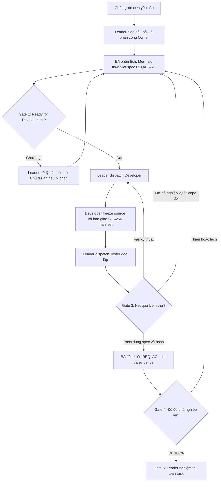

# [App Name] RotatingSavings — Trustless Rotating Savings Club (Hụi/Tontine)

> Built with Arc Studio - money-powered apps in minutes

This is the **project memory** - what Arc Studio remembers about building this app. It helps future agents (or humans) understand and extend the project.

---

## What This App Does

**RotatingSavings** — Trustless rotating savings club (hụi/tontine) on Arc Testnet. Members join a group, contribute fixed USDC each round, and bid to determine who gets the pot. Highest bidder wins; other bids are distributed as bonus. All payouts are pull-based via `claimPayout()`. Auto-kicks non-contributors at settlement.

## Deployed Contracts

| Contract | Network | Address |
|---|---|---|
| RotatingSavings | Arc Testnet | 0x6afaa0825d2e05ef00d571d4a043ab5dcc03534b |

- Explorer: https://explorer.testnet.arc.io/address/0x6afaa0825d2e05ef00d571d4a043ab5dcc03534b
- USDC: 0x3600000000000000000000000000000000000000 (6 decimals)
- Deploy params: contributionAmount=10 USDC, maxMembers=10, roundDuration=86400s (1 day), groupName="BAVI Savings Club"

## Tech Stack

- Frontend: React 18, Vite, TypeScript, Tailwind CSS
- Web3: wagmi v2, viem v2, ConnectKit
- Contracts: Solidity 0.8.28 + Foundry. Sources in `contracts/`, unit tests in `contracts/test/*.t.sol`.
- Wallet: injected (MetaMask, etc.)
- Chain: Arc Testnet (Chain ID: 5042002, imported from `viem/chains`)
- Token: USDC (6 decimals) (Address: 0x3600000000000000000000000000000000000000, Chain: Arc Testnet)
- Toasts: Sonner

## Key Files

- `src/App.tsx` - Main application logic
- `src/components/` - UI components
- `src/config.ts` - wagmi config (chains, connectors, transports)

---

# Quy trình Multi-Agent — RotatingSavings (Gemini / Antigravity)

Tài liệu quy tắc bắt buộc cho mọi phiên làm việc và subagent trong dự án **RotatingSavings (Tontine)**, tuân thủ nguyên tắc từ [MULTI_AGENT_GUIDE_FOR_GEMINI.md](./MULTI_AGENT_GUIDE_FOR_GEMINI.md).

## 1. Mô hình vai trò (Role Model)

Quy trình áp dụng chuỗi trách nhiệm nghiêm ngặt:
**Leader → BA → Developer → Tester độc lập → BA đối chiếu → Leader nghiệm thu**

| Vai trò | Trách nhiệm chính | Đầu ra (Artifacts) | Giới hạn bắt buộc |
| :--- | :--- | :--- | :--- |
| **Leader** | Nhận yêu cầu từ chủ dự án, giao đầu bài, chỉ định owner từng file, quản lý blocker/dispatch, duyệt gate. | Đầu bài, phân công dispatch, quyết định nghiệm thu cuối cùng. | Duy nhất Leader quản lý lifecycle/dispatch; không nghiệm thu nếu thiếu Tester signoff và BA coverage check. |
| **BA (Business Analyst)** | Phân tích vấn đề, giá trị, scope, actors, Mermaid flow, quy tắc nghiệp vụ (BR), yêu cầu (REQ), tiêu chí nghiệm thu (AC), bảng traceability. | Spec có version (`docs/ba/<task-id>/spec-v*.md`), bảng `REQ → AC → test → evidence`. | Không sửa source code/implementation; không tự quyết nghiệp vụ chưa rõ; không ký thay Tester. |
| **Developer** | Đọc spec/source, tạo baseline snapshot & SHA256 manifest, thực hiện code đúng file được giao, chạy validation tập trung. | File/diff thực tế, source SHA256 manifest đã đóng băng (`docs/manifests/<task-id>/...`). | Chỉ sửa trong file được giao (file owner); không tự sửa ngoài scope; ngừng sửa source sau khi bàn giao test. |
| **Tester (Độc lập)** | Đọc spec, tự thiết kế test suite độc lập, kiểm tra SHA256 trước và sau test, ghi log, exit code, pass/fail/skip thực tế. | Báo cáo test (`docs/qa/<task-id>/test-report.md`), test script, signoff hoặc blocker report. | Không sửa code implementation để làm test pass; không nhận kết quả pass từ lần chạy cũ nếu hash đã đổi. |

## 2. Luồng thực hiện và Điều kiện chuyển bước (Gates)

## 3. Phân quyền File (File Ownership)

- **Thư mục `docs/ba/<task-id>/...`**: Duy nhất **BA** sở hữu và được chỉnh sửa.
- **Thư mục `docs/qa/<task-id>/...` & `tests/` / `contracts/test/`**: Duy nhất **Tester** sở hữu và được chỉnh sửa.
- **Thư mục `docs/manifests/<task-id>/...`**: **Developer** tạo khi bàn giao, **Tester** và **BA** đọc để đối chiếu.
- **Source code (`src/...`, `contracts/src/...`)**: Duy nhất **Developer** được giao nhiệm vụ mới có quyền sửa đổi.
- **Root & Project Guidelines (`AGENTS.md`, `README.md`, `package.json`)**: Do **Leader** quản lý và điều phối.

## 4. Bằng chứng thật & Nguyên tắc SHA256

- Mọi kết quả kiểm thử phải dựa trên **lệnh thực thi thật**, lấy log thực tế và exit code từ hệ thống. Tuyệt đối không mock hoặc giả lập kết quả pass.
- Trước khi chỉnh sửa: Lưu snapshot baseline và tính mã băm SHA256 của các file liên quan.
- Khi bàn giao test: Developer tính mã băm SHA256 manifest bằng công cụ `node scripts/manifest-tool.mjs freeze <taskId> <files...>`.
- Tester so sánh SHA256 trước khi test và sau khi test bằng `node scripts/manifest-tool.mjs verify <taskId>`.
- Khi hoàn tất dispatch, mọi agent báo cáo `worker_done` gồm đúng 3 câu: việc đã làm, phát hiện, phần còn lại.
