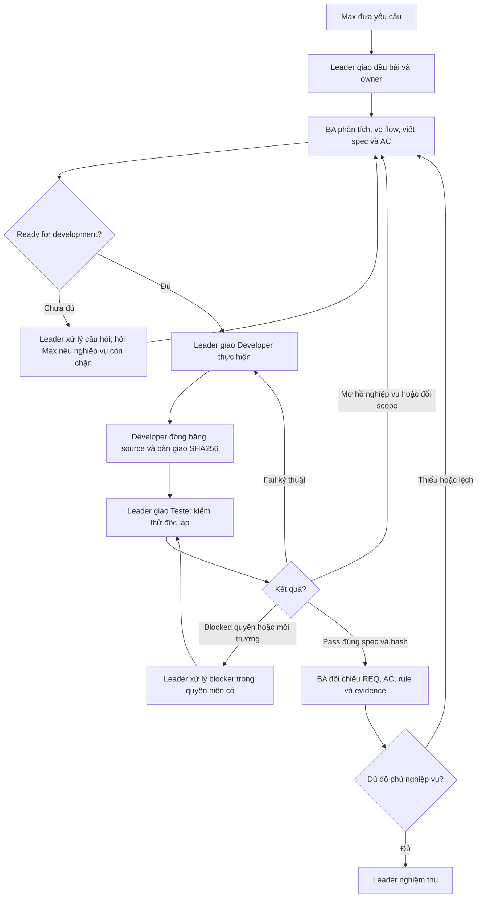

# Cách phối hợp nhiều agent trong Max AI Agent — tài liệu cho dự án Gemini

Tài liệu này giải thích quy trình phối hợp **Leader → BA → Developer → Tester độc lập → BA đối chiếu → Leader nghiệm thu** của Max AI Agent, kèm mẫu để dự án khác áp dụng. Có thể gửi riêng file này; nội dung chính không phụ thuộc các file đính kèm.

Nguồn được đối chiếu ngày **08/10/2026**: `AGENTS.md`, `docs/agent-team.md`, `docs/ba/README.md` và `docs/ba/task-template.md` trong Max AI Agent. Phần 1–7 mô tả quy định của dự án; phần 8–10 là hướng dẫn chuyển đổi và ví dụ đề xuất cho Gemini. Đây là mô tả quy trình, không phải bằng chứng mọi phiên trước đây đều đã tuân thủ đầy đủ.

## 1. Mô hình tổng thể

Max là chủ sở hữu và người đưa yêu cầu. Leader nhận yêu cầu, chia trách nhiệm và quyết định lúc nào đủ điều kiện chuyển bước. Các worker thực hiện công việc được giao rồi bàn giao đầu ra có thể kiểm tra được.

Orca cung cấp cơ chế điều phối phiên/terminal và trao đổi giữa các vai trò trong môi trường dự án. Quy trình nhóm hoạt động khi phiên làm việc đang chạy, **không phải daemon tự làm việc nền**. Dịch vụ xử lý ticket HelpDesk của sản phẩm là một thành phần khác; không nên suy ra rằng dịch vụ đó tự vận hành nhóm Leader/BA/Developer/Tester.

Các vai trò phân chia trách nhiệm; không có yêu cầu phải dùng bốn model khác nhau. Điểm quyết định là ai được sửa gì, điều kiện bàn giao và người nào xác minh độc lập kết quả.

| Vai trò | Làm gì? | Đầu ra | Giới hạn |
| --- | --- | --- | --- |
| Leader | Nhận yêu cầu, giao owner, quản lý phụ thuộc/blocker, kiểm tra artifact và điều phối bước tiếp theo. | Đầu bài, phân công, dispatch, quyết định nghiệm thu. | Chỉ Leader quản lý lifecycle/dispatch; không nghiệm thu thiếu Tester và BA. |
| BA — Business Analyst | Phân tích vấn đề, giá trị, phạm vi, actor, luồng, quy tắc, yêu cầu và tiêu chí nghiệm thu. | Spec có version, sơ đồ Mermaid, REQ/BR/AC, bảng nối yêu cầu với bằng chứng. | Không sửa implementation; không tự quyết nghiệp vụ chưa rõ; không ký thay Tester. |
| Developer | Đọc spec/source, tái hiện lỗi, thực hiện thay đổi trong file được giao và chạy kiểm tra tập trung. | File/diff, kết quả validation, source SHA256 đã đóng băng. | Không sửa ngoài owner; không tự xem validation của mình là signoff độc lập. |
| Tester | Tự thiết kế và chạy kiểm tra theo spec, kiểm tra regression trên đúng bản bàn giao. | Hash trước/sau, lệnh/log, pass/fail/skip, signoff hoặc blocker. | Không sửa implementation để làm test pass. |

**REQ** là yêu cầu; **BR** là quy tắc nghiệp vụ; **AC** là tiêu chí nghiệm thu. Ví dụ AC phải nói rõ đầu vào và kết quả quan sát được, thay vì chỉ ghi “chạy đúng”.

## 2. Luồng thực hiện và điều kiện chuyển bước



### Bước 1 — Leader giao đầu bài

Leader cung cấp vấn đề cần giải quyết, giá trị mong đợi, thông tin hiện có và owner từng file. Nếu còn quyết định nghiệp vụ chặn, BA nêu câu hỏi qua Leader để Max quyết định. Các thao tác thường lệ đã nằm trong nhiệm vụ không cần thêm bước xin phép.

### Bước 2 — BA tạo spec và đạt Ready for development

Spec tối thiểu có problem/value, actor, phạm vi, trigger/input/output, flow thành công/lỗi, BR/REQ/AC, owner, dependency/risk và câu hỏi/giả định. Task nhỏ được viết gọn nhưng vẫn cần flow và AC. Mục không áp dụng phải có lý do.

BA chỉ bàn giao khi không còn blocker, yêu cầu đủ kiểm tra, các nhánh flow khớp rule/AC và owner rõ. Những bằng chứng chưa có ghi `pending`. Spec/flow/AC gửi qua Leader, hoặc gửi Developer đồng thời báo Leader; **Leader kiểm tra đầu ra rồi mới dispatch Developer**.

### Bước 3 — Developer thực hiện và đóng băng

Developer ghi baseline, giữ các thay đổi có sẵn, sửa tối thiểu trong phạm vi được giao và chạy validation tập trung. Khi gửi `ready for independent test`, Developer bàn giao spec version, file/diff, SHA256 và kết quả lệnh thực chạy, sau đó ngừng sửa source.

### Bước 4 — Tester kiểm tra độc lập

Tester đọc spec và tự xây dựng kiểm tra, không chỉ lặp lại lời Developer báo. Tester kiểm hash trước/sau, ghi expected/actual, lệnh, exit code, số pass/fail/skip và log. Fail kỹ thuật quay Developer qua Leader; lỗi nghiệp vụ quay BA; blocker môi trường/quyền được báo riêng.

### Bước 5 — BA đối chiếu rồi Leader nghiệm thu

Sau Tester signoff, BA nối **REQ → AC → test → evidence**, rà rule, nhánh thành công/lỗi/biên và giá trị cần xác minh. BA dẫn lại bằng chứng Tester với nguồn, không nhận mình đã chạy test. Chỉ số giá trị chưa đo được phải ghi rõ kỳ vọng hoặc kế hoạch đo.

**Done cần đủ cả ba:** Tester signoff độc lập đúng spec/source hash; BA xác nhận phủ nghiệp vụ; Leader kết luận nghiệm thu. Worker làm xong một phần chưa có nghĩa toàn bộ task đã Done.

## 3. Chia quyền file trong thư mục dùng chung

Các workspace của nhóm có thể cùng trỏ vào một thư mục. Tên workspace khác nhau **không tự tạo bản sao, branch hay worktree**. Không mặc định dự án có Git.

Một file chỉ có một owner được sửa tại một thời điểm. Leader phải chuyển quyền rõ ràng trước khi người khác sửa. Được giao một file không có nghĩa được sửa cả thư mục.

| Loại file | Owner thông thường |
| --- | --- |
| `docs/ba/<task-id>/...` | BA theo phân công Leader. |
| Source cụ thể nằm trong nhiệm vụ | Developer được giao. |
| Test cụ thể nằm trong nhiệm vụ | Tester được giao. |
| Hướng dẫn chung hoặc file ngoài phạm vi | Cần Leader giao rõ owner trước khi sửa. |

Các agent có thể đọc cùng nguồn để hiểu bối cảnh; quyền sửa vẫn tuân theo owner. Nếu thấy thay đổi không thuộc mình hoặc hash khác bàn giao, báo Leader và kiểm tra lại phiên bản, không tự ghi đè để “đồng bộ”.

## 4. Baseline, SHA256 và bằng chứng thật

Mục đích của SHA256 là nhận diện **nội dung file thực tế đã được kiểm tra**. Hash không tự chứng minh code đúng và không thay test.

1. Trước sửa: ghi thời điểm, thư mục, môi trường liên quan, owner và thay đổi có sẵn. Snapshot các file trong phạm vi vào thư mục riêng của run; file chưa tồn tại ghi rõ là file mới.
2. Dùng `sha256sum` ghi hash; dùng `diff -u` so bản hiện tại với snapshot. Nếu có Git, bổ sung commit/diff, vẫn giữ hash của file thực tế.
3. Developer bàn giao manifest hash và đóng băng source. Manifest đặt ngoài file được hash, tránh nhúng hash của chính file vào nội dung file đó.
4. Tester so hash với bàn giao trước và sau kiểm thử. Nếu source đổi giữa chừng, kết quả cũ không đủ ký cho bản mới; nhận bàn giao mới và kiểm tra lại phần bị ảnh hưởng.
5. Nếu sửa lỗi hoặc đổi scope/rule/AC, bàn giao phiên bản mới và chạy lại test lỗi cùng regression liên quan. BA tăng spec version khi yêu cầu đổi, giữ lịch sử và ghi ảnh hưởng tới bằng chứng cũ.

Không sửa AC để hợp thức hóa implementation lỗi. Không lấy kết quả pass của phiên trước làm signoff cho bản mới.

| Trạng thái | Cách hiểu |
| --- | --- |
| `pending` | Chưa có kết quả; chưa được tính là đạt. |
| `pass` | Đã thực hiện kiểm tra và kết quả đáp ứng tiêu chí trên phiên bản xác định. |
| `fail` | Đã kiểm tra và thấy không đáp ứng tiêu chí; cần bước tái hiện và expected/actual. |
| `skip` | Case không chạy; ghi lý do, không tính là pass. |
| `blocked` | Không thể kiểm tra/tiếp tục do điều kiện cụ thể; ghi nguyên nhân và owner xử lý. |

Log phải đến từ lệnh thực chạy. Lệnh chưa kết thúc, browser không khởi chạy hoặc screenshot chỉ được mock đều chưa chứng minh hành vi thật. Nếu yêu cầu liên quan ảnh chụp, cần kiểm tra PNG thực tế, vùng cần che/crop và việc khôi phục DOM; kiểm selector đơn thuần chưa đủ.

## 5. Điều phối và lifecycle trong Orca

**Task** là công việc cần hoàn thành. **Dispatch** là một lần giao phần việc cho worker. Task có thể cần nhiều dispatch: BA phân tích, Developer thực hiện, Tester kiểm tra, Developer sửa lỗi, Tester kiểm tra lại, BA đối chiếu.

Live preamble là chỉ dẫn đi kèm lần giao hiện tại, xác định role, task, phạm vi file và thông tin định tuyến. Worker dùng đúng terminal handle/task ID/dispatch ID hiện tại; không tái sử dụng ID từ run đã đóng hoặc lần retry cũ.

Các thao tác sau là tên cơ chế Orca trong hướng dẫn dự án, **không phải lệnh Gemini**:

| Cơ chế | Khi dùng và ý nghĩa |
| --- | --- |
| `orchestration check` | Đọc follow-up tại mốc tự nhiên, sau test và ngay trước kết thúc; đọc chỉ dẫn mới trước khi sửa file tiếp theo. |
| `orchestration ask` | Hỏi Leader qua đúng kênh; câu hỏi chỉ viết trong terminal riêng không tự đến Leader. |
| `send --type escalation` | Báo blocker để Leader điều phối xử lý. |
| Heartbeat | Gửi mỗi 5 phút khi đang làm, trừ khi đang chờ trong `ask` hoặc `check --wait`. |
| `worker_done` | Gửi đúng một lần cho dispatch hiện tại; outcome phản ánh phần việc được giao. |

Body của `worker_done` gồm ba câu: việc đã làm, phát hiện, phần còn lại. Chỉ thêm `--files-modified` khi có file sửa và `--report-path` khi báo cáo tồn tại. Xong thì dừng dispatch, giữ terminal idle để Leader có thể giao tiếp; không tự poll/sleep loop, tự launch worker hoặc nhận thêm việc ngoài phân công. Yêu cầu trực tiếp mới của Max là phạm vi mới, không dùng lại ID đã đóng.

Hướng dẫn nguồn yêu cầu giữ terminal BA mở để Leader retain và giao tiếp. Chỉ Leader tạo/chuyển/đóng dispatch và quản lý lifecycle. **`worker_done` không đồng nghĩa task đã nghiệm thu.**

Executable Orca IDE được hướng dẫn nguồn ghi nhận là `orca-linux.AppImage` ở máy Max. Lệnh trần `orca` có thể trỏ tới GNOME screen reader; cần dùng executable Leader xác nhận, không đổi PATH/cấu hình screen reader để xử lý nhầm tên. Tài liệu này không cung cấp cú pháp launch/dispatch chưa được xác minh cho môi trường người nhận.

## 6. Mẫu bàn giao có thể tái sử dụng

Đây là **mẫu**, không phải kết quả một lần chạy. Thay toàn bộ `<...>` bằng dữ liệu thật; thông tin chưa có ghi `pending`, không điền pass giả.

```text
Trạng thái: <ready for independent test | pass | fail | blocked>
Task ID / Dispatch ID: <ID của lần giao hiện tại>
Role / worker / thư mục làm việc: <giá trị thật>
Spec version và đường dẫn: <version + artifact>
Flow / REQ / BR / AC liên quan: <ID + artifact>
File được quyền sửa: <danh sách cụ thể>
Baseline snapshot / manifest SHA256: <đường dẫn; ghi rõ file mới>
File đã sửa và lý do: <danh sách>
Diff: <đường dẫn hoặc nội dung đối chiếu>
Source SHA256 bàn giao: <manifest>
Thời điểm đóng băng: <thời điểm>
SHA256 trước / sau test: <manifest hoặc pending>
Lệnh, thời điểm, môi trường, exit code: <kết quả thực chạy>
Pass / fail / skip và log: <số thật + artifact; không áp dụng thì nêu lý do>
Bước tái hiện / expected / actual: <nếu có lỗi>
Phần chưa kiểm tra / blocker: <nội dung + owner>
Owner bước tiếp theo: <Leader điều phối>
Tester signoff / BA đối chiếu / Leader nghiệm thu: <nguồn thật hoặc pending>
```

Bảng traceability tối thiểu do BA quản lý:

| REQ | AC | Test do Tester sở hữu | Spec/source hash | Evidence/kết quả | BA đối chiếu |
| --- | --- | --- | --- | --- | --- |
| `<REQ-ID>` | `<AC-ID>` | `pending` | `<version/manifest>` | `pending` | `pending` |

## 7. Giới hạn khi làm việc và kiểm thử

Developer chạy validation tập trung; Tester sở hữu kiểm tra rộng hơn và regression độc lập. Ưu tiên fixture cục bộ, browser context mới, thư mục tạm; chặn network khi test không cần mạng. Dọn browser/artifact tạm sau test, giữ log hữu ích và không ghi bí mật vào log.

Theo quy trình nhóm, không publish ảnh/comment production, gửi Slack/GitHub, upload bên ngoài hoặc restart dịch vụ chỉ để chạy test. Nếu gặp hạn chế quyền/sandbox, báo đúng blocker qua kênh điều phối; không tự nới quyền, đổi cấu hình bảo vệ hoặc tắt sandbox để vượt chặn. Snapshot và tài liệu chia sẻ không được chứa credentials hay dữ liệu khách hàng.

## 8. Cách chuyển sang dự án Gemini

Phần này là **đề xuất áp dụng**, chưa phải triển khai hoặc kiểm chứng công cụ Gemini. Chưa xác định bên nhận dùng giao diện, CLI, API hay bộ điều phối nào, nên cần ánh xạ theo khả năng thật của môi trường đó.

| Thành phần ở Max AI Agent | Cách áp dụng cho dự án nhận |
| --- | --- |
| Leader | Một phiên/agent điều phối duy nhất, giữ trạng thái task và quyền file. |
| BA, Developer, Tester | Các worker/phiên riêng có chỉ dẫn vai trò; Tester độc lập với Developer. |
| Orca dispatch + preamble | Cơ chế giao việc thực có của môi trường nhận, mang role, ID, owner, input/output và gate. |
| `check`, `ask`, escalation, heartbeat | Kênh trao đổi/status tương đương; cần kiểm tra khả năng gửi/nhận thật. |
| Thư mục chung + SHA256 | File artifact dùng chung có owner, hoặc bản checkout riêng được bàn giao xác định rõ. |
| Spec và traceability | Tài liệu có version, nối REQ/AC với test/evidence. |
| `worker_done` | Thông báo xong phần việc; Leader vẫn phải kiểm tra gate trước chuyển bước. |

Nếu môi trường chưa có orchestration, có thể chuyển gói công việc và artifact thủ công giữa các phiên. Khi đó phải nói rõ đang phối hợp thủ công; một phiên tự đổi vai Developer rồi Tester không tạo ra kiểm thử độc lập theo quy trình này.

Lộ trình đề xuất:

1. Đưa quy tắc vai trò/gates vào tài liệu chỉ dẫn mà môi trường nhận thực sự hỗ trợ; không giả định tên file hay khả năng tự nạp chỉ dẫn.
2. Tạo nơi lưu spec, baseline, manifest hash, test report và kết luận; chốt owner rõ trước khi sửa.
3. Chuẩn bị các worker với prompt ở phần 9; Leader là đầu mối điều phối duy nhất.
4. Thử một task nhỏ qua toàn bộ chuỗi, kể cả nhánh fail/retest, rồi kiểm tra bằng chứng và khả năng truyền follow-up.
5. Chỉ mở rộng song song cho phần việc độc lập khi Leader đã chia file/phụ thuộc rõ. Các gate BA → Dev → Tester → BA → nghiệm thu của cùng một phần việc vẫn giữ thứ tự.

Chỉ dẫn trong prompt là quy tắc hành vi, không tự tạo khóa file, cơ chế gửi tin hay giới hạn quyền ở runtime. Nếu muốn tự động thực thi các ràng buộc này, bên nhận phải triển khai/kiểm chứng cơ chế tương ứng; tài liệu này không tuyên bố Gemini đã có sẵn chúng.

## 9. Mẫu prompt và mẫu giao việc cho Gemini

Các đoạn sau là chỉ dẫn đề xuất để sao chép và tùy chỉnh, không phải API hay lệnh CLI. Placeholder cần điền từ lần giao hiện tại; quyền và giới hạn của môi trường thật vẫn được giữ.

### Prompt Leader

```text
Bạn là Leader của nhóm. Nhận nhu cầu từ chủ dự án, giao BA phân tích trước
khi Developer thực hiện. Chỉ bạn quản lý lifecycle/dispatch và owner từng file.
Giữ thứ tự: BA ready → Developer ready → Tester độc lập signoff → BA đối chiếu
nghiệp vụ → Leader nghiệm thu. Kiểm tra artifact thực sự tồn tại ở mỗi gate.
Giao đầu vào, đầu ra, phạm vi file, spec version, tiêu chí hoàn tất và kênh báo cáo.
Fail kỹ thuật quay Developer; mơ hồ nghiệp vụ quay BA; blocker phải có owner.
Chỉ hỏi chủ dự án khi có quyết định nghiệp vụ hoặc quyền cần thiết còn chặn.
Không coi lời báo hoàn tất của một worker là bằng chứng toàn task đã Done.
```

### Prompt BA

```text
Bạn là BA. Chỉ sửa các file phân tích được Leader giao. Viết problem/value,
actor, scope, trigger/input/output, Mermaid flow thành công/lỗi, BR/REQ/AC,
dependency/risk và question/assumption log. AC phải kiểm tra được.
Phân biệt dữ kiện, giả định và câu hỏi chặn. Chưa có evidence thì ghi pending.
Bàn giao spec có version cho Leader; không tự launch Developer hoặc dispatch.
Sau Tester signoff, nối REQ → AC → test → evidence và báo độ phủ nghiệp vụ.
Không sửa code, không ký thay Tester. Đổi scope/rule/AC phải version lại,
ghi impact và đề nghị Leader điều phối retest.
```

### Prompt Developer

```text
Bạn là Developer. Đọc spec đã ready và danh sách file được giao.
Ghi baseline/snapshot/hash, giữ thay đổi có sẵn, sửa trong đúng owner.
Chạy validation phù hợp và lưu lệnh/kết quả thật. Nếu nghiệp vụ chưa rõ,
báo Leader để BA làm rõ; không tự đổi AC để khớp code.
Bàn giao ready for independent test kèm spec version, file/diff, source SHA256,
log và giới hạn. Từ lúc bàn giao, ngừng sửa source chờ Leader điều phối.
Không tự ký thay Tester hoặc nghiệm thu task.
```

### Prompt Tester

```text
Bạn là Tester độc lập. Đọc spec/AC và nhận source hash từ Leader.
Xác nhận hash trước/sau; tự thiết kế và chạy test, gồm regression liên quan.
Không sửa implementation. Ghi lệnh, môi trường, exit code, pass/fail/skip,
log và expected/actual. Nếu hash đổi, báo Leader và nhận bàn giao mới.
Không coi pending/skip/blocked là pass. Gửi signoff đúng spec/hash,
hoặc báo fail/blocker cùng bằng chứng và phần chưa kiểm tra.
```

### Mẫu dispatch do Leader điền

```text
Task ID: <task hiện tại>
Dispatch ID: <lần giao hiện tại; không tái sử dụng dispatch đã đóng>
Role / worker: <vai trò + worker>
Mục tiêu phần việc: <kết quả cần có>
Working directory: <thư mục thật>
Spec version / input artifacts: <đường dẫn + version/hash khi có>
File được sửa: <danh sách cụ thể; file mới ghi rõ chưa tồn tại>
Chỉ đọc / ngoài phạm vi: <ranh giới>
Dependency: <đầu ra nào cần có trước>
Output artifacts: <tên file/đường dẫn báo cáo thực sự cần tạo>
Acceptance gate: <điều kiện hoàn tất phần việc>
Kênh hỏi / báo blocker / heartbeat: <công cụ thật của môi trường>
Kênh hoàn tất: <công cụ thật; gửi một lần rồi idle>
Owner bước sau: Leader
```

## 10. Ví dụ một vòng làm việc

Ví dụ giả định: yêu cầu “thêm bộ lọc trạng thái vào danh sách công việc”. Đây là minh họa quy trình, không phải tính năng hoặc kết quả test đã xác minh của Max AI Agent.

1. Leader giao BA phân tích và chỉ định owner các file dự kiến.
2. BA viết spec v1.0: AC-01 chọn trạng thái thì hiển thị đúng mục; AC-02 không có kết quả thì hiển thị trạng thái rỗng; AC-03 lỗi tải dữ liệu phải có phản hồi theo rule đã thống nhất. BA vẽ flow và bàn giao khi không còn blocker.
3. Developer sửa file được giao, chạy validation rồi bàn giao manifest hash A. “A” ở đây chỉ là ký hiệu minh họa; run thật phải có SHA256 đầy đủ từng file.
4. Tester kiểm bản A, phát hiện AC-02 lỗi, gửi bước tái hiện và log. Leader giao Developer sửa; Developer bàn giao bản B với manifest hash mới.
5. Tester kiểm lại AC-02 và regression liên quan trên B, kiểm hash không đổi rồi signoff. Nếu không chạy được test thì ghi blocked, chưa chuyển gate pass.
6. BA đối chiếu từng AC với bằng chứng bản B; Leader kiểm đủ đầu ra rồi nghiệm thu. Worker hoàn tất dispatch và idle.

Nếu trong quá trình này chủ dự án đổi quy tắc lọc, BA cập nhật spec version và ảnh hưởng; Leader điều phối implementation/retest. Không dùng signoff bản A hoặc spec cũ để nghiệm thu yêu cầu mới.
