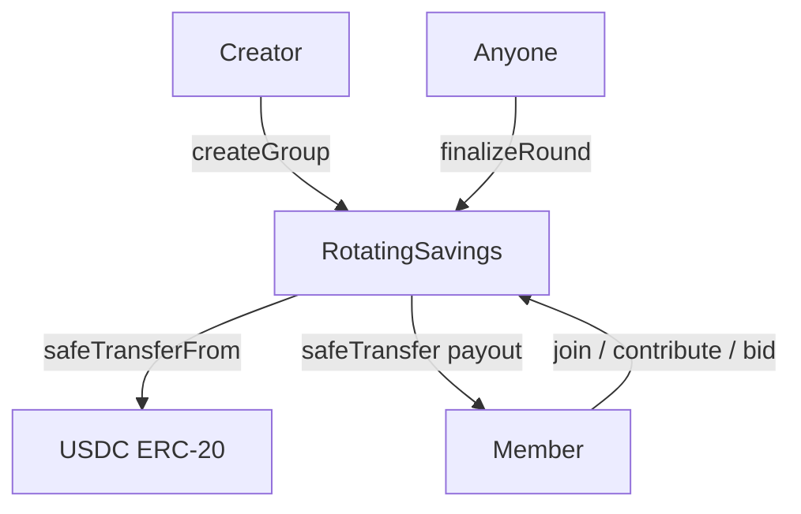

# RotatingSavings — Smart Contract Design Doc

## 1. Metadata

| Field | Value |
|---|---|
| Status | Draft |
| Authors | Arc Studio |
| Target chain | Arc Testnet (Chain ID 5042002) |
| Language / toolchain | Solidity 0.8.20, Foundry (arc-forge), OpenZeppelin 5.1.0 |
| Milestone | Testnet launch |

Reviews:
- [ ] Design
- [ ] Security
- [ ] Ops

---

## 2. Action Items (living)

_Empty — fill after each review round._

---

## 3. Goals / Non-Goals

### Goals
- Allow a group of members (3–20) to pool fixed USDC contributions each round
- Allocate the pot to one member per round via **auction** (highest bid wins earlier payout)
- Enforce contribution deadlines onchain — no chủ hụi holding funds
- Penalize/kick members who miss contribution deadlines; return their proportional share
- Trustless: no admin can move or freeze member funds unilaterally

### Non-Goals
- Cross-chain operation (single-chain Arc Testnet only for v1)
- Undercollateralized or credit-based participation
- Governance or DAO voting
- Random or fixed-order selection modes (auction only in v1)
- Fiat off-ramp / real-world identity verification

---

## 4. Requirements

### Functional
- F1: Any address may create a new savings group with configurable parameters (contribution amount, round duration, max members).
- F2: Members join by registering their address; group starts when `minMembers` threshold is met and creator calls `startGroup`.
- F3: Each round, all active members must call `contribute()` before the round deadline.
- F4: Within the contribution window, any member who has NOT yet received a payout may call `bidForPayout(bidAmount)`. The highest bidder wins the round pot minus their bid (bid goes to the remaining members as a bonus).
- F5: After the round deadline passes, anyone may call `finalizeRound()` to distribute the pot and advance to the next round.
- F6: A member who misses a contribution deadline is marked **defaulted**: they are removed from future rounds, and their unused deposited funds are returned proportionally to active members.
- F7: After all rounds complete, any remaining dust is returned to members.
- F8: The group creator has no special financial privilege — they cannot redirect funds.

### Security
- S1: No path lets any address withdraw another member's funds outside the defined payout rules.
- S2: Contract must be non-reentrant on all USDC transfer calls.
- S3: Round finalization is permissionless (anyone may trigger it after deadline) to avoid liveness dependency on a single actor.
- S4: Total USDC held by contract at any moment equals the sum of all member deposits minus payouts already distributed. Invariant must hold after every state transition.
- S5: A member cannot bid more than the round pot value (bids are capped to prevent underflow).
- S6: Creator cannot start a group with zero contribution amount or zero round duration.

---

## 5. Terminology & Actors

| Term | Definition |
|---|---|
| Group | A single rotating savings instance with fixed parameters |
| Round | One cycle: contributions collected → auction → payout |
| Pot | Sum of all member contributions for a round |
| Bid | Extra USDC a member offers to receive the pot early; distributed to others |
| Active member | Joined, not defaulted, not yet received payout |
| Defaulted member | Missed a contribution; removed; refunded proportionally |

| Actor | On/Off-chain | Trust level | Capabilities |
|---|---|---|---|
| Creator | On-chain | Semi-trusted | Deploy group, set parameters, call `startGroup` |
| Member | On-chain | Untrusted | Join, contribute, bid, claim payout |
| Caller (public) | On-chain | Untrusted | Call `finalizeRound()` after deadline (liveness) |
| Contract | On-chain | Trusted (code) | Hold USDC, enforce rules, distribute funds |

---

## 6. Language / Runtime

- **Solidity 0.8.20** — checked arithmetic by default; explicit `unchecked` blocks only where safe and justified.
- **EVM version: Paris** (Arc Testnet constraint; no Cancun opcodes).
- **OpenZeppelin 5.1.0** — `ReentrancyGuard`, `SafeERC20`, `Ownable2Step` (for group creator role).
- **USDC on Arc Testnet**: ERC-20 at `0x3600000000000000000000000000000000000000`, 6 decimals (ERC-20 interface).

---

## 7. Transaction & Execution Model

Every function call is atomic. All state changes (member balances, round state, pot totals) are committed before any external USDC transfer call. CEI (Checks-Effects-Interactions) discipline is applied throughout — state is fully updated before `safeTransfer` / `safeTransferFrom` calls. `ReentrancyGuard` (`nonReentrant`) is applied to every function that moves USDC.

---

## 8. Chain Standards & Interfaces

- No custom token standard; contract interacts with USDC ERC-20 only.
- No cross-chain message passing.
- No signature verification (no EIP-712 in v1; all actions are direct calls from member addresses).

---

## 9. Architecture Overview

### Component diagram



### Round lifecycle sequence

```mermaid
sequenceDiagram
    participant C as Creator
    participant M as Members
    participant S as RotatingSavings
    participant U as USDC

    C->>S: createGroup(contributionAmt, roundDuration, minMembers, maxMembers)
    M->>S: join() [up to maxMembers]
    C->>S: startGroup() [when >= minMembers joined]
    Note over S: Round 1 begins; roundDeadline = now + roundDuration

    loop Each round
        M->>U: approve(S, contributionAmt)
        M->>S: contribute() → pot grows
        M->>S: bidForPayout(bidAmt) [optional, increases winnerBonus to others]
        Note over S: After roundDeadline...
        Anyone->>S: finalizeRound()
        S->>M: safeTransfer(winner, pot - winningBid)
        S->>M: distribute winningBid to active members pro-rata
        Note over S: Mark winner as paid; advance round
    end

    Note over S: After all rounds complete
    S->>M: returnDust() [any rounding remainder]
```

### Flow of funds

| Step | Who moves what | Invariant |
|---|---|---|
| `join()` | No funds moved | memberCount increases |
| `contribute()` | Member → Contract (contributionAmt USDC) | `pot[round] += contributionAmt` |
| `finalizeRound()` | Contract → winner (`pot - winningBid`) | `totalPaid += pot - winningBid` |
| `finalizeRound()` | Contract → active members (winningBid, pro-rata) | `bidBonus distributed in full` |
| Member default refund | Contract → defaulted member (unused deposit) | `contract balance decreases by refundAmt` |
| `returnDust()` | Contract → active members | Contract balance = 0 after final round |

**Resting-state invariant**: `contract.balanceOf(USDC) == sum(unclaimedDeposits)` at all times.

---

## 10. Contract Design

### Roles

| Role | Holder | Permissions | Why it exists |
|---|---|---|---|
| Creator | One address set at group creation | `startGroup()` only | Bootstraps the group; no fund access |
| Member | Any joined address | `contribute`, `bidForPayout`, `claimRefund` | Participants |
| Public caller | Anyone | `finalizeRound` after deadline | Liveness; no trust required |

### Storage layout

```solidity
struct MemberInfo {
    bool active;           // not defaulted
    bool hasReceivedPayout; // already won a round
    uint256 totalDeposited;
    uint256 totalReceived;
}

struct GroupState {
    address creator;
    address usdcToken;          // 0x3600...0000 on Arc
    uint256 contributionAmt;    // in USDC (6 decimals)
    uint256 roundDuration;      // seconds
    uint8   minMembers;
    uint8   maxMembers;
    uint8   currentRound;       // 1-indexed
    uint8   totalRounds;        // = initial member count
    uint256 roundDeadline;
    uint256 pot;                // current round pot
    uint256 highestBid;
    address highestBidder;
    bool    started;
    bool    ended;
    address[] members;
    mapping(address => MemberInfo) memberInfo;
    mapping(address => bool) contributed;  // reset each round
}
```

_Not upgradeable — no gap or EIP-7201 namespace needed._

### Modifiers

| Modifier | Guard |
|---|---|
| `onlyActive(addr)` | `memberInfo[addr].active == true` |
| `onlyMember` | caller is in `members` array |
| `groupStarted` | `state.started == true` |
| `roundOpen` | `block.timestamp < state.roundDeadline` |

### Functions (write)

| Function | Caller | State mutated | Events | Reverts if |
|---|---|---|---|---|
| `createGroup(...)` | Anyone | New `GroupState` in mapping | `GroupCreated` | Invalid params (0 amount, 0 duration, min > max) |
| `join(groupId)` | Any non-member | `members.push(caller)` | `MemberJoined` | Already started, already member, at max capacity |
| `startGroup(groupId)` | Creator | `started=true`, `roundDeadline=now+duration`, `totalRounds=members.length` | `GroupStarted` | Not creator, already started, below minMembers |
| `contribute(groupId)` | Active member | `pot += amt`, mark contributed | `ContributionMade` | Not member, deadline passed, already contributed, not started |
| `bidForPayout(groupId, bidAmt)` | Active member who hasn't received payout | Update `highestBid/Bidder` | `BidPlaced` | Not eligible, bid ≤ current highest, bid ≥ pot, deadline passed |
| `finalizeRound(groupId)` | Anyone | Distribute pot, advance round, handle defaults | `RoundFinalized`, `MemberDefaulted` | Before deadline (unless all contributed), already finalized |
| `claimRefund(groupId)` | Defaulted member | Mark claimed, transfer | `RefundClaimed` | Not defaulted, already claimed |

### Events

```solidity
event GroupCreated(uint256 indexed groupId, address creator, uint256 contributionAmt, uint256 roundDuration);
event MemberJoined(uint256 indexed groupId, address member);
event GroupStarted(uint256 indexed groupId, uint256 totalRounds, uint256 firstDeadline);
event ContributionMade(uint256 indexed groupId, uint8 round, address member, uint256 amount);
event BidPlaced(uint256 indexed groupId, uint8 round, address bidder, uint256 bidAmount);
event RoundFinalized(uint256 indexed groupId, uint8 round, address winner, uint256 payout, uint256 bidBonus);
event MemberDefaulted(uint256 indexed groupId, address member, uint256 refundAmount);
event RefundClaimed(uint256 indexed groupId, address member, uint256 amount);
event GroupCompleted(uint256 indexed groupId);
```

---

## 11. Specification tables

### 11.1 Contribution invariants
1. A member may contribute exactly once per round.
2. `pot[round] == contributionAmt * activeMembers` after all contribute (or less if defaults occur).
3. No member receives a second payout before all active members have received one.
4. Contract holds ≥ 0 USDC at all times (no underflow path).

### 11.2 Auction invariants
1. Winning bid is strictly less than the round pot (winner always receives positive USDC).
2. Bid bonus is distributed only to members who are NOT the winner of that round.
3. If no bid is placed, the highest-active-member-index in the member array wins by default (round-robin fallback).

---

## 12. Deployment & Initialization

- **Constructor**: sets `usdc` address and deploys factory-style (groups created via `createGroup`).
- No proxy; immutable deploy.
- `createGroup` is permissionless — anyone may spawn a group.
- Init runbook: deploy contract → creator calls `createGroup` → members call `join` → creator calls `startGroup`.
- Constructor args: `address usdc` (= `0x3600000000000000000000000000000000000000` on Arc Testnet).

---

## 13. Upgradeability

Not upgradeable. Immutable contract. Migration story: if a bug is found, deploy a new contract; users interact with the new address. No funds are locked indefinitely — members can always call `claimRefund` or wait for `finalizeRound`.

---

## 14. Key Management & Signing

- No off-chain signatures in v1.
- Creator key: only needed to call `startGroup`. Compromise allows creator to delay start (only), not to steal funds.
- All fund movements are enforced by contract logic, not by any key.

---

## 15. Security Considerations

| Vulnerability | Applicable? | Mitigation |
|---|---|---|
| Reentrancy | Yes — USDC transfers in `finalizeRound`, `claimRefund` | CEI + `nonReentrant` on all fund-moving functions |
| Access control | Yes | `onlyMember`, `onlyCreator` guards; creator has no fund access |
| Integer overflow/underflow | Solidity 0.8 checked | No `unchecked` blocks on fund arithmetic |
| Unchecked external call | Yes — USDC `transfer` | `SafeERC20.safeTransfer` / `safeTransferFrom` throughout |
| Fee-on-transfer tokens | N/A — only USDC (known no-fee token on Arc) | N/A |
| Signature replay | N/A — no off-chain signatures in v1 | N/A |
| Front-running / MEV | Yes — bid sniping in auction | Bids are open; this is by design. Last-block sniping is a known tradeoff accepted for simplicity. |
| Flash-loan manipulation | Low — no price oracle, no spot-price read | N/A |
| Oracle manipulation | N/A — no oracle | N/A |
| Denial of service | Yes — unbounded loops over members array | Max member cap (20) bounds all loops |
| Delegatecall / proxy | N/A — not upgradeable | N/A |
| Timestamp dependence | Yes — `roundDeadline` uses `block.timestamp` | Tolerance: 15s miner drift acceptable for multi-hour rounds |
| Approval persistence | Yes — members approve contract per round | Contract uses exact amounts only; no max approvals |
| Centralization risk | Low — creator has no fund access | Creator can only `startGroup`; all else is permissionless |
| Default handling DoS | Yes — defaulted member processing in loop | Bounded by maxMembers (20); O(n) is safe |

---

## 16. Trust Model & Threat Analysis

| Actor | Worst-case compromise | Mitigation | Detection |
|---|---|---|---|
| Creator key | Refuses to call `startGroup` — group never begins | Members can re-create group elsewhere; creator has no fund access | Off-chain coordination |
| Malicious member | Contributes then bids to win early every round | Bid bonus compensates remaining members; auction is designed for this | Onchain event monitoring |
| Public `finalizeRound` caller | Triggers finalization slightly after deadline | Permissionless by design; no harm in early finalization post-deadline | N/A |
| Contract deployer | N/A — no privileged deployer role post-deploy | Immutable; no upgrade key | N/A |

---

## 17. Emergency Response & Circuit Breakers

No pause function in v1 (trust model: contract is immutable and trustless). Emergency paths:
- **Member defaults**: `claimRefund` always available for defaulted members.
- **Stuck group (all members default)**: `finalizeRound` with zero active members returns all funds to defaulted members' refund balances.
- **No rescue function**: USDC sent directly to contract address (not via `contribute`) is permanently locked — users must use the correct function. This is documented in the UI.

---

## 18. Failure Scenarios

| Scenario | Outcome |
|---|---|
| All members default in a round | Pot = 0 (nothing to distribute); round advances; refunds available |
| Winner's transfer fails (USDC reverts) | `safeTransfer` reverts entire `finalizeRound`; state unchanged; caller can retry after issue resolves |
| One member's refund transfer fails | `claimRefund` is pull-based (member calls it); failure only affects that member; others unaffected |
| `finalizeRound` called before deadline | Reverts unless all members have contributed (early finalization OK when all contributed) |

---

## 19. Priorities & Tradeoffs

| Decision | Tradeoff | Rationale |
|---|---|---|
| Auction mode only (no random/fixed) | Reduces flexibility; users who want fixed order can't use v1 | Simplifies contract; auctions create price discovery and bonuses for non-winners |
| Max 20 members | Limits use cases; tontines can be larger | Bounds loop gas cost; safe on-chain for v1 |
| No pause | Reduces operator control; can't freeze on exploit | Trustless design — no admin key holding user funds is the core value prop |
| Pull-based refunds | Extra UX step for defaulted members | Avoids push-to-array DoS; safer pattern |
| No off-chain signatures | Extra transaction for each action | Simpler; no signature replay surface; v2 can add EIP-712 gasless joins |
| Bid sniping accepted | Last-block front-running possible | Complexity of commit-reveal > benefit for testnet v1; documented known tradeoff |

---

## 20. Testing Strategy

- **Unit tests** (Foundry): happy path, revert paths, all events, fuzz on `contributionAmt` and `bidAmt`, invariant: contract balance == sum unclaimedDeposits.
- **Slither**: run before deploy; fix High/Medium findings.
- **Security review** (max severity): two independent reviewers covering different failure modes.
- Run: `forge test -vv` / `forge test --gas-report`

---

## 21. Third-party libraries

| Library | Version | Dependency? | Why | Security reviewed? |
|---|---|---|---|---|
| OpenZeppelin Contracts | 5.1.0 | Yes (pinned) | `ReentrancyGuard`, `SafeERC20`, `Ownable2Step` | Yes (OZ audit history) |

---

## 22. Monitoring & Alerting

| Event | Threshold | Severity | Action |
|---|---|---|---|
| `MemberDefaulted` | Any | Medium | Alert group creator off-chain |
| `RoundFinalized` | Any | Info | Update UI state |
| `GroupCompleted` | Any | Info | Close group in UI |

---

## 23. Cross-Functional Stakeholders

| Stakeholder | Owns |
|---|---|
| Smart contract dev | Contract correctness, security |
| Frontend dev | UX, wallet integration |
| Product | Member onboarding, group creation UX |

---

## 24. Message Encoding

N/A — single-chain, no cross-chain messaging.

---

## 25. Types & Enums

```solidity
enum GroupStatus { Pending, Active, Completed }

struct GroupParams {
    uint256 contributionAmt;   // USDC, 6 decimals
    uint256 roundDuration;     // seconds
    uint8   minMembers;
    uint8   maxMembers;        // max 20
}
```

---

## 26. Worked Examples

### Example: 4-member group, 10 USDC/round

**Setup**
- Creator calls `createGroup(10e6, 7 days, 3, 4)`
- 4 members join; creator calls `startGroup`
- Round 1 deadline = now + 7 days; totalRounds = 4

**Round 1 — Member C wants payout urgently**
1. All 4 members call `contribute()` → pot = 40 USDC
2. Member C calls `bidForPayout(5e6)` (bids 5 USDC)
3. No higher bid before deadline
4. Anyone calls `finalizeRound()`
5. Contract: sends C `40 - 5 = 35 USDC`; distributes 5 USDC to A, B, D (1.67 each)
6. C marked `hasReceivedPayout = true`; round 2 begins

**Round 2 — Member B defaults**
1. A, C, D contribute; B does not before deadline
2. `finalizeRound()` called: B marked defaulted, refund = B's proportional share (10 USDC added to B's claimable)
3. No bid placed → default winner = first active member alphabetically (A)
4. A receives pot from A + C + D contributions = 30 USDC
5. B can call `claimRefund()` to recover 10 USDC at any time
