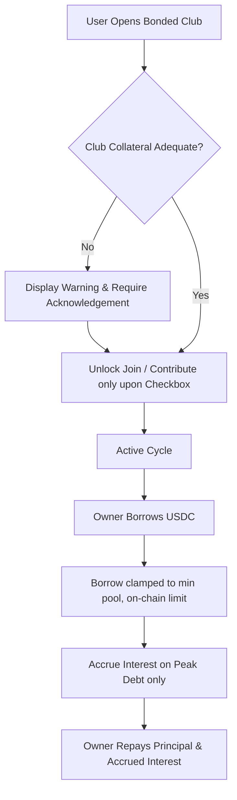

# BA Specification: Comprehensive Audit Fixes (bonded-audit-20261109)

## 1. Problem Statement & Scope
Based on comprehensive testing and audit feedback on Arc Testnet, several high-priority and medium-priority inconsistencies between the UI and on-chain mechanics were identified:
1. **Risk Gate Inactive in Real Browsers**: Gated behind `isAutomatedRiskTest = Boolean(globalThis.__riskHooks)`. Real users experienced 0 warnings on high-risk/under-collateralized clubs.
2. **Off-Chain / Simulated Cancel Votes**: Cancel voting was implemented solely using localStorage and dev-server middleware (`vite.config.ts`), with no on-chain voting functionality in `BondedTontine.sol` (which only provides `cancelOpen()` as an `onlyOwner` method).
3. **Misleading Fixed Interest / Payouts**: Displayed interest as a guaranteed fixed sum rather than variable interest accrued from peak round borrowing.
4. **Incorrect Borrow Max**: Filled entire pool balance without respecting `borrowLimit()` and accrued debt/interest, causing on-chain reverts (`ExceedsBorrowLimit`).
5. **Hardcoded BTC Price for Collateral**: Hardcoded $60,000 BTC price instead of using live Chainlink oracle data.
6. **Fragile Wallet Hydration & RPC Mismatch**: Brittle regex on `localStorage["wagmi.store"]` with `setTimeout(1200)` and conflicting RPC URL triggering wallet warnings.

## 2. Requirements & Business Rules

| ID | Requirement | Business Rule (BR) |
|---|---|---|
| REQ-01 | Always-on Risk Gate | Evaluate `requiresRiskAcknowledgement(club)` universally without test flags. Block Join/Contribute until explicit checkbox acknowledgement. |
| REQ-02 | Contract-Truthful Club Cancellation | Remove client-side vote simulation. Provide owner direct `cancelOpen()` modal in `OPEN` state. Members wait or withdraw. |
| REQ-03 | Accurate Borrow Max | Calculate `maxBorrowUsdc = min(availablePoolUsdc, (borrowLimit - owed) * 10000 / (10000 + rateBps) - totalDebt)`. |
| REQ-04 | Dynamic Oracle Collateral Suggestion | Compute suggested collateral from `oraclePriceRaw` and `oracleDecimals` to fully back cycle pool exposure. |
| REQ-05 | Robust Wallet Connection | Remove localStorage regex and arbitrary timers. Rely directly on Wagmi `useAccount` and Passkey status. |
| REQ-06 | Accessibility Compliance | Add `<h1>` element, supply accessible names for icon and language buttons. |
| REQ-07 | Canonical RPC Consistency | Standardize on canonical Arc Testnet RPC URL `https://rpc.testnet.arc.io`. |

## 3. Mermaid Flow

