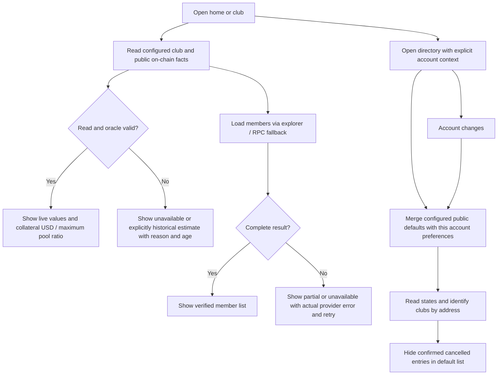

# Bonded review follow-up — specification v2

Status: Ready for Development; 2026-11-06; baseline branch `feat/bonded-tontine`, fetched HEAD `9f350bf` (Leader verified).

## Revision and evidence

v2 corrects BR-02 and AC-02 to the full-cycle maximum pool after reading `contracts/BondedTontine.sol`: `totalRounds = maxMembers` (line 216), each member contributes once per round and `totalDeposits` accumulates (lines 324–341), and the cycle lasts `maxMembers * roundDuration` (lines 463–475). Thus a full group contributes N rounds, not only one. v1 is retained as historical; any v1 ratio tests/evidence must be updated and rerun against v2. Other requirements are unchanged.

Leader supplied read-only on-chain observations: default collateral = 20 raw with 8 decimals; contribution = 10000000 raw with 6 decimals; maxMembers = 4; oracle answer = 6000000000000 with 8 decimals; updatedAt = 1793842161; maxPriceAge = 3600. At that last reported price, collateral is $0.012 and full-cycle maximum pool is $160, giving 0.0075% historical estimated coverage; this observation does not establish current oracle freshness. BA verified the full-cycle formula from source, not a fresh on-chain read.

## Problem, value, actors and scope

Visitors see legacy auction language and unsupported guarantees alongside a bonded lending product; account lists leak global preferences and operational failures are mislabeled. This change makes public facts evidence-based, distinguishes collateral adequacy from mere presence, isolates directory preferences and explains data failures truthfully. Actors: anonymous visitor, connected injected/passkey wallet, club owner, oracle operator. No contract economic change or deployed contract migration is required. This task prepares and tests code; live mock-feed writes and ongoing operator service are separate operational actions, not claimed as completed by a UI fix.

Source findings: `LandingPage.tsx` contains Bid for Pot, mathematical guarantees and static featured metrics; `i18n.ts` contains legacy metric/guide copy; `UnauthenticatedBondedClubPreview.tsx` labels any deposit as protection; `ClubDirectoryModal.tsx` references missing subtitle and pluralizes one hour; `savingsClubDirectory.ts` falls back to global known groups and holds mutable activeDirectoryAccount; several write functions still target global storage; `BondedClubWorkspace.tsx` hardcodes the block-range explanation despite explorer-first member fetching. Existing URL helpers and a mock refresh script can be reused.

## Flow

## Business rules

- BR-01: Bonded V2 onboarding describes its deployed contribution/owner borrowing/repayment/claim model; legacy V1 functionality may retain auction wording within explicit V1 context only. No zero-fraud, guaranteed return, mathematical safety, or overcollateralization assertion inferred solely from a nonzero bond.
- BR-02: Maximum full-cycle pool is `contributionAmount * maxMembers * maxMembers` in six-decimal USDC because each of N members contributes through N rounds. Optional per-round capacity is `contributionAmount * maxMembers` and must be labeled separately, never substituted for the full-cycle denominator. Coverage is `collateralValueUsdc / maximumPool * 100`; zero/unknown denominator produces unavailable, never Infinity. Small nonzero USD and ratios must not round misleadingly to zero. Values derive from actual collateral and feed decimals, not a hardcoded USD price.
- BR-03: Stale/invalid/missing oracle data is never eligible for current borrowing/health claims. A last reported price may support an explicitly historical estimate with timestamp/age, stale label and mock-feed disclosure; never silently substitute it as valid contract valuation. Freshness follows the club's maxPriceAge. Anonymous users can read metadata and see why a figure is unavailable.
- BR-04: Club identity is chain/address, not name. Identical legitimate names remain intact but their address/identifier is visibly distinct. Confirmed CANCELLED clubs are omitted from default discovery; direct address access remains possible for refund/recovery and unknown state is not invented as OPEN.
- BR-05: Public configured defaults may be shared, personal save/rename/remove/clear preferences must be scoped to explicit normalized account (guest uses its own namespace). No automatic import of unowned legacy global entries into a new account. Async reads/writes retain the originating context and cannot populate the next account. Mutable global active account is removed.
- BR-06: HTTP 429, timeout, actual RPC range failures and unknown errors have truthful distinct diagnostics. Successful complete fallback may recover; partial history is not asserted complete.
- BR-07: Network-dependent operational URLs come from the existing facts registry/configuration and URL helpers. Intentional documentation/external product links and XML namespaces are not network endpoint duplication.

## Requirements and acceptance criteria

| REQ | Acceptance criteria |
| --- | --- |
| REQ-01 Home accuracy | AC-01: English and Vietnamese home/active V2 guide contain no auction/winner steps or absolute fraud/safety/yield guarantees; featured amount, interest, member count/capacity and state read configured featured contract. Loading/error has explicit placeholders and never static 10/2%/4/Open fallbacks. |
| REQ-02 Collateral transparency | AC-02: Public preview and bonded workspace show collateral quantity, USD value or clearly labeled historical estimate, maximum full-cycle pool and percentage, labeled to distinguish per-round capacity if also displayed. For 10 USDC contributions and 4 members over 4 rounds, maximum full-cycle pool is $160: a $0.01 fixture displays 0.00625%; the default 20-satoshi collateral at historical $60,000/BTC yields $0.012 and 0.0075% (or adequate precision), with no protection guarantee; zero and missing price/denominator handle safely. |
| REQ-03 Directory quality | AC-03: Subtitle resolves in both languages; same-name distinct contracts show distinguishable addresses; duplicate address entries collapse; confirmed cancelled groups absent from default list with direct access retained; 3600 renders 1 hour and 7200 renders 2 hours (corresponding day singular handling also correct). |
| REQ-04 Oracle failures and remediation | AC-04: Guest and connected UI explicitly show stale/invalid/unavailable reason, price age/limit when available and mock status; freshness recovers after successful refetch. No relaxed contract maxPriceAge or fake fresh value. Refresh script validates all arguments (including interval) before any write, provides dry-run/read-only status without signing, and has an operator runbook stating credentials and recurring-update requirement; live feed unchanged must be reported honestly, not counted as refreshed. |
| REQ-05 Member diagnostics | AC-05: Explorer 429 plus failed fallback yields rate-limit evidence, not a fabricated range-only cause; genuine range error, timeout and generic error have corresponding messages. Complete fallback success clears error; incomplete reconstructed list is labeled incomplete and count mismatch preserved. |
| REQ-06 Account isolation | AC-06: Account A saves/renames/hides/clears without affecting B or guest; fresh B receives only configured public defaults/discovery plus B entries; return to A restores A state; mixed-case addresses normalize; asynchronous A operations cannot appear as B state; no mutable global account resolver. Factory discovery is explicit public discovery, not inheriting A's local data. |
| REQ-07 URL centralization | AC-07: App contract link and operational runtime Arc explorer/RPC links use configured helpers/facts, including old arcscan links in other source files, using ARC_RPC/ARC_EXPLORER/txUrl/addrUrl or existing facts helpers. Search inventory explains exclusions (registry, intentional external/documentation links, XML, archived backup); unrelated service/social/static URLs are outside this change. Tests verify generated URLs. |

## Ownership and implementation handoff

BA exclusively owns this directory; Developer owns assigned implementation and `docs/manifests/bonded-review-20261106`; Tester owns test additions/updates and `docs/qa/bonded-review-20261106`. Leader confirms exact owner list before dispatch. Proposed required files:

- `src/components/landing/LandingPage.tsx`, `src/lib/i18n.ts`, `src/components/savings/GuideModal.tsx` if V2 guide invoked.
- `src/components/savings/UnauthenticatedBondedClubPreview.tsx`, `src/components/savings/BondedClubWorkspace.tsx`, `src/hooks/useBondedClub.ts`, `src/lib/bondedTontine.ts` or new focused display/error helper.
- `src/lib/savingsClubDirectory.ts`, `src/components/savings/ClubDirectoryModal.tsx`, `src/App.tsx`, `src/hooks/useIsBondedClub.ts`, `src/components/savings/CreateClubModal.tsx`, `src/components/savings/CreateBondedClubModal.tsx`, `src/components/savings/GroupSwitcher.tsx` plus any caller found during explicit-account propagation.
- URL inventory: `src/config/arc-constants.ts`, `src/contract.ts`, `src/lib/TransactionHistory.ts`, `src/components/{Send,Swap,Payments,Bridge,NetworkStats,UniswapPortal,AgentStack,TransactionMemos}.tsx`, `src/components/savings/{ArcAppKitModal,Header}.tsx`; runtime service endpoint consumers found by inventory may need a new config module. `src/onchain-facts.ts` remains authoritative.
- `scripts/refresh-mock-oracle.mjs` and operator remediation documentation if changes needed; no run with signing credentials during this coding dispatch.

Dependencies/risks: on-chain RPC/explorer availability; mock oracle owner signing access for actual refresh; frontend historical estimates cannot cure stale contract valuation. Shared factory discoveries may have same names and must not be renamed on-chain merely to improve UI. Existing tests may assert obsolete source strings/global behavior and need independently justified updates. Baseline and frozen SHA256 are required before Tester runs.

Assumptions: review asks to fix code and prepare operational correction, not to submit oracle transactions or deploy a daemon. Shared public factory/default listing is allowed; account-specific preferences remain private. No open business blocker for implementation.

## Traceability (pending independent verification)

| REQ | AC | Test | Source hash | Evidence | BA coverage |
| --- | --- | --- | --- | --- | --- |
| REQ-01 | AC-01 | pending Tester design | pending | pending | pending |
| REQ-02 | AC-02 | pending Tester design | pending | pending | pending |
| REQ-03 | AC-03 | pending Tester design | pending | pending | pending |
| REQ-04 | AC-04 | pending Tester design | pending | pending | pending |
| REQ-05 | AC-05 | pending Tester design | pending | pending | pending |
| REQ-06 | AC-06 | pending Tester design | pending | pending | pending |
| REQ-07 | AC-07 | pending Tester design | pending | pending | pending |
