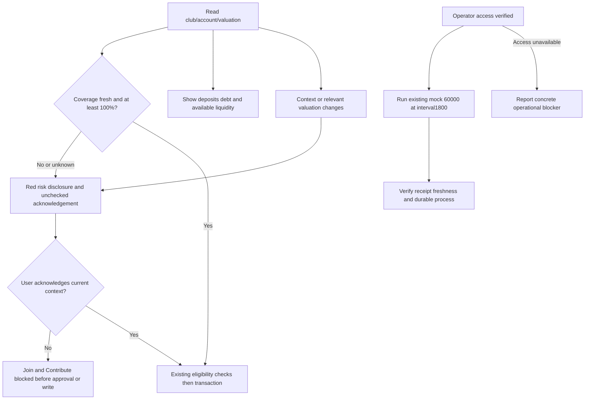

# Bonded risk follow-up — spec v1

Status: Ready for Development, 2026-11-06. Input: Leader dispatch for Max's follow-up after `bonded-review-20261106`. Scope extends that task; its full-cycle pool definition remains `C × N²`.

## Problem, value and actors

Visitors can now see small collateral values, but Join/Contribute still need an explicit informed acknowledgement when collateral cannot cover the maximum cycle pool. Members also need to distinguish deposits from immediately available liquidity. Operators need the authorized recurring mock oracle update, and repository evidence must remain verifiable without tracked source snapshots/long logs. Actors: visitor, member, club owner, oracle operator, Developer and independent Tester.

Source findings: `BondedClubWorkspace.tsx` handlers at join/contribute currently invoke writes directly; contribution can approve USDC before any acknowledgement. Existing `collateralCoverage` uses exact bigint calculations and preserves 0.0075%. `memberErrorMessage` currently concatenates provider causes. `task-059/manifest.json` contains 22 files and is stale relative to follow-up changes. Existing `.gitignore` ignores `*.log` but tracked files remain tracked. Oracle script already supports `--interval`, validates interval against on-chain maxPriceAge and has read-only mode.

## Rules and acceptance

| REQ | Rule and testable AC |
| --- | --- |
| R1 Risk acknowledgement | AC1: Coverage below 100% of the **maximum cycle pool**, or stale/invalid/unavailable valuation, displays a prominent red warning in English/Vietnamese near member actions explaining potential principal loss. Join AND Contribute require a visible explicit unchecked checkbox. Before acknowledgement, disabled buttons and handler guards prevent every signing call, including token approval; after awaiting approval, recheck the current account/club/risk context before the contribution write so a stale closure cannot authorize it. Account, club, oracle validity or relevant valuation/coverage inputs changing invalidate acknowledgement; age ticking alone need not reset a still-fresh unchanged quote. Existing eligibility checks remain required after ticking. Threshold is disclosure policy, not a lending/health/liquidation threshold or new contract rule; claims, refunds and withdrawals remain unaffected. Tests cover low/zero/unknown/stale, fresh exactly100%/above100%, reset and programmatic handler bypass. |
| R2 Available liquidity | AC2: Show total deposited pool, outstanding debt and available contributed principal `max(totalDeposits - totalDebt, 0)` distinctly using exact units; this is neither full token balance nor a promised withdrawable amount. Loading/error must show unavailable/loading, never a reassuring fabricated zero debt. If debt is 100% of deposits, available liquidity is zero, not the full pool; zero pool and debt greater than deposits handle safely without negative values/NaN. Where a utilization percentage is displayed, label denominator as deposited pool, not maximum cycle capacity. |
| R3 Percentage precision | AC3: Use adaptive display precision (at least1% may use two decimals; smaller percentages retain meaningful digits) and preserve meaningful coverage precision: $0.012/$160 displays **0.0075%**, genuine zero displays zero and tiny positive coverage never rounds to false zero. Fresh/historical labels continue matching oracle validity; do not replace exact bigint math with `toFixed(2)`. |
| R4 Member failure copy | AC4: Explorer HTTP429 produces a short primary message about rate limiting and retry in the active language, rather than a long concatenated provider message. Secondary technical detail may retain genuine fallback causes without asserting a false primary range-limit reason. Complete fallback success clears the error; partial results stay explicitly partial. |
| R5 Configuration literals | AC5: `Header.tsx` and `ArcAppKitModal.tsx` consume existing chain/config values for runtime network identity, wallet-add-chain arguments, explorer/RPC and related configuration display. No replacement hardcoded literals or conflicting duplicated config; canonical helpers remain authoritative. Static intentional external links remain outside scope. |
| R6 Duplicate names | AC6: Distinct contracts sharing a name show a short address beside/in their title so the title itself disambiguates them; full address/copy/explorer identity remains accessible. Same address deduplicates case-insensitively. Do not rename contracts on-chain or overwrite personal names solely for this presentation. |
| R7 Integrity and artifacts | AC7: Re-freeze `task-059` using **exactly its existing 22-path set**, preserving baseline metadata and documenting that current source supersedes old hashes; Tester verifies it and the new task manifest before/after final tests. Re-freezing does not reassert historical QA for changed code. Prior task tracked baseline source copies and long logs are removed from Git tracking while retained locally; hashes/manifests/specs/concise reports stay tracked. Future snapshots/logs are ignored. Inventory/Git evidence distinguishes untracked-local retention from deletion; no source/history wipe. |
| R8 Oracle operation | AC8: Max explicitly authorizes running recurring mock-feed refresh `--interval 1800` on an always-on machine, preserving the existing $60,000 mock value. Leader validates actual host access, signer/feed authority and secure credential availability without disclosing secrets; do not invent a new market price. With access, start a durable supervised process and record actual first successful receipt, read-back freshness/price, interval and service status; if possible observe next scheduled success without falsely claiming unobserved uptime. Prepare a supervised-service template with automatic restart and `--interval 1800` for the confirmed host; do not label a template as a running service. If access is unavailable, report exact blocker and retain completed code evidence; a prepared runbook alone is not successful activation. No new authorization question is needed for the already-authorized refresh, but actual tool escalation rules still apply. |

## Ownership and handoff

- BA owns only `docs/ba/bonded-risk-20261106/`.
- Proposed Developer source: `src/components/savings/BondedClubWorkspace.tsx`, `BondedCollateralSummary.tsx`, `UnauthenticatedBondedClubPreview.tsx` (if public warning needed), `ClubDirectoryModal.tsx`, `Header.tsx`, `ArcAppKitModal.tsx`; `src/lib/bondedDisplay.ts`; focused new risk helper/component if useful; `src/lib/i18n.ts` if shared text is introduced. No Solidity economic change.
- Developer owns new task baseline/frozen manifests and authorized re-freeze `docs/manifests/task-059/manifest.json`; preserve its exact path set. Root `.gitignore`, Git untracking and shared documentation are Leader-owned or explicitly delegated by Leader. Baseline copy/log untracking must preserve files on disk.
- Tester owns `tests/` updates and `docs/qa/bonded-risk-20261106/`, independently tests guards before token approval, boundary values, callback resets, short errors, identity presentation, configuration and both manifests.
- Leader owns operational host/credentials investigation and authorized process activation; Developer may prepare service/runbook/script changes only after exact file ownership assignment. Keep secret environment files outside tracked artifacts and logs.

Leader execution evidence at spec handoff: `.gitignore` now includes `docs/manifests/**/baseline/`; 82 previous-task snapshots and 5 logs were untracked with files retained locally (Tester verification pending). Leader found no signing key in process environment/project `.env` by presence-only checks and has asked for host and credential-file location without requesting the key itself; operational activation is pending that access.

Dependencies/risks: Existing owner borrowing restrictions and oracle validity remain intact; acknowledgement is not a waiver or promise of safety. A refresh restores feed freshness but does not increase collateral. Persistent operation requires an available authorized signer, gas and durable host; this operational gate may remain blocked independently of code. Business assumptions are explicit: conservative <100% cycle-pool disclosure, including unknown/stale valuation, and no new restriction on exiting funds. No open business question blocks implementation.

## Traceability

| REQ | AC | Independent test | Hash / evidence | BA check |
| --- | --- | --- | --- | --- |
| R1 | AC1 | pending | pending | pending |
| R2 | AC2 | pending | pending | pending |
| R3 | AC3 | pending | pending | pending |
| R4 | AC4 | pending | pending | pending |
| R5 | AC5 | pending | pending | pending |
| R6 | AC6 | pending | pending | pending |
| R7 | AC7 | pending | pending | pending |
| R8 | AC8 | pending operator evidence | pending | pending |
