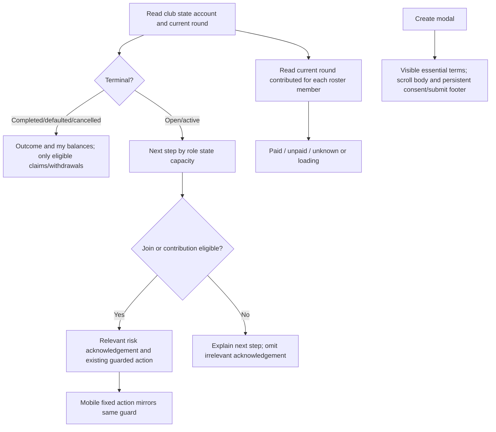

# State-aware bonded UX — spec v1

Status: Ready for Development, 2026-11-07. BA owns this directory only. Input: Max's latest state/layout/readability review as dispatched by Leader. Prior risk acknowledgement, exact valuation and account isolation remain regression requirements. No contract economics or oracle service activation work is included.

## Problem and verified rules

Current workspace shows generic risk/member/owner/keeper sections across lifecycle states; preview always invites joining; create modal puts interest/margins behind Advanced and acknowledgement/submit inside the scrolling form. Members need relevant outcomes and reachable actions, while configuration must expose economically important terms before creation.

Source: `BondedClubWorkspace.tsx` has a risk warning independent of action eligibility, no capacity condition in join eligibility, current-round member roster without payment-state reads, and generic permissionless labels. `CreateBondedClubModal.tsx` nests checkbox/submit in its scroll body. `UnauthenticatedBondedClubPreview.tsx` has unconditional Join wording.

Contract facts resolve state/capacity ambiguity: `joinGroup` rejects memberCount>=maxMembers; ACTIVE members may still `contribute` in each eligible round regardless of full capacity. Therefore a full OPEN group needs no join acknowledgement, while full ACTIVE groups must retain acknowledgement for eligible contributors. `withdrawPrincipal` is permitted only COMPLETED/DEFAULTED with a deposit and not yet withdrawn; `cancelOpen` returns owner collateral immediately and prevents contributions, so CANCELLED must not invent a principal claim. `contributed(round,member)` is a public mapping and is authoritative for roster status.

## REQ and AC

| REQ | Acceptance criteria |
| --- | --- |
| R1 State and outcome | AC1: COMPLETED, DEFAULTED and CANCELLED each have a dedicated, human-readable outcome and user's actual balances/claim status. Terminal primary view omits join/contribute acknowledgements, ongoing health dashboards and disabled keeper-action grids. Show only contract-eligible claim/withdraw actions with pending/zero/already-claimed/read-failure states, including owner residual collateral withdrawal when allowed. DEFAULTED recovery distinguishes pro-rata USDC and cirBTC plus claimable paid interest, without promising full principal; preserve existing passkey restrictions. CANCELLED explains closure/owner collateral return without promising unsupported withdrawPrincipal. Full OPEN nonmember sees full status, no join button or join-only risk checkbox; ACTIVE full eligible member still sees contribution and acknowledgement. All handlers preserve existing eligibility/approval-await guards. |
| R2 Mobile action reachability | AC2: On mobile, a bottom sticky/fixed action area exposes the relevant primary action (or access to its required acknowledgement), including claim/withdraw for eligible terminal members. It uses the same handlers and gates; it never bypasses tick, account context or pending status. Safe-area inset and content bottom padding prevent obstruction; no horizontal overflow or overlay on modal/footer content. No-action states explain rather than offer an impossible action. |
| R3 Public preview | AC3: OPEN with capacity uses a connect-to-join invitation; full OPEN, ACTIVE and terminal previews use connect-to-view-my-position/claim-availability wording appropriate to state, without offering immediate joining. Loading/unknown state never claims capacity or guaranteed returns. |
| R4 Create modal essentials and layout | AC4: Interest rate, collateral requirement/amount and borrowing constraints/margins are visible in the default form or persistent terms summary, without opening Advanced. Creation does not deposit collateral: explain initial borrowing capacity is zero until collateral is deposited and a fresh feed is available. The contract minimum to start is positive cirBTC collateral with at least2 members, not200% of pool. Show safetyBps as collateral required for intended borrowing/exposure including interest (e.g200% means $200 collateral per $100 exposure), clearly separate from start conditions; do not invent a contract minimum or hardcode a $60,000 price. An optional recommended pool-backing estimate must be labeled advisory and based on real price inputs. Modal is viewport-constrained with scrollable body and non-scrolling footer containing acknowledgement and Create; both remain visible at 1440×900 desktop, mobile390×844 and a smaller mobile height, with safe-area handling. Mandatory consent and validation stay effective, submit is reachable by keyboard/touch, and pending creation cannot duplicate transactions. |
| R5 Risk consolidation | AC5: One readable framed summary carries collateral USD/coverage, oracle validity and principal-loss explanation. Retain one actionable acknowledgement near a currently eligible funding action, and a distinct unverified-contract acknowledgement if required; remove redundant generic risk paragraphs/cards repeated across4–5 sections. Terminal outcomes explain recovery loss where relevant without prospective funding checkboxes. Current stale/historical labels remain truthful. |
| R6 Readable figures and labels | AC6: Durations render readable localized units with correct singulars instead of unexplained seconds; ordinary USDC amounts consistently show two decimals, tiny positive amounts retain meaningful precision instead of zero. Preserve collateral coverage0.0075% and exact internal math. Very large health ratios use a semantic upper bound such as >1000% or a clear sufficiently-collateralized label rather than an enormous number; raw precision may appear in optional detail. No primary button requires understanding Solidity function names or keeper terminology. |
| R7 Roster and owner next step | AC7: In an active valid current round, each loaded member shows contributed/not-yet-contributed based on `contributed(currentRoundIndex,address)`; failed/pending reads show unknown/loading, never unpaid. Account/club/round changes invalidate prior statuses; partial batch failure affects only unknown rows. OPEN/terminal roster does not fabricate a current payment obligation. Owner guidance follows state and actual prerequisites: OPEN recruiting/deposit collateral/start, ACTIVE repayment/interest or settlement as eligible, terminal outcome/eligible withdrawal. |
| R8 Verification and integrity | AC8: New task baseline/freeze manifest identifies actual changed files; if task059's path set intersects changes, refresh current hashes with the original path set/baseline metadata preserved, then Tester verifies both before/after. Independent automated state/guard/data tests plus **actual browser UI verification** are required: EN/VI, desktop900px and mobile390×844; inspect terminal views, full OPEN versus full ACTIVE, funding risk guard, sticky action and modal consent/submit visibility. Save truthful screenshots/observations; fixture-driven browser states are identified as fixtures. Load browser-skill and bsk-avada before bsk use; no transaction signing required for UI verification. |

## Ownership, dependencies and traceability

Proposed Developer ownership: `src/components/savings/BondedClubWorkspace.tsx`, `UnauthenticatedBondedClubPreview.tsx`, `CreateBondedClubModal.tsx`, `BondedCollateralSummary.tsx`; `src/hooks/useBondedClub.ts`; `src/lib/bondedDisplay.ts`; focused new state/format/roster helper or UI components; `src/lib/i18n.ts` if shared translations required; `src/App.tsx`/styles only if mounting or mobile spacing needs it and Leader assigns exact files. Developer owns `docs/manifests/bonded-state-ux-20261107/` and authorized task059 manifest refresh. Tester owns tests and `docs/qa/bonded-state-ux-20261107/`, including browser artifacts; BA owns only this analysis directory. Leader approves exact implementation owner list and handles browser/environment blockers.

Risks: terminal claim amounts differ from original deposit and must use existing settled previews; cancelled contract semantics differ from completed/defaulted. Live roster calls can fail/rate-limit and must not become assertions of nonpayment. Sticky controls must not create duplicate action paths. Existing pending oracle credentials/service remains a separate unresolved operational task, not silently marked complete here.

| REQ | AC | Test / evidence | BA coverage |
| --- | --- | --- | --- |
| R1 | AC1 | pending | pending |
| R2 | AC2 | pending | pending |
| R3 | AC3 | pending | pending |
| R4 | AC4 | pending | pending |
| R5 | AC5 | pending | pending |
| R6 | AC6 | pending | pending |
| R7 | AC7 | pending | pending |
| R8 | AC8 | pending | pending |
