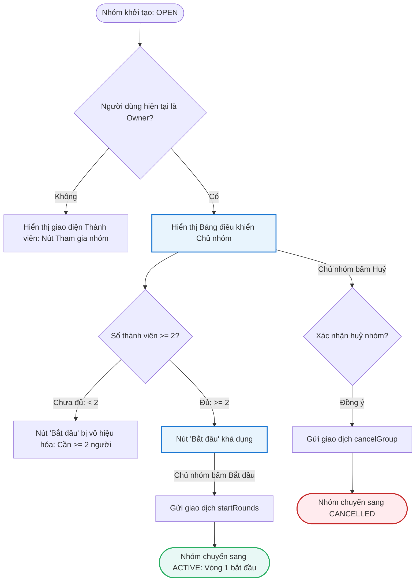
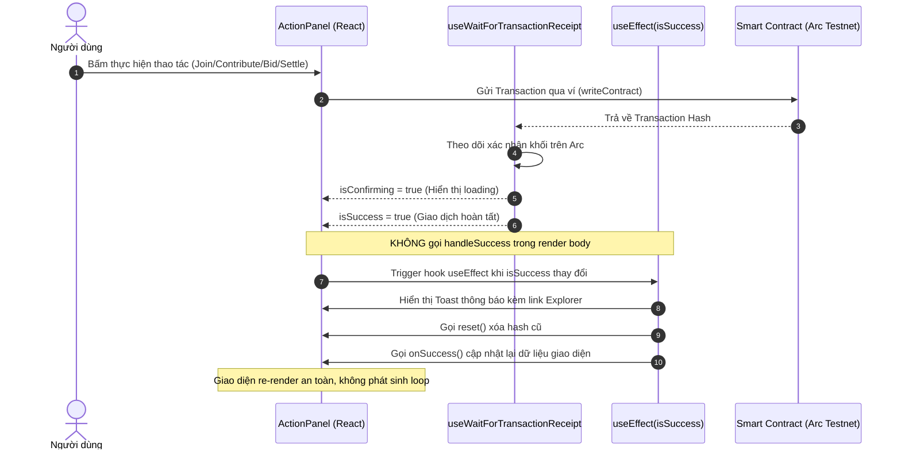
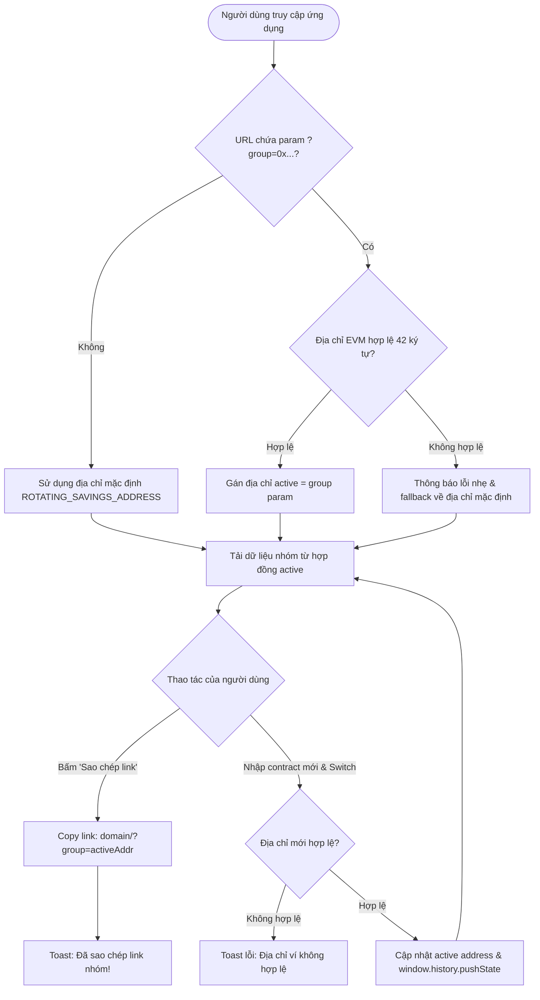

# Business Specification: Nâng cấp Toàn diện & Fix lỗi HụiChain (RotatingSavings)
**Task ID**: `task-002`  
**Spec Version**: `v1.0`  
**Tác giả (BA)**: `ba-agent`  
**Trạng thái**: `Verified`  

---

## 1. Tổng quan & Giá trị (Problem & Value)

### 1.1. Vấn đề cần giải quyết (Problem Statement)
Ứng dụng **HụiChain (RotatingSavings)** là nền tảng tiết kiệm xoay vòng không cần tín nhiệm (Trustless Tontine) xây dựng trên mạng Arc Testnet. Qua rà soát vận hành thực tế và đối chiếu theo kế hoạch phát triển [docs/tontine-build-plan.md](file:///home/avada/tontine/docs/tontine-build-plan.md), ứng dụng đang tồn tại 5 vấn đề cốt lõi cần nâng cấp và xử lý triệt để:
1. **Lỗi Render Loop sau Giao dịch**: Trong `ActionPanel.tsx`, hàm xử lý thành công `handleSuccess()` được kích hoạt trực tiếp trong thân hàm render của component mỗi khi `isSuccess` là `true`. Điều này kích hoạt cập nhật trạng thái (`reset()`, `onSuccess()`) trong khi React đang render, dẫn đến lỗi nghiêm trọng `Too many re-renders` làm sập/treo giao diện.
2. **Sai số dấu phẩy động & Rủi ro Crash ô nhập Bid**:
   - Hàm `parseUsdc` trong `src/contract.ts` dùng `parseFloat` và `Math.round`, gây sai lệch độ chính xác (floating-point loss) và không chặn số âm, chuỗi chữ hoặc ký tự rác.
   - Trong `PasskeyActionPanel.tsx`, hàm `parseUnits(bidAmount, 6)` được gọi trực tiếp trong quá trình render mà không có cơ chế bọc lỗi; khi người dùng đang nhập dở hoặc nhập ký tự lạ, ứng dụng sẽ bị ném `Uncaught Error` và sập UI.
3. **Thiếu Bảng điều khiển Chủ nhóm (Owner Controls)**: Hợp đồng `RotatingSavings.sol` quy định chỉ có Chủ nhóm (`onlyGroupOwner`) mới có quyền gọi hàm `startRounds()` (khi có tối thiểu 2 thành viên) hoặc `cancelGroup()` (khi nhóm ở trạng thái `OPEN`). Giao diện hiện tại thiếu hoàn toàn các nút này khiến chủ nhóm không thể khởi động hay hủy nhóm từ Web UI.
4. **Thiếu Lịch sử các vòng (Round History)**: Giao diện hiện tại chỉ hiển thị thông tin vòng đang diễn ra (`currentRound`), người dùng không thể xem lại kết quả của các vòng trước (ai thắng, số pot đã nhận, tổng tiền bid).
5. **Cố định Địa chỉ Hợp đồng (Hardcoded Contract Address)**: Địa chỉ hợp đồng nhóm hụi bị fix cứng tại `0x6afaa0825d2e05ef00d571d4a043ab5dcc03534b`, ứng dụng không thể chuyển đổi giữa các nhóm khác nhau và không thể chia sẻ liên kết trực tiếp `?group=0x...` để mời người khác tham gia.

### 1.2. Giá trị mang lại (Value Proposition)
- **Độ tin cậy & Ổn định giao diện**: Chấm dứt triệt để lỗi render loop và crash component, đảm bảo luồng giao dịch mượt mà.
- **An toàn tài chính (Safety First)**: Quy đổi chuẩn xác 6 chữ số thập phân của USDC, chặn đứng số âm và input không hợp lệ trước khi gửi giao dịch on-chain.
- **Khép kín Vòng đời Hụi (Lifecycle Completeness)**: Cung cấp đầy đủ quyền điều phối cho Chủ nhóm từ khởi tạo đến kích hoạt và huỷ nhóm.
- **Minh bạch & Trải nghiệm xã hội**: Hiển thị lịch sử tất toán minh bạch và tính năng chia sẻ link 1-click giúp mở rộng nhanh chóng cộng đồng người dùng hụi trên Arc Testnet.

### 1.3. Đối tượng sử dụng (Actors)
- **Thành viên nhóm (Club Member)**: Người tham gia đóng tiền hụi, đặt bid, xem lịch sử vòng và rút tiền thắng.
- **Chủ nhóm (Group Owner)**: Người tạo nhóm, có quyền độc quyền bắt đầu các vòng hụi (`startRounds`) hoặc huỷ nhóm (`cancelGroup`).
- **Khách / Người mới (Guest / Invitee)**: Người dùng nhận link chia sẻ chứa tham số `?group=0x...` để vào xem và tham gia nhóm.
- **Hệ thống (Web3 Infrastructure)**: Smart Contract `RotatingSavings.sol`, RPC Arc Testnet, Bundler Circle Modular Wallets.

### 1.4. Phạm vi (Scope)
- **Trong phạm vi (In-Scope)**:
  - Tái cấu trúc luồng xử lý hậu giao dịch trong `ActionPanel.tsx`: chuyển `handleSuccess()` vào `useEffect` lắng nghe `isSuccess`.
  - Nâng cấp hàm `parseUsdc` an toàn trong `src/contract.ts` (không dùng `parseFloat`, hỗ trợ chuỗi số nguyên/thập phân dương tối đa 6 decimals, fallback `0n` cho chuỗi lỗi).
  - Tăng cường kiểm soát ô nhập `bidAmount` trong `ActionPanel.tsx` và `PasskeyActionPanel.tsx` (loại bỏ crash render, chỉ kích hoạt nút bid khi `bidRaw > 0n`).
  - Xây dựng cụm điều khiển dành riêng cho Chủ nhóm (Owner Controls) khi `state === OPEN`: Nút "Bắt đầu các vòng" (`startRounds`) kích hoạt khi $\ge 2$ thành viên; Nút "Huỷ nhóm" (`cancelGroup`).
  - Xây dựng component Lịch sử vòng (`Round History`): Đọc và hiển thị danh sách các vòng đã tất toán (`settled === true`), gồm `roundId`, `winner`, `totalPot`, `totalBids`.
  - Xây dựng tính năng Quản lý & Chuyển đổi nhóm (`Group Switcher & Share Link`): Đọc tham số `?group=0x...` từ URL khi khởi chạy, cho phép chuyển sang địa chỉ hợp đồng mới hợp lệ, và nút "Sao chép link nhóm" kèm Toast thông báo.
- **Ngoài phạm vi (Out-of-Scope)**:
  - Sửa đổi source code hợp đồng Solidity đã triển khai (`contracts/RotatingSavings.sol`).
  - Triển khai Factory Contract mới on-chain (các nhóm mới được deploy qua scripts hoặc nhập địa chỉ có sẵn).

---

## 2. Luồng nghiệp vụ (Workflow & Mermaid Diagrams)

### 2.1. Luồng Vòng đời nhóm & Điều khiển của Chủ nhóm (Group Lifecycle & Owner Controls)

### 2.2. Luồng Xử lý Giao dịch An toàn không gây Render Loop (Safe Post-Transaction Flow)

### 2.3. Luồng Quản lý Địa chỉ Nhóm & Chia sẻ Liên kết (Group Switcher & Share Link)

---

## 3. Quy tắc nghiệp vụ (Business Rules - BR)

- **BR-01 (Safe Transaction Lifecycle & Zero Render Loop)**:
  Toàn bộ xử lý sau khi giao dịch on-chain được xác nhận (hiển thị `toast.success`, gọi `reset()`, và gọi hàm `onSuccess()` để làm mới dữ liệu) bắt buộc phải nằm bên trong React `useEffect` theo dõi biến cờ `isSuccess`. Nghiêm cấm tuyệt đối việc gọi hàm xử lý cập nhật trạng thái trực tiếp trong thân hàm component render.
- **BR-02 (Safe USDC Decimal Arithmetic & Bid Validation)**:
  - Hàm `parseUsdc(amount: string): bigint` phải là hàm thuần tuý (pure function), loại bỏ khoảng trắng thừa, thẩm định tính hợp lệ của số thập phân dương và nhân chuẩn xác với $10^6$ (`USDC_DECIMALS = 6`) mà không dùng `parseFloat` làm tròn dấu phẩy động.
  - Bất kỳ đầu vào nào là số âm, chứa chữ cái, rỗng hoặc không phải số thập phân hợp lệ đều phải trả về giá trị an toàn `0n`.
  - Ô nhập `bidAmount` trong `ActionPanel` và `PasskeyActionPanel` phải xử lý an toàn; không gọi hàm ném ngoại lệ trong render. Nút "Đặt bid" chỉ khả dụng khi `bidRaw > 0n`.
- **BR-03 (Owner Controls & Role Authentication)**:
  - Giao diện điều khiển Chủ nhóm (Owner Controls) chỉ được hiển thị khi địa chỉ ví đang kết nối trùng khớp với `owner()` của hợp đồng hụi (`owner.toLowerCase() === userAddress.toLowerCase()`).
  - Nút **"Bắt đầu các vòng" (`startRounds`)** chỉ được kích hoạt khi nhóm ở trạng thái `OPEN` (State = 0) và số lượng thành viên đã tham gia đạt tối thiểu 2 người ($\ge 2$). Nếu dưới 2 người, nút phải bị vô hiệu hoá (`disabled`) kèm thông báo rõ ràng cho chủ nhóm.
  - Nút **"Huỷ nhóm" (`cancelGroup`)** chỉ được hiển thị khi nhóm ở trạng thái `OPEN` (State = 0).
  - Khi nhóm chuyển sang các trạng thái `ACTIVE` (1), `COMPLETED` (2), hoặc `CANCELLED` (3), các nút điều khiển mở/bắt đầu/huỷ này phải tự động ẩn đi.
- **BR-04 (Round History Integrity & Completeness)**:
  - Khu vực Lịch sử vòng phải đọc và hiển thị toàn bộ các vòng từ vòng 1 đến vòng hiện tại đã có cờ `settled == true`.
  - Mỗi thẻ/dòng lịch sử phải hiển thị đầy đủ 4 trường dữ liệu cốt lõi: Số thứ tự vòng (`roundId`), Địa chỉ người thắng (`winner` dạng rút gọn, hoặc gắn nhãn "Bạn" nếu khớp ví người dùng), Tổng tiền Pot người thắng nhận (`totalPot` định dạng USDC), và Tổng tiền bid được chia (`totalBids` định dạng USDC).
  - Nếu chưa có vòng nào kết thúc tất toán, hiển thị trạng thái trống ("Chưa có vòng nào kết thúc").
- **BR-05 (URL-Synchronized Dynamic Contract Routing)**:
  - Ứng dụng phải hỗ trợ chọn nhóm hụi thông qua tham số URL `?group=<0xAddress>`.
  - Khi tải trang, hệ thống kiểm tra định dạng địa chỉ `group`. Nếu hợp lệ (42 ký tự, bắt đầu bằng `0x`, chuỗi hex hợp lệ), ứng dụng sử dụng địa chỉ này làm địa chỉ hợp đồng hoạt động (Active Contract Address). Nếu không có tham số hoặc không hợp lệ, hệ thống sử dụng địa chỉ mặc định `0x6afaa0825d2e05ef00d571d4a043ab5dcc03534b`.
  - Khi người dùng chuyển đổi nhóm, hệ thống cập nhật địa chỉ hoạt động và đồng bộ hóa URL bằng `history.pushState` / `replaceState` mà không làm tải lại trang.
- **BR-06 (One-Click Shareable Invite Link)**:
  - Cung cấp tính năng sao chép liên kết chia sẻ nhóm trực tiếp tại thanh công cụ / chi tiết nhóm.
  - Định dạng liên kết tạo ra: `<window.location.origin><pathname>?group=<ActiveContractAddress>`.
  - Khi người dùng bấm sao chép, chuỗi liên kết phải được nạp vào clipboard và hiển thị thông báo Toast xác nhận thành công.

---

## 4. Yêu cầu & Tiêu chí nghiệm thu (REQ & AC)

### Yêu cầu REQ-01: Khắc phục triệt để lỗi Render Loop trong ActionPanel
- **AC-01.1 (Safe execution in useEffect)**:
  - **Input**: Giao dịch gửi lên mạng Arc thành công, hook `useWaitForTransactionReceipt` trả về `isSuccess = true`.
  - **Expected Output**: Toast thông báo thành công xuất hiện đúng 1 lần; `reset()` và `onSuccess()` được gọi trong `useEffect`; Console không xuất hiện cảnh báo `Warning: Maximum update depth exceeded` hoặc `Too many re-renders`.
- **AC-01.2 (No duplicate trigger on state reset)**:
  - **Input**: Sau khi `reset()` hoàn tất, biến `hash` trở về `undefined` và `isSuccess` trở về `false`.
  - **Expected Output**: `handleSuccess` không bị kích hoạt lại; component ở trạng thái sẵn sàng cho giao dịch tiếp theo.

---

### Yêu cầu REQ-02: Nâng cấp hàm an toàn parseUsdc và Kiểm soát ô nhập Bid
- **AC-02.1 (Valid integer string)**:
  - **Input**: `parseUsdc("10")`
  - **Expected Output**: `10000000n` (10 USDC với 6 số 0).
- **AC-02.2 (Valid decimal string)**:
  - **Input**: `parseUsdc("1.5")`
  - **Expected Output**: `1500000n` (1.5 USDC).
- **AC-02.3 (Minimum precision decimal)**:
  - **Input**: `parseUsdc("0.000001")`
  - **Expected Output**: `1n` (1 micro-USDC).
- **AC-02.4 (Negative number rejected safely)**:
  - **Input**: `parseUsdc("-5")` hoặc `parseUsdc("-0.01")`
  - **Expected Output**: `0n` (không âm, không ném lỗi).
- **AC-02.5 (Empty and whitespace string rejected)**:
  - **Input**: `parseUsdc("")` hoặc `parseUsdc("   ")`
  - **Expected Output**: `0n`.
- **AC-02.6 (Non-numeric characters rejected)**:
  - **Input**: `parseUsdc("abc")` hoặc `parseUsdc("10usdc")` hoặc `parseUsdc("1.2.3")`
  - **Expected Output**: `0n`.
- **AC-02.7 (Excessive decimals truncated safely)**:
  - **Input**: `parseUsdc("1.123456789")` (> 6 số thập phân)
  - **Expected Output**: `1123456n` (cắt tỉa ở chữ số thập phân thứ 6, không làm sập ứng dụng).
- **AC-02.8 (Passkey & Regular ActionPanel Bid Input Safety)**:
  - **Input**: Người dùng nhập ký tự không hợp lệ hoặc chuỗi rỗng vào ô `bidAmount` trong cả `ActionPanel` và `PasskeyActionPanel`.
  - **Expected Output**: Component render bình thường không crash; nút "Đặt bid" bị `disabled` hoặc khi nhấn hiển thị Toast lỗi `"Nhập số tiền bid hợp lệ (lớn hơn 0)."`.

---

### Yêu cầu REQ-03: Bổ sung Bảng điều khiển Chủ nhóm (Owner Controls)
- **AC-03.1 (Owner identification)**:
  - **Input**: Ví kết nối trùng với `owner()` của hợp đồng hụi, nhóm ở trạng thái `state === OPEN` (0).
  - **Expected Output**: Giao diện hiển thị khu vực "Bảng điều khiển Chủ nhóm" (Owner Controls).
- **AC-03.2 (Start button disabled when members < 2)**:
  - **Input**: Ví là Owner, `state === OPEN`, số lượng thành viên hiện tại = 1.
  - **Expected Output**: Nút "Bắt đầu các vòng" ở trạng thái `disabled` với dòng ghi chú `"Cần tối thiểu 2 thành viên để bắt đầu"`.
- **AC-03.3 (Start button enabled when members >= 2)**:
  - **Input**: Ví là Owner, `state === OPEN`, số lượng thành viên hiện tại = 2.
  - **Expected Output**: Nút "Bắt đầu các vòng" sáng (`enabled`); khi bấm kích hoạt gọi hàm `startRounds()` của hợp đồng.
- **AC-03.4 (Cancel group button available in OPEN state)**:
  - **Input**: Ví là Owner, `state === OPEN`.
  - **Expected Output**: Nút "Huỷ nhóm" hiển thị; khi bấm kích hoạt gọi hàm `cancelGroup()` của hợp đồng.
- **AC-03.5 (Non-owner cannot see Owner Controls)**:
  - **Input**: Ví kết nối không phải là `owner()` của hợp đồng.
  - **Expected Output**: Khu vực "Bảng điều khiển Chủ nhóm" bị ẩn hoàn toàn (không hiển thị trên DOM).
- **AC-03.6 (Controls hidden when state != OPEN)**:
  - **Input**: Ví là Owner nhưng nhóm đã chuyển sang `ACTIVE`, `COMPLETED`, hoặc `CANCELLED`.
  - **Expected Output**: Các nút `startRounds` và `cancelGroup` tự động ẩn.

---

### Yêu cầu REQ-04: Bổ sung Khu vực Lịch sử các vòng (Round History)
- **AC-04.1 (Render settled rounds)**:
  - **Input**: Vòng 1 đã kết thúc với `settled = true`, `winner = 0x1111111111111111111111111111111111111111`, `totalPot = 20000000n`, `totalBids = 4000000n`.
  - **Expected Output**: Thẻ Vòng 1 hiển thị: Winner `0x1111...1111`, Tổng Pot `20.00 USDC`, Tổng Bid `4.00 USDC`, Trạng thái `Đã tất toán`.
- **AC-04.2 (Highlight connected user as winner)**:
  - **Input**: Người chiến thắng của vòng đã settled trùng với địa chỉ ví đang kết nối.
  - **Expected Output**: Tên người thắng hiển thị nhãn `"Bạn!"` kèm chỉ báo màu xanh nổi bật.
- **AC-04.3 (Empty history state)**:
  - **Input**: Nhóm đang ở Vòng 1 chưa kết thúc hoặc chưa có vòng nào có cờ `settled == true`.
  - **Expected Output**: Hiển thị thông báo rỗng thân thiện: `"Chưa có vòng nào kết thúc"`.

---

### Yêu cầu REQ-05: Quản lý & Chuyển đổi nhóm (Group Switcher & Share Link)
- **AC-05.1 (Load group from valid URL query param)**:
  - **Input**: Truy cập URL `http://localhost:5173/?group=0x6afaa0825d2e05ef00d571d4a043ab5dcc03534b`.
  - **Expected Output**: Ứng dụng nạp và hiển thị thông tin nhóm hụi từ địa chỉ `0x6afaa0825d2e05ef00d571d4a043ab5dcc03534b`.
- **AC-05.2 (Fallback on invalid or missing URL param)**:
  - **Input**: Truy cập URL không có `?group` hoặc `?group=invalid-addr`.
  - **Expected Output**: Ứng dụng tự động sử dụng địa chỉ mặc định `0x6afaa0825d2e05ef00d571d4a043ab5dcc03534b` để tải dữ liệu.
- **AC-05.3 (Switch group dynamically)**:
  - **Input**: Người dùng nhập một địa chỉ hợp lệ `0xAnotherValidAddress...` vào ô chuyển nhóm và nhấn "Chuyển".
  - **Expected Output**: URL cập nhật thành `?group=0xAnotherValidAddress...` mà không reload trang; các hook đọc dữ liệu chuyển sang địa chỉ mới.
- **AC-05.4 (Copy share link to clipboard)**:
  - **Input**: Người dùng bấm nút "Sao chép link nhóm" (Share Link).
  - **Expected Output**: Clipboard hệ thống lưu URL chứa `?group=<activeAddress>`; Toast thông báo `"Đã sao chép link nhóm!"` xuất hiện.

---

## 5. Bảng truy vết yêu cầu (Traceability Matrix)

| REQ ID | AC ID | Test Case (Tester) | Spec/Source Hash | Evidence / Test Run | BA Đối chiếu | Trạng thái |
| :--- | :--- | :--- | :--- | :--- | :--- | :--- |
| REQ-01 | AC-01.1 | TC-01 | `3d85f16b58df5635d8bf29179deb6cf8c5793d5bb79b289861d4a95ba542acb7` | [test-report.md#2](file:///home/avada/tontine/docs/qa/task-002/test-report.md#2), exit code 0, PASS 100% | VERIFIED (Khớp 100% đặc tả nghiệp vụ) | VERIFIED |
| REQ-01 | AC-01.2 | TC-02 | `3d85f16b58df5635d8bf29179deb6cf8c5793d5bb79b289861d4a95ba542acb7` | [test-report.md#2](file:///home/avada/tontine/docs/qa/task-002/test-report.md#2), exit code 0, PASS 100% | VERIFIED (Khớp 100% đặc tả nghiệp vụ) | VERIFIED |
| REQ-02 | AC-02.1 | TC-03 | `70fe09ccf4d1aaf4f62acd198d791b3ebc9af617e9232dd3180a0e7799d990bf` | [test-report.md#2](file:///home/avada/tontine/docs/qa/task-002/test-report.md#2), exit code 0, PASS 100% | VERIFIED (Khớp 100% đặc tả nghiệp vụ) | VERIFIED |
| REQ-02 | AC-02.2 | TC-04 | `70fe09ccf4d1aaf4f62acd198d791b3ebc9af617e9232dd3180a0e7799d990bf` | [test-report.md#2](file:///home/avada/tontine/docs/qa/task-002/test-report.md#2), exit code 0, PASS 100% | VERIFIED (Khớp 100% đặc tả nghiệp vụ) | VERIFIED |
| REQ-02 | AC-02.3 | TC-05 | `70fe09ccf4d1aaf4f62acd198d791b3ebc9af617e9232dd3180a0e7799d990bf` | [test-report.md#2](file:///home/avada/tontine/docs/qa/task-002/test-report.md#2), exit code 0, PASS 100% | VERIFIED (Khớp 100% đặc tả nghiệp vụ) | VERIFIED |
| REQ-02 | AC-02.4 | TC-06 | `70fe09ccf4d1aaf4f62acd198d791b3ebc9af617e9232dd3180a0e7799d990bf` | [test-report.md#2](file:///home/avada/tontine/docs/qa/task-002/test-report.md#2), exit code 0, PASS 100% | VERIFIED (Khớp 100% đặc tả nghiệp vụ) | VERIFIED |
| REQ-02 | AC-02.5 | TC-07 | `70fe09ccf4d1aaf4f62acd198d791b3ebc9af617e9232dd3180a0e7799d990bf` | [test-report.md#2](file:///home/avada/tontine/docs/qa/task-002/test-report.md#2), exit code 0, PASS 100% | VERIFIED (Khớp 100% đặc tả nghiệp vụ) | VERIFIED |
| REQ-02 | AC-02.6 | TC-08 | `70fe09ccf4d1aaf4f62acd198d791b3ebc9af617e9232dd3180a0e7799d990bf` | [test-report.md#2](file:///home/avada/tontine/docs/qa/task-002/test-report.md#2), exit code 0, PASS 100% | VERIFIED (Khớp 100% đặc tả nghiệp vụ) | VERIFIED |
| REQ-02 | AC-02.7 | TC-09 | `70fe09ccf4d1aaf4f62acd198d791b3ebc9af617e9232dd3180a0e7799d990bf` | [test-report.md#2](file:///home/avada/tontine/docs/qa/task-002/test-report.md#2), exit code 0, PASS 100% | VERIFIED (Khớp 100% đặc tả nghiệp vụ) | VERIFIED |
| REQ-02 | AC-02.8 | TC-10 | `bcd3fda6704e9d645b04a47ee015563d25f5b6983b6f90b7608629794faef21c` | [test-report.md#2](file:///home/avada/tontine/docs/qa/task-002/test-report.md#2), exit code 0, PASS 100% | VERIFIED (Khớp 100% đặc tả nghiệp vụ) | VERIFIED |
| REQ-03 | AC-03.1 | TC-11 | `d0797733a8dbfb5c6aea70030e3429f6394c35ca8aa5986ebfe63aeb27cd90b0` | [test-report.md#2](file:///home/avada/tontine/docs/qa/task-002/test-report.md#2), exit code 0, PASS 100% | VERIFIED (Khớp 100% đặc tả nghiệp vụ) | VERIFIED |
| REQ-03 | AC-03.2 | TC-12 | `d0797733a8dbfb5c6aea70030e3429f6394c35ca8aa5986ebfe63aeb27cd90b0` | [test-report.md#2](file:///home/avada/tontine/docs/qa/task-002/test-report.md#2), exit code 0, PASS 100% | VERIFIED (Khớp 100% đặc tả nghiệp vụ) | VERIFIED |
| REQ-03 | AC-03.3 | TC-13 | `d0797733a8dbfb5c6aea70030e3429f6394c35ca8aa5986ebfe63aeb27cd90b0` | [test-report.md#2](file:///home/avada/tontine/docs/qa/task-002/test-report.md#2), exit code 0, PASS 100% | VERIFIED (Khớp 100% đặc tả nghiệp vụ) | VERIFIED |
| REQ-03 | AC-03.4 | TC-14 | `d0797733a8dbfb5c6aea70030e3429f6394c35ca8aa5986ebfe63aeb27cd90b0` | [test-report.md#2](file:///home/avada/tontine/docs/qa/task-002/test-report.md#2), exit code 0, PASS 100% | VERIFIED (Khớp 100% đặc tả nghiệp vụ) | VERIFIED |
| REQ-03 | AC-03.5 | TC-15 | `d0797733a8dbfb5c6aea70030e3429f6394c35ca8aa5986ebfe63aeb27cd90b0` | [test-report.md#2](file:///home/avada/tontine/docs/qa/task-002/test-report.md#2), exit code 0, PASS 100% | VERIFIED (Khớp 100% đặc tả nghiệp vụ) | VERIFIED |
| REQ-03 | AC-03.6 | TC-16 | `d0797733a8dbfb5c6aea70030e3429f6394c35ca8aa5986ebfe63aeb27cd90b0` | [test-report.md#2](file:///home/avada/tontine/docs/qa/task-002/test-report.md#2), exit code 0, PASS 100% | VERIFIED (Khớp 100% đặc tả nghiệp vụ) | VERIFIED |
| REQ-04 | AC-04.1 | TC-17 | `30d0d844b0e55d1d5827aaa5ea952ad7f4c30da7e1f0506b149a389b3cf91045` | [test-report.md#2](file:///home/avada/tontine/docs/qa/task-002/test-report.md#2), exit code 0, PASS 100% | VERIFIED (Khớp 100% đặc tả nghiệp vụ) | VERIFIED |
| REQ-04 | AC-04.2 | TC-18 | `30d0d844b0e55d1d5827aaa5ea952ad7f4c30da7e1f0506b149a389b3cf91045` | [test-report.md#2](file:///home/avada/tontine/docs/qa/task-002/test-report.md#2), exit code 0, PASS 100% | VERIFIED (Khớp 100% đặc tả nghiệp vụ) | VERIFIED |
| REQ-04 | AC-04.3 | TC-19 | `30d0d844b0e55d1d5827aaa5ea952ad7f4c30da7e1f0506b149a389b3cf91045` | [test-report.md#2](file:///home/avada/tontine/docs/qa/task-002/test-report.md#2), exit code 0, PASS 100% | VERIFIED (Khớp 100% đặc tả nghiệp vụ) | VERIFIED |
| REQ-05 | AC-05.1 | TC-20 | `44a212e2d38e3660545efb44b824125c63987656f9e8d5d8552b500b4cd975e9` | [test-report.md#2](file:///home/avada/tontine/docs/qa/task-002/test-report.md#2), exit code 0, PASS 100% | VERIFIED (Khớp 100% đặc tả nghiệp vụ) | VERIFIED |
| REQ-05 | AC-05.2 | TC-21 | `44a212e2d38e3660545efb44b824125c63987656f9e8d5d8552b500b4cd975e9` | [test-report.md#2](file:///home/avada/tontine/docs/qa/task-002/test-report.md#2), exit code 0, PASS 100% | VERIFIED (Khớp 100% đặc tả nghiệp vụ) | VERIFIED |
| REQ-05 | AC-05.3 | TC-22 | `44a212e2d38e3660545efb44b824125c63987656f9e8d5d8552b500b4cd975e9` | [test-report.md#2](file:///home/avada/tontine/docs/qa/task-002/test-report.md#2), exit code 0, PASS 100% | VERIFIED (Khớp 100% đặc tả nghiệp vụ) | VERIFIED |
| REQ-05 | AC-05.4 | TC-23 | `44a212e2d38e3660545efb44b824125c63987656f9e8d5d8552b500b4cd975e9` | [test-report.md#2](file:///home/avada/tontine/docs/qa/task-002/test-report.md#2), exit code 0, PASS 100% | VERIFIED (Khớp 100% đặc tả nghiệp vụ) | VERIFIED |

---

## 6. Phụ thuộc & Rủi ro (Dependencies & Risks)

### 6.1. Phụ thuộc kỹ thuật (Technical Dependencies)
- **Framework & Libraries**:
  - `wagmi` (v2.19.5), `viem` (v2.56.3): Sử dụng `useReadContract`, `useWriteContract`, `useWaitForTransactionReceipt`.
  - `sonner`: Quản lý thông báo toast.
  - `lucide-react`: Hệ thống icon cho nút Share, Switch, Owner, History.
  - `Browser History API`: Sử dụng `URLSearchParams` và `window.history.replaceState` / `pushState` để đồng bộ URL param `?group=`.

### 6.2. Rủi ro & Giải pháp phòng ngừa (Risks & Mitigations)
- **Rủi ro 1: Đồng bộ hóa trạng thái địa chỉ hợp đồng khi chuyển nhóm**:
  - *Nguy cơ*: Khi người dùng đổi địa chỉ contract, các hook đọc dữ liệu có thể bị trễ hoặc giữ cache cũ của nhóm trước.
  - *Giải pháp*: Truyền `contractAddress` làm tham số phụ thuộc (key hoặc dependency) cho toàn bộ các hook đọc contract (`useClubInfo`, `useRoundInfo`, `useMemberStatus`) và gọi hàm `refetch()` khi địa chỉ thay đổi.
- **Rủi ro 2: Lỗi đọc mảng thành viên để đếm số lượng người**:
  - *Nguy cơ*: Hợp đồng `RotatingSavings.sol` không có hàm `getMemberCount()`, hàm `members` là public array getter nhận index. Nếu gọi index vượt quá độ dài mảng sẽ bị revert.
  - *Giải pháp*: Để kiểm tra điều kiện bắt đầu ($\ge 2$ thành viên), UI chỉ cần kiểm tra xem `members(1)` (phần tử thứ 2) có tồn tại hay không (thông qua `try/catch` hoặc đọc `members[0]` và `members[1]`). Nếu đọc `members(1)` thành công, chắc chắn nhóm đã có $\ge 2$ thành viên.

---

## 7. Nhật ký câu hỏi & Giả định (Question & Assumption Log)

### 7.1. Dữ kiện đã xác thực (Verified Facts)
1. Hợp đồng `RotatingSavings.sol` đã được triển khai sẵn tại `0x6afaa0825d2e05ef00d571d4a043ab5dcc03534b` trên Arc Testnet (Chain ID 5042002).
2. Hàm `startRounds()` chỉ cho phép `onlyGroupOwner` gọi khi `state == OPEN` và `members.length >= 2`.
3. Hàm `cancelGroup()` chỉ cho phép `onlyGroupOwner` gọi khi `state == OPEN`.
4. Hàm `getRoundSummary(roundId)` trả về tuple 6 phần tử gồm `(startTime, endTime, winner, totalPot, totalBids, settled)`.
5. Đơn vị tiền tệ hiển thị và tính toán là USDC với 6 chữ số thập phân (`decimals = 6`).

### 7.2. Giả định nghiệp vụ (Assumptions)
1. Địa chỉ mặc định của ứng dụng khi không có URL param luôn là `0x6afaa0825d2e05ef00d571d4a043ab5dcc03534b`.
2. Tính năng Lịch sử vòng chỉ cần hiển thị các vòng từ 1 đến `currentRound` đã hoàn thành tất toán (`settled === true`).
3. Việc cắt tỉa chữ số thập phân vượt quá 6 số trong `parseUsdc` là phương án xử lý người dùng thân thiện, tránh gây lỗi runtime.

### 7.3. Câu hỏi chặn (Blocker Questions)
- *Hiện tại không có câu hỏi chặn*. Mọi yêu cầu và hành vi giao diện đã được định nghĩa chi tiết, hoàn toàn sẵn sàng cho Developer triển khai.
