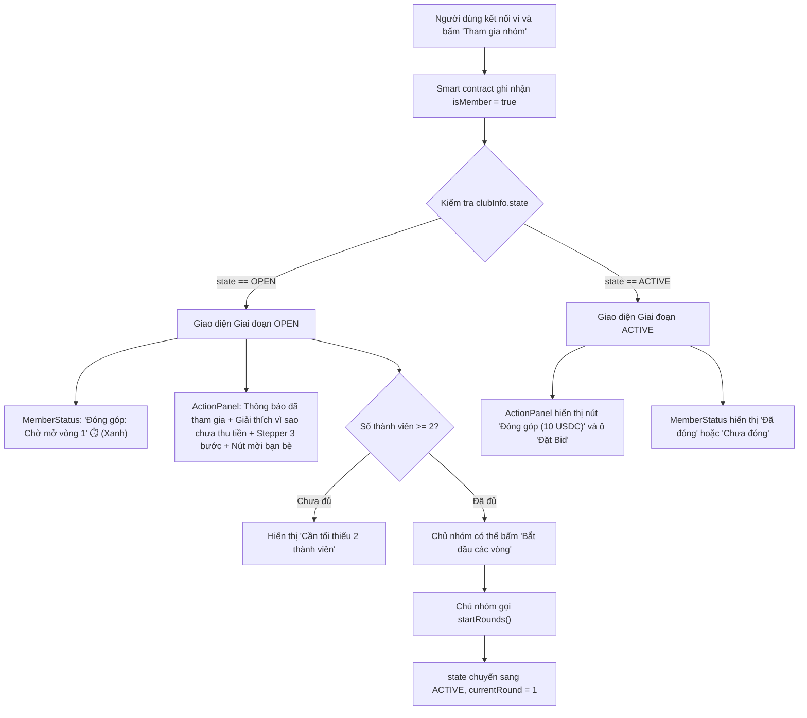

# Business Specification: Cải tiến Trải nghiệm Giao diện Trạng thái Đóng tiền & Vòng đời Giai đoạn Đăng ký (OPEN)
**Task ID**: `task-003`  
**Spec Version**: `v1.0`  
**Tác giả (BA)**: `ba-agent`  
**Trạng thái**: `Verified`  

---

## 1. Tổng quan & Giá trị (Problem & Value)

### 1.1. Vấn đề cần giải quyết (Problem Statement)
Sau khi người dùng kết nối ví và bấm "Tham gia nhóm" (`joinGroup`), họ gặp phải trải nghiệm khó hiểu và hoang mang về mặt tài chính:
1. **Hiểu lầm "Chưa đóng tiền" trong thẻ Trạng thái**: Thẻ `MemberStatus` hiển thị mục Đóng góp là **"Chưa đóng"** kèm icon cảnh báo màu vàng (`AlertCircle`), khiến người dùng ngộ nhận rằng họ đang trễ hạn hoặc phải nộp tiền ngay lập tức.
2. **Không thấy nút nộp tiền / đóng hụi**: Người dùng tìm kiếm nút đóng tiền trên toàn bộ trang nhưng không thấy bất kỳ nút hay ô nhập số tiền nào, dẫn đến câu hỏi phản ánh: *"sao tôi tham gia rồi nhưng không thấy chỗ đóng tiền"*.
3. **Thiếu thông tin giải thích cơ chế Hụi on-chain**: Smart contract `RotatingSavings.sol` quy định giai đoạn `OPEN` chỉ là ghi danh thành viên (`currentRound = 0`). Tiền đóng hụi (10 USDC) chỉ bắt đầu thu theo từng vòng khi Vòng 1 chính thức được Chủ nhóm khởi động (`startRounds()`) sau khi nhóm có tối thiểu 2 thành viên. Giao diện trước đây chưa truyền tải quy tắc này tới người dùng.
4. **Thiếu hỗ trợ mời thành viên**: Người dùng không biết nhóm đang cần thêm bao nhiêu người để có thể bắt đầu đóng tiền, và không có nút chia sẻ lời mời nhanh ngay tại bảng hành động.

### 1.2. Giá trị mang lại (Value Proposition)
- **Minh bạch tài chính & Xóa bỏ hoang mang**: Người dùng hiểu rõ tại sao chưa phải nộp tiền, khi nào cần nộp tiền và tiền được quản lý ra sao.
- **Trải nghiệm Onboarding mượt mà (Seamless UX Stepper)**: Hiển thị thanh tiến trình 3 bước trực quan: *#1 Ghi danh thành công* → *#2 Chờ đủ tối thiểu 2 thành viên & Chủ nhóm bắt đầu* → *#3 Mở cổng đóng tiền & Đấu giá Vòng 1*.
- **Tương tác cộng đồng**: Bổ sung nút sao chép link mời bạn bè 1-click ngay trong bảng hành động để thúc đẩy nhóm nhanh chóng đạt điều kiện mở vòng.
- **Đồng bộ hóa 100% giữa Web3 Wallet và Passkey Smart Wallet**: Đảm bảo cả hai loại ví đều có trải nghiệm nhất quán, trực quan.

### 1.3. Đối tượng sử dụng (Actors)
- **Thành viên mới gia nhập (Joined Member)**: Người đã gọi `joinGroup()`, cần biết lộ trình tiếp theo và thời điểm nộp tiền.
- **Chủ nhóm (Group Owner)**: Cần biết khi nào đủ điều kiện bấm "Bắt đầu các vòng" để kích hoạt nộp tiền cho cả nhóm.
- **Khách xem công khai (Guest)**: Người chuẩn bị tham gia, nắm được quy chế nộp tiền theo vòng.

### 1.4. Phạm vi (Scope)
- **Trong phạm vi (In-Scope)**:
  - Cập nhật `MemberStatus.tsx`: Nhận prop `state`, khi `state === GROUP_STATE.OPEN` hiển thị "Đóng góp: Chờ mở vòng 1" (icon `Clock`, màu xanh lam trung tính), chỉ hiển thị "Đã đóng"/"Chưa đóng" khi `state === GROUP_STATE.ACTIVE`.
  - Cập nhật `ActionPanel.tsx`: Khi `state === GROUP_STATE.OPEN` và `isMember === true`, hiển thị thông báo đã tham gia thành công, khối giải thích *"Vì sao chưa thấy chỗ đóng tiền?"*, tiến trình 3 bước và nút *"Sao chép link mời bạn bè"*.
  - Cập nhật `PasskeyActionPanel.tsx`: Đồng bộ trải nghiệm tương tự cho người dùng Passkey/Smart Wallet.
  - Cập nhật `ClubCard.tsx`: Bổ sung chỉ báo tiến độ thành viên chi tiết (`X/10 TV — Cần tối thiểu 2 TV để mở vòng`).
  - Cập nhật `App.tsx`: Truyền `state={clubInfo.state}` vào `MemberStatus`.
- **Ngoài phạm vi (Out-of-Scope)**:
  - Sửa đổi smart contract đã deploy trên Arc Testnet.

---

## 2. Quy tắc nghiệp vụ (Business Rules - BR)

- **BR-01 (Open State Contribution Status)**: Khi nhóm ở trạng thái `OPEN` (`state === 0`), không được hiển thị nhãn "Chưa đóng" hoặc icon cảnh báo vàng. Bắt buộc hiển thị trạng thái "Chờ mở vòng 1" với icon đồng hồ trung tính.
- **BR-02 (Clear Lifecycle Guidance)**: Bảng hành động khi thành viên đã tham gia trong trạng thái `OPEN` phải giải thích rõ ràng lý do chưa thu tiền (thu theo vòng khi `ACTIVE`) và điều kiện mở vòng (tối thiểu 2 thành viên + Chủ nhóm kích hoạt).
- **BR-03 (Invite Capability)**: Cung cấp tính năng sao chép liên kết mời thành viên với thông báo toast phản hồi trực quan.
- **BR-04 (Zero Regression)**: Toàn bộ 26 test assertions hiện có và quy trình build Vite không bị ảnh hưởng.

---

## 3. Luồng nghiệp vụ (Workflow Mermaid)

---

## 4. Yêu cầu chi tiết & Tiêu chí nghiệm thu (REQ & AC)

### REQ-01: Cải tiến trạng thái Đóng góp trong MemberStatus
- **AC-01.1**: Khi `state === GROUP_STATE.OPEN`, ô Đóng góp hiển thị tiêu đề "Đóng góp", nội dung phụ "Chờ mở vòng 1", sử dụng icon `Clock` và màu xanh lam/trung tính, không hiển thị icon cảnh báo `AlertCircle` màu vàng.
- **AC-01.2**: Khi `state === GROUP_STATE.ACTIVE`, ô Đóng góp hiển thị "Đã đóng" (xanh lá) nếu `hasContributed === true`, hoặc "Chưa đóng" (vàng) nếu `hasContributed === false`.
- **AC-01.3**: Prop `state?: number` được khai báo trong `MemberStatusProps` và được `App.tsx` truyền đầy đủ.

### REQ-02: Bảng giải thích & Lộ trình Vòng đời trong ActionPanel
- **AC-02.1**: Khi `state === GROUP_STATE.OPEN` và `isMember === true`, `ActionPanel` hiển thị thẻ chúc mừng "Bạn đã là thành viên của nhóm!".
- **AC-02.2**: `ActionPanel` hiển thị khối giải thích "Vì sao chưa thấy chỗ đóng tiền?" giải thích rõ tiền hụi thu theo vòng khi Vòng 1 bắt đầu.
- **AC-02.3**: `ActionPanel` hiển thị lộ trình 3 bước: 1. Đủ tối thiểu 2 thành viên -> 2. Chủ nhóm bấm bắt đầu -> 3. Nút Đóng góp & Đặt Bid xuất hiện.
- **AC-02.4**: `ActionPanel` cung cấp nút sao chép link mời gia nhập nhóm kèm thông báo phản hồi (copy toast).

### REQ-03: Đồng bộ PasskeyActionPanel cho Smart Wallet
- **AC-03.1**: `PasskeyActionPanel` hiển thị thông điệp giải thích tương tự khi `state === GROUP_STATE.OPEN` và `isMember === true`.

### REQ-04: Cải tiến thông tin sức chứa trong ClubCard
- **AC-04.1**: `ClubCard` hiển thị rõ số thành viên hiện tại và điều kiện mở vòng (ví dụ: `1/10 Thành viên (Cần tối thiểu 2 để mở vòng)`).

---

## 5. Bảng Ma trận Đối chiếu (Traceability Matrix)

| Yêu cầu (REQ) | Tiêu chí (AC) | Thành phần thực hiện | Kiểm thử (Test TC) | Trạng thái |
| :--- | :--- | :--- | :--- | :--- |
| REQ-01 | AC-01.1 | `src/components/savings/MemberStatus.tsx` | TC-OPEN-01 | Verified |
| REQ-01 | AC-01.2 | `src/components/savings/MemberStatus.tsx` | TC-OPEN-02 | Verified |
| REQ-01 | AC-01.3 | `src/App.tsx`, `MemberStatus.tsx` | TC-OPEN-03 | Verified |
| REQ-02 | AC-02.1 | `src/components/savings/ActionPanel.tsx` | TC-OPEN-04 | Verified |
| REQ-02 | AC-02.2 | `src/components/savings/ActionPanel.tsx` | TC-OPEN-05 | Verified |
| REQ-02 | AC-02.3 | `src/components/savings/ActionPanel.tsx` | TC-OPEN-06 | Verified |
| REQ-02 | AC-02.4 | `src/components/savings/ActionPanel.tsx` | TC-OPEN-07 | Verified |
| REQ-03 | AC-03.1 | `src/components/savings/PasskeyActionPanel.tsx` | TC-OPEN-08 | Verified |
| REQ-04 | AC-04.1 | `src/components/savings/ClubCard.tsx` | TC-OPEN-09 | Verified |
