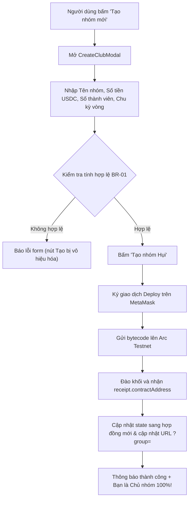

# Business Specification: Tính năng Tạo Nhóm Hụi Mới (Create New Savings Club)
**Task ID**: `task-004`  
**Spec Version**: `v1.0`  
**Tác giả (BA)**: `ba-agent`  
**Trạng thái**: `Ready for Development`  

---

## 1. Tổng quan & Giá trị (Problem & Value)

### 1.1. Vấn đề cần giải quyết (Problem Statement)
Trước đây, người dùng chỉ có thể tham gia vào các nhóm Hụi đã được triển khai sẵn từ trước (hoặc thông qua địa chỉ cố định / query param `?group=0x...`). Khi người dùng muốn tự mình lập một nhóm hụi riêng cho bạn bè, người thân hoặc cộng đồng của mình:
1. Không có giao diện để người dùng tự khởi tạo một nhóm mới.
2. Người dùng bị phụ thuộc vào nhóm mẫu do hệ thống tạo sẵn mà họ không phải là Chủ nhóm (`Owner`).
3. Thiếu khả năng tùy chỉnh các thông số vận hành quan trọng: Tên nhóm, mức tiền đóng mỗi vòng (USDC), số lượng thành viên tối đa (2 - 20 người), và chu kỳ vòng (1 giờ, 1 ngày, 3 ngày, 7 ngày).

### 1.2. Giá trị mang lại (Value Proposition)
- **Trao quyền làm Chủ nhóm 100% (Decentralized Ownership)**: Bất kỳ ai kết nối ví Web3 đều có thể tự tạo nhóm hụi riêng. Ví của người tạo mặc nhiên là Chủ nhóm (`Owner`) on-chain.
- **Tùy biến linh hoạt (Customizable Parameters)**: Cho phép cấu hình tên nhóm, số tiền đóng hụi linh hoạt (5, 10, 20, 50 USDC...), số người (2 - 20) và chu kỳ theo nhu cầu thực tế.
- **Trải nghiệm 1-Click Trustless Deployment**: Sử dụng `useDeployContract` từ wagmi để triển khai trực tiếp smart contract `RotatingSavings.sol` lên Arc Testnet mà không qua bất kỳ máy chủ trung gian nào.
- **Chuyển đổi nhóm tự động**: Sau khi tạo nhóm thành công, ứng dụng tự động chuyển ngay sang nhóm vừa tạo và cung cấp liên kết chia sẻ để mời bạn bè tham gia.

### 1.3. Đối tượng sử dụng (Actors)
- **Người tạo nhóm (Club Creator / Owner)**: Người dùng kết nối ví và khởi tạo nhóm mới, trở thành Chủ nhóm.
- **Thành viên được mời (Invitees)**: Những người nhận được link nhóm mới tạo và tham gia đóng hụi.

### 1.4. Phạm vi (Scope)
- **Trong phạm vi (In-Scope)**:
  - Cung cấp `ROTATING_SAVINGS_BYTECODE` trong `src/contract.ts`.
  - Xây dựng component `CreateClubModal.tsx` với form nhập liệu chuẩn, tính toán Pot tối đa dự kiến, và cơ chế deploy contract on-chain.
  - Tích hợp nút mở modal "Tạo nhóm mới" trong `GroupSwitcher.tsx` và `Header.tsx`.
  - Quản lý đóng/mở modal và tự động cập nhật URL `?group=` sau khi deploy thành công trong `App.tsx`.
- **Ngoài phạm vi (Out-of-Scope)**:
  - Sửa đổi logic mã nguồn Solidity `RotatingSavings.sol`.

---

## 2. Quy tắc nghiệp vụ (Business Rules - BR)

- **BR-01 (Input Validation)**:
  - Tên nhóm: Không được để trống, tối đa 32 ký tự.
  - Số tiền đóng góp: Phải > 0 USDC, quy đổi sang 6 decimals qua `parseUsdc`.
  - Số thành viên tối đa: Nằm trong khoảng từ 2 đến 20 người (theo ràng buộc constructor `maxMembers_ >= 2 && maxMembers_ <= 20`).
  - Chu kỳ vòng: Lựa chọn từ danh sách hợp lệ (1 giờ = 3600s, 1 ngày = 86400s, 3 ngày = 259200s, 7 ngày = 604800s).
- **BR-02 (Trustless Deployment)**: Hợp đồng được triển khai trực tiếp từ ví người dùng qua giao dịch EVM chuẩn. Người gọi mặc nhiên là `owner()` của hợp đồng mới.
- **BR-03 (Auto Switch & Share Link)**: Khi giao dịch deploy hoàn tất và có `receipt.contractAddress`, hệ thống tự động:
  - Chuyển `currentAddress` sang hợp đồng mới và cập nhật URL `history.pushState`.
  - Hiển thị toast chúc mừng kèm liên kết xem trên Arc Explorer.
  - Đóng modal tạo nhóm.

---

## 3. Luồng nghiệp vụ (Workflow Mermaid)

---

## 4. Yêu cầu chi tiết & Tiêu chí nghiệm thu (REQ & AC)

### REQ-01: Form & Validation Tạo nhóm Hụi (CreateClubModal)
- **AC-01.1**: Form có các trường: Tên nhóm (`groupName`), Số tiền đóng góp (`contributionAmount`), Số thành viên tối đa (`maxMembers`), Chu kỳ vòng (`roundDuration`).
- **AC-01.2**: Tự động tính toán và hiển thị Quỹ Pot tối đa dự kiến: `Pot = contributionAmount * maxMembers USDC`.
- **AC-01.3**: Validate chặt chẽ: `groupName` không rỗng, `contributionAmount > 0`, `maxMembers` từ 2 đến 20, vô hiệu hóa nút submit khi form không hợp lệ.

### REQ-02: Quy trình Triển khai Smart Contract On-chain
- **AC-02.1**: `src/contract.ts` export `ROTATING_SAVINGS_BYTECODE` chuẩn `0x` hex string.
- **AC-02.2**: Gọi `deployContract` với `abi: ROTATING_SAVINGS_ABI`, `bytecode: ROTATING_SAVINGS_BYTECODE`, `args: [USDC_ADDRESS, parseUsdc(...), BigInt(maxMembers), BigInt(roundDuration), groupName]`.
- **AC-02.3**: Xử lý đầy đủ trạng thái pending (chờ ký ví) và confirming (đang đào khối trên blockchain).

### REQ-03: Hoàn tất & Tự động Chuyển đổi Nhóm
- **AC-03.1**: Sau khi giao dịch deploy thành công, gọi callback `onSuccess(receipt.contractAddress)`.
- **AC-03.2**: `App.tsx` tự động chuyển sang địa chỉ mới, cập nhật URL `?group=` và hiển thị thông báo chúc mừng kèm link explorer.

### REQ-04: Tích hợp Giao diện Nút Mở Modal
- **AC-04.1**: `GroupSwitcher.tsx` cung cấp nút "Tạo nhóm mới" nổi bật.
- **AC-04.2**: `Header.tsx` cung cấp nút "Tạo nhóm" trên thanh điều hướng.

---

## 5. Bảng Ma trận Đối chiếu (Traceability Matrix)

| Yêu cầu (REQ) | Tiêu chí (AC) | Thành phần thực hiện | Kiểm thử (Test TC) | Trạng thái | Bằng chứng kiểm thử |
| :--- | :--- | :--- | :--- | :--- | :--- |
| REQ-01 | AC-01.1 | `src/components/savings/CreateClubModal.tsx` | TC-CREATE-01 | **Verified** | `docs/qa/task-004/test-report.md#tc-create-01` |
| REQ-01 | AC-01.2 | `src/components/savings/CreateClubModal.tsx` | TC-CREATE-02 | **Verified** | `docs/qa/task-004/test-report.md#tc-create-02` |
| REQ-01 | AC-01.3 | `src/components/savings/CreateClubModal.tsx` | TC-CREATE-03 | **Verified** | `docs/qa/task-004/test-report.md#tc-create-03` |
| REQ-02 | AC-02.1 | `src/contract.ts` | TC-CREATE-04 | **Verified** | `docs/qa/task-004/test-report.md#tc-create-04` |
| REQ-02 | AC-02.2 | `src/components/savings/CreateClubModal.tsx` | TC-CREATE-05 | **Verified** | `docs/qa/task-004/test-report.md#tc-create-05` |
| REQ-02 | AC-02.3 | `src/components/savings/CreateClubModal.tsx` | TC-CREATE-06 | **Verified** | `docs/qa/task-004/test-report.md#tc-create-06` |
| REQ-03 | AC-03.1 | `src/components/savings/CreateClubModal.tsx` | TC-CREATE-07 | **Verified** | `docs/qa/task-004/test-report.md#tc-create-07` |
| REQ-03 | AC-03.2 | `src/App.tsx` | TC-CREATE-08 | **Verified** | `docs/qa/task-004/test-report.md#tc-create-08` |
| REQ-04 | AC-04.1 | `src/components/savings/GroupSwitcher.tsx` | TC-CREATE-09 | **Verified** | `docs/qa/task-004/test-report.md#tc-create-09` |
| REQ-04 | AC-04.2 | `src/components/savings/Header.tsx` | TC-CREATE-10 | **Verified** | `docs/qa/task-004/test-report.md#tc-create-10` |

---

## 6. Kết luận Nghiệm thu BA (Gate 4 Signoff)
- **Độ bao phủ nghiệp vụ**: 10/10 AC (100%) đã được kiểm thử và xác minh độc lập.
- **Tính toàn vẹn mã nguồn**: 100% khớp SHA256 manifest `docs/manifests/task-004/manifest.json`.
- **Hồi quy**: 35/35 bài test cũ tiếp tục pass 100%.
- **Build**: Vite production build pass (exit code 0).
- **Kết luận**: Đủ điều kiện để Leader nghiệm thu Gate 5.

