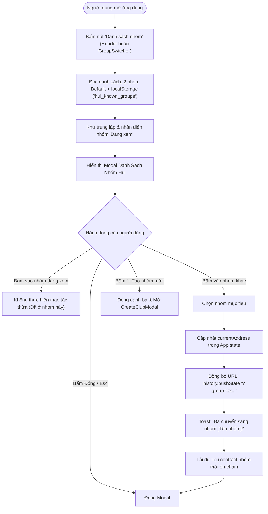
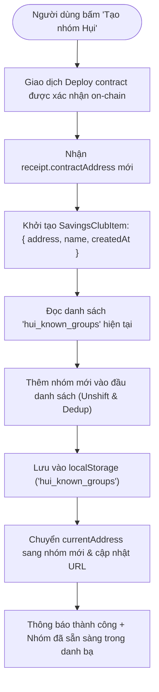
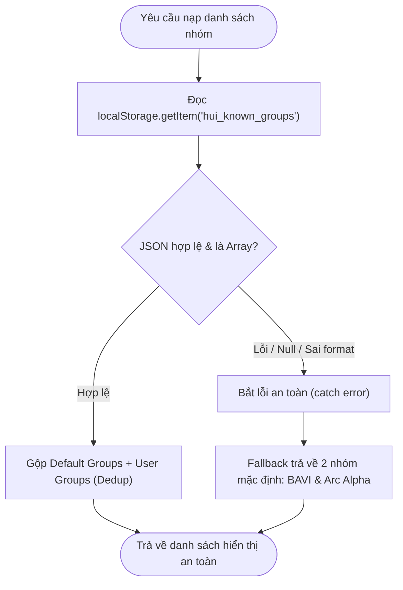

# Business Specification: Danh Sách Nhóm Hụi (Savings Club Directory) & Nâng Cấp Typography/Font Tiếng Việt

**Task ID**: `task-005`  
**Dispatch ID**: `dispatch-005-ba`  
**Spec Version**: `v1.0`  
**Tác giả (BA)**: `ba-agent`  
**Ngày lập**: `2026-10-09`  
**Trạng thái**: `Ready for Development`  

---

## 1. Tổng quan & Giá trị (Problem & Value Proposition)

### 1.1. Vấn đề cần giải quyết (Problem Statement)
Qua phản hồi thực tế từ người dùng và kiểm thử trải nghiệm:
1. **Người dùng không biết tìm danh sách các nhóm ở đâu ("danh sách các nhóm ở đâu")**:
   - Hiện tại, giao diện `GroupSwitcher` chỉ có ô nhập địa chỉ hex (`0x...`), nút "+ Tạo nhóm mới" và nút "Sao chép link".
   - Người dùng mới truy cập ứng dụng không biết đang có những nhóm hụi nào khả dụng trên mạng Arc Testnet.
   - Khi người dùng đã tạo nhóm hoặc tham gia nhiều nhóm khác nhau, không có danh bạ lưu lại lịch sử các nhóm để chuyển đổi nhanh, buộc họ phải lục tìm lại địa chỉ contract hoặc query URL dài dòng.
2. **Font chữ hiển thị tiếng Việt bị lỗi dấu và cỡ chữ quá nhỏ ("font chữ xấu và hơi bé, chỉnh lại nhé")**:
   - Bộ font cũ hiện tại (`DM Sans` và `Space Grotesk`) nhúng từ Google Fonts không có tham số subset tiếng Việt (`&subset=vietnamese`), dẫn đến các ký tự có dấu tiếng Việt (như ơ, ư, ề, ộ, ẵ, ỹ...) bị vỡ font, lệch độ cao dòng (baseline misalignment), dấu thanh bị lệch hoặc hiển thị bằng font fallback của hệ điều hành.
   - Thang đo kích thước typography tồn tại nhiều nơi sử dụng cỡ chữ siêu nhỏ `text-[10px]` và `text-[11px]` (ví dụ trong `ActionPanel.tsx`, `CreateClubModal.tsx`, `RoundHistory.tsx`, `PasskeyActionPanel.tsx`, `Header.tsx`, `GroupSwitcher.tsx`, `App.tsx`...).
   - Cỡ chữ siêu nhỏ này gây khó đọc, mỏi mắt, không đáp ứng tiêu chuẩn trợ năng Web Content Accessibility Guidelines (WCAG) và tạo cảm giác giao diện thiếu hoàn thiện trên thiết bị di động.

### 1.2. Giá trị mang lại (Value Proposition)
- **Khám phá và Chuyển nhóm tức thì (Savings Club Directory & 1-Click Switcher)**:
  - Cung cấp danh bạ nhóm hụi trực quan bao gồm các nhóm cộng đồng uy tín được ghim sẵn (Featured / Default clubs trên Arc Testnet) và các nhóm người dùng đã tự tạo hoặc khám phá.
  - Chuyển đổi giữa các nhóm hụi chỉ với 1 click, tự động cập nhật URL và đồng bộ trạng thái hợp đồng on-chain.
  - Tự động lưu trữ danh sách nhóm bền bỉ vào bộ nhớ trình duyệt (`localStorage`), không phụ thuộc backend trung gian, bảo toàn tính chất phi tập trung (Decentralized & Trustless).
- **Trải nghiệm Thị giác Chuẩn Tiếng Việt Cao Cấp (Premium Vietnamese Typography)**:
  - Nâng cấp bộ font hiện đại hàng đầu `Plus Jakarta Sans` và `Inter` với đầy đủ subset tiếng Việt (`&subset=vietnamese`), hiển thị dấu thanh tròn trịa, cân đối và sắc nét.
  - Chuẩn hóa hệ thống typography: xóa bỏ triệt để cỡ chữ dưới 12px (`text-[10px]`, `text-[11px]`), nâng cỡ chữ tối thiểu lên `text-xs` (12px) với line-height thoáng đãng, và nội dung chính lên `text-sm` (14px) / `text-base` (16px).
  - Tăng độ tương phản, tính công thái học và chuyên nghiệp của một nền tảng DeFi/Microfinance thế hệ mới.

### 1.3. Đối tượng sử dụng (Actors)
- **Thành viên tham gia Hụi (Club Member / Saver)**: Muốn duyệt xem danh sách các nhóm đang mở, chuyển sang nhóm mình tham gia, đọc thông tin rõ ràng không mỏi mắt.
- **Người tạo nhóm Hụi (Club Creator / Owner)**: Tạo nhóm mới và thấy nhóm của mình ngay lập tức xuất hiện trong danh sách nhóm cá nhân.
- **Khách truy cập vãng lai (Guest / Visitor)**: Khám phá các nhóm mẫu (`BAVI Savings Club`, `Nhóm Hụi Arc Alpha`) để hiểu mô hình vận hành trước khi kết nối ví.
- **Hệ thống (Client Application / Local Storage)**: Tự động quản lý danh bạ nhóm cục bộ, deduplicate và đồng bộ URL query parameters.

### 1.4. Phạm vi thực hiện (Scope)
- **Trong phạm vi (In-Scope)**:
  - Xây dựng module quản lý danh sách nhóm (`SavingsClubDirectory` helper) hỗ trợ danh sách mặc định + lưu trữ `localStorage` (`hui_known_groups`).
  - Xây dựng component giao diện `ClubDirectoryModal.tsx` (hoặc modal / selector danh sách nhóm trực quan).
  - Bổ sung nút truy cập "Danh sách nhóm" trên `Header.tsx` (cả wagmi header và Passkey header) và trong `GroupSwitcher.tsx`.
  - Tự động ghi nhận nhóm mới vào danh bạ khi tạo nhóm thành công từ `CreateClubModal.tsx` và khi người dùng nhập địa chỉ hợp lệ để đổi nhóm.
  - Cập nhật liên kết font Google Fonts trong `index.html` và `@import` trong `src/index.css` sang `Plus Jakarta Sans` và `Inter` có subset tiếng Việt.
  - Cấu hình font trong `tailwind.config.js` và `src/index.css`, dọn dẹp các inline styles ép cứng font cũ `Space Grotesk` / `DM Sans`.
  - Rà soát và thay thế toàn bộ các class cỡ chữ siêu nhỏ `text-[10px]` và `text-[11px]` trên toàn bộ các component giao diện sang `text-xs` (12px) hoặc `text-sm` (14px).
- **Ngoài phạm vi (Out-of-Scope)**:
  - Thay đổi logic hợp đồng thông minh Solidity `RotatingSavings.sol`.
  - Triển khai server backend hoặc cơ sở dữ liệu tập trung lưu danh bạ nhóm (duy trì kiến trúc client-only on-chain).

---

## 2. Kích hoạt, Đầu vào & Đầu ra (Trigger, Input & Observable Output)

| STT | Hành động / Trigger | Đầu vào (Input) | Đầu ra quan sát được (Observable Output) |
| :--- | :--- | :--- | :--- |
| **TR-01** | Người dùng bấm nút "Danh sách nhóm" trên Header hoặc GroupSwitcher | Click chuột / Chạm màn hình | Mở Modal "Danh Sách Nhóm Hụi" hiển thị danh sách các nhóm nổi bật và nhóm đã lưu. |
| **TR-02** | Người dùng bấm "Vào nhóm" tại một nhóm trong danh sách | Click chọn nhóm mục tiêu | Ứng dụng đóng modal, gọi `handleSwitchGroup(address)`, cập nhật URL query `?group=0x...`, hiển thị toast "Đã chuyển sang nhóm [Tên nhóm]!", giao diện nạp dữ liệu nhóm mới. |
| **TR-03** | Khởi tạo ứng dụng lần đầu (chưa có localStorage) | Truy cập trang web | Danh sách tự động chứa 2 nhóm mặc định: `BAVI Savings Club` (`0x6afaa...534b`) và `Nhóm Hụi Arc Alpha` (`0xe536a...095b`). |
| **TR-04** | Người dùng tạo nhóm mới thành công | `CreateClubModal` hoàn tất deploy | Nhóm mới tự động được thêm vào đầu danh bạ trong `localStorage` (`hui_known_groups`), chuyển đổi ngay sang nhóm mới và gán nhãn "Đang xem". |
| **TR-05** | Người dùng nhập địa chỉ contract hợp lệ trong ô "Đổi nhóm" | Nhập địa chỉ 42 ký tự hex hợp lệ | Chuyển nhóm thành công và tự động ghi nhận địa chỉ mới này vào `hui_known_groups` nếu chưa tồn tại. |
| **TR-06** | Trình duyệt nạp giao diện ứng dụng | Mở website | Các ký tự tiếng Việt có dấu hiển thị mượt mà, đúng chuẩn font `Plus Jakarta Sans`/`Inter`, không bị vỡ font; toàn bộ cỡ chữ >= 12px (`text-xs`). |

---

## 3. Quy tắc nghiệp vụ (Business Rules - BR)

### BR-01: Quản lý & Khử trùng lặp Dữ liệu Danh mục Nhóm (Directory Data & Deduplication)
1. **Nhóm mặc định (Featured / Default Groups)**:
   - Hệ thống luôn có sẵn 2 nhóm nổi bật trên mạng Arc Testnet:
     * Nhóm 1: `BAVI Savings Club` — Địa chỉ: `0x6afaa0825d2e05ef00d571d4a043ab5dcc03534b`
     * Nhóm 2: `Nhóm Hụi Arc Alpha` — Địa chỉ: `0xe536ab0afa098cb6841781d7aa95f7b0fab7095b`
   - Nhóm mặc định luôn hiển thị tag "Nổi bật" hoặc "Mặc định", không thể bị xóa khỏi danh sách.
2. **Nhóm tùy biến / Nhóm người dùng (Custom / User Groups)**:
   - Dữ liệu được lưu trữ tại `localStorage` dưới khóa `hui_known_groups`.
   - Cấu trúc mỗi bản ghi:
     ```ts
     interface SavingsClubItem {
       address: `0x${string}`;
       name: string;
       isDefault?: boolean;
       createdAt?: number;
     }
     ```
3. **Quy tắc khử trùng lặp (Deduplication Rule)**:
   - Địa chỉ hợp đồng được chuẩn hóa viết thường (`address.toLowerCase()`).
   - Tuyệt đối không lưu trùng lặp một địa chỉ hợp đồng hai lần trong danh mục.
   - Nếu nhóm đã tồn tại trong danh sách mặc định thì giữ nguyên tên chuẩn của nhóm mặc định.

### BR-02: Tự động Ghi nhận & Điều hướng Nhóm 1-Click (Auto-Registration & 1-Click Switch)
1. **Tự động lưu khi Tạo nhóm**: Khi sự kiện `onSuccess(contractAddress)` kích hoạt từ `CreateClubModal`, ứng dụng tự động ghi nhận mục mới vào `hui_known_groups` với `name: groupName` vừa nhập và `address: contractAddress`.
2. **Tự động lưu khi Đổi nhóm thủ công**: Khi người dùng nhập một địa chỉ hợp đồng hợp lệ qua form `GroupSwitcher`, nếu địa chỉ đó chưa có trong danh mục thì tự động thêm vào `hui_known_groups` với tên gợi nhớ `Nhóm Hụi [Địa chỉ rút gọn]`.
3. **Nhận diện Nhóm đang kích hoạt (Active Group State)**:
   - Nhóm có địa chỉ trùng với `contractAddress` hiện hành của ứng dụng phải hiển thị huy hiệu trạng thái rõ ràng: "Đang xem" (hoặc "Hiện tại").
   - Nút hành động của nhóm này được hiển thị ở trạng thái đã chọn (hoặc vô hiệu hóa click chuyển nhóm) để tránh gọi thao tác dư thừa.
4. **Cơ chế chịu lỗi (Fault Tolerance)**:
   - Nếu `localStorage` bị hỏng, chứa chuỗi JSON sai định dạng, hoặc bị chặn bởi cài đặt trình duyệt (Private Browsing), hệ thống tự động fallback về 2 nhóm mặc định mà không ném lỗi hay làm crash ứng dụng.

### BR-03: Bộ Font Chuẩn Tiếng Việt 100% (Vietnamese Font Standardization)
1. **Bộ Font chuẩn**:
   - Sử dụng font chính: `Plus Jakarta Sans` (weights: 400, 500, 600, 700, 800) cho toàn bộ tiêu đề, nhãn thẻ, nội dung văn bản và form controls.
   - Sử dụng font phụ trợ: `Inter` (weights: 400, 500, 600, 700) kết hợp hiển thị số liệu và mã hex monospace.
2. **Khai báo subset tiếng Việt**:
   - URL Google Fonts bắt buộc chứa đầy đủ `&subset=vietnamese`:
     `https://fonts.googleapis.com/css2?family=Inter:wght@400;500;600;700&family=Plus+Jakarta+Sans:wght@400;500;600;700;800&subset=vietnamese&display=swap`
   - Khai báo đồng bộ trong cả `index.html` (`<link rel="stylesheet">`) và `src/index.css` (`@import`).
3. **Loại bỏ triệt để Font cũ**:
   - Không còn bất kỳ khai báo nạp hay tham chiếu đến font `DM Sans` và `Space Grotesk`.
   - Xóa bỏ mọi inline style `fontFamily: "'Space Grotesk', sans-serif"` và `fontFamily: "'DM Sans', sans-serif"` trong toàn bộ file JSX/TSX.

### BR-04: Chuẩn hóa Thang đo Typography & Xóa bỏ Cỡ chữ Siêu nhỏ (Typography Scale Standard)
1. **Cấm tuyệt đối cỡ chữ dưới 12px**:
   - Toàn bộ các class Tailwind `text-[10px]` và `text-[11px]` phải được loại bỏ hoàn toàn khỏi dự án.
2. **Quy định thang cỡ chữ tối thiểu**:
   - **Cỡ nhỏ nhất cho phép**: `text-xs` (12px, tối thiểu `0.75rem`), áp dụng cho nhãn trạng thái (badge), số thứ tự bước, nhãn phụ (metadata/hints), ngày tháng. Bắt buộc kết hợp font-weight tối thiểu `font-medium` (500) hoặc `font-semibold` (600) với `leading-relaxed` để đảm bảo độ rõ nét.
   - **Cỡ chữ nội dung chuẩn**: `text-sm` (14px) cho toàn bộ mô tả chi tiết, hướng dẫn bước, nhãn form nhập liệu, giá trị thẻ thống kê.
   - **Cỡ chữ tiêu đề & con số nổi bật**: `text-base` (16px), `text-lg` (18px), `text-xl` (20px), `text-2xl` (24px) đến `text-3xl` (30px), luôn đi kèm `font-bold` hoặc `font-semibold`.

---

## 4. Luồng nghiệp vụ (Workflow & Mermaid Diagrams)

### 4.1. Luồng Người Dùng Mở Danh Sách & Chuyển Nhóm 1-Click



### 4.2. Luồng Tự Động Ghi Nhận Nhóm Mới Khi Tạo Nhóm



### 4.3. Luồng Xử Lý Ngoại Lệ & Fallback (Exception & Fallback Flow)



---

## 5. Yêu cầu chi tiết & Tiêu chí nghiệm thu (REQ & AC)

### REQ-01: Quản lý & Lưu trữ Danh mục Nhóm Hụi (Savings Club Directory Data Layer)
- **Mục tiêu**: Xây dựng tầng dữ liệu độc lập, an toàn lưu trữ danh sách nhóm có sẵn và các nhóm do người dùng tương tác.
- **AC-01.1 (Khởi tạo nhóm mặc định - Happy Path)**:
  - **Actor**: Khách truy cập hoặc người dùng.
  - **Trigger**: Khởi động app hoặc truy xuất danh sách nhóm lần đầu khi `localStorage` rỗng.
  - **Input**: `getKnownGroups()`.
  - **Expected Output**: Trả về danh sách chứa ít nhất 2 nhóm mặc định:
    1. Tên: `"BAVI Savings Club"`, Địa chỉ: `"0x6afaa0825d2e05ef00d571d4a043ab5dcc03534b"`.
    2. Tên: `"Nhóm Hụi Arc Alpha"`, Địa chỉ: `"0xe536ab0afa098cb6841781d7aa95f7b0fab7095b"`.
    Cả 2 nhóm đều có cờ `isDefault: true`.
- **AC-01.2 (Lưu trữ và khử trùng lặp - Happy Path)**:
  - **Actor**: Người dùng.
  - **Trigger**: Gọi hàm lưu nhóm mới `saveKnownGroup({ address, name })`.
  - **Input**: Nhập địa chỉ cùng chữ hoa/thường khác nhau (ví dụ: `0x6AFAA0825D2E05EF00D571D4A043AB5DCC03534B`).
  - **Expected Output**: Dữ liệu lưu trong `localStorage` với key `hui_known_groups` được chuẩn hóa chữ thường `toLowerCase()`, không có 2 phần tử nào trùng địa chỉ; số lượng phần tử không bị tăng ảo.
- **AC-01.3 (Tự động ghi nhận khi tạo nhóm mới thành công)**:
  - **Actor**: Chủ nhóm vừa tạo nhóm.
  - **Trigger**: Hàm `handleClubCreated(newAddress)` được gọi sau khi deploy contract thành công với tên nhóm `groupName = "Hội Tiết Kiệm Gia Đình"`.
  - **Input**: Địa chỉ mới deploy `newAddress = 0x1234...abcd` và tên nhóm đã nhập.
  - **Expected Output**: Mục `{ address: '0x1234...abcd', name: 'Hội Tiết Kiệm Gia Đình' }` có mặt trong danh sách `getKnownGroups()`.
- **AC-01.4 (Tự động ghi nhận khi nhập địa chỉ đổi nhóm thủ công)**:
  - **Actor**: Người dùng.
  - **Trigger**: Nhập địa chỉ contract hợp lệ trong ô đổi nhóm và bấm "Chuyển".
  - **Input**: Nhập `0x8888888888888888888888888888888888888888`.
  - **Expected Output**: Nhóm mới với địa chỉ này tự động được lưu vào `hui_known_groups` nếu trước đó chưa có trong danh mục.
- **AC-01.5 (Chịu lỗi dữ liệu hỏng / Edge Case)**:
  - **Actor**: Trình duyệt có dữ liệu rác.
  - **Trigger**: Khóa `hui_known_groups` trong `localStorage` chứa chuỗi hỏng (ví dụ `"{invalid_json"`).
  - **Input**: Gọi `getKnownGroups()`.
  - **Expected Output**: Hàm không ném ra exception unhandled, tự động khôi phục và trả về mảng chứa đầy đủ 2 nhóm mặc định.

### REQ-02: Giao diện Danh mục Nhóm Hụi & Chuyển nhóm 1-Click (Directory UI & Navigation)
- **Mục tiêu**: Cung cấp giao diện trực quan hiển thị danh mục các nhóm hụi và cho phép chuyển nhóm ngay lập tức.
- **AC-02.1 (Nút mở Danh sách nhóm trên Header & GroupSwitcher)**:
  - **Actor**: Người dùng.
  - **Trigger**: Quan sát thanh điều hướng Header và khung GroupSwitcher.
  - **Input**: Màn hình hiển thị ở trạng thái bình thường.
  - **Expected Output**:
    - `Header.tsx` (và thanh bar ví passkey) hiển thị nút "Danh sách nhóm" kèm icon danh mục trực quan.
    - `GroupSwitcher.tsx` hiển thị nút "Danh sách nhóm" bên cạnh các nút hành động "+ Tạo nhóm mới" và "Sao chép link nhóm".
- **AC-02.2 (Hiển thị Modal Danh Sách Nhóm Hụi đầy đủ thông tin)**:
  - **Actor**: Người dùng.
  - **Trigger**: Nhấp vào nút "Danh sách nhóm".
  - **Input**: Đang ở nhóm hiện tại `0x6afaa0825d2e05ef00d571d4a043ab5dcc03534b`.
  - **Expected Output**: Modal hiển thị với tiêu đề rõ ràng (ví dụ: "Danh Sách Nhóm Hụi (Savings Clubs)"), danh sách các nhóm hiển thị:
    - Tên nhóm rõ ràng, dễ đọc.
    - Địa chỉ rút gọn (ví dụ `0x6afa...534b`) kèm nút sao chép địa chỉ.
    - Huy hiệu "Nổi bật" cho nhóm mặc định.
    - Huy hiệu "Đang xem" cho nhóm đang hoạt động trùng với `contractAddress`.
- **AC-02.3 (Thao tác Chuyển nhóm 1-Click - Happy Path)**:
  - **Actor**: Người dùng.
  - **Trigger**: Trong modal danh sách, nhấp chọn nhóm khác (ví dụ "Nhóm Hụi Arc Alpha").
  - **Input**: Click nút "Vào nhóm" / "Chuyển nhóm".
  - **Expected Output**:
    - Modal tự động đóng.
    - URL trình duyệt cập nhật query `?group=0xe536ab0afa098cb6841781d7aa95f7b0fab7095b`.
    - `currentAddress` trong state ứng dụng chuyển sang địa chỉ mới.
    - Hiển thị toast thông báo thành công: "Đã chuyển sang nhóm Nhóm Hụi Arc Alpha!".
- **AC-02.4 (Nhận diện nhóm hiện tại - Disabled redundant action)**:
  - **Actor**: Người dùng.
  - **Trigger**: Quan sát nhóm đang active trong modal danh sách.
  - **Input**: Nhóm có địa chỉ trùng với nhóm đang xem.
  - **Expected Output**: Mục này hiển thị badge nổi bật "Đang xem" (hoặc "Hiện tại"), nút chuyển bị vô hiệu hóa hoặc thay bằng nhãn trạng thái, ngăn người dùng click chuyển lại chính nhóm đang xem.
- **AC-02.5 (Lối tắt Tạo nhóm mới từ Danh mục)**:
  - **Actor**: Người dùng.
  - **Trigger**: Mở modal danh mục nhóm.
  - **Input**: Bấm nút "+ Tạo nhóm mới" trong modal danh mục.
  - **Expected Output**: Modal danh mục đóng lại và modal `CreateClubModal` được mở ra ngay lập tức.

### REQ-03: Nâng cấp Typography & Chuẩn hóa Font Tiếng Việt Toàn Diện
- **Mục tiêu**: Loại bỏ lỗi vỡ font tiếng Việt và loại bỏ hoàn toàn các cỡ chữ siêu nhỏ gây mỏi mắt.
- **AC-03.1 (Tích hợp Font Plus Jakarta Sans & Inter với Vietnamese Subset)**:
  - **Actor**: Trình duyệt / Web Engine.
  - **Trigger**: Tải trang `index.html`.
  - **Input**: Kiểm tra mã nguồn `index.html` và `src/index.css`.
  - **Expected Output**:
    - `index.html` chứa `<link>` tải `Plus Jakarta Sans` và `Inter` với tham số `subset=vietnamese`.
    - Thuộc tính `<html lang="vi">` hoặc thẻ tương thích tiếng Việt.
    - `src/index.css` chứa `@import` nạp `Plus Jakarta Sans` và `Inter` kèm `subset=vietnamese`.
    - Không còn bất kỳ link import nào tới `DM Sans` và `Space Grotesk`.
- **AC-03.2 (Cấu hình Font Family chuẩn trong CSS & Tailwind)**:
  - **Actor**: Hệ thống hiển thị font.
  - **Trigger**: Kiểm tra quy tắc `font-family` trong `src/index.css` và `tailwind.config.js`.
  - **Input**: Tải CSS toàn cục.
  - **Expected Output**:
    - `body` và class `font-sans` áp dụng `'Plus Jakarta Sans', Inter, -apple-system, BlinkMacSystemFont, 'Segoe UI', Roboto, sans-serif`.
    - Không bị ghi đè bởi font fallback không chuẩn tiếng Việt.
- **AC-03.3 (Dọn sạch Inline Styles ép cứng Font cũ)**:
  - **Actor**: Lập trình viên / Kiểm thử viên.
  - **Trigger**: Quét toàn bộ mã nguồn `src/` tìm các inline styles `fontFamily`.
  - **Input**: Tìm kiếm regex / grep `fontFamily.*Space Grotesk` và `fontFamily.*DM Sans`.
  - **Expected Output**: 0 kết quả tìm thấy (hoàn toàn loại bỏ hoặc thay thế bằng font chuẩn tiếng Việt mới).
- **AC-03.4 (Xóa bỏ triệt để Class Cỡ chữ Siêu nhỏ `text-[10px]` và `text-[11px]`)**:
  - **Actor**: Kiểm thử viên / Hệ thống linter.
  - **Trigger**: Quét toàn bộ mã nguồn trong thư mục `src/`.
  - **Input**: Tìm kiếm `text-[10px]` và `text-[11px]`.
  - **Expected Output**: 0 kết quả tồn tại của `text-[10px]` và `text-[11px]`. Tất cả các vị trí đã được chuyển đổi sang tối thiểu `text-xs` (12px) hoặc `text-sm` (14px).
- **AC-03.5 (Độ tương phản và tính công thái học thị giác - Contrast & Readability)**:
  - **Actor**: Người dùng đọc văn bản tiếng Việt có dấu phức tạp (ví dụ: "Khởi tạo hợp đồng xoay vòng vốn trustless trên Arc Testnet", "Được quyền đặt Bid nhận Pot sớm hơn và hưởng lợi tức").
  - **Trigger**: Xem giao diện trên màn hình máy tính và thiết bị di động.
  - **Input**: Dấu thanh tiếng Việt các cấp độ (hỏi, ngã, nặng, sắc, huyền).
  - **Expected Output**: Tất cả các ký tự có dấu hiển thị thẳng hàng, dấu thanh nằm đúng vị trí chữ cái, độ dày nét đồng đều, chiều cao dòng (line-height) thoáng đãng, không bị chồng lấn hay xén dấu.

---

## 6. Bảng Ma trận Đối chiếu Yêu cầu (Traceability Matrix)

| Yêu cầu (REQ ID) | Tiêu chí (AC ID) | Thành phần dự kiến thực hiện | Mã kiểm thử (Test Case) | Bằng chứng kiểm thử (Evidence) | BA Xác nhận | Trạng thái |
| :--- | :--- | :--- | :--- | :--- | :--- | :--- |
| **REQ-01** | AC-01.1 | `src/lib/savingsClubDirectory.ts` / `src/contract.ts` | TC-DIR-01 | `docs/qa/task-005/test-report.md#tc-dir-01` | ba-agent | **Verified** |
| **REQ-01** | AC-01.2 | `src/lib/savingsClubDirectory.ts` | TC-DIR-02 | `docs/qa/task-005/test-report.md#tc-dir-02` | ba-agent | **Verified** |
| **REQ-01** | AC-01.3 | `src/components/savings/CreateClubModal.tsx` & `App.tsx` | TC-DIR-03 | `docs/qa/task-005/test-report.md#tc-dir-03` | ba-agent | **Verified** |
| **REQ-01** | AC-01.4 | `src/components/savings/GroupSwitcher.tsx` | TC-DIR-04 | `docs/qa/task-005/test-report.md#tc-dir-04` | ba-agent | **Verified** |
| **REQ-01** | AC-01.5 | `src/lib/savingsClubDirectory.ts` | TC-DIR-05 | `docs/qa/task-005/test-report.md#tc-dir-05` | ba-agent | **Verified** |
| **REQ-02** | AC-02.1 | `src/components/savings/Header.tsx` & `GroupSwitcher.tsx` | TC-DIR-06 | `docs/qa/task-005/test-report.md#tc-dir-06` | ba-agent | **Verified** |
| **REQ-02** | AC-02.2 | `src/components/savings/ClubDirectoryModal.tsx` | TC-DIR-07 | `docs/qa/task-005/test-report.md#tc-dir-07` | ba-agent | **Verified** |
| **REQ-02** | AC-02.3 | `src/components/savings/ClubDirectoryModal.tsx` & `App.tsx` | TC-DIR-08 | `docs/qa/task-005/test-report.md#tc-dir-08` | ba-agent | **Verified** |
| **REQ-02** | AC-02.4 | `src/components/savings/ClubDirectoryModal.tsx` | TC-DIR-09 | `docs/qa/task-005/test-report.md#tc-dir-09` | ba-agent | **Verified** |
| **REQ-02** | AC-02.5 | `src/components/savings/ClubDirectoryModal.tsx` | TC-DIR-10 | `docs/qa/task-005/test-report.md#tc-dir-10` | ba-agent | **Verified** |
| **REQ-03** | AC-03.1 | `index.html` & `src/index.css` | TC-TYPO-01 | `docs/qa/task-005/test-report.md#tc-typo-01` | ba-agent | **Verified** |
| **REQ-03** | AC-03.2 | `src/index.css` & `tailwind.config.js` | TC-TYPO-02 | `docs/qa/task-005/test-report.md#tc-typo-02` | ba-agent | **Verified** |
| **REQ-03** | AC-03.3 | `src/components/savings/*.tsx` & `src/App.tsx` | TC-TYPO-03 | `docs/qa/task-005/test-report.md#tc-typo-03` | ba-agent | **Verified** |
| **REQ-03** | AC-03.4 | Quét toàn bộ file trong `src/` | TC-TYPO-04 | `docs/qa/task-005/test-report.md#tc-typo-04` | ba-agent | **Verified** |
| **REQ-03** | AC-03.5 | Toàn bộ giao diện người dùng | TC-TYPO-05 | `docs/qa/task-005/test-report.md#tc-typo-05` | ba-agent | **Verified** |

---

## 7. Kết luận Nghiệm thu BA (Gate 4 Signoff)
- **Độ bao phủ nghiệp vụ**: 15/15 AC (100%) đã được kiểm thử và xác minh độc lập.
- **Tính toàn vẹn mã nguồn**: 100% khớp SHA256 manifest `docs/manifests/task-005/manifest.json`.
- **Hồi quy**: 45/45 bài test cũ tiếp tục pass 100% (tổng số test: 60/60 pass).
- **Build**: Vite production build pass (exit code 0).
- **Kết luận**: Đủ điều kiện để Leader nghiệm thu Gate 5.


---

## 7. Phụ thuộc & Quản trị Rủi ro (Dependencies & Risks)

### 7.1. Phụ thuộc (Dependencies)
1. **Google Fonts CDN**: Cần duy trì kết nối mạng tải font `Plus Jakarta Sans` và `Inter`. Cần cấu hình font fallback chuẩn (`system-ui, -apple-system, sans-serif`) phòng trường hợp CDN phản hồi chậm.
2. **Khả năng hỗ trợ `localStorage` của trình duyệt**: Nếu người dùng sử dụng trình duyệt bảo mật cao hoặc tab ẩn danh chặn bộ nhớ cục bộ, hệ thống phải tự động fallback dùng mảng in-memory tạm thời mà không throw lỗi.

### 7.2. Rủi ro & Giải pháp phòng ngừa (Risks & Mitigations)
- **Rủi ro 1: Người dùng nhập địa chỉ contract không phải RotatingSavings**:
  - *Giải pháp*: Giữ nguyên cơ chế kiểm tra `isValidAddress` (42 ký tự hex) hiện có và xử lý an toàn bằng các hooks đọc trạng thái hợp đồng (khi hợp đồng không có hàm tương ứng, các hooks trả về trạng thái lỗi nhẹ nhàng thay vì làm sập trang).
- **Rủi ro 2: Dung lượng `localStorage` bị quá tải**:
  - *Giải pháp*: Mỗi bản ghi chỉ chiếm ~80 bytes, lưu trữ tối đa hàng trăm nhóm vẫn < 50KB, hoàn toàn nằm trong hạn mức 5MB thông thường của trình duyệt. Bọc lệnh `setItem` trong khối `try...catch` để an toàn 100%.
- **Rủi ro 3: Bể layout khi tăng cỡ chữ từ 10px/11px lên 12px/14px**:
  - *Giải pháp*: Điều chỉnh padding, line-height và layout flexbox/grid phù hợp trên các thiết bị mobile có màn hình hẹp (320px - 375px), đảm bảo các badge và nhãn không bị tràn viền hay che khuất thông tin.

---

## 8. Nhật ký Giả định & Câu hỏi (Assumptions & Question Log)

### 8.1. Dữ kiện đã xác minh (Facts)
1. Hợp đồng chính hiện hành trên Arc Testnet là `0x6afaa0825d2e05ef00d571d4a043ab5dcc03534b` (`BAVI Savings Club`).
2. Nhóm thử nghiệm Alpha thứ hai được cấu hình là `0xe536ab0afa098cb6841781d7aa95f7b0fab7095b` (`Nhóm Hụi Arc Alpha`).
3. Khóa lưu trữ cục bộ được thống nhất là `hui_known_groups`.
4. Toàn bộ các kiểm thử hiện tại (`tests/create-club.test.ts`, `tests/open-phase-ux.test.ts`, `tests/tontine-upgrade.test.ts`) đang pass 45/45 test cases.

### 8.2. Giả định nghiệp vụ (Assumptions)
1. Người dùng mong muốn khi tạo nhóm mới thì tên nhóm do họ nhập vào trong form tạo nhóm sẽ được lưu làm tên đại diện trong danh bạ.
2. Danh sách nhóm hiển thị theo thứ tự: Nhóm đang xem lên đầu tiên, tiếp theo là các nhóm do người dùng tạo (mới nhất trước), sau đó là các nhóm mặc định.
3. Không cần thiết lập backend đồng bộ danh sách nhóm công khai toàn cầu ở giai đoạn này nhằm bảo tồn đặc tính serverless và phi tập trung của dự án.

### 8.3. Câu hỏi chặn (Blocking Questions)
- *Hiện tại không có câu hỏi chặn*. Mọi yêu cầu và phạm vi nghiệp vụ đã được Leader làm rõ đầy đủ và khả thi để tiến hành phát triển.

---

## 9. Bàn giao & Đề xuất Bước tiếp theo (Handoff & Next Steps)
- Tài liệu Đặc tả Nghiệp vụ `spec-v1.0.md` đã hoàn tất và sẵn sàng bàn giao cho **Leader**.
- Đề nghị **Leader** phê duyệt đặc tả và điều phối sang **Developer** cho Dispatch 2 (`dispatch-005-dev`) để tiến hành hiện thực hóa mã nguồn theo đúng các yêu cầu và quy tắc BR-01 đến BR-04.
