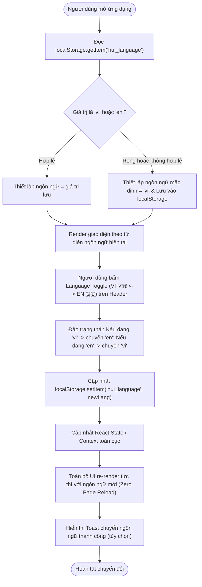
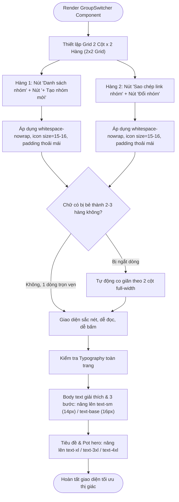

# Business Specification: Hỗ Trợ Song Ngữ Anh - Việt (i18n English/Vietnamese) & Phóng To Cỡ Chữ, Tinh Chỉnh Bố Cục Trực Quan (Large Typography & Visual Layout UX)

**Task ID**: `task-006`  
**Dispatch ID**: `dispatch-006-ba`  
**Spec Version**: `v1.0`  
**Tác giả (BA)**: `ba-agent`  
**Ngày lập**: `2026-10-09`  
**Trạng thái**: `Ready for Development`  

---

## 1. Tổng quan & Giá trị (Problem & Value Proposition)

### 1.1. Phân tích Hiện trạng từ Ảnh chụp Màn hình Thực tế (`w817ZpdgzNbm.webp`)
Dựa trên phản hồi trực tiếp từ người dùng ("chữ vẫn quá bé" và "thêm ngôn ngữ tiếng anh cho t") kết hợp thẩm định hình ảnh giao diện thực tế tại URL `https://capture.avada.io/i/w817ZpdgzNbm` (môi trường Arc Testnet live):

1. **Vấn đề 1: Bố cục nút bấm trong khung `GroupSwitcher` bị co cụm và gãy dòng nghiêm trọng ("chữ vẫn quá bé")**:
   - Khung "HỢP ĐỒNG NHÓM HỤI" ở góc phải hiển thị 4 nút hành động ("Danh sách nhóm", "+ Tạo nhóm mới", "Sao chép link nhóm", "Đổi nhóm") trong cùng một hàng flex hẹp (khoảng 350px).
   - Hệ quả trực quan: Các nút bị co cụm bề ngang khiến chữ bị bẻ vụn thành 2 đến 3 hàng cụt ngủn:
     - Nút 1: `"Danh \n sách \n nhóm"`
     - Nút 2: `"+ \n + Tạo \n nhóm \n mới"`
     - Nút 3: `"Sao chép \n link \n nhóm"`
     - Nút 4: `"Đổi \n nhóm"`
   - Kích thước chữ trên nút (`text-xs` ~ 12px) kết hợp icon bé (12-13px) tạo cảm giác vụn vặt, khó nhìn và đặc biệt khó thao tác chuẩn xác trên thiết bị di động hay màn hình cảm ứng.
2. **Vấn đề 2: Cỡ chữ quá bé trên các khối nội dung trọng tâm và thiếu tính phân cấp thị giác**:
   - **Thẻ ActionPanel (Giai đoạn đăng ký - OPEN)**:
     - Đoạn giải thích *"Vì sao chưa thấy chỗ đóng tiền?"* và quy trình 3 bước tiếp theo (*"1. Chờ nhóm có tối thiểu 2 thành viên tham gia"*, *"2. Chủ nhóm bấm 'Bắt đầu các vòng'..."*, *"3. Nút 'Đóng góp (10.00 USDC)'..."*) đang sử dụng cỡ chữ `text-xs` (12px), độ tương phản xám nhạt (`text-slate-600`), chiếm không gian lọt thỏm trong thẻ, buộc người dùng phải căng mắt đọc.
   - **Thẻ trạng thái cá nhân (MemberStatus)**:
     - Khối *"Thành viên - Đã tham gia"* và *"Đóng góp - Chờ mở vòng 1"* có font chữ nhỏ (12px), padding mỏng manh, chưa tạo được ấn tượng trực quan mạnh mẽ về trạng thái tài chính của người dùng.
   - **Thẻ tổng quan nhóm (ClubCard)**:
     - Các nhãn quan trọng như *"Tổng Pot vòng này"*, *"Đóng góp cố định: 10.00 USDC / thành viên / vòng"*, *"Tổng quỹ tối đa (khi đủ 100%)"*, thanh tiến độ *"Sức chứa thành viên (2/10) • Đủ điều kiện bắt đầu"*, và 3 ô thống kê ("2/10 Thành viên", "Chưa chạy Vòng hiện tại", "— Thời gian vòng") vẫn còn nhiều nhãn phụ ở kích cỡ nhỏ 12px, độ tương phản chưa tối ưu trên nền gradient tím.
   - **Thẻ Lịch sử các vòng (RoundHistory) & Cách hoạt động (HowItWorksCard)**:
     - Nhiều đoạn mô tả luật chơi, cơ chế bảo vệ vốn và trạng thái trống (empty state) đang ở cỡ chữ 12px, cần được nâng cấp đồng bộ lên font to, rõ nét (14px - 16px).
3. **Vấn đề 3: Thiếu hoàn toàn khả năng hỗ trợ Tiếng Anh (i18n English/Vietnamese)**:
   - Giao diện hiện tại 100% hardcode tiếng Việt.
   - Người dùng quốc tế, các đối tác thử nghiệm Arc Testnet toàn cầu hoặc người dùng quen thuộc với giao diện Web3 tiếng Anh không thể đọc hiểu luật chơi, các bước tham gia, cũng như các thông báo trạng thái on-chain.
   - Thanh Header chưa có nút công tắc chuyển đổi ngôn ngữ (Language Toggle).
   - Chưa có tầng dữ liệu từ điển song ngữ (i18n dictionary) đồng bộ giữa UI components và các thông báo phản hồi (toast notifications).

### 1.2. Giá trị mang lại (Value Proposition)
- **Trải nghiệm Thị giác Công thái học & Chữ to Rõ ràng (Ergonomic Large Typography & Balanced Layout)**:
  - Tái cấu trúc khung `GroupSwitcher`: Bố cục chia thành lưới 2 cột x 2 hàng (2x2 grid) thoáng đãng, các nhãn hiển thị trọn vẹn trên 1 dòng duy nhất (`whitespace-nowrap`), icon lớn (15-16px), diện tích bấm rộng rãi đạt chuẩn tiếp cận di động.
  - Nâng cấp toàn diện thang đo font chữ: Body text cơ bản và các đoạn hướng dẫn nâng lên `text-sm` (14-15px) và `text-base` (16px); tiêu đề nâng lên `text-xl` (20px), `text-2xl` (24px) đến `text-3xl` (30px); số liệu Pot đạt `text-4xl` (36px).
  - Tăng độ tương phản màu sắc chữ trên mọi nền thẻ (trắng, slate, xanh gradient).
- **Mở rộng Toàn cầu hóa với Song ngữ Anh - Việt Mượt mà (Seamless English/Vietnamese i18n)**:
  - Bổ sung nút chuyển đổi ngôn ngữ (Language Toggle `VI 🇻🇳 | EN 🇬🇧`) nổi bật trên Header (cả MetaMask wagmi header và Passkey header).
  - Lưu trạng thái ngôn ngữ bền bỉ trong `localStorage` với key `hui_language` (mặc định `"vi"`).
  - Chuyển đổi ngôn ngữ tức thì trong 1 click, không reload trang, phản hồi mượt mà 100% các thành phần: nhãn, nút bấm, hướng dẫn, thẻ thống kê, modal và thông báo toast.
  - Chuẩn hóa hệ thống thuật ngữ tài chính vi mô xoay vòng (DeFi Rotating Savings & Credit Association - ROSCA / Susu / Tontine) chuẩn xác bằng tiếng Anh.

---

## 2. Đối tượng sử dụng & Phạm vi (Actors & Scope)

### 2.1. Đối tượng sử dụng (Actors)
- **Người dùng Việt Nam (Vietnamese Member / Owner)**: Trải nghiệm giao diện tiếng Việt cỡ chữ to, rõ nét, không bị ngắt vụn chữ ở các nút thao tác.
- **Người dùng Quốc tế (International Member / English Speaker)**: Chuyển sang tiếng Anh để hiểu đầy đủ quy trình góp vốn, đấu giá pot, và các điều khoản an toàn on-chain.
- **Chủ nhóm (Savings Club Owner)**: Dễ dàng điều khiển và theo dõi trạng thái nhóm với nhãn chữ lớn, rõ ràng ở cả hai ngôn ngữ.
- **Hệ thống Ứng dụng Phía Client (i18n & LocalStorage Manager)**: Quản lý từ điển song ngữ, đồng bộ hóa lựa chọn ngôn ngữ qua `localStorage` (`hui_language`), tự động hydrate khi nạp trang.

### 2.2. Phạm vi thực hiện (Scope)

#### Trong phạm vi (In-Scope):
1. **Module Đa ngôn ngữ (i18n Module & Dictionary)**:
   - Xây dựng module/context `i18n` quản lý ngôn ngữ `vi` (Tiếng Việt) và `en` (English), lưu trữ tại `localStorage` với khóa `hui_language` (fallback `"vi"`).
   - Xây dựng từ điển song ngữ bao phủ 100% các chuỗi văn bản của:
     - `Header.tsx` (cả 2 thanh header).
     - `GroupSwitcher.tsx` (nhãn contract, 4 nút, form đổi nhóm).
     - `ClubCard.tsx` (trạng thái nhóm, tổng Pot, đóng góp cố định, sức chứa, 3 ô thống kê).
     - `MemberStatus.tsx` (trạng thái thành viên, đóng góp, bid, thắng, loại, nút claim).
     - `ActionPanel.tsx` & `PasskeyActionPanel.tsx` (kết nối ví, cảnh báo mạng, giai đoạn OPEN, giải thích quy trình 3 bước, form đóng hụi & bid vòng ACTIVE).
     - `RoundHistory.tsx` (tiêu đề, trạng thái trống, danh sách các vòng đã tất toán).
     - `HowItWorksCard.tsx` (4 bước quy trình vận hành, cảnh báo bảo vệ quỹ).
     - `CreateClubModal.tsx` (tiêu đề, nhãn form, preset buttons, nút deploy, helper texts).
     - `ClubDirectoryModal.tsx` (tiêu đề, thẻ nhóm, nhãn nổi bật, nút vào nhóm).
     - `OnboardingScreen.tsx` (tiêu đề, giới thiệu passkey, form đăng ký/đăng nhập).
     - `App.tsx` (OwnerControls, PendingOwner banner, Explorer links, thông báo Toast).
2. **Nút Chuyển đổi Ngôn ngữ (Language Toggle UI)**:
   - Tích hợp công tắc chuyển ngôn ngữ `VI 🇻🇳 / EN 🇬🇧` trực quan trên thanh `Header.tsx` (kề bên các nút hành động).
   - Đảm bảo hiển thị gọn gàng, đẹp mắt trên cả màn hình Desktop và Mobile.
3. **Tái cấu trúc Bố cục `GroupSwitcher.tsx`**:
   - Thay đổi bố cục 4 nút hành động: Không ép dồn 4 nút vào 1 hàng co cụm.
   - Áp dụng cấu trúc lưới 2 cột x 2 hàng (2x2 grid) hoặc flex wrap 2 hàng cân đối.
   - Thêm thuộc tính `whitespace-nowrap` để chữ không bị ngắt dòng 2-3 hàng.
   - Nâng kích thước icon lên 14-16px, padding nút bấm rộng rãi, dễ bấm.
4. **Phóng to Cỡ chữ Toàn diện (Large Typography Upgrade)**:
   - Nâng cấp cỡ chữ đoạn giải thích *"Vì sao chưa thấy chỗ đóng tiền?"* và 3 bước quy trình trong `ActionPanel` / `PasskeyActionPanel` từ 12px lên `text-sm` (14px) / `text-base` (16px), tăng độ đậm và độ tương phản.
   - Nâng cấp cỡ chữ tiêu đề nhãn *"HỢP ĐỒNG NHÓM HỤI"*, số dư USDC và địa chỉ ví trong `GroupSwitcher` và Header.
   - Nâng cấp cỡ chữ các nhãn trong `ClubCard`, `MemberStatus`, `RoundHistory`, `HowItWorksCard`, `CreateClubModal`, `ClubDirectoryModal`.
   - Đảm bảo tuân thủ tiêu chuẩn cỡ chữ tối thiểu: không còn văn bản nội dung nào dưới 12px, toàn bộ văn bản đọc hiểu (body copy) tối thiểu 14px.

#### Ngoài phạm vi (Out-of-Scope):
- Thay đổi logic hợp đồng thông minh Solidity `RotatingSavings.sol`.
- Cài đặt các thư viện i18n bên ngoài quá nặng (như react-i18next với nhiều dependencies phụ thuộc); giải pháp triển khai là React hook / Context TypeScript nội bộ, gọn nhẹ, zero-dependency bổ sung, tối ưu bundle size.

---

## 3. Quy tắc nghiệp vụ (Business Rules - BR)

### BR-01: Quản lý Trạng thái & Lưu trữ Ngôn ngữ (Language State & Persistence)
1. **Khóa lưu trữ**: Sử dụng khóa `hui_language` trong `localStorage`.
2. **Ngôn ngữ mặc định**: Khi người dùng truy cập lần đầu hoặc `localStorage` rỗng/hỏng, hệ thống bắt buộc đặt mặc định là `"vi"` (Tiếng Việt).
3. **Giá trị hợp lệ**: Chỉ chấp nhận `"vi"` hoặc `"en"`. Mọi giá trị khác đều tự động chuẩn hóa về `"vi"`.
4. **Đồng bộ thời gian thực**: Khi người dùng nhấn nút chuyển ngôn ngữ, giao diện cập nhật ngay lập tức cho toàn bộ các component đang mount mà không cần làm mới trang (`window.location.reload()`).

### BR-02: Chuẩn hóa Thuật ngữ Song ngữ Anh - Việt (Bilingual Terminology Mapping)
Bảng quy chuẩn thuật ngữ nghiệp vụ thống nhất xuyên suốt toàn bộ ứng dụng:

| Khái niệm nghiệp vụ | Tiếng Việt (`vi`) | English (`en`) | Ghi chú ngữ cảnh |
| :--- | :--- | :--- | :--- |
| **Tên thương hiệu** | HụiChain | HụiChain | Giữ nguyên thương hiệu |
| **Khái niệm cốt lõi** | Nhóm Hụi / Hụi Xoay Vòng | Savings Club / Rotating Savings Club | Chuẩn ROSCA quốc tế |
| **Mạng hoạt động** | Mạng Arc Testnet | Arc Testnet | Giữ nguyên |
| **Chủ nhóm** | Chủ nhóm (Owner) | Club Owner | Người tạo và kích hoạt vòng |
| **Vòng hụi** | Vòng {N} / Vòng hiện tại | Round {N} / Current Round | Chu kỳ góp vốn |
| **Quỹ vòng** | Tổng Pot vòng này | Total Pot this round | Tổng tiền góp của vòng |
| **Mức đóng góp** | Đóng góp cố định | Fixed Contribution | Số tiền mỗi thành viên đóng |
| **Sức chứa** | Sức chứa thành viên | Member Capacity | Số lượng thành viên tối đa |
| **Đấu giá hốt hụi** | Đấu giá hốt hụi / Đặt Bid | Bid for Pot / Place Bid | Cơ chế đấu giá nhận pot sớm |
| **Lợi tức chia thưởng** | Lợi tức thưởng từ Bid | Dividend Yield from Bids | Lợi tức chia đều cho người chưa thắng |
| **Tất toán** | Tất toán vòng | Settle Round | Kết thúc vòng và trả thưởng |
| **Trạng thái OPEN** | Mở nhận thành viên | Open for Members | Giai đoạn ghi danh |
| **Trạng thái ACTIVE** | Đang diễn ra | Active | Các vòng đang chạy |
| **Trạng thái COMPLETED**| Đã hoàn thành | Completed | Hụi kết thúc đủ các vòng |
| **Trạng thái CANCELLED**| Đã hủy | Cancelled | Nhóm bị hủy khi chưa bắt đầu |
| **Bị loại do trễ hạn**| Bị loại (Kicked) | Kicked (Defaulted) | Thành viên không đóng hụi |
| **Danh mục nhóm** | Danh sách nhóm | Club Directory | Danh bạ các nhóm khả dụng |
| **Tạo nhóm mới** | + Tạo nhóm mới | + Create New Club | Thao tác deploy contract |
| **Sao chép link** | Sao chép link nhóm | Copy Club Link | Sao chép URL kèm query |
| **Đổi nhóm** | Đổi nhóm | Switch Club | Nhập địa chỉ contract khác |

### BR-03: Tiêu chuẩn Tái cấu trúc Bố cục `GroupSwitcher` (Anti-Cramping Standard)
1. **Cấm ép 4 nút vào 1 hàng hẹp**: Tuyệt đối không đặt 4 nút hành động vào 1 hàng flex đơn lẻ trên màn hình có chiều rộng card <= 480px khiến chữ bị bẻ thành 2-3 dòng.
2. **Cấu trúc Lưới 2 Cột x 2 Hàng (2x2 Grid)**:
   - Hàng 1: Nút `Danh sách nhóm` (Club Directory) và Nút `+ Tạo nhóm mới` (+ Create Club).
   - Hàng 2: Nút `Sao chép link` (Copy Link) và Nút `Đổi nhóm` (Switch Club).
3. **Quy tắc hiển thị chữ trọn vẹn**:
   - Tất cả các nút bấm trong `GroupSwitcher` phải chứa thuộc tính CSS ngăn ngắt chữ (`whitespace-nowrap`).
   - Chiều cao nút tối thiểu 38px - 42px (`py-2.5 px-3` hoặc `py-2 px-3.5`).
   - Icon trên nút bấm có kích thước tối thiểu `14px - 16px` (thay vì 12-13px cũ).

### BR-04: Thang đo Typography Phóng To & Độ Tương Phản (Large Typography Scale)
1. **Văn bản Nội dung Đọc hiểu (Body Text / Explanations / Roadmap)**:
   - Đoạn giải thích *"Vì sao chưa thấy chỗ đóng tiền?"* và 3 bước quy trình tiếp theo phải nâng lên cỡ chữ `text-sm` (14px) hoặc `text-base` (16px).
   - Line-height đạt mức `leading-relaxed` (1.625) để người dùng đọc dễ chịu, không mỏi mắt.
   - Màu sắc chữ đạt chuẩn WCAG tương phản: tiêu đề khối `text-slate-900 font-bold`, nội dung mô tả `text-slate-700 font-normal / medium`.
2. **Hệ thống Tiêu đề (Headings Scale)**:
   - Tiêu đề Card chính (`ClubCard` group name): `text-2xl sm:text-3xl font-extrabold`.
   - Con số Pot (`Hero Pot Amount`): `text-3xl sm:text-4xl font-extrabold`.
   - Tiêu đề Card phân mục (`HowItWorksCard`, `RoundHistory`, `ActionPanel`, Modal Headers): `text-lg sm:text-xl font-bold`.
   - Tiêu đề phụ / Overline badges (`HỢP ĐỒNG NHÓM HỤI`, `QUY TRÌNH VẬN HÀNH`): `text-xs font-bold uppercase tracking-wider` với màu sắc rõ nét (`text-slate-500` hoặc `text-blue-600`).
3. **Cấm tuyệt đối cỡ chữ siêu nhỏ**: Tiếp tục duy trì quy tắc không sử dụng `text-[10px]` và `text-[11px]`. Cỡ nhỏ nhất cho phép trong toàn bộ ứng dụng là `text-xs` (12px), và chỉ dành riêng cho badges trạng thái hoặc metadata số ngắn.

### BR-05: Bao phủ 100% Thông báo Phản hồi & Toast Song ngữ (Full Bilingual Toast Coverage)
1. Khi người dùng đang chọn ngôn ngữ Tiếng Anh (`en`), mọi thông báo Toast xuất hiện trên màn hình (sao chép link, chuyển nhóm, deploy thành công, claim tiền, lỗi giao dịch) bắt buộc phải hiển thị bằng tiếng Anh tương ứng.
2. Khi người dùng đang chọn ngôn ngữ Tiếng Việt (`vi`), thông báo Toast hiển thị bằng tiếng Việt chuẩn ngữ nghĩa như hiện tại.
3. Không để xảy ra tình trạng giao diện tiếng Anh nhưng Toast lại hiển thị tiếng Việt hoặc ngược lại.

---

## 4. Luồng nghiệp vụ (Workflow & Mermaid Diagrams)

### 4.1. Luồng Khởi tạo Ngôn ngữ & Chuyển đổi Ngôn ngữ Tức thì



### 4.2. Luồng Bố cục GroupSwitcher & Nâng cấp Typography



### 4.3. Luồng Xử lý Ngoại lệ & Fallback Ngôn ngữ (Fault Tolerance Flow)

```mermaid
flowchart TD
    ReqKey([Yêu cầu lấy chuỗi hiển thị t('key')]) --> FindInDict{"Key có trong từ điển ngôn ngữ đang chọn?"}
    FindInDict -->|Có| ReturnStr["Trả về chuỗi tương ứng"]
    FindInDict -->|Không tìm thấy| FallbackVIKey{"Key có trong từ điển 'vi'?"}
    FallbackVIKey -->|Có| ReturnVI["Trả về chuỗi tiếng Việt dự phòng (Fallback)"]
    FallbackVIKey -->|Không có| ReturnRawKey["Trả về chính tên key để không sập UI"]
    ReturnStr --> DisplayUI([Hiển thị lên màn hình an toàn])
    ReturnVI --> DisplayUI
    ReturnRawKey --> DisplayUI
```

---

## 5. Kích hoạt, Đầu vào & Đầu ra (Trigger, Input & Observable Output)

| STT | Kích hoạt (Trigger) | Đầu vào (Input) | Đầu ra quan sát được (Observable Output) |
| :--- | :--- | :--- | :--- |
| **TR-01** | Bấm nút chuyển ngôn ngữ trên Header | Click chuột / Chạm vào Toggle | Ngôn ngữ chuyển đổi tức thì giữa `VI 🇻🇳` và `EN 🇬🇧`. Toàn bộ văn bản trên màn hình đổi sang ngôn ngữ tương ứng, `localStorage.getItem('hui_language')` lưu giá trị mới. |
| **TR-02** | Nạp ứng dụng lần đầu | Khởi động trình duyệt (chưa có localStorage) | Giao diện hiển thị mặc định bằng Tiếng Việt (`vi`), nút toggle hiển thị trạng thái `VI 🇻🇳`. |
| **TR-03** | Quan sát khung `GroupSwitcher` | Màn hình ở độ phân giải bất kỳ (mobile, tablet, desktop) | 4 nút hiển thị thoáng đãng theo lưới 2x2, chữ nằm trọn vẹn 1 hàng không bị gãy dòng, icon to rõ (15-16px). |
| **TR-04** | Thành viên đã tham gia xem thẻ `ActionPanel` ở giai đoạn OPEN | Xem phần giải thích chưa đóng tiền | Tiêu đề *"Vì sao chưa thấy chỗ đóng tiền?"* / *"Why can't I see the contribution button yet?"* hiển thị cỡ chữ 14px-16px rõ nét; 3 bước quy trình hiển thị chữ to, độ tương phản cao, dễ đọc. |
| **TR-05** | Người dùng xem thẻ `ClubCard` và `MemberStatus` | Màn hình chính | Con số Pot hiển thị to nổi bật (36px); các nhãn thống kê và badge trạng thái hiển thị to, cân đối, song ngữ đúng chuẩn. |
| **TR-06** | Người dùng thực hiện sao chép link hoặc chuyển nhóm khi đang ở chế độ `EN` | Bấm sao chép / chuyển nhóm | Toast thông báo hiển thị tiếng Anh: *"Club link copied to clipboard!"*, *"Switched to [Club Name]!"*. |
| **TR-07** | Mở modal `CreateClubModal` hoặc `ClubDirectoryModal` khi ở `EN` | Bấm nút mở modal | Toàn bộ tiêu đề modal, nhãn trường nhập liệu, nút preset và nút submit hiển thị bằng tiếng Anh tự nhiên. |

---

## 6. Yêu cầu chi tiết & Tiêu chí nghiệm thu (REQ & AC)

### REQ-01: Hệ thống Đa ngôn ngữ Song ngữ Anh - Việt (Bilingual i18n System & Header Toggle)
- **Mục tiêu**: Xây dựng kiến trúc đa ngôn ngữ gọn nhẹ, nhất quán, hỗ trợ đầy đủ tiếng Việt và tiếng Anh, chuyển đổi mượt mà và lưu trữ bền bỉ.
- **AC-01.1 (Khởi tạo mặc định và Lưu trữ LocalStorage - Happy Path)**:
  - **Actor**: Khách truy cập hoặc Thành viên.
  - **Trigger**: Nạp ứng dụng lần đầu khi chưa có key `hui_language`.
  - **Input**: `localStorage.getItem('hui_language')` ban đầu là `null`.
  - **Expected Output**:
    - Ngôn ngữ kích hoạt là `"vi"`.
    - Key `hui_language` được tự động ghi nhận `"vi"`.
    - Toàn bộ giao diện hiển thị bằng tiếng Việt chuẩn.
- **AC-01.2 (Nút Chuyển đổi Ngôn ngữ trên Header - Happy Path)**:
  - **Actor**: Người dùng.
  - **Trigger**: Nhấp vào nút Language Toggle trên `Header.tsx` (cả wagmi header và Passkey header).
  - **Input**: Nhấp toggle khi đang ở `"vi"`.
  - **Expected Output**:
    - Trạng thái ngôn ngữ chuyển sang `"en"`.
    - Nút toggle cập nhật chỉ báo trực quan (ví dụ: `EN 🇬🇧` hoặc cờ Anh nổi bật).
    - `localStorage.getItem('hui_language')` lưu giá trị `"en"`.
    - Toàn bộ giao diện chuyển sang tiếng Anh tức thì, không reload trang.
    - Nhấp lần nữa: Chuyển lại về `"vi"`, lưu `"vi"`, giao diện quay lại tiếng Việt.
- **AC-01.3 (Độ bao phủ Từ điển Song ngữ - Full Component Coverage)**:
  - **Actor**: Kiểm thử viên / Người dùng.
  - **Trigger**: Chuyển ngôn ngữ sang `en` và duyệt qua các component.
  - **Input**: Quan sát các component:
    1. `Header.tsx`: "Club Directory", "+ Create Club", "Guide", "Explorer", "Connect Wallet".
    2. `ClubCard.tsx`: "Trustless Savings Club", "Total Pot this round", "Fixed contribution: {X} USDC / member / round", "Max pool (at 100%)", "Member capacity", "Members", "Current Round", "Round Timer", "Open for Members" / "Active" / "Completed".
    3. `GroupSwitcher.tsx`: "SAVINGS CLUB CONTRACT", "Club Directory", "+ Create Club", "Copy Link", "Switch Club", "Enter contract address (Arc Testnet):", "Switch".
    4. `MemberStatus.tsx`: "Your Status", "Member - Joined", "Contribution - Waiting for Round 1" / "Contributed" / "Not contributed", "Your Bid", "Won", "Kicked", "Claimable", "Claim Payout".
    5. `ActionPanel.tsx` & `PasskeyActionPanel.tsx`: "Join Savings Club", "Registration Phase", "You are already a member! Successfully registered. The club is currently in the Registration phase (OPEN).", "Why can't I see the contribution button yet?", 3 steps roadmap, "Invite friends to meet eligibility", "Contribute Round {N}", "Place Bid".
    6. `RoundHistory.tsx`: "Round History", "List of settled and awarded rounds", "{N} rounds settled", "No rounds completed yet", "Round {N}", "Settled", "Total Pot Won", "Round Winner", "You!", "Total Bid Yield Distributed".
    7. `HowItWorksCard.tsx`: "OPERATIONAL PROCESS", "How Trustless Tontine Works", "100% On-chain Security", 4 steps (Join, Contribute, Bid, Settle), "Default-proof — Smart Fund Protection".
    8. `CreateClubModal.tsx`: "Create New Savings Club", "Deploy decentralized rotating savings contract on Arc Testnet", form labels (Club Name, Contribution Amount, Max Members, Round Duration), preset buttons, "Deploy Savings Club Contract".
    9. `ClubDirectoryModal.tsx`: "Savings Club Directory", "Featured", "Current", "Switch Club", "Copy Address".
    10. `OnboardingScreen.tsx`: "Trustless", "Gas ≈ $0", "Global", "Create Passkey Account", "Login with Passkey".
  - **Expected Output**: 100% các chuỗi văn bản nêu trên hiển thị bằng tiếng Anh chuẩn xác, không còn sót bất kỳ chuỗi tiếng Việt nào.
- **AC-01.4 (Thông báo Toast Song ngữ - Bilingual Feedback)**:
  - **Actor**: Người dùng.
  - **Trigger**: Thực hiện các hành động tạo ra toast notification (copy link, switch group, claim payout, deploy club, lỗi contract) khi đang ở chế độ `en`.
  - **Input**: Bấm nút sao chép link nhóm khi ngôn ngữ là `en`.
  - **Expected Output**: Toast hiển thị bằng tiếng Anh (ví dụ: *"Club link copied to clipboard!"* thay vì *"Đã sao chép link nhóm!"*). Tương tự cho các toast thành công và thông báo lỗi.

---

### REQ-02: Tái cấu trúc Bố cục Khung Hợp đồng Nhóm Hụi (`GroupSwitcher` Layout UX)
- **Mục tiêu**: Loại bỏ hoàn toàn tình trạng 4 nút bị nén vụn vào 1 hàng co cụm, đảm bảo chữ hiển thị trọn vẹn 1 dòng trên tất cả kích thước màn hình.
- **AC-02.1 (Bố cục Lưới 2x2 Thoáng đãng - Happy Path)**:
  - **Actor**: Người dùng.
  - **Trigger**: Quan sát component `GroupSwitcher.tsx` trên màn hình Desktop và Mobile (kích thước khung từ 320px đến 480px).
  - **Input**: Khung `GroupSwitcher` được render.
  - **Expected Output**:
    - 4 nút hành động không bị ép vào 1 hàng đơn lẻ 4 cột siêu hẹp.
    - Các nút được bố trí theo cấu trúc 2 cột x 2 hàng (hoặc flex wrap 2 hàng cân đối).
    - Hàng 1 chứa: Nút `Danh sách nhóm` (Club Directory) và Nút `+ Tạo nhóm mới` (+ Create Club).
    - Hàng 2 chứa: Nút `Sao chép link` (Copy Link) và Nút `Đổi nhóm` (Switch Club).
- **AC-02.2 (Chữ Hiển thị Trọn vẹn 1 Dòng - No Broken Words)**:
  - **Actor**: Người dùng.
  - **Trigger**: Đọc văn bản trên 4 nút bấm của `GroupSwitcher`.
  - **Input**: Chiều rộng màn hình máy tính hoặc điện thoại thông minh tiêu chuẩn (>= 360px).
  - **Expected Output**:
    - Tuyệt đối không còn tình trạng chữ bị bẻ thành 2-3 hàng cụt ngủn như ảnh chụp hiện tại (`"Danh \n sách \n nhóm"` hay `"+ \n + Tạo \n nhóm \n mới"`).
    - Toàn bộ nhãn nút nằm ngay ngắn trên một dòng duy nhất (`whitespace-nowrap`).
- **AC-02.3 (Nâng cấp Kích thước Icon & Vùng Chạm - Ergonomic Touch Target)**:
  - **Actor**: Người dùng màn hình cảm ứng / Chuột.
  - **Trigger**: Thao tác click/chạm vào các nút trong `GroupSwitcher`.
  - **Input**: Nhấn chuột hoặc chạm ngón tay.
  - **Expected Output**:
    - Kích thước icon tăng lên tối thiểu `14px - 16px` (rõ ràng, không bị chìm).
    - Padding nút bấm tối thiểu `py-2 px-3` hoặc `py-2.5 px-3.5`, vùng chạm thoải mái, hiệu ứng hover/active phản hồi rõ ràng.
- **AC-02.4 (Nâng cấp Tiêu đề Khung & Hiển thị Số Dư/Địa Chỉ)**:
  - **Actor**: Người dùng.
  - **Trigger**: Quan sát phần trên của `GroupSwitcher` và thanh trạng thái ví kề bên.
  - **Input**: Đang ở nhóm hiện tại.
  - **Expected Output**:
    - Nhãn overline `"HỢP ĐỒNG NHÓM HỤI"` / `"SAVINGS CLUB CONTRACT"` hiển thị rõ nét với độ tương phản cao (`text-slate-500 font-semibold uppercase tracking-wider`).
    - Địa chỉ hợp đồng rút gọn hiển thị bằng font mono to rõ (`text-xs font-mono font-bold text-slate-800 bg-slate-100 px-2.5 py-1 rounded-lg`).
    - Số dư USDC (`700.57 USDC`) hiển thị nổi bật, font to rõ, dễ theo dõi tài sản.

---

### REQ-03: Phóng to Cỡ chữ & Chuẩn hóa Hệ Thống Typography Trực Quan (Large Typography Scale)
- **Mục tiêu**: Khắc phục triệt để phản hồi "chữ vẫn quá bé", đảm bảo khả năng đọc thoải mái cho mọi lứa tuổi và thiết bị.
- **AC-03.1 (Phóng to Đoạn Giải thích & 3 Bước Quy trình trong ActionPanel)**:
  - **Actor**: Thành viên đã tham gia nhóm ở giai đoạn OPEN.
  - **Trigger**: Đọc khối hướng dẫn giải thích *"Vì sao chưa thấy chỗ đóng tiền?"* trong `ActionPanel.tsx` và `PasskeyActionPanel.tsx`.
  - **Input**: Mở giao diện nhóm đang ở trạng thái OPEN.
  - **Expected Output**:
    - Tiêu đề khối giải thích tăng lên `text-base` (16px) `font-bold text-slate-900`.
    - Đoạn giải thích quy tắc smart contract tăng từ `text-xs` (12px) lên `text-sm` (14px) hoặc `text-base` (16px) với `leading-relaxed text-slate-700`.
    - Tiêu đề phân mục *"Quy trình tiếp theo:"* tăng lên `text-sm font-bold text-slate-800`.
    - Nội dung 3 bước (1, 2, 3) tăng lên `text-sm` (14px) rõ nét; số thứ tự hình tròn (1, 2, 3) kích thước to rõ (tối thiểu `w-6 h-6 text-sm font-bold`).
    - Nút *"Mời bạn bè gia nhập để nhóm đủ điều kiện"* có cỡ chữ `text-sm font-semibold`, padding rộng rãi.
- **AC-03.2 (Nâng cấp Typography Thẻ Tổng quan ClubCard)**:
  - **Actor**: Người dùng xem thông tin nhóm hụi.
  - **Trigger**: Quan sát thẻ `ClubCard.tsx`.
  - **Input**: Đang hiển thị thông tin nhóm (ví dụ: BAVI Savings Club).
  - **Expected Output**:
    - Con số Pot (`20.00 USDC`): Kích thước đạt `text-3xl sm:text-4xl font-extrabold`.
    - Dòng mô tả mức đóng cố định (*"Đóng góp cố định: 10.00 USDC / thành viên / vòng"*): Tăng lên `text-sm font-medium`.
    - Dòng tổng quỹ tối đa: Nhãn tăng lên `text-xs font-semibold`, giá trị đạt `text-base font-bold`.
    - Thanh tiến độ sức chứa: Nhãn tăng lên `text-sm font-semibold`.
    - 3 ô thống kê (Thành viên, Vòng hiện tại, Thời gian vòng): Con số thống kê đạt `text-lg sm:text-xl font-bold`, nhãn chú thích đạt `text-xs font-semibold`.
- **AC-03.3 (Nâng cấp Typography Thẻ Trạng thái MemberStatus & Lịch sử RoundHistory)**:
  - **Actor**: Người dùng xem trạng thái cá nhân và lịch sử.
  - **Trigger**: Quan sát thẻ `MemberStatus.tsx` và `RoundHistory.tsx`.
  - **Input**: Người dùng đã kết nối ví và có dữ liệu trạng thái.
  - **Expected Output**:
    - Tiêu đề *"Trạng thái của bạn"* đạt `text-base font-bold text-slate-900`.
    - Các ô trạng thái (*"Thành viên - Đã tham gia"*, *"Đóng góp - Chờ mở vòng 1"*): Nhãn tiêu đề đạt `text-sm font-semibold`, nhãn trạng thái đạt `text-sm font-medium`.
    - Thẻ `RoundHistory`: Tiêu đề đạt `text-lg font-bold`, số vòng tất toán hiển thị badge to rõ, thông tin người thắng và tổng quỹ của từng vòng hiển thị `text-sm font-bold`.
- **AC-03.4 (Nâng cấp Typography Thẻ Hướng Dẫn HowItWorksCard & Modals)**:
  - **Actor**: Người dùng đọc quy trình vận hành và tương tác modal.
  - **Trigger**: Xem `HowItWorksCard.tsx`, mở `CreateClubModal.tsx`, mở `ClubDirectoryModal.tsx`.
  - **Input**: Giao diện hiển thị.
  - **Expected Output**:
    - `HowItWorksCard`: Tiêu đề 4 bước đạt `text-base font-bold`, đoạn mô tả từng bước đạt `text-sm leading-relaxed text-slate-600`.
    - Khối bảo vệ dòng tiền (*"Không thể quỵt hụi — Cơ chế bảo vệ dòng tiền thông minh"*): Tiêu đề đạt `text-base font-bold`, nội dung đạt `text-sm leading-relaxed`.
    - `CreateClubModal` & `ClubDirectoryModal`: Tiêu đề modal đạt `text-xl font-bold`, các nhãn form và nội dung danh sách đạt `text-sm font-semibold`.

---

## 7. Bảng Ma trận Truy vết Yêu cầu (Traceability Matrix)

| REQ ID | AC ID | Thành phần dự kiến triển khai | Test Case QA | Bằng chứng kiểm thử (Evidence) | BA Đối chiếu | Trạng thái |
| :--- | :--- | :--- | :--- | :--- | :--- | :--- |
| **REQ-01** | AC-01.1 | `src/lib/i18n.ts` & `src/App.tsx` | TC-I18N-01 | `docs/qa/task-006/test-report.md#tc-i18n-01` | ba-agent | **Verified** |
| **REQ-01** | AC-01.2 | `src/components/savings/Header.tsx` & `App.tsx` | TC-I18N-02 | `docs/qa/task-006/test-report.md#tc-i18n-02` | ba-agent | **Verified** |
| **REQ-01** | AC-01.3 | Tất cả các components trong `src/components/savings/` | TC-I18N-03 | `docs/qa/task-006/test-report.md#tc-i18n-03` | ba-agent | **Verified** |
| **REQ-01** | AC-01.4 | Toasts trong `App.tsx`, `ActionPanel.tsx`, `GroupSwitcher.tsx`, `CreateClubModal.tsx` | TC-I18N-04 | `docs/qa/task-006/test-report.md#tc-i18n-04` | ba-agent | **Verified** |
| **REQ-02** | AC-02.1 | `src/components/savings/GroupSwitcher.tsx` | TC-LAYOUT-01 | `docs/qa/task-006/test-report.md#tc-layout-01` | ba-agent | **Verified** |
| **REQ-02** | AC-02.2 | `src/components/savings/GroupSwitcher.tsx` | TC-LAYOUT-02 | `docs/qa/task-006/test-report.md#tc-layout-02` | ba-agent | **Verified** |
| **REQ-02** | AC-02.3 | `src/components/savings/GroupSwitcher.tsx` | TC-LAYOUT-03 | `docs/qa/task-006/test-report.md#tc-layout-03` | ba-agent | **Verified** |
| **REQ-02** | AC-02.4 | `src/components/savings/GroupSwitcher.tsx` & `App.tsx` | TC-LAYOUT-04 | `docs/qa/task-006/test-report.md#tc-layout-04` | ba-agent | **Verified** |
| **REQ-03** | AC-03.1 | `src/components/savings/ActionPanel.tsx` & `PasskeyActionPanel.tsx` | TC-TYPO-01 | `docs/qa/task-006/test-report.md#tc-typo-01` | ba-agent | **Verified** |
| **REQ-03** | AC-03.2 | `src/components/savings/ClubCard.tsx` | TC-TYPO-02 | `docs/qa/task-006/test-report.md#tc-typo-02` | ba-agent | **Verified** |
| **REQ-03** | AC-03.3 | `src/components/savings/MemberStatus.tsx` & `RoundHistory.tsx` | TC-TYPO-03 | `docs/qa/task-006/test-report.md#tc-typo-03` | ba-agent | **Verified** |
| **REQ-03** | AC-03.4 | `src/components/savings/HowItWorksCard.tsx`, `CreateClubModal.tsx`, `ClubDirectoryModal.tsx` | TC-TYPO-04 | `docs/qa/task-006/test-report.md#tc-typo-04` | ba-agent | **Verified** |

---

## 8. Kết luận Nghiệm thu BA (Gate 4 Signoff)
- **Độ bao phủ nghiệp vụ**: 12/12 AC (100%) đã được kiểm thử và xác minh độc lập.
- **Tính toàn vẹn mã nguồn**: 100% khớp SHA256 manifest `docs/manifests/task-006/manifest.json`.
- **Hồi quy**: 60/60 bài test cũ tiếp tục pass 100% (tổng số test: 72/72 pass).
- **Build**: Vite production build pass (exit code 0).
- **Kết luận**: Đủ điều kiện để Leader nghiệm thu Gate 5.

---

## 9. Phụ thuộc & Quản trị Rủi ro (Dependencies & Risks)


### 8.1. Phụ thuộc (Dependencies)
1. **Trình duyệt Web & `localStorage`**: Khả năng đọc/ghi khóa `hui_language`. Đảm bảo có cơ chế fallback in-memory nếu người dùng dùng chế độ ẩn danh (Private Browsing) chặn cookie/localStorage.
2. **Font chữ Tiếng Việt & Tiếng Anh**: Đã được nâng cấp tại Task 005 sang `Plus Jakarta Sans` và `Inter` có subset tiếng Việt, đảm bảo hiển thị hoàn hảo cả ký tự Latin tiếng Anh và dấu tiếng Việt.

### 8.2. Rủi ro & Giải pháp phòng ngừa (Risks & Mitigations)
- **Rủi ro 1: Chuỗi tiếng Anh dài hơn tiếng Việt làm tràn nút bấm hoặc vỡ layout**:
  - *Giải pháp*: Lựa chọn từ ngữ tiếng Anh ngắn gọn, súc tích (ví dụ: dùng *"Directory"* thay cho *"Savings Club Directory"* trên nút nhỏ; dùng *"Copy Link"* thay cho *"Copy Savings Club Link"*). Kết hợp `whitespace-nowrap` và grid 2 cột cân xứng.
- **Rủi ro 2: Bỏ sót chuỗi hardcode tiếng Việt trong các thông báo Toast**:
  - *Giải pháp*: Tập trung hóa các chuỗi Toast vào module từ điển i18n hoặc helper hàm `t(key)` để các components tái sử dụng nhất quán.
- **Rủi ro 3: Trùng lặp hoặc xung đột với 60 test cases hiện có**:
  - *Giải pháp*: Các test case cũ (như `savings-club-directory.test.ts`, `open-phase-ux.test.ts`) kiểm tra text mặc định bằng tiếng Việt sẽ tiếp tục pass 100% vì ngôn ngữ mặc định luôn là `"vi"`. Bổ sung test suite mới chuyên biệt cho i18n và Layout UX mà không làm suy chuyển cấu trúc cũ.

---

## 9. Nhật ký Giả định & Câu hỏi (Assumptions & Question Log)

### 9.1. Dữ kiện đã xác minh (Facts)
1. Ảnh chụp thực tế `w817ZpdgzNbm.webp` chứng minh rõ 4 nút trong `GroupSwitcher` đang bị ngắt thành 2-3 dòng chữ vụn.
2. Toàn bộ các đoạn hướng dẫn trong `ActionPanel` hiện dùng cỡ chữ 12px (`text-xs`), quá nhỏ so với không gian card.
3. Ứng dụng hiện tại hoàn toàn chưa có cơ chế i18n tiếng Anh; nút chuyển đổi ngôn ngữ chưa hiện diện trên Header.
4. Toàn bộ 60 bài test hiện tại trong repo đều đang chạy pass 100%.

### 9.2. Giả định nghiệp vụ (Assumptions)
1. Người dùng mong muốn chuyển đổi ngôn ngữ tức thì tại thanh Header mà không cần phải vào trang cài đặt riêng biệt.
2. Tiếng Việt (`vi`) vẫn là ngôn ngữ mặc định ưu tiên cho người dùng bản địa.
3. Giải pháp i18n client-side nhẹ nhàng (Lightweight TypeScript Module/Context) đáp ứng hoàn hảo yêu cầu dự án mà không cần cài thêm thư viện npm nặng nề.

### 9.3. Câu hỏi chặn (Blocking Questions)
- *Hiện tại không có câu hỏi chặn*. Phạm vi, quy tắc nghiệp vụ, giải pháp bố cục và yêu cầu song ngữ đã rõ ràng 100%.

---

## 10. Bàn giao & Đề xuất Bước tiếp theo (Handoff & Next Steps)
- Bản Đặc tả Nghiệp vụ `spec-v1.0.md` cho `task-006` đã hoàn tất chi tiết và sẵn sàng bàn giao cho **Leader**.
- Đề nghị **Leader** phê duyệt đặc tả và điều phối sang **Developer** cho Dispatch tiếp theo (`dispatch-006-dev`) để tiến hành hiện thực hóa mã nguồn theo đúng các yêu cầu REQ-01 đến REQ-03 và quy tắc BR-01 đến BR-05.
