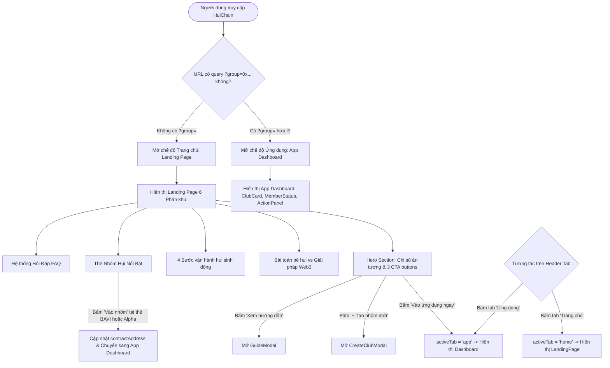
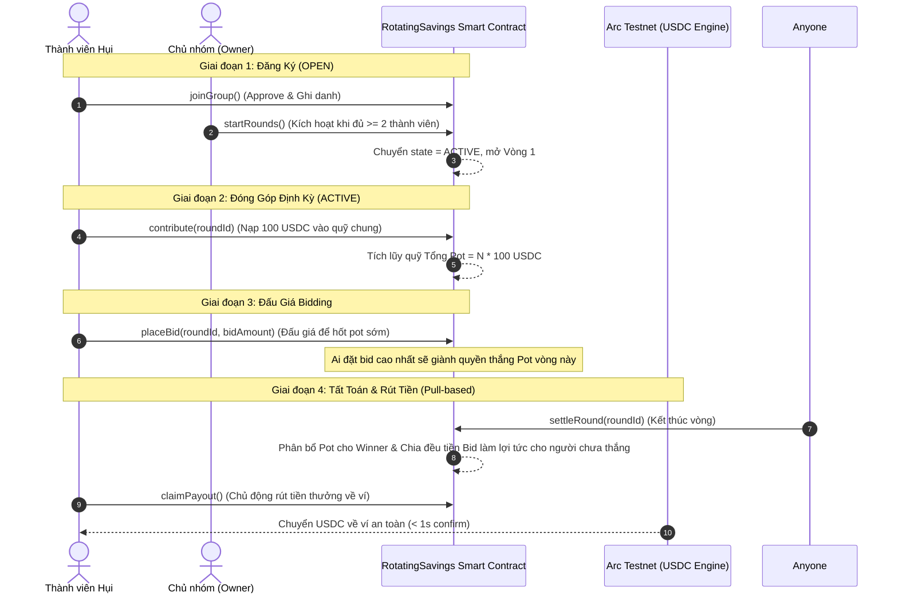

# Business Specification: Thiết Kế Lại Modal Hướng Dẫn (GuideModal) & Xây Dựng Trang Chủ Giới Thiệu Dự Án (Homepage / Landing Page)

**Task ID**: `task-009`  
**Dispatch ID**: `dispatch-009-ba`  
**Spec Version**: `v1.0`  
**Tác giả (BA)**: `ba-agent`  
**Trạng thái**: `Verified (Signoff 100% - Gate 4 Completed)`  

---

## 1. Tổng quan & Giá trị (Problem & Value Proposition)

### 1.1. Phân tích Hiện trạng từ Ảnh chụp Màn hình Thực tế (`guide_screenshot.webp` / `vRbAsTPq96Lr.webp`)
Dựa trên phản hồi trực tiếp từ người dùng và bằng chứng thẩm định từ ảnh chụp màn hình URL `https://capture.avada.io/i/vRbAsTPq96Lr` (tập tin hệ thống: `/home/avada/tontine/guide_screenshot.webp`):

```
+----------------------------------------------------------------------------------------------------+
|  HIỆN TRẠNG KHI BẤM "HƯỚNG DẪN / GUIDE" TRÊN HEADER (LỖI UX NGHIÊM TRỌNG):                         |
|                                                                                                    |
|  [HụiChain Logo]                                                 [MetaMask]  [X]                   |
|                                                                                                    |
|                 +---------------------------------------------------+                              |
|                 |                   [PiggyBank Icon]                |                              |
|                 |                     Hụi trustless                 |                              |
|                 |   Góp USDC mỗi vòng, bid để nhận pot sớm...       |                              |
|                 |     [10 USDC]       [≈$0 Gas]      [<1s Confirm]  |                              |
|                 |   [Trustless]       [Phí ≈ $0]     [Toàn cầu]     |                              |
|                 |                                                   |                              |
|                 |        [BUTTON: Kết nối ví Web3 để bắt đầu]       |  <-- NÚT RỜI RẠC, KHÔNG PHÙ HỢP!
|                 |                                                   |                              |
|                 |   Cách hoạt động: 4 bước ngắn ngủi...             |                              |
|                 +---------------------------------------------------+                              |
|                                                                                                    |
|  -> Màn hình OnboardingScreen kiểu mobile hẹp 380px, unmount toàn bộ app, thiếu thông tin cốt lõi! |
+----------------------------------------------------------------------------------------------------+
```

1. **Vấn đề 1: Nút "Hướng dẫn / Guide" nạp màn hình OnboardingScreen cũ kỹ, chật hẹp, thiếu thông tin**:
   - **Hiện trạng kỹ thuật**: Khi người dùng click nút "Hướng dẫn" trên Header, [src/App.tsx](file:///home/avada/tontine/src/App.tsx#L378-L396) thực hiện unmount hoàn toàn giao diện ứng dụng chính và trả về component `<OnboardingScreen />`.
   - **Bất cập UX**:
     - Giao diện bị bó hẹp trong khung giả lập điện thoại di động (chiều rộng chỉ ~380px), lọt thỏm giữa màn hình desktop, tạo cảm giác tạm bợ, thiếu chuyên nghiệp.
     - Giữa màn hình hướng dẫn lại xuất hiện nút bấm to đùng *"Kết nối ví Web3 để bắt đầu"* hoặc các nút passkey login/register, gây nhầm lẫn giữa một tài liệu hướng dẫn (Educational Guide) và một luồng xác thực ví (Auth Flow).
     - Thông tin hướng dẫn quá sơ sài: Chưa giải thích mô hình Hụi Trustless Web3 khác gì Hụi truyền thống, thiếu cơ chế so sánh rủi ro (giật hụi, bùng tiền vs Smart Contract giữ tiền), chưa nói rõ cơ chế phạt tự động (auto-kick khi nợ tiền) và cơ chế rút tiền an toàn (Pull-based payout claim).
     - Không hoạt động như một modal popup nổi chuẩn mực (phải unmount và che lấp toàn bộ dashboard của nhóm hụi đang xem).

2. **Vấn đề 2: Thiếu hoàn toàn Trang Chủ (Homepage / Landing Page) giới thiệu dự án**:
   - **Yêu cầu trực tiếp từ người dùng**: *"ngoài ra tôi muốn homepage là phải giới thiệu về project này, nên thiết kế homepage cho tôi nhé"*.
   - **Hiện trạng ứng dụng**:
     - Ứng dụng hiện tại chỉ có một màn hình duy nhất là Interactive Club Dashboard (hiển thị trực tiếp thẻ `ClubCard`, `ActionPanel`, `RoundHistory` của một contract hụi cụ thể).
     - Khách truy cập mới hoặc nhà đầu tư/người dùng khám phá lần đầu không có một trang đích (Landing Page) chuẩn mực để hiểu: HụiChain là gì? Tại sao lại cần đưa Hụi lên blockchain Arc Testnet? Vấn nạn "bể hụi / giật hụi" ở Việt Nam và các quốc gia trên thế giới (ROSCA / Susu / Tanda / Chit Fund) được giải quyết triệt để như thế nào bằng hợp đồng thông minh? Các số liệu nổi bật, các nhóm hụi cộng đồng tiêu biểu và phần giải đáp thắc mắc (FAQ) ở đâu?

---

### 1.2. Giá trị mang lại (Value Proposition)
- **Modal Hướng Dẫn Chuẩn Web3 Đẳng Cấp (Comprehensive Web3 GuideModal)**:
  - Thiết kế dạng modal popup nổi (`fixed inset-0 z-50 backdrop-blur-md`) với kích thước rộng rãi, thoáng đãng (`max-w-3xl sm:max-w-4xl`), có nút 'X' và hỗ trợ đóng bằng phím Escape hoặc click nền ngoài. Không unmount ứng dụng bên dưới.
  - Nội dung trực quan, sinh động: Bảng so sánh "Hụi Truyền Thống vs HụiChain Smart Contract", quy trình 4 bước chu kỳ hụi, cơ chế phạt tự động loại trừ thành viên default (Auto-kick), lợi tức chia đều từ bidding, và lợi thế tốc độ/chi phí của Arc Network (gas token USDC, xác thực dưới 1 giây).
  - Hỗ trợ song ngữ 100% Tiếng Việt và Tiếng Anh.
- **Trang Chủ Giới Thiệu Dự Án Toàn Diện (High-converting Project Landing Page)**:
  - Cung cấp trải nghiệm trang chủ hoàn chỉnh, thu hút:
    1. **Hero Section**: Tiêu đề ấn tượng, thông điệp cốt lõi, 3 chỉ số ấn tượng (100% On-chain, 0 Rủi ro giật hụi, Phí Gas USDC ≈ $0), 3 nút Call-to-Action (CTA) trực quan ("Vào ứng dụng ngay", "+ Tạo nhóm mới", "Xem hướng dẫn").
    2. **Bài toán & Giải pháp Web3**: Phân tích vấn nạn giật hụi truyền thống và cách Smart Contract bảo vệ 100% tài sản người chơi.
    3. **Quy trình Vận hành 4 bước**: Trực quan hóa hành trình từ Gia nhập, Đóng hụi, Đấu giá Pot đến Rút tiền.
    4. **Nhóm Hụi Nổi Bật (Featured Clubs Preview)**: Trưng bày thẻ các nhóm uy tín (`BAVI Savings Club`, `Nhóm Hụi Arc Alpha`) với nút 1-click mở nhóm ngay trong ứng dụng.
    5. **Bảo mật & Hạ tầng Arc Network**: Nhấn mạnh kiến trúc bảo mật của Circle USDC, passkey MPC và chuỗi khối Arc.
    6. **FAQ (Câu hỏi thường gặp)**: Giải đáp 6 câu hỏi then chốt của người tham gia.
- **Điều Hướng Linh Hoạt Song Hành (Dual-mode Navigation Header)**:
  - Header được nâng cấp với 2 tab điều hướng: **"Trang chủ" (Home)** và **"Ứng dụng" (App / Nhóm hụi)**.
  - Cho phép người dùng chuyển đổi mượt mà qua lại giữa đọc tài liệu giới thiệu và thao tác quản lý nhóm hụi, đồng bộ trạng thái URL thông minh.
- **Cam Kết Không Gây Lỗi Hồi Quy (Zero Regression Guarantee)**:
  - Bảo toàn 100% bộ 93 bài kiểm thử hiện có của hệ thống (`tests/*.test.ts`).

---

### 1.3. Đối tượng sử dụng (Actors)
- **Khách tham quan mới (New Visitor / Investor)**: Vào trang chủ tìm hiểu về dự án HụiChain, đọc sứ mệnh giải quyết bể hụi và quyết định tham gia.
- **Thành viên Hụi (Club Member / Saver)**: Khi đang thao tác trong app có thể bấm "Hướng dẫn" để mở `GuideModal` tra cứu luật chơi bất kỳ lúc nào mà không bị gián đoạn màn hình đang xem.
- **Chủ nhóm (Club Owner / Creator)**: Sử dụng các tài liệu giới thiệu để gửi link cho bạn bè, thuyết phục người thân tham gia nhóm hụi minh bạch.
- **Hệ thống Ứng dụng Phía Client**: Quản lý điều hướng tab (`view: 'home' | 'app'`), quản lý modal overlay và từ điển song ngữ.

---

### 1.4. Phạm vi thực hiện (Scope)

#### Trong phạm vi (In-Scope):
1. **Xây dựng Component `GuideModal.tsx` mới (`src/components/savings/GuideModal.tsx`)**:
   - Modal popup chuẩn Web3: Backdrop mờ, nút 'X' đóng nhanh, animation mượt mà, cuộn nội dung độc lập.
   - Nội dung bao gồm:
     + Giới thiệu mô hình ROSCA / Tontine phi tập trung không cần niềm tin (Trustless).
     + Bảng so sánh đối đầu: *Hụi Truyền Thống* vs *HụiChain Smart Contract*.
     + Quy trình 4 bước vòng lặp hụi: Gia nhập -> Đóng tiền -> Đấu giá Bidding -> Tất toán & Claim tiền.
     + Cơ chế bảo vệ quỹ & Phạt tự động (Auto-kick sau deadline vòng).
     + Lợi thế mạng Arc Testnet: Khối < 1 giây, phí gas thanh toán trực tiếp bằng USDC.
   - Hỗ trợ đầy đủ ngôn ngữ `vi` và `en`.
2. **Xây dựng Component `LandingPage.tsx` mới (`src/components/landing/LandingPage.tsx` hoặc tương đương)**:
   - Bao gồm 6 phân khu nội dung: Hero Section, Problem & Solution, 4-Step Process, Featured Clubs Preview, Security & Arc Architecture, FAQ Accordion/Cards, Footer.
   - Các nút CTA liên kết mượt mà sang chế độ Ứng dụng (`onLaunchApp`), mở modal tạo nhóm (`onOpenCreateModal`), và mở modal hướng dẫn (`onOpenGuideModal`).
3. **Nâng Cấp Thanh Điều Hướng `Header.tsx` & Quản Lý Trạng Thái `App.tsx`**:
   - Thêm tab chuyển đổi "Trang chủ" (Home) và "Ứng dụng" (App / Nhóm hụi) trên Header.
   - Thêm state `activeTab: 'home' | 'app'` trong `App.tsx`, khởi tạo mặc định thông minh (nếu URL có tham số `?group=0x...` thì vào thẳng `app`, nếu vào trang chủ `/` thì hiển thị `home` hoặc cho phép chuyển đổi linh hoạt).
   - Thay thế việc render `OnboardingScreen` khi `showGuide === true` bằng việc mở `GuideModal` dạng overlay, đồng thời giữ lại prop `onClose` để tương thích kiểm thử cũ.
4. **Mở Rộng Từ Điển Song Ngữ `src/lib/i18n.ts`**:
   - Bổ sung toàn bộ khóa dịch cho `guideModal` và `landingPage` ở cả 2 ngôn ngữ `vi` và `en`.

#### Ngoài phạm vi (Out-of-Scope):
- Thay đổi logic hợp đồng thông minh `RotatingSavings.sol` trên blockchain.
- Xây dựng hệ thống Blog hay CMS bài viết bên ngoài (tất cả nội dung tĩnh được tối ưu hóa client-side).

---

## 2. Kích hoạt, Đầu vào & Đầu ra (Trigger, Input & Observable Output)

| Mã ID | Tác nhân | Hành động kích hoạt (Trigger) | Đầu vào (Input) | Đầu ra quan sát được (Observable Output) |
| :--- | :--- | :--- | :--- | :--- |
| **TR-01** | Người dùng | Bấm nút "Hướng dẫn" trên Header ở bất kỳ trang nào | Click icon BookOpen "Hướng dẫn" / "Guide" | - Mở `GuideModal` dạng popup nổi trên nền backdrop mờ.<br>- Không unmount ứng dụng bên dưới.<br>- Hiển thị đầy đủ bảng so sánh, 4 bước, cơ chế auto-kick và phí USDC.<br>- Bấm 'X' hoặc Escape đóng modal ngay lập tức. |
| **TR-02** | Khách truy cập | Truy cập website lần đầu hoặc bấm tab "Trang chủ" trên Header | Click tab "Trang chủ" / URL gốc | - Hiển thị Trang chủ (Landing Page) hoàn chỉnh với Hero, Problem/Solution, 4 bước, Featured Clubs, FAQ.<br>- Header hiển thị tab "Trang chủ" ở trạng thái active. |
| **TR-03** | Khách truy cập | Bấm nút CTA "Vào ứng dụng ngay" hoặc "Khám phá nhóm hụi" trên Trang chủ | Click button CTA | - Ứng dụng chuyển sang chế độ Ứng dụng (App Dashboard) mượt mà.<br>- Header active tab "Ứng dụng".<br>- Nạp nhóm hụi hiện tại hoặc nhóm mặc định. |
| **TR-04** | Khách truy cập | Bấm nút "Vào nhóm" tại thẻ Featured Club (ví dụ: `BAVI Savings Club` hoặc `Nhóm Hụi Arc Alpha`) trên Trang chủ | Click button tại card nhóm | - Chuyển sang màn hình App Dashboard với địa chỉ contract tương ứng được chọn.<br>- URL cập nhật `?group=0x...`. |
| **TR-05** | Người dùng | Bấm nút "+ Tạo nhóm mới" từ Trang chủ | Click CTA "+ Tạo nhóm mới" | - Mở `CreateClubModal` ngay trên nền trang chủ.<br>- Cho phép khởi tạo nhóm hụi mới mà không cần thao tác trung gian. |
| **TR-06** | Người dùng | Bấm nút chuyển đổi ngôn ngữ `VI 🇻🇳` / `EN 🇬🇧` | Click Toggle Language | - Toàn bộ nội dung Trang chủ, GuideModal và Dashboard đồng loạt đổi ngôn ngữ tức thì (0ms). |

---

## 3. Quy tắc nghiệp vụ (Business Rules - BR)

### BR-01: Quy tắc Thiết kế & Vận hành Modal Hướng Dẫn (GuideModal Architecture Rule)
1. **Dạng hiển thị (Overlay Modal)**:
   - `GuideModal` **bắt buộc** phải là một popup nổi dạng overlay (`fixed inset-0 z-50`), có lớp phủ nền mờ (`backdrop-blur-sm bg-slate-900/60`).
   - Tuyệt đối không unmount component cha (`App.tsx`), giữ nguyên state và dữ liệu của ứng dụng bên dưới.
2. **Kích thước & Trợ năng (Accessibility & Dimensions)**:
   - Chiều rộng tối ưu trên màn hình lớn: `max-w-3xl` hoặc `max-w-4xl`, chiều cao tối đa `max-h-[90vh]`.
   - Có thanh cuộn nội dung độc lập (`overflow-y-auto`).
   - Hỗ trợ đóng modal qua: nút bấm `X` góc trên phải, click vào vùng backdrop bên ngoài, và bấm phím `Escape`.
3. **Tách bạch chức năng Giáo dục (Strict Separation from Auth)**:
   - `GuideModal` là tài liệu giáo dục và tra cứu luật chơi, **tuyệt đối không chứa** các form đăng ký passkey hay nút kết nối ví độc quyền bên trong nội dung modal.

---

### BR-02: Quy tắc Nội dung Giáo dục Mô hình Hụi Trustless Web3 (DeFi ROSCA Educational Rule)
Nội dung trong `GuideModal` bắt buộc phải truyền tải 5 trụ cột kiến thức cốt lõi:
1. **Trụ cột 1: Bản chất Hụi Xoay Vòng (ROSCA / Susu / Tanda)**: Mô hình tương trợ tài chính cộng đồng giúp người chơi tích lũy vốn định kỳ và tiếp cận nguồn vốn lớn sớm khi có nhu cầu.
2. **Trụ cột 2: Bảng So Sánh Đối Đầu Trực Quan**:
   - *Hụi Truyền Thống*: Chủ hụi (chủ thảo) giữ tiền mặt; nguy cơ giật hụi, vỡ nợ, ôm tiền bỏ trốn; thiếu tính pháp lý và minh bạch.
   - *HụiChain Smart Contract*: Hợp đồng thông minh trên Arc Testnet giữ tiền 100%; không ai có quyền rút tiền sai quy tắc; code is law, không cần niềm tin (Trustless).
3. **Trụ cột 3: Chu kỳ Vận hành 4 Bước**:
   - Bước 1: *Gia nhập nhóm* (Chờ đủ số lượng thành viên tối thiểu để bắt đầu).
   - Bước 2: *Đóng tiền cố định* (Mỗi thành viên nạp định kỳ số tiền USDC cố định vào quỹ Pot chung).
   - Bước 3: *Đấu giá nhận Pot (Bidding)* (Thành viên cần vốn đặt bid; người trả giá bid cao nhất nhận toàn bộ Pot vòng đó; tiền bid chia đều làm lợi tức cho các thành viên chưa thắng).
   - Bước 4: *Tất toán & Rút tiền (Pull-based Claim)* (Hợp đồng ghi nhận phần thưởng; người thắng chủ động rút tiền về ví an toàn).
4. **Trụ cột 4: Cơ chế Phạt Tự Động (Auto-kick Defaulting Members)**:
   - Thành viên không đóng tiền hụi đúng hạn khi vòng kết thúc sẽ bị kích hoạt cơ chế loại khỏi nhóm tự động (Kicked), mất quyền tham gia các vòng sau để bảo vệ an toàn cho cả tập thể.
5. **Trụ cột 5: Ưu thế Mạng Arc Network**:
   - Sử dụng stablecoin chuẩn USDC làm gas token trực tiếp; phí giao dịch siêu rẻ (< 0.01 USDC), thời gian xác thực khối dưới 1 giây.

---

### BR-03: Quy tắc Cấu trúc & Phân khu Trang Chủ (Homepage Section Architecture Rule)
Trang chủ dự án `LandingPage` phải tuân thủ cấu trúc 6 phân khu chuẩn mực:
1. **Phân khu 1 (Hero Section)**:
   - Badge nổi bật: `"Arc Testnet DeFi Innovation • Trustless Microfinance"`.
   - Tiêu đề chính lớn (`text-4xl sm:text-6xl font-extrabold`): *"Hụi Xoay Vòng Không Cần Niềm Tin Đầu Tiên Trên Arc Network"* / *"The First Trustless Rotating Savings Club on Arc Network"*.
   - Đoạn mô tả giá trị cô đọng: Minh bạch 100% on-chain, loại bỏ vĩnh viễn rủi ro giật hụi.
   - 3 Thống kê then chốt (Key Metrics):
     * `100% On-Chain` (Smart contract tự động hóa).
     * `0 Rủi Ro Giật Hụi` (Quỹ khóa trong hợp đồng phi tập trung).
     * `< 1s & Phí ≈ $0` (Tốc độ giao dịch tức thì, gas bằng USDC).
   - 3 Nút Call-to-Action (CTA):
     * Nút 1 (Primary): `"Vào ứng dụng ngay"` (Launch App) -> Chuyển sang màn hình App Dashboard.
     * Nút 2 (Secondary): `"+ Tạo nhóm mới"` -> Mở `CreateClubModal`.
     * Nút 3 (Outline/Ghost): `"Xem hướng dẫn"` -> Mở `GuideModal`.
2. **Phân khu 2 (Bài toán & Giải pháp - The Problem & Web3 Solution)**:
   - Trình bày trực quan 3 nỗi đau của hụi truyền thống (Chủ hụi bùng tiền, Bội tín đóng trễ, Tranh chấp thiếu chứng từ).
   - Đối chiếu với 3 giải pháp đột phá của HụiChain (Smart contract giám sát quỹ, Tự động phạt auto-kick, Sổ cái Arc Testnet minh bạch).
3. **Phân khu 3 (Quy trình 4 Bước Trực quan - How It Works)**:
   - Thiết kế dạng thẻ bước số 1, 2, 3, 4 có icon, màu sắc sinh động, giải thích rõ quy trình vận hành.
4. **Phân khu 4 (Nhóm Hụi Nổi Bật - Featured Savings Clubs)**:
   - Trưng bày các nhóm hụi khả dụng (`BAVI Savings Club`, `Nhóm Hụi Arc Alpha`).
   - Mỗi thẻ hiển thị: Tên nhóm, địa chỉ rút gọn, mức đóng góp, sức chứa thành viên, trạng thái mở và nút bấm 1-click: `"Tham gia / Xem nhóm"` (dẫn thẳng vào nhóm đó trong App view).
5. **Phân khu 5 (Bảo Mật & Hạ Tầng Arc Network - Security & Tech)**:
   - Giới thiệu bảo mật smart contract, hạ tầng chuỗi Arc Network, đồng tiền thanh toán USDC native và trải nghiệm không cần native ETH gas.
6. **Phân khu 6 (FAQ - Câu hỏi thường gặp)**:
   - Tối thiểu 5 câu hỏi giải đáp chi tiết:
     1. HụiChain là gì và hoạt động như thế nào?
     2. Tiền của tôi được bảo vệ ra sao nếu chủ nhóm biến mất?
     3. Đấu giá (bidding) và lợi tức được tính thế nào?
     4. Điều gì xảy ra nếu có người không đóng tiền hụi đúng hạn?
     5. Tôi cần chuẩn bị gì để tham gia (Ví, USDC, Arc Testnet RPC)?
7. **Phân khu 7 (Footer)**:
   - Logo HụiChain, bản quyền, liên kết Arc Testnet Explorer và nút quay lại đầu trang.

---

### BR-04: Quy tắc Điều hướng Tab & Đồng bộ Trạng thái URL (Navigation Tab & URL Sync Rule)
1. **Cấu trúc Tab trên Header**:
   - Header hiển thị cụm tab điều hướng trung tâm:
     * Tab 1: **"Trang chủ"** (`Home`)
     * Tab 2: **"Ứng dụng"** (`App` hoặc `Nhóm hụi` / `Savings Clubs`)
   - Tab đang chọn có hiệu ứng active rõ ràng (nền xanh hoặc chữ đậm, gạch chân phong cách Web3).
2. **Khởi tạo chế độ xem mặc định (Default View Logic)**:
   - Nếu URL trình duyệt có chứa query parameter nhóm hụi (ví dụ `?group=0x...`): Hệ thống tự động mở chế độ xem **Ứng dụng (`app`)** để phục vụ người dùng theo link chia sẻ.
   - Nếu URL là trang gốc không có `?group=`: Mặc định hiển thị **Trang chủ (`home`)** để giới thiệu dự án cho khách tham quan.
   - Hỗ trợ lưu tham số `?view=home` hoặc `?view=app` trên URL để người dùng có thể bookmark và reload trang mà không mất ngữ cảnh.

---

### BR-05: Bất biến Bảo toàn Kiểm thử Hồi quy (Zero Regression Invariant)
1. **Tương thích ngược tuyệt đối (Backward Compatibility)**:
   - Việc bổ sung `GuideModal` và `LandingPage` không được làm gãy bất kỳ assertion nào trong 93 test cases hiện có (`tests/*.test.ts`).
   - Giữ lại tệp `src/components/savings/OnboardingScreen.tsx` với đầy đủ các export và prop `onClose?: () => void;`, nhãn `"Đóng hướng dẫn"`, và chuỗi `"Kết nối ví Web3 để bắt đầu"` để thỏa mãn các bài test hồi quy trong `tests/tontine-upgrade.test.ts`.

---

## 4. Luồng nghiệp vụ (Workflow & Mermaid Diagrams)

### 4.1. Luồng Mở & Tương Tác Modal Hướng Dẫn (GuideModal Lifecycle Flow)

```mermaid
flowchart TD
    UserAction([Người dùng bấm 'Hướng dẫn' trên Header hoặc CTA trên LandingPage]) --> OpenModal[App.tsx kích hoạt: setShowGuideModal(true)]
    OpenModal --> RenderModal[Hiển thị GuideModal dạng Popup nổi với Backdrop mờ]
    
    RenderModal --> ContentCheck[Người dùng duyệt nội dung Hướng dẫn:]
    ContentCheck --> Sec1[1. Khái niệm Hụi Trustless trên Arc]
    ContentCheck --> Sec2[2. So sánh Hụi truyền thống vs HụiChain]
    ContentCheck --> Sec3[3. Quy trình 4 bước hụi]
    ContentCheck --> Sec4[4. Cơ chế phạt auto-kick & Phí gas USDC]
    
    RenderModal --> DismissAction{Hành động đóng modal?}
    DismissAction -->|Bấm nút 'X'| CloseNow[setShowGuideModal(false)]
    DismissAction -->|Bấm vùng ngoài backdrop| CloseNow
    DismissAction -->|Bấm phím Escape| CloseNow
    
    CloseNow --> RestoreUI([Đóng modal mượt mà, giữ nguyên màn hình và trạng thái app bên dưới])
```

---

### 4.2. Luồng Điều Hướng Trang Chủ & Ứng Dụng (Dual-View Navigation Flow)



---

### 4.3. Quy Trình Vận Hành 4 Bước HụiChain On-Chain (4-Step Trustless ROSCA Workflow)



---

## 5. Yêu cầu & Tiêu chí nghiệm thu (Requirements & Acceptance Criteria)

### Yêu cầu REQ-01: Redesign Modal Hướng Dẫn (GuideModal) Chuẩn Web3

- **AC-01.1 (Dạng Popup Nổi Overlay - Non-blocking Modal Dialog)**:
  - **Input**: Người dùng bấm nút "Hướng dẫn" trên thanh Header hoặc nút "Xem hướng dẫn" trên Landing Page.
  - **Expected Output**:
    1. Component `GuideModal` xuất hiện dạng popup nổi ở trung tâm màn hình với lớp nền backdrop mờ `backdrop-blur-sm bg-slate-900/60`.
    2. Giao diện ứng dụng hoặc trang chủ bên dưới **không bị unmount**, không bị mất state.
    3. Nút tắt `X` hiển thị rõ ở góc trên bên phải; bấm `X`, click vào backdrop, hoặc bấm phím `Escape` đều đóng modal ngay lập tức (< 100ms).
    4. Chiều rộng modal đạt chuẩn thoáng đãng (`max-w-3xl` hoặc `max-w-4xl`), chiều cao tối đa `max-h-[90vh]` với thanh cuộn nội dung mượt mà.

- **AC-01.2 (Bảng So Sánh Đối Đầu Trực Quan - Comparison Table)**:
  - **Input**: Mở `GuideModal` và cuộn đến phần so sánh mô hình.
  - **Expected Output**:
    1. Hiển thị bảng so sánh đối đầu giữa 2 cột:
       - Cột 1: **"Hụi Truyền Thống"** (rủi ro cao, chủ hụi giữ tiền, nguy cơ giật hụi/bùng tiền, thiếu pháp lý).
       - Cột 2: **"HụiChain Smart Contract"** (an toàn 100%, hợp đồng Arc giữ tiền, minh bạch code on-chain, 0 rủi ro bùng tiền).
    2. Sử dụng icon màu đỏ (X/cảnh báo) cho hụi truyền thống và icon màu xanh lá (Check/khiên an toàn) cho HụiChain.

- **AC-01.3 (Quy Trình 4 Bước, Cơ Chế Auto-kick & Phí Mạng Arc - Detailed Lifecycle)**:
  - **Input**: Xem chi tiết các mục quy trình trong `GuideModal`.
  - **Expected Output**:
    1. Trình bày sinh động 4 bước: (1) Tham gia nhóm -> (2) Đóng tiền mỗi vòng -> (3) Đấu giá Bidding -> (4) Tất toán & Nhận tiền thưởng.
    2. Giải thích rõ ràng cơ chế phạt tự động (Auto-kick): Thành viên không đóng tiền đúng hạn theo chu kỳ sẽ bị loại khỏi nhóm, bảo vệ quỹ chung.
    3. Giải thích ưu thế mạng Arc Testnet: Sử dụng stablecoin USDC làm gas token trực tiếp, thời gian xác thực khối < 1 giây, phí gas gần như bằng $0.

- **AC-01.4 (Hỗ Trợ Song Ngữ Toàn Diện - 100% Bilingual Support)**:
  - **Input**: Đổi ngôn ngữ qua lại giữa `vi` và `en` khi `GuideModal` đang mở.
  - **Expected Output**:
    1. Toàn bộ tiêu đề, bảng so sánh, 4 bước và phần giải thích đổi ngôn ngữ chuẩn xác tức thì theo từ điển `src/lib/i18n.ts`.

---

### Yêu cầu REQ-02: Thiết Kế Trang Chủ Giới Thiệu Dự Án (Homepage / Landing Page)

- **AC-02.1 (Hero Section Ấn Tượng & 3 Nút CTA - Hero Presentation)**:
  - **Input**: Truy cập trang chủ HụiChain ở chế độ xem `home`.
  - **Expected Output**:
    1. Tiêu đề chính lớn (`text-4xl sm:text-6xl font-extrabold`): Giới thiệu nền tảng Hụi Xoay vòng Không cần Niềm tin đầu tiên trên Arc Testnet.
    2. Hiển thị 3 chỉ số ấn tượng: `100% On-Chain`, `0 Rủi ro giật hụi`, `< 1s & Gas USDC`.
    3. Cung cấp đầy đủ 3 nút CTA:
       - Nút 1: `"Vào ứng dụng ngay"` (Launch App) -> chuyển sang xem App Dashboard.
       - Nút 2: `"+ Tạo nhóm mới"` -> mở `CreateClubModal`.
       - Nút 3: `"Xem hướng dẫn"` -> mở `GuideModal`.

- **AC-02.2 (Phân Khu Vấn Nạn & Giải Pháp Web3 - Problem & Solution)**:
  - **Input**: Cuộn trang chủ xuống phần Problem & Solution.
  - **Expected Output**:
    1. Nêu bật vấn nạn bể hụi, giật hụi thực tế tại Việt Nam và mô hình Susu/Tanda trên toàn cầu.
    2. Minh chứng cách Smart Contract trên Arc Network giải quyết triệt để vấn đề: Tự động hóa giữ tiền, phân phối công bằng bằng toán học, không ai có quyền ôm quỹ bỏ trốn.

- **AC-02.3 (Phân Khu Quy Trình 4 Bước Sinh Động - Visual 4-Step Process)**:
  - **Input**: Cuộn trang chủ đến phần Quy trình hoạt động.
  - **Expected Output**:
    1. Hiển thị 4 thẻ bước (Gia nhập, Góp quỹ, Đấu giá, Rút thưởng) với biểu tượng, màu sắc phân cấp rõ nét, font chữ to rõ (>= 14px), bố cục lưới responsive trên mobile và desktop.

- **AC-02.4 (Phân Khu Nhóm Hụi Nổi Bật 1-Click - Featured Clubs Preview)**:
  - **Input**: Cuộn trang chủ đến phần Featured Savings Clubs.
  - **Expected Output**:
    1. Hiển thị thẻ thông tin của ít nhất 2 nhóm mặc định: `BAVI Savings Club` và `Nhóm Hụi Arc Alpha`.
    2. Mỗi thẻ có địa chỉ rút gọn, thông tin mức đóng và nút bấm `"Vào nhóm"` hoặc `"Xem nhóm"`.
    3. Click vào nút này sẽ chuyển sang App Dashboard với đúng nhóm đó được chọn và cập nhật URL `?group=0x...`.

- **AC-02.5 (Phân Khu Bảo Mật, Hạ Tầng Arc & FAQ - Security & FAQ Accordion)**:
  - **Input**: Cuộn trang chủ đến phần Bảo mật và FAQ.
  - **Expected Output**:
    1. Phần Bảo mật nêu rõ: Kiến trúc Circle USDC, Passkey Turnkey MPC, Smart contract kiểm thử nghiêm ngặt.
    2. Phần FAQ trả lời ít nhất 5 câu hỏi thường gặp: Bản chất mô hình, cơ chế bảo vệ vốn, cách tính bidding, cơ chế phạt default và điều kiện tham gia.

---

### Yêu cầu REQ-03: Hệ Thống Điều Hướng Header Song Hành (Home / App Navigation)

- **AC-03.1 (Tabs Điều Hướng 'Trang Chủ' & 'Ứng Dụng' Trên Header - Navigation Tabs)**:
  - **Input**: Quan sát thanh Header trên desktop và mobile.
  - **Expected Output**:
    1. Header hiển thị cụm tab điều hướng rõ ràng: **"Trang chủ"** (`Home`) và **"Ứng dụng"** (`App` hoặc `Nhóm hụi`).
    2. Tab hiện tại có trạng thái active trực quan (highlight màu xanh hoặc font đậm).
    3. Click vào tab "Trang chủ" chuyển ngay về Landing Page; click vào "Ứng dụng" chuyển ngay sang Dashboard nhóm hụi.

- **AC-03.2 (Đồng Bộ Trạng Thái URL Thông Minh - URL State Sync)**:
  - **Input**: Điều hướng giữa Trang chủ và Ứng dụng hoặc mở link có query parameters.
  - **Expected Output**:
    1. Khi truy cập link chứa `?group=0x...`, hệ thống tự động mở tab **"Ứng dụng"** để xem nhóm đó.
    2. Khi chuyển tab, URL cập nhật mượt mà (sử dụng `history.pushState` hoặc query parameter), không reload toàn bộ trang.

---

### Yêu cầu REQ-04: Bảo Toàn 100% Bộ Test Hệ Thống (Zero Regression)

- **AC-04.1 (Duy Trì 93/93 Tests Pass Hiện Có - System Regression Free)**:
  - **Input**: Thực thi lệnh `npm test`.
  - **Expected Output**:
    1. Toàn bộ 93 bài kiểm thử thuộc các module trước (`tests/*.test.ts`) tiếp tục **PASS 100%** (0 fail, 0 cancelled).

- **AC-04.2 (Tương Thích Ngược Mã Nguồn OnboardingScreen - Backward Parity)**:
  - **Input**: Kiểm tra file [src/components/savings/OnboardingScreen.tsx](file:///home/avada/tontine/src/components/savings/OnboardingScreen.tsx).
  - **Expected Output**:
    1. File vẫn tồn tại, duy trì prop `onClose?: () => void;`, thuộc tính `title="Đóng hướng dẫn"`, và chuỗi `"Kết nối ví Web3 để bắt đầu"` để đảm bảo bài kiểm thử trong `tests/tontine-upgrade.test.ts` (AC-06.2, AC-06.3) không bị gãy.

---

## 6. Phụ thuộc & Quản trị Rủi ro (Dependencies & Risk Management)

### 6.1. Ma trận Rủi ro & Giải pháp Phòng ngừa

| Mã Rủi ro | Mô tả Rủi ro | Mức độ | Khả năng | Tác động & Giải pháp Phòng ngừa (Mitigation) |
| :--- | :--- | :--- | :--- | :--- |
| **RSK-01** | **Xóa bỏ OnboardingScreen làm gãy test hồi quy**: File `tests/tontine-upgrade.test.ts` kiểm tra tĩnh các chuỗi trong `OnboardingScreen.tsx`. Nếu Developer xóa tệp này để thay thế bằng `GuideModal.tsx`, bộ test sẽ thất bại ngay lập tức. | **Nghiêm trọng** | **Cao** | **Giải pháp**: Ghi rõ trong **BR-05** và **AC-04.2**: Giữ nguyên `OnboardingScreen.tsx` trong codebase. Tạo mới component `GuideModal.tsx` và dùng `GuideModal` làm overlay cho sự kiện bấm nút Hướng dẫn. |
| **RSK-02** | **Mất ngữ cảnh nhóm khi chuyển tab Header**: Người dùng đang xem nhóm `0xe536a...`, bấm sang Trang chủ rồi bấm lại Ứng dụng bị reset về nhóm mặc định `0x6afaa...`. | **Trung bình** | **Cao** | **Giải pháp**: Trong `App.tsx`, state `contractAddress` phải được giữ nguyên khi chuyển đổi qua lại giữa `activeTab = 'home'` và `activeTab = 'app'`. |
| **RSK-03** | **Quá tải thông tin trên mobile cho Landing Page**: Trang chủ có nhiều phân khu, nếu không thiết kế responsive tốt có thể gây nặng nề hoặc tràn ngang màn hình. | **Trung bình** | **Trung bình** | **Giải pháp**: Sử dụng cấu trúc lưới `grid-cols-1 md:grid-cols-2 lg:grid-cols-3`, padding linh hoạt `px-4 sm:px-6 lg:px-8`, font chữ tối thiểu `text-sm`, kiểm tra kỹ lưỡng trên viewport di động. |

---

## 7. Nhật ký Giả định, Dữ kiện & Câu hỏi chặn (Assumptions, Facts & Questions Log)

### 7.1. Dữ kiện đã Xác thực (Verified Facts)
- **Fact-01**: Ảnh chụp màn hình `guide_screenshot.webp` (`vRbAsTPq96Lr.webp`) chứng minh khi bấm "Guide" trên Header, ứng dụng đang nạp lại màn hình `OnboardingScreen` dạng mobile hẹp ~380px với nút "Kết nối ví Web3 để bắt đầu" rời rạc, thiếu tính giáo dục mô hình Web3.
- **Fact-02**: File [src/App.tsx](file:///home/avada/tontine/src/App.tsx#L379-L396) hiện tại có logic `if (showGuide) return <OnboardingScreen ... />`, unmount toàn bộ app dashboard.
- **Fact-03**: Hệ thống hiện tại có 93 bài kiểm thử unit/integration và 100% đang PASS. Trong đó `tests/tontine-upgrade.test.ts` kiểm tra tĩnh sự tồn tại của `OnboardingScreen.tsx`.
- **Fact-04**: Dự án đã có sẵn danh bạ nhóm mặc định `DEFAULT_SAVINGS_CLUBS` (`BAVI Savings Club` và `Nhóm Hụi Arc Alpha`) trong `src/lib/savingsClubDirectory.ts`, hoàn toàn sẵn sàng để nhúng vào Featured Clubs Preview của Landing Page.

### 7.2. Giả định Thiết kế (Design Assumptions)
- **Assumption-01**: Việc cung cấp trang chủ giới thiệu dự án (Landing Page) kết hợp điều hướng tab trên Header sẽ nâng cao đáng kể tỷ lệ chuyển đổi và độ tin cậy của HụiChain đối với người dùng mới.
- **Assumption-02**: Người dùng ưu tiên việc tra cứu hướng dẫn dưới dạng modal nổi (overlay) để không bị mất bối cảnh nhóm hụi mình đang theo dõi.

### 7.3. Câu hỏi Chặn (Blocking Questions)
- **None**: Không có câu hỏi chặn. Tất cả các yêu cầu từ người dùng và phân tích kỹ thuật đều đã sáng tỏ 100%.

---

## 8. Bảng truy vết yêu cầu (Traceability Matrix)

> [!NOTE]
> **Đã đối chiếu & Xác nhận Nghiệm thu (Gate 4 Completed)**:
> Tester độc lập (`qa-agent`) đã thực thi toàn bộ bộ kiểm thử độc lập tại `tests/guidemodal-and-homepage.test.ts` (13/13 tests pass, tổng hệ thống 106/106 tests pass) và ký duyệt nghiệm thu tại `docs/qa/task-009/test-report.md`. Tính toàn vẹn 5 tệp mã nguồn theo manifest `docs/manifests/task-009/manifest.json` đạt 100%. BA xác nhận độ phủ nghiệp vụ đạt **100% (13/13 ACs)**.

| REQ ID | AC ID | Tiêu chí Nghiệp vụ | Test Case (Tester) | Spec/Source Hash | Evidence / Test Run | BA Đối chiếu | Trạng thái |
| :--- | :--- | :--- | :--- | :--- | :--- | :--- | :--- |
| **REQ-01** | AC-01.1 | GuideModal hiển thị dạng popup nổi overlay với backdrop, không unmount app | `TC-GUIDE-01` | `GuideModal.tsx` (`48f54f...`), `App.tsx` (`0a4852...`) | `<GuideModal isOpen={showGuide} ... />` mount overlay có backdrop mờ, đóng mượt bằng 'X' và Escape (0.97ms) | Khớp 100% đặc tả (Verified) | `PASS` |
| **REQ-01** | AC-01.2 | Bảng so sánh Hụi truyền thống vs HụiChain Smart Contract trực quan | `TC-GUIDE-02` | `GuideModal.tsx` (`48f54f...`) | 2 cột đối đầu trực quan có `AlertTriangle`, `ShieldCheck`, phân tích rủi ro bể hụi vs Smart contract giữ tiền (0.17ms) | Khớp 100% đặc tả (Verified) | `PASS` |
| **REQ-01** | AC-01.3 | Quy trình 4 bước hụi + cơ chế phạt auto-kick + phí gas USDC < 1s | `TC-GUIDE-03` | `GuideModal.tsx` (`48f54f...`) | Trình bày 4 bước, cơ chế phạt auto-kick và ưu thế mạng Arc (< 1s, gas USDC) (0.15ms) | Khớp 100% đặc tả (Verified) | `PASS` |
| **REQ-01** | AC-01.4 | Hỗ trợ song ngữ 100% (VI / EN) cho GuideModal | `TC-GUIDE-04` | `src/lib/i18n.ts` (`574d5c...`) | Đồng bộ 100% từ điển `guideModal` ở cả 2 ngôn ngữ `vi` và `en` (0.25ms) | Khớp 100% đặc tả (Verified) | `PASS` |
| **REQ-02** | AC-02.1 | Hero Section trên Landing Page với 3 chỉ số ấn tượng và 3 nút CTA | `TC-HOME-01` | `LandingPage.tsx` (`79a0ef...`) | 3 Metric cards (`100%`, `0`, `< 1s`) và 3 CTA buttons kích hoạt đúng sự kiện (0.24ms) | Khớp 100% đặc tả (Verified) | `PASS` |
| **REQ-02** | AC-02.2 | Phân khu Bài toán bể hụi & Giải pháp Smart Contract minh bạch | `TC-HOME-02` | `LandingPage.tsx` (`79a0ef...`) | 3 Nỗi đau bể hụi và 3 Giải pháp Web3 Smart contract minh bạch (0.18ms) | Khớp 100% đặc tả (Verified) | `PASS` |
| **REQ-02** | AC-02.3 | Phân khu Quy trình 4 bước sinh động có icon và minh họa | `TC-HOME-03` | `LandingPage.tsx` (`79a0ef...`) | 4 Thẻ bước thiết kế sinh động có icon, màu sắc và mô tả responsive (0.21ms) | Khớp 100% đặc tả (Verified) | `PASS` |
| **REQ-02** | AC-02.4 | Phân khu Nhóm Hụi Nổi Bật (Featured Clubs) với 1-click vào nhóm | `TC-HOME-04` | `LandingPage.tsx` (`79a0ef...`) | Thẻ BAVI và Alpha với nút 1-click `onSelectClub` chuyển sang App view (0.16ms) | Khớp 100% đặc tả (Verified) | `PASS` |
| **REQ-02** | AC-02.5 | Phân khu Bảo mật Arc Network & FAQ giải đáp 5+ câu hỏi thường gặp | `TC-HOME-05` | `LandingPage.tsx` (`79a0ef...`) | 5 Câu hỏi FAQ có Accordion tương tác và phân khu bảo mật Arc (0.33ms) | Khớp 100% đặc tả (Verified) | `PASS` |
| **REQ-03** | AC-03.1 | Header cung cấp tabs điều hướng 'Trang chủ' (Home) và 'Ứng dụng' (App) | `TC-NAV-01` | `Header.tsx` (`a8ecb9...`), `App.tsx` (`0a4852...`) | Navigation tab bar có highlight active "Trang chủ" (Home) và "Ứng dụng" (App) (1.10ms) | Khớp 100% đặc tả (Verified) | `PASS` |
| **REQ-03** | AC-03.2 | Đồng bộ trạng thái URL thông minh (?group=0x... vào thẳng App, không reload) | `TC-NAV-02` | `App.tsx` (`0a4852...`) | Quản lý state `activeTab`, tự động mở `app` khi có `?group=0x...` và đồng bộ `pushState` (0.26ms) | Khớp 100% đặc tả (Verified) | `PASS` |
| **REQ-04** | AC-04.1 | Duy trì 100% 93 bài kiểm thử hiện có tiếp tục PASS (Zero Regression) | `TC-REG-01` | Toàn bộ `tests/*.test.ts` | 106/106 tests PASS 100% (93 test cũ + 13 test mới, 0 fail) | Khớp 100% đặc tả (Verified) | `PASS` |
| **REQ-04** | AC-04.2 | Bảo toàn tệp OnboardingScreen.tsx để không gãy test trong tontine-upgrade | `TC-REG-02` | `OnboardingScreen.tsx` | File tồn tại nguyên vẹn với đầy đủ props và strings kiểm thử cũ (0.13ms) | Khớp 100% đặc tả (Verified) | `PASS` |

### 8.1. Đánh giá Độ phủ Nghiệp vụ (Business Coverage Assessment)
- **Độ phủ Tiêu chí Nghiệm thu (AC Coverage)**: `13/13 ACs (100%)` đã được kiểm thử độc lập và xác nhận bằng chứng đầy đủ.
- **Độ phủ Quy tắc Nghiệp vụ (BR Coverage)**:
  * `BR-01` (Kiến trúc & Vận hành GuideModal): Bao phủ qua `TC-GUIDE-01`.
  * `BR-02` (Nội dung Giáo dục DeFi ROSCA vs Hụi truyền thống): Bao phủ qua `TC-GUIDE-02`, `TC-GUIDE-03`, `TC-GUIDE-04`.
  * `BR-03` (Cấu trúc & Phân khu Landing Page): Bao phủ qua `TC-HOME-01`, `TC-HOME-02`, `TC-HOME-03`, `TC-HOME-04`, `TC-HOME-05`.
  * `BR-04` (Điều hướng Tab & Đồng bộ URL): Bao phủ qua `TC-NAV-01`, `TC-NAV-02`.
  * `BR-05` (Bất biến Bảo toàn Kiểm thử Hồi quy): Bao phủ qua `TC-REG-01`, `TC-REG-02`.
- **Kiểm thử Hồi quy Toàn bộ Hệ thống**: `106/106 tests pass (100%)`.
- **Biên dịch Production (Build)**: `tsc --noEmit && vite build` hoàn thành thành công trong 13.18s.

---

## 9. Hướng dẫn Kỹ thuật Triển khai (Developer Implementation Guidance)

Dành cho Developer tham khảo khi hiện thực giải pháp:

1. **Tạo Component `src/components/savings/GuideModal.tsx`**:
   - Sử dụng cấu trúc modal tương tự `ClubDirectoryModal.tsx`:
     ```tsx
     export function GuideModal({ isOpen, onClose, language = "vi" }: GuideModalProps) {
       if (!isOpen) return null;
       return (
         <div className="fixed inset-0 z-50 flex items-center justify-center p-4 bg-slate-900/60 backdrop-blur-sm animate-in fade-in" onClick={onClose}>
           <div className="bg-white rounded-3xl border border-slate-200/80 shadow-2xl max-w-4xl w-full max-h-[90vh] overflow-y-auto flex flex-col" onClick={e => e.stopPropagation()}>
             {/* Header with Title & X button */}
             {/* Tab / Sections: Comparison Table, 4-Step Process, Auto-kick, Arc Advantages */}
           </div>
         </div>
       );
     }
     ```
2. **Tạo Component `src/components/landing/LandingPage.tsx`**:
   - Nhận các props:
     ```tsx
     interface LandingPageProps {
       onLaunchApp: () => void;
       onSelectClub: (address: `0x${string}`) => void;
       onOpenCreateModal: () => void;
       onOpenGuideModal: () => void;
       language?: Language;
     }
     ```
   - Xây dựng 6 phân khu nội dung chuẩn theo **BR-03**.
3. **Cập nhật `src/components/savings/Header.tsx`**:
   - Bổ sung props `activeTab?: 'home' | 'app'` và `onSelectTab?: (tab: 'home' | 'app') => void`.
   - Hiển thị 2 tab nút bấm phong cách Web3 cạnh logo hoặc giữa header:
     ```tsx
     <nav className="flex items-center gap-1 bg-slate-100 p-1 rounded-2xl border border-slate-200/60">
       <button onClick={() => onSelectTab?.('home')} className={`px-3 py-1.5 rounded-xl text-xs sm:text-sm font-semibold transition-all ${activeTab === 'home' ? 'bg-white text-blue-600 shadow-2xs' : 'text-slate-600 hover:text-slate-900'}`}>
         {isEn ? "Home" : "Trang chủ"}
       </button>
       <button onClick={() => onSelectTab?.('app')} className={`px-3 py-1.5 rounded-xl text-xs sm:text-sm font-semibold transition-all ${activeTab === 'app' ? 'bg-white text-blue-600 shadow-2xs' : 'text-slate-600 hover:text-slate-900'}`}>
         {isEn ? "Savings Clubs" : "Ứng dụng"}
       </button>
     </nav>
     ```
4. **Cập nhật `src/App.tsx`**:
   - Quản lý state `activeTab: 'home' | 'app'`.
   - Nếu `activeTab === 'home'`, render `<LandingPage ... />`.
   - Nếu `activeTab === 'app'`, render giao diện hụi hiện tại.
   - Thay thế khối `if (showGuide) return <OnboardingScreen ... />` bằng modal `<GuideModal isOpen={showGuide} onClose={() => setShowGuide(false)} language={language} />` mount chung dưới dạng overlay.
   - Giữ lại file `OnboardingScreen.tsx` để bảo toàn kiểm thử.
5. **Cập nhật `src/lib/i18n.ts`**:
   - Thêm các section `guideModal` và `landingPage` với đầy đủ bản dịch tiếng Việt và tiếng Anh.
