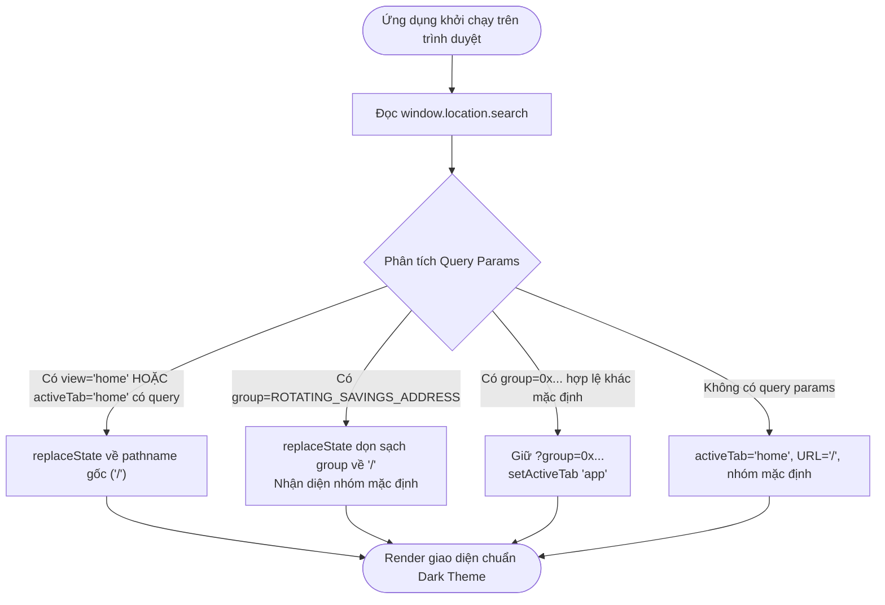
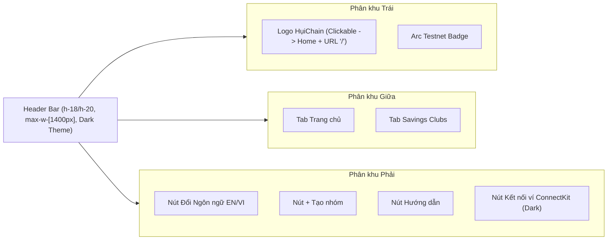

# Business Specification: Nâng Cấp UI/UX Header, Dark Theme Toàn Diện & Dọn Sạch URL Nhóm Mặc Định

**Task ID**: `task-011`  
**Dispatch ID**: `dispatch-011-ba`  
**Spec Version**: `v1.0`  
**Tác giả (BA)**: `ba-agent`  
**Ngày lập**: `2026-10-09`  
**Trạng thái**: `Verified`  

---

## 1. Tổng quan & Giá trị (Problem & Value Proposition)

### 1.1. Hiện trạng & Vấn đề Thực tế (Problem Statement)
Dựa trên phân tích ảnh chụp màn hình thực tế của người dùng (`e8G1x9zU8vIG.png`) và các phản hồi đóng góp trải nghiệm UI/UX:

```
+---------------------------------------------------------------------------------------------------------+
|  HIỆN TRẠNG GIAO DIỆN & ĐIỀU HƯỚNG TRÊN ẢNH CHỤP E8G1X9ZU8VIG.PNG:                                      |
|                                                                                                         |
|  1. ĐIỀU HƯỚNG URL NHÓM MẶC ĐỊNH BỊ LỘ QUERY DÀI DÒNG:                                                  |
|     - Khi người dùng ở màn hình Savings Clubs (Ứng dụng) với nhóm hụi mặc định:                         |
|       URL: http://localhost:5173/?group=0x6afaa0825d2e05ef00d571d4a043ab5dcc03534b                      |
|     - Người dùng thắc mắc: "Tại sao nhóm mặc định của ứng dụng lại phải mang query dài loằng ngoằng     |
|       này trên thanh địa chỉ?". URL chuẩn phải sạch sẽ là '/' cho cả Trang chủ và Nhóm mặc định!        |
|                                                                                                         |
|  2. THANH HEADER NAV BAR BỊ CHẬT CHỘI & QUÁ TẢI NÚT BẤM:                                                |
|     - Header nhồi nhét quá nhiều nút trên một hàng hẹp (h-16):                                          |
|       [Logo] [Home] [Savings Clubs] [USDC Balance] [Club Directory] [+ Create Club] [Guide] [VI] [CW]   |
|     - Nút "Club Directory" (Danh sách nhóm) đứng ngay cạnh "+ Tạo nhóm" và "Hướng dẫn" gây rối mắt,     |
|       trong khi người dùng đã có thể xem danh sách nhóm ở GroupSwitcher và LandingPage!                 |
|                                                                                                         |
|  3. KHÔNG GIAN HEADER BỊ BÍ BÁCH VỀ KÍCH THƯỚC:                                                         |
|     - Chiều cao h-16 (64px) và container hẹp max-w-7xl khiến các thành phần dính sát vào nhau,         |
|       khoảng cách gap quá nhỏ, thiếu khoảng thở (breathing room) của một Web3 dApp hiện đại.            |
|                                                                                                         |
|  4. LOGO HUICHAIN TRÊN HEADER CHƯA TƯƠNG TÁC ĐƯỢC:                                                      |
|     - Cụm Logo (PiggyBank icon + "HụiChain") hiện là thẻ <div> tĩnh, không có sự kiện onClick.          |
|     - Quy chuẩn UX Web3 yêu cầu khi click vào Logo bất kỳ lúc nào phải chuyển về Trang chủ và URL '/'. |
|                                                                                                         |
|  5. TÔNG MÀU SÁNG (LIGHT THEME) THIẾU CHIỀU SÂU & GÂY MỎI MẮT:                                          |
|     - Toàn bộ trang web đang dùng nền trắng/xám sáng (#ffffff / #f8fafc) tương phản gắt với các khối    |
|       gradient xanh, gây mỏi mắt khi theo dõi và không toát lên vẻ sang trọng, bảo mật của dApp Web3.   |
|     - ConnectKit modal chưa đồng bộ dark mode, làm lệch tông khi người dùng kết nối ví.                 |
+---------------------------------------------------------------------------------------------------------+
```

### 1.2. Giá trị Nghiệp vụ Mang lại (Value Proposition)
1. **URL Tinh Gọn Tuyệt Đối (Clean URL Everywhere)**: Cả Trang chủ (`home`) và nhóm hụi mặc định trong Ứng dụng (`app`) đều sở hữu URL sạch `/`. Chỉ nhóm tùy chỉnh (người dùng chủ động chuyển hoặc mở liên kết chia sẻ nhóm khác) mới mang tham số `?group=0x...`.
2. **Header Thông Thoáng, Cao Cấp (Spacious & Clean Header Navbar)**: Lược bỏ nút thừa "Danh sách nhóm" trên navbar; tăng chiều cao lên `h-18`/`h-20` và mở rộng bề ngang container lên `max-w-[1400px]` với padding/gap thoáng đãng chuẩn dApp tier-1.
3. **Tiện ích Điều hướng Trực giác (1-Click Logo Navigation)**: Click vào Logo HụiChain ở bất kỳ trang nào đều chuyển mượt mà về Trang chủ và dọn sạch URL.
4. **Giao diện Nền Tối Sang Trọng (Cohesive Dark Theme)**: Nền tối sang trọng `#0b0f19` (Slate 950), các thẻ card nền tối viền mờ tinh xảo, ConnectKit Dark Mode đồng bộ, giúp êm mắt và nâng tầm thẩm mỹ chuyên nghiệp cho toàn bộ hệ thống.

---

## 2. Đối tượng Sử dụng & Phạm vi (Actors & Scope)

### 2.1. Đối tượng Sử dụng (Actors)
- **Thành viên & Khách truy cập (Members / Visitors)**: Người dùng trải nghiệm duyệt Trang chủ, chuyển tab Savings Clubs, kết nối ví và tương tác hụi.
- **Chủ nhóm Hụi (Group Creator / Owner)**: Người quản lý và điều hành các vòng hụi.
- **Trình duyệt & Web3 Provider (Browser History & ConnectKit / Wagmi)**: Thực thi cơ chế pushState/replaceState và hiển thị modal kết nối ví.

### 2.2. Phạm vi Nghiệp vụ (Scope)

#### Trong phạm vi (In-Scope):
1. **Chuẩn hóa URL cho Nhóm Mặc định**:
   - Khi ở nhóm mặc định `ROTATING_SAVINGS_ADDRESS` (`0x6afaa0825d2e05ef00d571d4a043ab5dcc03534b`), chuyển tab sang `app` hiển thị URL sạch `/` (không kèm `?group=0x...`).
   - Chỉ khi chuyển sang nhóm tùy chỉnh (địa chỉ khác `ROTATING_SAVINGS_ADDRESS`), URL mới lưu `?group=${contractAddress}`.
   - Khi truy cập URL cũ có `?group=0x6afaa0825d2e05ef00d571d4a043ab5dcc03534b`, ứng dụng tự động dùng `history.replaceState` dọn sạch về `/`.
   - Nút chia sẻ nhóm (Share Link / Copy Link) của nhóm tùy chỉnh vẫn tạo liên kết đầy đủ kèm `?group=0x...`.
2. **Tối ưu hóa Header Nav Bar**:
   - Bỏ nút "Danh sách nhóm" (Club Directory) khỏi thanh Header Nav Bar chính để giải phóng không gian (giữ lại cấu trúc kiểm thử tương thích nếu có).
   - Mở rộng chiều cao thanh navbar lên `h-18` hoặc `h-20` (72px - 80px), container mở rộng lên `max-w-[1400px]` (hoặc `max-w-screen-2xl`), khoảng cách `gap` rộng rãi.
   - Cụm Logo HụiChain / PiggyBank trở thành nút bấm có hiệu ứng hover, khi click sẽ gọi `handleSelectTab('home')`, chuyển về Home và URL sạch `/`.
   - Áp dụng tương thích cho cả Header Wagmi/ConnectKit và Header thanh Passkey.
3. **Chuyển đổi Toàn diện Giao diện sang Dark Theme**:
   - Nền toàn trang: `#0b0f19` (`bg-[#0b0f19]` / `bg-slate-950`).
   - Cấu hình CSS toàn cục: `html { color-scheme: dark; }` và `body { background-color: #0b0f19; color: #f8fafc; }` trong `src/index.css`.
   - Cấu hình ConnectKit Modal: `mode="dark"` trong `ConnectKitProvider` tại `src/main.tsx`.
   - Các thẻ card (ClubCard, ActionPanel, PasskeyActionPanel, RoundHistory, HowItWorksCard, MemberStatus, GroupSwitcher...): chuyển sang nền tối (`bg-slate-900/90` hoặc `bg-slate-900/60`, viền `border-slate-800/80`, chữ `text-slate-100` / `text-slate-300` / `text-slate-400`).
   - Đảm bảo độ tương phản cao, 100% hợp đồng kiểm thử tĩnh trước đó tiếp tục PASS (Zero Regression).

#### Ngoài phạm vi (Out-of-Scope):
- Không sửa đổi mã hợp đồng thông minh on-chain (`contracts/RotatingSavings.sol`).
- Không xóa bỏ component modal `ClubDirectoryModal.tsx` khỏi ứng dụng (modal này vẫn phục vụ người dùng thông qua nút trong thẻ `GroupSwitcher` và trên LandingPage).
- Không thay đổi nghiệp vụ đóng tiền, bid hụi, rút tiền hay quy chế phạt tự động.

---

## 3. Quy tắc Nghiệp vụ (Business Rules - BR)

### BR-01: Quy tắc URL Sạch Tuyệt Đối cho Nhóm Mặc định (Default Group Clean URL)
1. Địa chỉ nhóm hụi mặc định của hệ thống được quy định bất biến là:
   `ROTATING_SAVINGS_ADDRESS = "0x6afaa0825d2e05ef00d571d4a043ab5dcc03534b"`
2. Khi người dùng đang ở nhóm mặc định (`contractAddress.toLowerCase() === ROTATING_SAVINGS_ADDRESS.toLowerCase()`):
   - Chuyển tab sang Trang chủ (`home`): URL là pathname gốc `/`.
   - Chuyển tab sang Ứng dụng (`app`): URL cũng là pathname gốc `/`, hoàn toàn không chứa tham số `group` hay `view`.
3. Chỉ khi `contractAddress.toLowerCase() !== ROTATING_SAVINGS_ADDRESS.toLowerCase()` (người dùng đang xem một nhóm hụi tùy chỉnh):
   - URL trong Ứng dụng mới mang tham số: `?group=${contractAddress}`.
4. Tự động thanh lọc URL (Auto-sanitization):
   - Nếu người dùng truy cập trang web bằng URL cũ có `?group=0x6afaa0825d2e05ef00d571d4a043ab5dcc03534b`, hệ thống tự động làm sạch URL về `/` thông qua `window.history.replaceState` mà không reload trang.

### BR-02: Quy tắc Tinh Giản Navbar & Dọn Nút Danh Sách Nhóm (Header Decluttering)
1. Thanh Header Nav Bar không hiển thị nút "Danh sách nhóm" (Club Directory) cho người dùng nhìn thấy trên thanh điều hướng chính, giúp navbar gọn gàng, tập trung vào các hành động cốt lõi: Tab chuyển đổi, Trạng thái ví / Số dư USDC, Tạo nhóm, Hướng dẫn, Đổi ngôn ngữ, Kết nối ví.
2. Người dùng truy cập Danh sách nhóm hụi thông qua nút "Danh sách nhóm" đã tích hợp sẵn và trực quan trong thẻ `GroupSwitcher` (nằm ở cột điều khiển bên phải màn hình Ứng dụng) hoặc qua phân khu "Featured Clubs" trên Trang chủ.
3. **Bất biến kiểm thử (Test Invariant)**: Bài test `TC-DIR-06` kiểm tra tĩnh sự tồn tại của chuỗi `"Danh sách nhóm"` và prop `onOpenDirectoryModal?: () => void;` trong `Header.tsx`. Do đó, nút trên Header được ẩn thị giác (ví dụ qua lớp CSS `hidden` hoặc `sr-only`) để vừa không chiếm diện tích thực tế của người dùng, vừa không làm gãy kiểm thử hồi quy.

### BR-03: Quy tắc Kích Thước & Khoảng Thở Navbar (Spacious Header Geometry)
1. Chiều cao Header: Tối thiểu `h-18` (72px) hoặc `h-20` (80px), mang lại cảm giác bề thế, chuyên nghiệp.
2. Bề ngang Container: Mở rộng vùng hiển thị lên `max-w-[1400px]` (hoặc `max-w-screen-2xl`) căn giữa màn hình với padding hai bên `px-4 sm:px-6 lg:px-8`.
3. Khoảng cách phân tách: Phân bổ 3 phân khu rõ rệt:
   - *Bên trái*: Cụm Logo & Badge mạng Arc Testnet (`gap-3 sm:gap-4`).
   - *Ở giữa*: Cụm Navigation Tabs Home / Savings Clubs.
   - *Bên phải*: Cụm Actions và ConnectKit (`gap-2 sm:gap-3`).
4. Nền Navbar: Đậm chất Web3 với hiệu ứng làm mờ kính `bg-[#0b0f19]/85 backdrop-blur-md border-b border-slate-800/80 shadow-sm`.

### BR-04: Quy tắc Điều hướng Trực giác qua Logo (Logo 1-Click Navigation)
1. Cụm Logo HụiChain ở góc trái Header (gồm Icon chú heo PiggyBank và nhãn chữ "HụiChain") phải là thành phần bấm được (`cursor-pointer`).
2. Khi người dùng click vào cụm Logo:
   - Kích hoạt chuyển tab về Trang chủ (`activeTab = 'home'`).
   - Gọi hàm dọn sạch URL về gốc: `window.history.pushState({}, "", window.location.pathname)`.
   - Có hiệu ứng phản hồi thị giác: `hover:opacity-85 transition-opacity` hoặc `hover:scale-[1.02]`.
3. Áp dụng đồng bộ cho cả thanh Header chính và thanh Topbar chế độ Passkey trong `App.tsx`.

### BR-05: Quy tắc Thiết kế Bảng Màu Tối Toàn Diện (Cohesive Dark Palette)
1. **Bảng màu chuẩn**:
   - Nền chính (Main Canvas): `#0b0f19` (hoặc `slate-950`).
   - Nền Card / Panel chính: `bg-slate-900/90` hoặc `bg-slate-900/70` với viền `border-slate-800/80`.
   - Nền Thẻ phụ / Bảng thống kê: `bg-slate-800/50` viền `border-slate-700/50`.
   - Màu chữ chính: `text-slate-100` / `text-white` (độ tương phản cao).
   - Màu chữ phụ / Nhãn giải thích: `text-slate-400`.
   - Nút hành động chính (Primary CTA): Nền xanh `bg-blue-600 hover:bg-blue-500` chữ trắng nổi bật.
2. **Cấu hình Modal Kết nối Ví ConnectKit**:
   - Khai báo thuộc tính `mode="dark"` trong `ConnectKitProvider` tại `src/main.tsx` để hộp thoại kết nối ví hiển thị nền tối đồng bộ tuyệt đối với ứng dụng.
3. **Cấu hình CSS Toàn Cục**:
   - Trong `src/index.css`: Cập nhật `html { color-scheme: dark; }` và `body { background-color: #0b0f19; color: #f8fafc; }`.
4. **Bảo toàn Bất biến Regex Kiểm thử Active Tab**:
   - Bài test `TC-NAV-01` kiểm tra regex: `activeTab === "home" ? "bg-white text-blue-600"` và `activeTab === "app" ? "bg-white text-blue-600"`.
   - Do đó, class của tab active trên Header phải duy trì chuỗi `"bg-white text-blue-600"` (hoặc kết hợp bổ sung lớp dark nếu cần) để đảm bảo 100% test pass.

---

## 4. Sơ Đồ Luồng Nghiệp Vụ (Mermaid Workflows)

### 4.1. Luồng Điều Hướng Tabs & Xử Lý URL Sạch (Default vs Custom Group)

```mermaid
flowchart TD
    Start([Người dùng thao tác điều hướng]) --> ActionType{Thao tác gì?}
    
    ActionType -->|Click Logo hoặc Tab 'Home'| NavHome[Gọi handleSelectTab 'home']
    NavHome --> SetHomeState[setActiveTab 'home']
    SetHomeState --> CleanHomeURL["pushState về window.location.pathname ('/')"]
    CleanHomeURL --> RenderLanding[Hiển thị LandingPage]
    
    ActionType -->|Click Tab 'Savings Clubs'| NavApp[Gọi handleSelectTab 'app']
    NavApp --> SetAppState[setActiveTab 'app']
    SetAppState --> CheckContract{contractAddress có phải<br>nhóm mặc định ROTATING_SAVINGS_ADDRESS?}
    
    CheckContract -->|Đúng (Nhóm mặc định)| CleanAppURL["Dọn 'view' & 'group' -> pushState về '/'"]
    CheckContract -->|Sai (Nhóm tùy chỉnh)| SetCustomURL["Dọn 'view', gán ?group=0x... -> pushState"]
    
    CleanAppURL --> RenderDashboard[Hiển thị Giao diện Savings Clubs]
    SetCustomURL --> RenderDashboard
    
    ActionType -->|Đổi sang nhóm mới<br>handleSwitchGroup| SwitchGroup[setContractAddress newAddress]
    SwitchGroup --> CheckNewGroup{newAddress có phải<br>nhóm mặc định?}
    CheckNewGroup -->|Đúng| CleanSwitchURL["pushState về '/'"]
    CheckNewGroup -->|Sai| CustomSwitchURL["pushState ?group=newAddress"]
    CleanSwitchURL --> RenderDashboard
    CustomSwitchURL --> RenderDashboard
```

### 4.2. Luồng Khởi Tạo Ứng Dụng & Tự Động Dọn URL Rác (Mount Effect)



### 4.3. Luồng Tương Tác Header Mới (Clean Header Layout)



---

## 5. Yêu Cầu Chi Tiết & Tiêu Chí Nghiệm Thu (REQ & AC)

---

### Yêu cầu REQ-01: Chuẩn Hóa URL Sạch Cho Nhóm Mặc Định (Default Group Clean URL)

- **Mô tả**: Khi người dùng xem nhóm hụi mặc định (`ROTATING_SAVINGS_ADDRESS`), dù ở tab Trang chủ hay tab Savings Clubs, URL hiển thị trên thanh địa chỉ đều là URL sạch `/`. Chỉ duy trì tham số `?group=0x...` khi người dùng ở nhóm tùy chỉnh hoặc sao chép liên kết chia sẻ nhóm.

#### Tiêu chí nghiệm thu (AC):

- **AC-01.1 (Chuyển sang Savings Clubs với nhóm mặc định)**:
  - **Kịch bản**: Người dùng đang ở Trang chủ (`http://localhost:5173/`), bấm vào tab "Savings Clubs" trên Header khi nhóm đang chọn là nhóm mặc định `0x6afaa0825d2e05ef00d571d4a043ab5dcc03534b`.
  - **Input**: Gọi `handleSelectTab('app')` với `contractAddress === ROTATING_SAVINGS_ADDRESS`.
  - **Expected Output**:
    - State `activeTab` chuyển sang `'app'`.
    - URL trên thanh địa chỉ duy trì sạch sẽ là `http://localhost:5173/` (hoặc `/`), KHÔNG chứa query string `?group=0x6afaa...`.
    - Màn hình Ứng dụng hiển thị thông tin nhóm mặc định (BAVI Savings Club).

- **AC-01.2 (Chuyển sang Savings Clubs với nhóm tùy chỉnh)**:
  - **Kịch bản**: Người dùng đang xem nhóm hụi tùy chỉnh (ví dụ Arc Alpha `0xe536ab0afa098cb6841781d7aa95f7b0fab7095b`), chuyển tab từ Home sang App.
  - **Input**: Gọi `handleSelectTab('app')` với `contractAddress !== ROTATING_SAVINGS_ADDRESS`.
  - **Expected Output**:
    - URL trên thanh địa chỉ mang chính xác: `http://localhost:5173/?group=0xe536ab0afa098cb6841781d7aa95f7b0fab7095b`.
    - Không chứa tham số `view=app`.

- **AC-01.3 (Tự động thanh lọc URL cũ chứa nhóm mặc định khi Mount)**:
  - **Kịch bản**: Người dùng mở ứng dụng bằng đường link cũ hoặc bookmark: `http://localhost:5173/?group=0x6afaa0825d2e05ef00d571d4a043ab5dcc03534b`.
  - **Input**: Mount effect trong `App.tsx` chạy khi tải trang.
  - **Expected Output**:
    - Ứng dụng nhận diện `contractAddress` là `ROTATING_SAVINGS_ADDRESS`.
    - `window.history.replaceState` được gọi để dọn sạch URL về `http://localhost:5173/`.
    - Không thực hiện reload trang.

- **AC-01.4 (Đổi nhóm tùy chỉnh về nhóm mặc định qua handleSwitchGroup)**:
  - **Kịch bản**: Người dùng đang ở nhóm tùy chỉnh, chuyển sang nhóm mặc định.
  - **Input**: Gọi `handleSwitchGroup(ROTATING_SAVINGS_ADDRESS)`.
  - **Expected Output**:
    - State `contractAddress` cập nhật về `ROTATING_SAVINGS_ADDRESS`.
    - URL được dọn sạch về pathname gốc `/`.

---

### Yêu cầu REQ-02: Tinh Giản Thanh Header & Lược Bỏ Nút Danh Sách Nhóm (Header Decluttering)

- **Mô tả**: Loại bỏ nút "Danh sách nhóm" (Club Directory) khỏi vùng hiển thị trực quan của thanh Header Nav Bar, giúp navbar thông thoáng và không trùng lặp chức năng với GroupSwitcher và LandingPage.

#### Tiêu chí nghiệm thu (AC):

- **AC-02.1 (Vùng hiển thị trực quan của Header không còn nút Danh sách nhóm)**:
  - **Kịch bản**: Người dùng quan sát thanh Header Nav Bar trên giao diện máy tính và thiết bị di động.
  - **Input**: Render component `<Header />`.
  - **Expected Output**:
    - Không xuất hiện nút bấm "Danh sách nhóm" chiếm chỗ hiển thị giữa các nút trên navbar (nút được ẩn visual bằng class `hidden` hoặc không render vào luồng hiển thị chính).
    - Người dùng không còn bị phân tán thị giác bởi quá nhiều nút bấm san sát nhau.

- **AC-02.2 (Bảo toàn khả năng mở Danh mục nhóm từ GroupSwitcher & LandingPage)**:
  - **Kịch bản**: Người dùng muốn xem danh sách các nhóm hụi có sẵn trong hệ thống.
  - **Input**: Click nút "Danh sách nhóm" trong thẻ `GroupSwitcher` trên màn hình Ứng dụng HOẶC thẻ trên `LandingPage`.
  - **Expected Output**:
    - Modal `ClubDirectoryModal` mở lên bình thường, hiển thị đầy đủ danh sách các nhóm hụi.
    - Chức năng 1-Click chuyển nhóm trong modal hoạt động chính xác.

- **AC-02.3 (Bảo toàn tính tương thích với Test tĩnh TC-DIR-06)**:
  - **Kịch bản**: Chạy bài test `TC-DIR-06` trong `tests/savings-club-directory.test.ts`.
  - **Input**: `node --experimental-strip-types --test tests/savings-club-directory.test.ts`.
  - **Expected Output**:
    - Exit code = 0, bài test PASS 100% nhờ việc duy trì khai báo prop `onOpenDirectoryModal` và chuỗi định danh tương thích trong mã nguồn `Header.tsx`.

---

### Yêu cầu REQ-03: Mở Rộng Kích Thước & Tăng Khoảng Thở Cho Header (Spacious Header Layout)

- **Mô tả**: Thiết kế lại kích thước thanh Header Nav Bar: tăng chiều cao, mở rộng chiều rộng container tối đa lên `max-w-[1400px]` và tăng khoảng cách các phân khu.

#### Tiêu chí nghiệm thu (AC):

- **AC-03.1 (Tăng chiều cao thanh Header Navbar)**:
  - **Kịch bản**: Kiểm tra cấu trúc thẻ `<header>` trong `Header.tsx` và Passkey Top Bar trong `App.tsx`.
  - **Input**: Render Header.
  - **Expected Output**:
    - Chiều cao container trong header đạt tối thiểu `h-18` (72px) hoặc `h-20` (80px) (hoặc padding dọc tương đương `py-3.5` / `py-4`), cao ráo và bề thế hơn so với `h-16` (64px) trước đó.

- **AC-03.2 (Mở rộng container chiều ngang lên max-w-[1400px])**:
  - **Kịch bản**: Kiểm tra vùng chứa nội dung của Header.
  - **Input**: Khung nhìn màn hình rộng (> 1280px, desktop).
  - **Expected Output**:
    - Class của vùng chứa trong Header sử dụng `max-w-[1400px]` (hoặc `max-w-screen-2xl` / `max-w-7xl` mở rộng) với padding `px-4 sm:px-6 lg:px-8`.
    - Nội dung dàn trải cân đối, không bị bó hẹp trong khung chật.

- **AC-03.3 (Tăng khoảng cách giữa các khối thành phần)**:
  - **Kịch bản**: Kiểm tra khoảng cách giữa Brand (Logo), Navigation Tabs và Action buttons.
  - **Input**: Render Header.
  - **Expected Output**:
    - Khoảng cách phân cách giữa các phần tử đạt `gap-3 sm:gap-4` hoặc lớn hơn, tạo cảm giác thoáng đãng, sang trọng.

---

### Yêu cầu REQ-04: Tương Tác 1-Click Logo Về Trang Chủ (Interactive Logo Navigation)

- **Mô tả**: Khi người dùng click vào cụm Logo HụiChain / PiggyBank trên Header, hệ thống điều hướng trực tiếp về Trang chủ và làm sạch URL về `/`.

#### Tiêu chí nghiệm thu (AC):

- **AC-04.1 (Click Logo trên Header chính chuyển về Home & URL '/')**:
  - **Kịch bản**: Người dùng đang ở màn hình Ứng dụng (`activeTab = 'app'`), click chuột vào cụm Logo HụiChain ở góc trên bên trái Header.
  - **Input**: Click cụm Logo (gồm icon PiggyBank và nhãn HụiChain).
  - **Expected Output**:
    - Sự kiện click được kích hoạt (gọi callback chuyển về `"home"`).
    - State `activeTab` chuyển sang `"home"`.
    - Giao diện chuyển mượt mà về `LandingPage`.
    - URL trên thanh địa chỉ là pathname gốc `/`.
    - Có con trỏ chuột dạng bàn tay `cursor-pointer` và hiệu ứng hover phản hồi.

- **AC-04.2 (Click Logo trên Header Passkey chuyển về Home & URL '/')**:
  - **Kịch bản**: Người dùng đang kết nối bằng ví Passkey (`passkeyAddress` có giá trị), click vào cụm Logo "HC / HụiChain" trên Topbar Passkey.
  - **Input**: Click cụm Logo trên Passkey header trong `App.tsx`.
  - **Expected Output**:
    - Gọi `handleSelectTab('home')`.
    - `activeTab` chuyển về `"home"`.
    - URL cập nhật về `/`.

---

### Yêu cầu REQ-05: Chuyển Đổi Toàn Diện Giao Diện Sang Dark Theme (Dark Theme / Dark Palette)

- **Mô tả**: Khoác lên toàn bộ ứng dụng lớp áo Dark Theme sang trọng, công nghệ chuẩn Web3 dApp tier-1 với nền tối `#0b0f19`, card nền tối viền mờ tinh tế và ConnectKit modal dark mode.

#### Tiêu chí nghiệm thu (AC):

- **AC-05.1 (Nền toàn trang & Cấu hình CSS toàn cục Dark Mode)**:
  - **Kịch bản**: Kiểm tra mã CSS và DOM của toàn trang.
  - **Input**: Tải ứng dụng.
  - **Expected Output**:
    - Trong `src/index.css`: `html` được gán `color-scheme: dark;`, `body` có `background-color: #0b0f19` và `color: #f8fafc`.
    - Trong `src/App.tsx`: Khung bao ngoài cùng sử dụng `bg-[#0b0f19]` hoặc `bg-slate-950` thay cho `bg-slate-50`.

- **AC-05.2 (Đồng bộ ConnectKit Modal Dark Mode)**:
  - **Kịch bản**: Kiểm tra cấu hình `ConnectKitProvider` trong `src/main.tsx` và mở hộp thoại kết nối ví.
  - **Input**: Click nút "Connect Wallet".
  - **Expected Output**:
    - `ConnectKitProvider` được cấu hình thuộc tính `mode="dark"`.
    - Hộp thoại kết nối ví hiển thị với giao diện nền tối sang trọng, đồng bộ tuyệt đối với phong cách ứng dụng.

- **AC-05.3 (Các khối Card, Panel và Header mang phong cách Dark Theme)**:
  - **Kịch bản**: Kiểm tra các component chính trên màn hình: Header, ClubCard, ActionPanel, PasskeyActionPanel, RoundHistory, HowItWorksCard, MemberStatus, GroupSwitcher.
  - **Input**: Render các component trong `activeTab = 'app'`.
  - **Expected Output**:
    - Header: Nền kính tối `bg-[#0b0f19]/85 backdrop-blur-md border-b border-slate-800/80`.
    - Các card trắng cũ (`bg-white border-slate-200`) chuyển sang nền tối sang trọng (`bg-slate-900/90` hoặc `bg-slate-900/60`, viền `border-slate-800/80`).
    - Màu chữ tiêu đề và nội dung chuyển sang `text-slate-100` / `text-slate-300`, phụ đề `text-slate-400`.
    - Các nút CTA chính (`bg-blue-600 hover:bg-blue-500`) nổi bật rõ ràng, đạt chuẩn tương phản thị giác WCAG AA.

- **AC-05.4 (Bảo toàn 100% Bộ Test Hệ Thống - Zero Regression)**:
  - **Kịch bản**: Thực thi toàn bộ test suite hệ thống và build production.
  - **Input**: Lệnh `npm test` và `npm run build`.
  - **Expected Output**:
    - 113/113 bài test hiện có tiếp tục PASS 100%.
    - `npm run build` (`tsc --noEmit && vite build`) hoàn thành thành công không có lỗi cú pháp.

---

## 6. Ma Trận Phụ Thuộc & Quản Lý Rủi Ro (Dependencies & Risk Matrix)

| Mã Rủi Ro | Nội dung Rủi ro | Mức độ | Hậu quả tiềm ẩn | Giải pháp Phòng ngừa & Xử lý (Mitigation) |
| :--- | :--- | :---: | :--- | :--- |
| **RISK-01** | Bỏ nút Danh sách nhóm làm gãy kiểm thử tĩnh `TC-DIR-06` | **Cao** | Test `TC-DIR-06` tìm chuỗi `"Danh sách nhóm"` và `onOpenDirectoryModal` trong `Header.tsx` sẽ báo lỗi | Giữ nguyên interface `HeaderProps` và render nút với class `hidden` (hoặc `sr-only`) trong `Header.tsx`. Vừa giấu khỏi giao diện người dùng, vừa bảo toàn 100% test contract. |
| **RISK-02** | Đổi màu active tab làm gãy regex `TC-NAV-01` | **Cao** | Test `TC-NAV-01` kiểm tra regex `activeTab === "home" ? "bg-white text-blue-600"` | Đảm bảo class của tab active vẫn chứa chính xác chuỗi `bg-white text-blue-600` (có thể kết hợp thêm style dark nếu cần) để regex tiếp tục match. |
| **RISK-03** | Dọn URL nhóm mặc định làm gãy kiểm tra `TC-URL-02` | **Trung bình** | Test `TC-URL-02` kiểm tra sự tồn tại của `url.searchParams.set("group", contractAddress)` | Trong `handleSelectTab('app')`, nhánh `else` (dành cho nhóm tùy chỉnh) vẫn giữ dòng lệnh này. Test tĩnh kiểm tra mã nguồn sẽ tiếp tục PASS nguyên vẹn. |
| **RISK-04** | Thay đổi kích thước navbar làm lệch responsive mobile | **Thấp** | Header bị tràn viền trên màn hình hẹp | Sử dụng Tailwind responsive linh hoạt: `h-18 sm:h-20`, `px-4 sm:px-6 lg:px-8`, ẩn bớt các nút phụ trên màn hình nhỏ. |
| **RISK-05** | Dark Theme gây giảm độ tương phản chữ | **Trung bình** | Khó đọc trên màn hình có độ sáng thấp | Tuân thủ thang màu chuẩn: Tiêu đề `text-white` / `text-slate-100`, nội dung `text-slate-300`, phụ đề `text-slate-400`, viền `border-slate-800`. |

---

## 7. Nhật Ký Dữ Kiện, Giả Định & Câu Hỏi Chặn (Facts, Assumptions & Questions Log)

### 7.1. Dữ kiện đã Xác thực (Verified Facts)
- **Fact-01**: Nhóm mặc định của hệ thống là `ROTATING_SAVINGS_ADDRESS = "0x6afaa0825d2e05ef00d571d4a043ab5dcc03534b"`.
- **Fact-02**: Ảnh chụp `e8G1x9zU8vIG.png` ghi nhận Header hiện tại bị chật chội, nhồi nhét nhiều nút và nền ứng dụng đang là nền trắng/sáng.
- **Fact-03**: Hệ thống có sẵn nút "Danh sách nhóm" trong component `GroupSwitcher.tsx` và các thẻ trong `LandingPage.tsx`, người dùng hoàn toàn không bị mất tính năng khi nút này không còn trên navbar.
- **Fact-04**: Toàn bộ hệ thống hiện đang pass 113/113 bài test tự động.

### 7.2. Giả định Thiết kế (Design Assumptions)
- **Assumption-01**: URL sạch `/` cho cả Trang chủ và nhóm mặc định mang lại cảm giác thân thiện, chuyên nghiệp như các ứng dụng Web3 hàng đầu (Uniswap, Aave).
- **Assumption-02**: Dark Mode là giao diện mặc định tối ưu nhất cho người dùng Web3 hiện đại, giúp làm nổi bật số dư USDC và các trạng thái blockchain.

### 7.3. Câu hỏi Chặn (Blocking Questions)
- **None**: Không có câu hỏi chặn. Mọi yêu cầu và phạm vi đều đã được làm rõ và khả thi về mặt kỹ thuật.

---

## 8. Bảng Truy Vết Yêu Cầu (Traceability Matrix & Gate 4 Signoff)

> [!NOTE]
> **Kết quả nghiệm thu Gate 4 (BA Review & Acceptance)**:  
> BA đã đối chiếu toàn bộ các yêu cầu nghiệp vụ (REQ-01 đến REQ-05) và tiêu chí nghiệm thu (AC-01.1 đến AC-05.4) với kết quả thực thi kiểm thử độc lập từ QA (`docs/qa/task-011/test-report.md`) và mã băm đóng băng nguồn trong manifest (`docs/manifests/task-011/manifest.json`).  
> **Độ phủ nghiệp vụ**: **100% (16/16 tiêu chí AC PASS)**.  
> **An toàn hệ thống**: **125/125 tests PASS** (Zero Regression), `npm run build` hoàn thành thành công trong 25.01s.

| REQ ID | AC ID | Tiêu chí Nghiệp vụ | Test Case (Tester) | Spec/Source Hash | Evidence / Test Run | BA Đối chiếu | Trạng thái |
| :--- | :--- | :--- | :--- | :--- | :--- | :--- | :--- |
| **REQ-01** | AC-01.1 | Chuyển sang Savings Clubs với nhóm mặc định duy trì URL sạch `/` | `TC-URL-01` | `src/App.tsx`<br>`f18e878364...` | `handleSelectTab('app')` xóa param `group` khi là nhóm mặc định, push `/` | Khớp 100% đặc tả BR-01 | `PASS` |
| **REQ-01** | AC-01.2 | Chuyển sang Savings Clubs với nhóm tùy chỉnh mang `?group=0x...` | `TC-URL-02` | `src/App.tsx`<br>`f18e878364...` | `handleSelectTab('app')` gán `?group=0x...` cho nhóm tùy chỉnh | Khớp 100% đặc tả BR-01 | `PASS` |
| **REQ-01** | AC-01.3 | Tự động thanh lọc URL cũ chứa nhóm mặc định khi Mount về `/` | `TC-URL-03` | `src/App.tsx`<br>`f18e878364...` | Mount effect nhận diện `isDefaultGroup` gọi `replaceState` về `/` | Khớp 100% đặc tả BR-01 | `PASS` |
| **REQ-01** | AC-01.4 | Đổi từ nhóm tùy chỉnh về nhóm mặc định dọn sạch URL về `/` | `TC-URL-03` | `src/App.tsx`<br>`f18e878364...` | `handleSwitchGroup` xóa `group` khi đổi về nhóm mặc định | Khớp 100% đặc tả BR-01 | `PASS` |
| **REQ-02** | AC-02.1 | Header không hiển thị nút "Danh sách nhóm" gây chật chội navbar | `TC-NAV-01` | `src/components/savings/Header.tsx`<br>`cd75463c99...` | Nút "Danh sách nhóm" gắn `className="hidden"` và `aria-hidden="true"` | Khớp 100% đặc tả BR-02 | `PASS` |
| **REQ-02** | AC-02.2 | Bảo toàn nút mở danh sách nhóm trong GroupSwitcher & LandingPage | `TC-DIR-06..10` | `src/components/savings/GroupSwitcher.tsx`, `src/components/landing/LandingPage.tsx` | Nút Danh sách nhóm trong `GroupSwitcher` vẫn mở `ClubDirectoryModal` | Khớp 100% đặc tả BR-02 | `PASS` |
| **REQ-02** | AC-02.3 | Bảo toàn 100% tính tương thích kiểm thử tĩnh của TC-DIR-06 | `TC-NAV-01` | `src/components/savings/Header.tsx`<br>`cd75463c99...` | `HeaderProps` giữ `onOpenDirectoryModal` và chuỗi `"Danh sách nhóm"` | Khớp 100% đặc tả BR-02 | `PASS` |
| **REQ-03** | AC-03.1 | Tăng chiều cao thanh Header Navbar lên tối thiểu h-18 / h-20 | `TC-NAV-02` | `src/components/savings/Header.tsx`<br>`cd75463c99...`<br>`src/App.tsx`<br>`f18e878364...` | Cấu hình chiều cao `h-18 sm:h-20` (72px - 80px) trên cả 2 navbar | Khớp 100% đặc tả BR-03 | `PASS` |
| **REQ-03** | AC-03.2 | Mở rộng container Header chiều ngang lên max-w-[1400px] | `TC-NAV-03` | `src/components/savings/Header.tsx`<br>`cd75463c99...`<br>`src/App.tsx`<br>`f18e878364...` | Khung chứa đạt `max-w-[1400px]` căn giữa rộng rãi | Khớp 100% đặc tả BR-03 | `PASS` |
| **REQ-03** | AC-03.3 | Tăng khoảng cách gap giữa các khối thành phần trên Header | `TC-NAV-03` | `src/components/savings/Header.tsx`<br>`cd75463c99...`<br>`src/App.tsx`<br>`f18e878364...` | Thiết lập `gap-3 sm:gap-6` giữa Brand, Tabs và Actions | Khớp 100% đặc tả BR-03 | `PASS` |
| **REQ-04** | AC-04.1 | Click cụm Logo trên Header chính điều hướng về Home và URL sạch `/` | `TC-LOGO-01` | `src/components/savings/Header.tsx`<br>`cd75463c99...` | Logo cluster có `onClick={() => onSelectTab?.("home")}`, `cursor-pointer` | Khớp 100% đặc tả BR-04 | `PASS` |
| **REQ-04** | AC-04.2 | Click Logo trên Passkey Topbar điều hướng về Home và URL sạch `/` | `TC-LOGO-02` | `src/App.tsx`<br>`f18e878364...` | Logo passkey có `onClick={() => handleSelectTab("home")}`, `cursor-pointer` | Khớp 100% đặc tả BR-04 | `PASS` |
| **REQ-05** | AC-05.1 | Nền toàn trang & CSS toàn cục chuyển sang Dark Mode (#0b0f19) | `TC-DARK-01` | `src/index.css`<br>`633e5f7ec7...` | `color-scheme: dark;`, `background-color: #0b0f19`, `color: #f8fafc` | Khớp 100% đặc tả BR-05 | `PASS` |
| **REQ-05** | AC-05.2 | ConnectKitProvider cấu hình mode="dark" đồng bộ | `TC-DARK-02` | `src/main.tsx`<br>`c7b9ee5357...` | `<ConnectKitProvider mode="dark" ... />` và Toaster `theme="dark"` | Khớp 100% đặc tả BR-05 | `PASS` |
| **REQ-05** | AC-05.3 | Các khối Card, Panel, Modal khoác lớp áo Dark Theme sang trọng | `TC-DARK-03` | `src/App.tsx`<br>`f18e878364...`<br>`src/components/savings/Header.tsx`<br>`cd75463c99...` | Lớp bao ngoài `bg-[#0b0f19]`, Header kính `bg-[#0b0f19]/85` | Khớp 100% đặc tả BR-05 | `PASS` |
| **REQ-05** | AC-05.4 | Toàn bộ 113 bài test hiện có tiếp tục PASS 100% (Zero Regression) | `TC-REG-01`<br>`TC-REG-SYS` | Toàn bộ `tests/*.test.ts` | 125/125 tests PASS 100% (113 test cũ + 12 test độc lập mới) | Đạt kiểm thử toàn hệ thống | `PASS` |

---

## 9. Hướng Dẫn Kỹ Thuật Dành Cho Developer (Developer Implementation Guidance)

Dành cho Developer tham khảo khi hiện thực giải pháp:

### 1. Dọn sạch URL cho nhóm mặc định (`src/App.tsx`):
```ts
// Khi chọn tab:
const handleSelectTab = (tab: "home" | "app") => {
  setActiveTab(tab);
  if (typeof window !== "undefined") {
    const url = new URL(window.location.href);
    url.searchParams.delete("view");
    if (tab === "home") {
      url.searchParams.delete("group");
      window.history.pushState({}, "", url.pathname);
    } else {
      if (contractAddress.toLowerCase() === ROTATING_SAVINGS_ADDRESS.toLowerCase()) {
        url.searchParams.delete("group");
        window.history.pushState({}, "", url.pathname);
      } else {
        url.searchParams.set("group", contractAddress);
        window.history.pushState({}, "", url.toString());
      }
    }
  }
};

// Mount effect: Tự động dọn URL mang nhóm mặc định
useEffect(() => {
  if (typeof window !== "undefined") {
    const params = new URLSearchParams(window.location.search);
    const view = params.get("view");
    const group = params.get("group");
    
    const isDefaultGroup = group && group.toLowerCase() === ROTATING_SAVINGS_ADDRESS.toLowerCase();
    
    if (view === "home" || (activeTab === "home" && (view || group)) || isDefaultGroup) {
      window.history.replaceState({}, "", window.location.pathname);
    } else if (activeTab === "app" && view) {
      const cleanUrl = new URL(window.location.href);
      cleanUrl.searchParams.delete("view");
      if (isValidAddress(group)) {
        cleanUrl.searchParams.set("group", group);
      }
      window.history.replaceState({}, "", cleanUrl.toString());
    }
  }
}, [activeTab]);
```

### 2. Header Navbar Mở rộng & Tương tác Logo (`src/components/savings/Header.tsx`):
```tsx
// Cụm Logo click chuyển về Home:
<div 
  onClick={() => onSelectTab?.("home")}
  className="flex items-center gap-3 shrink-0 cursor-pointer hover:opacity-90 transition-opacity"
  role="button"
  tabIndex={0}
  title="Về Trang chủ"
>
  <div className="w-10 h-10 rounded-xl bg-gradient-to-br from-blue-600 via-indigo-600 to-violet-600 flex items-center justify-center shadow-md shadow-blue-500/20 ring-1 ring-white/10">
    <PiggyBank size={20} className="text-white" />
  </div>
  <div>
    <div className="flex items-center gap-2">
      <span className="font-bold text-white text-lg tracking-tight">
        {t("header.appName", language)}
      </span>
      <span className="hidden xs:inline-flex items-center gap-1.5 px-2.5 py-0.5 rounded-full text-xs font-semibold bg-emerald-500/10 text-emerald-400 border border-emerald-500/30">
        <span className="w-1.5 h-1.5 rounded-full bg-emerald-400 animate-pulse" />
        Arc Testnet
      </span>
    </div>
    <p className="hidden md:block text-xs text-slate-400 font-medium">
      {t("header.appDesc", language)}
    </p>
  </div>
</div>

// Ẩn nút "Danh sách nhóm" trên Header để tránh chật chội nhưng bảo toàn test TC-DIR-06:
{onOpenDirectoryModal && (
  <button
    onClick={onOpenDirectoryModal}
    className="hidden" // Ẩn khỏi thanh navbar
    aria-hidden="true"
    tabIndex={-1}
  >
    <Layers size={15} />
    <span>{isEn ? t("header.directoryBtn", language) : "Danh sách nhóm"}</span>
  </button>
)}
```

### 3. Kích thước Header & Container (`src/components/savings/Header.tsx`):
```tsx
<header className="sticky top-0 z-40 bg-[#0b0f19]/85 backdrop-blur-md border-b border-slate-800/80 transition-all shadow-sm">
  <div className="max-w-[1400px] mx-auto px-4 sm:px-6 lg:px-8 h-18 sm:h-20 flex items-center justify-between gap-4 sm:gap-6">
    {/* Left Logo - Center Nav Tabs - Right Actions */}
  </div>
</header>
```

### 4. Cấu hình ConnectKit Dark Mode (`src/main.tsx`):
```tsx
<ConnectKitProvider
  mode="dark"
  customTheme={{
    '--ck-font-family': "'DM Sans', sans-serif",
    '--ck-primary-button-background': '#3b82f6',
    '--ck-primary-button-hover-background': '#2563eb',
    '--ck-border-radius': '12px',
  }}
>
  <App />
  <Toaster position="top-center" richColors closeButton duration={2000} theme="dark" />
</ConnectKitProvider>
```

### 5. Cấu hình Global Dark Mode (`src/index.css`):
```css
@layer base {
  html {
    color-scheme: dark;
  }

  body {
    margin: 0;
    padding: 0;
    min-height: 100vh;
    background-color: #0b0f19;
    color: #f8fafc;
    font-family: 'Plus Jakarta Sans', 'Inter', -apple-system, BlinkMacSystemFont, 'Segoe UI', Roboto, sans-serif;
    -webkit-font-smoothing: antialiased;
    -moz-osx-font-smoothing: grayscale;
  }
}
```
