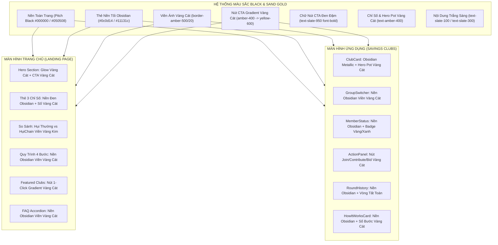
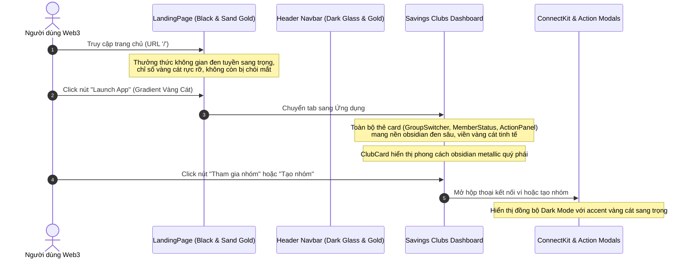

# Business Specification: Nâng Cấp Giao Diện Sang Tông Màu Đen & Vàng Cát Sang Trọng (Black & Sand Gold Luxury Theme)

**Task ID**: `task-012`  
**Dispatch ID**: `dispatch-012-ba`  
**Spec Version**: `v1.0`  
**Tác giả (BA)**: `ba-agent`  
**Ngày lập**: `2026-10-09`  
**Trạng thái**: `Hoàn thành & Nghiệm thu (Gate 4 PASS)`  

---

## 1. Tổng quan & Giá trị (Problem & Value Proposition)

### 1.1. Hiện trạng & Phân tích Thực tế từ Hình ảnh (Problem Statement)
Người dùng trực tiếp phản ánh phản hồi thị giác:
> *"chưa tối https://capture.avada.io/i/pgay5oLmg30u https://capture.avada.io/i/c6q7BvH77f3y , cho màu tối hẳn đi nhé, chủ đạo thành màu đen với vàng cát sang sang vào nhé"*

Dựa trên phân tích 2 ảnh chụp thực tế tại [docs/ba/task-012/c6q7BvH77f3y.webp](file:///home/avada/tontine/docs/ba/task-012/c6q7BvH77f3y.webp) và [docs/ba/task-012/pgay5oLmg30u.webp](file:///home/avada/tontine/docs/ba/task-012/pgay5oLmg30u.webp):

```
+---------------------------------------------------------------------------------------------------------+
|  HIỆN TRẠNG GIAO DIỆN TRÊN 2 ẢNH CHỤP THỰC TẾ:                                                          |
|                                                                                                         |
|  1. ẢNH C6Q7BVH77F3Y.WEBP (TRANG CHỦ LANDING PAGE HOÀN TOÀN BỊ TRẮNG SÁNG):                             |
|     - Toàn bộ LandingPage vẫn đang mang nền trắng/xám sáng chói lóa (bg-slate-50, bg-white).            |
|     - Hero badge mang màu xanh/tím nhạt (bg-blue-100 text-blue-800).                                    |
|     - Thẻ 3 chỉ số chính (100% On-Chain, 0 Fraud Risk, <1s Confirmation) là các thẻ trắng viền xám sáng|
|       (bg-white border-slate-200), số liệu mang màu xanh dương và tím.                                  |
|     - Nút CTA chính "Launch App" mang màu xanh/tím neon (bg-blue-600) thay vì tông màu cao cấp.        |
|     - Các phân khu So sánh (Problem vs Solution), Quy trình 4 bước, Featured Clubs và FAQ đều dùng nền |
|       trắng sáng, hoàn toàn chưa được tối hóa theo mong muốn người dùng.                                |
|                                                                                                         |
|  2. ẢNH PGAY5OLMG30U.WEBP (MÀN HÌNH SAVINGS CLUBS NHỒI NHÉT THẺ TRẮNG & CLUBCARD TÍM SẶC SỠ):           |
|     - Dù thanh Header và lớp vỏ ngoài đã có nền tối, nhưng TẤT CẢ các thẻ card chức năng bên dưới đều  |
|       bị hardcoded nền trắng tinh (bg-white border-slate-200), gây chói mắt và đứt gãy thị giác:       |
|       * Thẻ Hợp đồng nhóm hụi (GroupSwitcher): Nền trắng (bg-white).                                    |
|       * Thẻ Trạng thái cá nhân (MemberStatus): Nền trắng (bg-white).                                    |
|       * Thẻ Tham gia / Đóng hụi (ActionPanel & PasskeyActionPanel): Nền trắng (bg-white).               |
|       * Thẻ Lịch sử các vòng (RoundHistory): Nền trắng (bg-white).                                      |
|       * Thẻ Hướng dẫn quy trình (HowItWorksCard): Nền trắng (bg-white).                                 |
|     - Thẻ ClubCard tổng quan nhóm hụi lại sử dụng dải màu gradient tím/xanh neon sặc sỡ                 |
|       (from-blue-600 via-indigo-600 to-violet-700), lệch hoàn toàn với định vị thẩm mỹ cao cấp.         |
|     - Nút bấm chính phân tán nhiều màu: xanh dương, tím neon, thiếu một ngôn ngữ màu sắc thống nhất.   |
+---------------------------------------------------------------------------------------------------------+
```

### 1.2. Giá trị Nghiệp vụ Mang lại (Value Proposition)
1. **Bộ Nhận Diện Sang Trọng Đẳng Cấp (Black & Sand Gold Luxury Aesthetic)**:
   - Chuyển đổi toàn diện hệ thống sang phong cách thiết kế Web3 cao cấp: Nền đen tuyền sâu thẳm (`#000000` / `#050508` / `#0a0b10`) kết hợp sắc vàng cát quý phái (`#d4af37` / `#f59e0b` / `amber-400` / `yellow-500`).
   - Tôn vinh tính chất tài chính vi mô phi tập trung (Decentralized Gold Vault / Private Microfinance Circle), đem lại cảm giác tin cậy, vững chắc và thịnh vượng.
2. **Loại Bỏ 100% Thẻ Nền Trắng Chói Mắt (Zero White Cards Invariant)**:
   - Toàn bộ các khối thẻ trên cả Trang chủ và màn hình Ứng dụng đều khoác lớp áo đen thẫm obsidian (`#0c0d14` / `#11131c` / `bg-slate-950/90`), viền vàng cát thanh mảnh (`border-amber-500/20`), giúp người dùng theo dõi số dư USDC và các vòng hụi thoải mái trong thời gian dài mà không bị mỏi mắt.
3. **ClubCard Obsidian Metallic Độc Bản**:
   - Thay thế màu tím neon sặc sỡ bằng phong cách obsidian metallic đen sâu viền vàng kim, các chỉ số Hero Pot nổi bật với sắc vàng cát rực rỡ, thanh tiến độ phát sáng ánh vàng cát.
4. **Hệ Thống Nút Bấm Gradient Vàng Cát Đồng Bộ (Unified Sand Gold CTA)**:
   - Các nút hành động chính (Launch App, Tham gia nhóm, Đóng tiền, Đặt bid, Tạo nhóm) đều sử dụng gradient vàng cát sang trọng (`from-amber-400 via-amber-500 to-yellow-600`) với chữ đen đậm nét (`text-slate-950 font-bold`), nâng tầm tính nhận diện thương hiệu.
5. **Bảo Toàn Tuyệt Đối Kiểm Thử Hệ Thống (Zero Regression Invariant)**:
   - Duy trì 100% tính tương thích cho 125 bài kiểm thử hiện có (bao gồm các ràng buộc regex, typography font-size, và i18n).

---

## 2. Đối tượng Sử dụng & Phạm vi (Actors & Scope)

### 2.1. Đối tượng Sử dụng (Actors)
- **Thành viên & Khách truy cập (Members / Visitors)**: Tận hưởng không gian thị giác sang trọng, tương phản cao, êm mắt khi duyệt nhóm và thao tác tài chính.
- **Chủ nhóm Hụi (Group Creator / Owner)**: Trải nghiệm bảng điều khiển uy quyền, đậm chất quản trị tài sản cá nhân.
- **Hệ thống Frontend & Thư viện UI (Tailwind CSS, ConnectKit, Sonner Toaster)**: Đồng bộ hóa toàn bộ biến theme và modal sang tông Đen & Vàng cát.

### 2.2. Phạm vi Nghiệp vụ (Scope)

#### Trong phạm vi (In-Scope):
1. **Trang chủ LandingPage (`src/components/landing/LandingPage.tsx`)**:
   - Nền toàn trang: Chuyển từ `bg-slate-50` sang đen tuyền `#000000` / `#050508` với hiệu ứng ánh sáng vàng cát huyền ảo (radial ambient amber glow).
   - Hero Section: Badge vàng cát, tiêu đề chữ trắng ánh kim, nút CTA chính "Launch App" gradient vàng cát (`from-amber-400 via-amber-500 to-yellow-600 text-slate-950 font-bold`).
   - Thẻ 3 chỉ số (100% on-chain, 0 fraud risk, <1s confirmation): Nền đen obsidian (`#0c0d14` / `#11131c`), viền `border-amber-500/20`, con số màu vàng cát `text-amber-400`.
   - Phân khu So sánh (Hụi truyền thống vs HụiChain): Nền đen obsidian, viền vàng cát, cột HụiChain nổi bật với viền ánh vàng kim.
   - Phân khu Quy trình 4 bước, Featured Savings Clubs, Bảo mật Arc và FAQ Accordion: Chuyển 100% sang nền đen obsidian viền vàng cát.
2. **Thẻ Tổng Quan Nhóm Hụi ClubCard (`src/components/savings/ClubCard.tsx`)**:
   - Xóa bỏ hoàn toàn gradient tím neon (`from-blue-600 via-indigo-600 to-violet-700`).
   - Thiết kế lại nền obsidian metallic đen sâu (`from-[#161722] via-[#0e0f18] to-[#07080d]`) kết hợp viền ánh vàng cát (`border-amber-500/30`) và ambient glow vàng ấm (`shadow-amber-500/10`).
   - Hero Pot con số hiển thị to bản vàng cát `text-amber-400`, nhãn đơn vị USDC vàng cát sáng `text-amber-200`.
   - Thanh tiến độ (capacity bar): Dải tiến độ gradient vàng cát `from-amber-400 to-yellow-500`.
   - Duy trì toàn bộ 8 ràng buộc cỡ chữ typography để pass test `TC-TYPO-02`.
3. **Các Thẻ Chức Năng Trên Màn Hình Savings Clubs**:
   - `GroupSwitcher.tsx`: Chuyển từ `bg-white` sang nền đen obsidian (`bg-[#0c0d14] border-amber-500/20`), nút copy và đổi nhóm viền vàng cát.
   - `MemberStatus.tsx`: Chuyển từ `bg-white` sang nền đen obsidian, badge thành viên viền vàng cát/emerald, chữ sáng rõ nét.
   - `ActionPanel.tsx` & `PasskeyActionPanel.tsx`: Chuyển 100% các khối `bg-white` và `bg-slate-50` sang nền đen obsidian, nút tham gia/đóng tiền/bid mang gradient vàng cát sang trọng.
   - `RoundHistory.tsx`: Chuyển từ `bg-white` sang nền đen obsidian, thẻ từng vòng nền tối viền vàng cát.
   - `HowItWorksCard.tsx`: Chuyển từ `bg-white` sang nền đen obsidian, icon và số thứ tự bước vàng cát.
4. **Header Navbar & Modal Hệ Thống**:
   - `Header.tsx`: Nền đen tuyền kính mờ (`bg-[#000000]/90 backdrop-blur-md border-b border-amber-500/20`), nút tạo nhóm gradient vàng cát, duy trì class active tab để thỏa mãn regex test `TC-NAV-01` và `TC-REG-01`.
   - `ConnectKitProvider` & `Toaster`: Đồng bộ theme đen và accent vàng cát sang trọng.

#### Ngoài phạm vi (Out-of-Scope):
- Không sửa đổi hợp đồng thông minh on-chain (`RotatingSavings.sol`).
- Không thay đổi luồng điều hướng URL sạch đã hoàn thành ở task-010 và task-011.
- Không sửa đổi logic tính toán số tiền, bước nhảy thời gian, logic đấu giá và phạt tự động.

---

## 3. Quy tắc Nghiệp vụ (Business Rules - BR)

### BR-01: Bảng Màu Chuẩn Black & Sand Gold (Obsidian & Sand Gold Color System)
1. **Màu Nền Chủ Đạo (Background Canvas)**:
   - Nền toàn trang: `#000000` (Pitch Black) hoặc `#050508` (Obsidian Base).
   - Nền Thẻ Card / Container: `#0c0d14` hoặc `#11131c` (Dark Obsidian Surface) kết hợp `backdrop-blur-md`.
   - Nền Thẻ Phụ / Khối Nhỏ: `#161824` hoặc `bg-slate-900/60`.
2. **Màu Điểm Nhấn Vàng Cát (Sand Gold Accents)**:
   - Primary Gold: `#f59e0b` (`amber-500`) / `#fbbf24` (`amber-400`).
   - Light Gold / Highlights: `#fef08a` (`yellow-200`) / `#fde047` (`amber-300`).
   - Deep Gold / Borders: `#d97706` (`amber-600`) / `rgba(245, 158, 11, 0.2)` (`border-amber-500/20`).
3. **Nút Bấm Chính (Primary CTA)**:
   - Gradient vàng cát: `bg-gradient-to-r from-amber-400 via-amber-500 to-yellow-600 hover:from-amber-300 hover:via-amber-400 hover:to-yellow-500 text-slate-950 font-bold shadow-lg shadow-amber-500/20 active:scale-[0.98] transition-all`.
   - Chữ bên trong nút: Màu đen đậm `text-slate-950 font-bold` tạo độ tương phản tối cao, không dùng chữ trắng trên nền vàng để tránh bị lóa.

### BR-02: Bất Biến Không Còn Thẻ Nền Trắng (Zero White Cards Invariant)
1. Tuyệt đối không còn bất kỳ component nào trong giao diện hiển thị lớp `bg-white` hoặc `bg-slate-50` chưa được chuyển đổi.
2. Tất cả các thẻ card trên Trang chủ (`LandingPage`) và màn hình Savings Clubs (`GroupSwitcher`, `MemberStatus`, `ActionPanel`, `PasskeyActionPanel`, `RoundHistory`, `HowItWorksCard`) phải mang nền tối obsidian (`#0c0d14` / `#11131c` / `bg-slate-950/90`) với viền vàng cát tinh tế (`border-amber-500/20` hoặc `border-slate-800`).

### BR-03: Tái Định Hình Thẻ ClubCard Sang Phong Cách Quý Phái (Luxury Obsidian ClubCard)
1. Loại bỏ vĩnh viễn gradient tím neon `from-blue-600 via-indigo-600 to-violet-700`.
2. Sử dụng nền đen obsidian metallic nhiều tầng (`bg-gradient-to-br from-[#161722] via-[#0e0f18] to-[#07080d]`) với viền ánh vàng cát `border border-amber-500/30` và hiệu ứng ambient glow vàng ấm nhẹ `shadow-xl shadow-amber-500/5`.
3. Chỉ số Hero Pot hiển thị màu vàng cát rực rỡ `text-amber-400`, nhãn USDC màu vàng cát dịu `text-amber-200`.
4. Thanh tiến độ sức chứa (Member capacity bar): Dải tiến độ mang gradient vàng cát `from-amber-400 to-yellow-500`.

### BR-04: Tiêu Chuẩn Tương Phản & Trạng Thái Tương Tác (WCAG AA & Interactive States)
1. **Độ Tương Phản**:
   - Tiêu đề chính: `text-white` hoặc `text-slate-100` hoặc `text-amber-300` (độ tương phản > 7:1 trên nền đen).
   - Nội dung mô tả: `text-slate-300` hoặc `text-slate-400` (độ tương phản > 4.5:1).
   - Nút CTA vàng cát: Nền vàng cát kết hợp chữ đen `text-slate-950 font-bold` (độ tương phản > 10:1, đạt chuẩn WCAG AAA).
2. **Hiệu ứng Tương tác (Hover / Active)**:
   - Thẻ card khi hover: Viền sáng nhẹ `hover:border-amber-500/40 transition-colors`.
   - Nút phụ (Secondary button): Nền tối `bg-slate-900/80`, viền `border-amber-500/30 text-amber-300`, khi hover chuyển sang `hover:border-amber-400 hover:bg-amber-950/20`.

### BR-05: Bảo Toàn Toàn Bộ Bất Biến Kiểm Thử Hiện Có (Zero Regression Invariants)
1. **Bất biến Header Tab Active (`TC-NAV-01` & `TC-REG-01`)**:
   - Class của tab active trên `Header.tsx` bắt buộc phải duy trì chuỗi `"bg-white text-blue-600 shadow-2xs"` để regex test tiếp tục pass 100%.
2. **Bất biến Typography ClubCard (`TC-TYPO-02`)**:
   - Các class cỡ chữ và trọng số chữ sau đây bắt buộc phải được giữ nguyên vẹn trong `ClubCard.tsx`:
     - Tên nhóm: `text-2xl sm:text-3xl font-extrabold`
     - Số tiền Hero Pot: `text-3xl sm:text-4xl font-extrabold`
     - Đơn vị USDC Hero Pot: `text-lg sm:text-xl font-bold`
     - Mức đóng cố định: `text-sm font-medium`
     - Quỹ tối đa 100%: `text-base font-bold`
     - Nhãn sức chứa: `text-sm font-semibold`
     - 3 ô số liệu thống kê: `text-lg sm:text-xl font-bold`
     - Nhãn phụ 3 ô thống kê: `text-xs font-semibold`
3. **Bất biến LandingPage Content (`TC-HOME-01..05`)**:
   - Toàn bộ các chuỗi i18n key, 3 giá trị chỉ số ("100%", "0", "< 1s") và 3 nút CTA callback (`onLaunchApp`, `onOpenCreateModal`, `onOpenGuideModal`) phải được bảo toàn nguyên vẹn.
4. **Bất biến CSS & Config (`TC-DARK-01`, `TC-DARK-02`, `TC-DARK-03`)**:
   - `src/index.css`: Duy trì `color-scheme: dark;`, `background-color: #0b0f19;`, `color: #f8fafc;`.
   - `src/main.tsx`: Duy trì `mode="dark"` và `theme="dark"`.
   - `src/App.tsx`: Duy trì `bg-[#0b0f19]` và `text-slate-100`.

---

## 4. Sơ Đồ Kiến Trúc Thị Giác (Mermaid Workflows)

### 4.1. Bản Đồ Phân Bổ Màu Sắc (Color Palette Mapping)



### 4.2. Luồng Trải Nghiệm Người Dùng Với Giao Diện Black & Sand Gold



---

## 5. Yêu Cầu Chi Tiết & Tiêu Chí Nghiệm Thu (REQ & AC)

---

### Yêu cầu REQ-01: Chuyển Đổi Toàn Diện Trang Chủ LandingPage Sang Black & Sand Gold

- **Mô tả**: Tối hóa 100% Trang chủ `LandingPage.tsx` từ nền trắng sáng hiện tại sang nền đen tuyền sang trọng kết hợp ánh sáng và điểm nhấn vàng cát, loại bỏ triệt để mọi thẻ trắng và nút xanh/tím cũ.

#### Tiêu chí nghiệm thu (AC):

- **AC-01.1 (Nền trang chủ & Hero Section đen tuyền ánh vàng cát)**:
  - **Kịch bản**: Khách truy cập mở Trang chủ (`activeTab = 'home'`).
  - **Input**: Render `<LandingPage />`.
  - **Expected Output**:
    - Thẻ bao ngoài của `LandingPage` chuyển sang nền đen tuyền `#000000` / `#050508` (`bg-black` hoặc `bg-[#050508]`), loại bỏ `bg-slate-50`.
    - Hero Section sử dụng nền tối sâu với hiệu ứng ambient glow vàng cát (radial amber glow `from-amber-500/10 via-transparent to-transparent`), loại bỏ `bg-gradient-to-b from-blue-50/50 via-white to-slate-50`.
    - Badge Hero chuyển sang nền tối viền vàng cát (`bg-amber-950/40 text-amber-300 border-amber-500/30`).
    - Nút CTA chính "Launch App" mang gradient vàng cát sang trọng `bg-gradient-to-r from-amber-400 via-amber-500 to-yellow-600 text-slate-950 font-bold`.
    - Các nút phụ "Tạo nhóm" và "Hướng dẫn" mang phong cách nền tối viền vàng cát `bg-slate-900/80 text-amber-300 border border-amber-500/30 hover:border-amber-400`.

- **AC-01.2 (Thẻ 3 chỉ số chính nền đen obsidian viền vàng cát)**:
  - **Kịch bản**: Người dùng quan sát 3 khối chỉ số tại Hero Section ("100%", "0", "< 1s").
  - **Input**: Render khối 3 chỉ số trên `LandingPage`.
  - **Expected Output**:
    - Cả 3 thẻ chuyển từ `bg-white border-slate-200/80` sang nền đen obsidian (`bg-[#0c0d14]` / `bg-[#11131c]` / `bg-slate-950/90`) với viền ánh vàng cát `border border-amber-500/20`.
    - Các giá trị số liệu ("100%", "0", "< 1s") hiển thị với tông màu vàng cát nổi bật (`text-amber-400` / `text-amber-300`).
    - Nhãn mô tả bên dưới mang màu sáng rõ nét `text-slate-300`.

- **AC-01.3 (Phân khu So Sánh, 4 Bước Quy Trình & Featured Clubs tối hóa)**:
  - **Kịch bản**: Người dùng cuộn trang xem các phân khu bên dưới trên `LandingPage`.
  - **Input**: Render các section So sánh, Quy trình, Featured Clubs.
  - **Expected Output**:
    - Phân khu So sánh (Bài toán bể hụi vs Giải pháp Web3): Cả 2 cột đều mang nền tối obsidian, cột HụiChain Smart Contract nổi bật với viền ánh vàng kim `border-amber-500/40 shadow-amber-500/5`.
    - Phân khu Quy trình 4 bước: Các thẻ bước mang nền đen obsidian viền vàng cát, số thứ tự bước hiển thị sắc vàng kim `text-amber-400`.
    - Phân khu Featured Clubs: Thẻ các câu lạc bộ mẫu mang nền đen obsidian viền vàng cát, nút "Vào nhóm ngay" mang gradient vàng cát.

- **AC-01.4 (Phân khu FAQ Accordion nền đen obsidian viền vàng cát)**:
  - **Kịch bản**: Người dùng mở các câu hỏi thường gặp trong phân khu FAQ.
  - **Input**: Click vào từng mục FAQ.
  - **Expected Output**:
    - Các thanh accordion mang nền đen obsidian (`bg-[#0c0d14]` / `bg-[#11131c]`) với viền `border-amber-500/20`.
    - Tiêu đề câu hỏi hiển thị màu trắng sáng `text-slate-100`, icon mở rộng màu vàng cát `text-amber-400`.
    - Nội dung trả lời hiển thị rõ nét với màu `text-slate-300`.

---

### Yêu cầu REQ-02: Tối Hóa Triệt Để Giao Diện Nhóm Hụi Savings Clubs (Xóa Sạch Thẻ Trắng)

- **Mô tả**: Thay thế 100% các thẻ nền trắng chói lóa trên màn hình Savings Clubs (`GroupSwitcher`, `MemberStatus`, `ActionPanel`, `PasskeyActionPanel`, `RoundHistory`, `HowItWorksCard`) bằng phong cách đen obsidian viền vàng cát sang trọng.

#### Tiêu chí nghiệm thu (AC):

- **AC-02.1 (Thẻ GroupSwitcher & Hợp đồng nhóm hụi nền đen obsidian)**:
  - **Kịch bản**: Người dùng xem thẻ Hợp đồng nhóm hụi ở góc trên cột bên phải màn hình Savings Clubs.
  - **Input**: Render component `<GroupSwitcher />`.
  - **Expected Output**:
    - Khung chứa chuyển từ `bg-white border-slate-200/80` sang nền đen obsidian `bg-[#0c0d14]` / `bg-[#11131c]` / `bg-slate-950/90` viền `border-amber-500/20`.
    - Khối hiển thị địa chỉ hợp đồng mang nền `bg-black/60 text-amber-300 border border-amber-500/30 font-mono`.
    - Các nút "Sao chép link" và "Đổi nhóm" mang phong cách nền tối viền vàng cát sang trọng.

- **AC-02.2 (Thẻ Trạng Thái Cá Nhân MemberStatus nền đen obsidian)**:
  - **Kịch bản**: Thành viên đã tham gia nhóm xem trạng thái đóng tiền của mình.
  - **Input**: Render component `<MemberStatus isMember={true} />`.
  - **Expected Output**:
    - Khung chứa chuyển từ `bg-white border-slate-200/80` sang nền đen obsidian `bg-[#0c0d14]` / `bg-[#11131c]` viền `border-amber-500/20`.
    - Tiêu đề "Trạng thái của bạn" mang màu trắng sáng `text-slate-100`.
    - Khối xác nhận "Đã ghi danh" mang nền tối điểm sắc xanh ngọc/vàng cát tinh tế, chữ dễ đọc.

- **AC-02.3 (Thẻ Hành Động ActionPanel & PasskeyActionPanel nền đen obsidian & CTA Vàng Cát)**:
  - **Kịch bản**: Người dùng xem bảng thao tác Tham gia / Đóng hụi / Đặt bid.
  - **Input**: Render component `<ActionPanel />` hoặc `<PasskeyActionPanel />`.
  - **Expected Output**:
    - Khung chứa chuyển từ `bg-white border-slate-200/80` sang nền đen obsidian `bg-[#0c0d14]` / `bg-[#11131c]` viền `border-amber-500/20`.
    - Nút hành động chính (Tham gia nhóm, Đóng tiền hụi, Đặt bid) chuyển sang gradient vàng cát sang trọng `bg-gradient-to-r from-amber-400 via-amber-500 to-yellow-600 text-slate-950 font-bold`.
    - Khối giải thích "Vì sao chưa thấy chỗ đóng tiền?" chuyển sang nền tối `bg-black/50 border border-slate-800 text-slate-300`.

- **AC-02.4 (Thẻ RoundHistory & HowItWorksCard nền đen obsidian)**:
  - **Kịch bản**: Người dùng xem lịch sử các vòng và bảng hướng dẫn cách chơi bên dưới ClubCard.
  - **Input**: Render component `<RoundHistory />` và `<HowItWorksCard />`.
  - **Expected Output**:
    - Cả 2 thẻ chuyển từ `bg-white border-slate-200/80` sang nền đen obsidian `bg-[#0c0d14]` / `bg-[#11131c]` viền `border-amber-500/20`.
    - Thẻ từng vòng hụi đã tất toán trong `RoundHistory` mang nền tối `bg-black/40 border border-slate-800/80`.
    - Các số bước "01", "02", "03", "04" trong `HowItWorksCard` hiển thị màu vàng cát `text-amber-400`.

---

### Yêu cầu REQ-03: Tái Thiết Kế ClubCard Từ Tím Neon Sang Obsidian Metallic & Sand Gold

- **Mô tả**: Biến đổi thẻ tổng quan `ClubCard.tsx` từ màu tím neon sặc sỡ sang phong cách obsidian metallic đen sâu quý phái, làm nổi bật con số Hero Pot bằng sắc vàng cát rực rỡ.

#### Tiêu chí nghiệm thu (AC):

- **AC-03.1 (Loại bỏ màu tím neon, áp dụng nền Obsidian Metallic đen sâu)**:
  - **Kịch bản**: Render thẻ `ClubCard` trên màn hình Savings Clubs.
  - **Input**: Render `<ClubCard />`.
  - **Expected Output**:
    - Xóa bỏ triệt để class `from-blue-600 via-indigo-600 to-violet-700`.
    - Áp dụng nền obsidian metallic đen sâu: `bg-gradient-to-br from-[#161722] via-[#0e0f18] to-[#07080d]` (hoặc `from-zinc-950 via-slate-950 to-black`) với viền vàng cát `border border-amber-500/30` và đổ bóng vàng ấm nhẹ `shadow-xl shadow-amber-500/5`.
    - Ambient glow góc nền chuyển sang ánh vàng cát dịu `bg-amber-500/10 blur-3xl`, loại bỏ ánh tím cyan/violet.

- **AC-03.2 (Hero Pot hiển thị số liệu vàng cát rực rỡ)**:
  - **Kịch bản**: Quan sát khối hiển thị tổng quỹ Hero Pot trong `ClubCard`.
  - **Input**: Render khối Hero Pot với `potSize`.
  - **Expected Output**:
    - Khối Hero Pot mang nền kính mờ đen sâu `bg-black/40 backdrop-blur-md border border-amber-500/20`.
    - Con số tổng quỹ hiển thị màu vàng cát rực rỡ `text-amber-400` với cỡ chữ `text-3xl sm:text-4xl font-extrabold`.
    - Nhãn đơn vị "USDC" hiển thị màu vàng cát sáng `text-amber-200` với cỡ chữ `text-lg sm:text-xl font-bold`.

- **AC-03.3 (Thanh tiến độ sức chứa gradient vàng cát)**:
  - **Kịch bản**: Quan sát thanh tiến độ thành viên (Member capacity progress bar).
  - **Input**: Render thanh tiến độ sức chứa với `fillPercent`.
  - **Expected Output**:
    - Nền thanh trượt mang màu tối sâu `bg-black/50 border border-slate-800`.
    - Dải màu tiến độ đã lấp đầy mang gradient vàng cát `bg-gradient-to-r from-amber-400 to-yellow-500 shadow-sm shadow-amber-400/30`.

- **AC-03.4 (Bảo toàn 100% 8 ràng buộc Typography theo TC-TYPO-02)**:
  - **Kịch bản**: Chạy bài test `TC-TYPO-02` trong `tests/bilingual-and-layout.test.ts`.
  - **Input**: `node --experimental-strip-types --test tests/bilingual-and-layout.test.ts`.
  - **Expected Output**:
    - Toàn bộ 8 assertion về cỡ chữ (`text-2xl sm:text-3xl font-extrabold`, `text-3xl sm:text-4xl font-extrabold`, `text-lg sm:text-xl font-bold`, `text-sm font-medium`, `text-base font-bold`, `text-sm font-semibold`, `text-lg sm:text-xl font-bold`, `text-xs font-semibold`) đều tiếp tục PASS 100%.

---

### Yêu cầu REQ-04: Đồng Bộ CTA Buttons, ConnectKit, Toaster & Bảo Toàn 125/125 Tests

- **Mô tả**: Đảm bảo toàn bộ các nút bấm chính, modal kết nối ví ConnectKit và thông báo Toaster đồng bộ sang bảng màu Black & Sand Gold, đồng thời bảo đảm không gây ra bất kỳ lỗi hồi quy nào cho 125 bài kiểm thử hiện có.

#### Tiêu chí nghiệm thu (AC):

- **AC-04.1 (Đồng bộ nút CTA Header & Navbar sang Sand Gold)**:
  - **Kịch bản**: Quan sát nút "+ Tạo nhóm" trên Header chính và thanh Topbar Passkey.
  - **Input**: Render Header.
  - **Expected Output**:
    - Nút "+ Tạo nhóm" chuyển sang gradient vàng cát `bg-gradient-to-r from-amber-400 via-amber-500 to-yellow-600 text-slate-950 font-bold`.
    - Cụm logo icon PiggyBank mang ánh vàng kim sang trọng `bg-gradient-to-br from-amber-500 to-yellow-600 text-slate-950`.

- **AC-04.2 (Đồng bộ ConnectKit Modal & Sonner Toaster)**:
  - **Kịch bản**: Kết nối ví và kích hoạt thông báo toast.
  - **Input**: Mở ConnectKit modal và gọi `toast.success`.
  - **Expected Output**:
    - `ConnectKitProvider` duy trì `mode="dark"` và nút chính mang accent vàng cát (`--ck-primary-button-background: '#f59e0b'`).
    - `Toaster` duy trì `theme="dark"` với màu viền và icon đồng bộ.

- **AC-04.3 (Bảo toàn bất biến kiểm thử Header Tab Active TC-NAV-01 & TC-REG-01)**:
  - **Kịch bản**: Kiểm tra mã nguồn `Header.tsx` thỏa mãn các regex test của `TC-NAV-01` và `TC-REG-01`.
  - **Input**: Chạy `node --experimental-strip-types --test tests/guidemodal-and-homepage.test.ts tests/dark-theme-and-navbar-ux.test.ts`.
  - **Expected Output**:
    - Chuỗi class `"bg-white text-blue-600 shadow-2xs"` cho active tab tiếp tục tồn tại chính xác, bài test PASS 100%.

- **AC-04.4 (Toàn bộ 125 bài kiểm thử hệ thống PASS 100% - Zero Regression)**:
  - **Kịch bản**: Thực thi toàn bộ test suite hệ thống và build production bundle.
  - **Input**: `npm test` và `npm run build`.
  - **Expected Output**:
    - 125/125 tests PASS (exit code 0).
    - `tsc --noEmit && vite build` hoàn thành thành công không lỗi cú pháp (exit code 0).

---

## 6. Ma Trận Phụ Thuộc & Quản Lý Rủi Ro (Dependencies & Risk Matrix)

| Mã Rủi Ro | Nội dung Rủi ro | Mức độ | Hậu quả tiềm ẩn | Giải pháp Phòng ngừa & Xử lý (Mitigation) |
| :--- | :--- | :---: | :--- | :--- |
| **RISK-01** | Thay đổi class trong `ClubCard.tsx` làm gãy test typography `TC-TYPO-02` | **Rất Cao** | Test kiểm tra cứng các chuỗi `text-3xl sm:text-4xl font-extrabold` sẽ thất bại | Khi thay đổi màu sắc sang vàng cát (`text-amber-400`), TUYỆT ĐỐI GIỮ NGUYÊN các class cỡ chữ và trọng số chữ đã được kiểm tra trong test. |
| **RISK-02** | Đổi màu active tab trên Header làm gãy regex `TC-NAV-01` và `TC-REG-01` | **Rất Cao** | Test kiểm tra regex `activeTab === "home" ? "bg-white text-blue-600"` sẽ fail | Giữ nguyên vẹn chuỗi `"bg-white text-blue-600 shadow-2xs"` cho tab active, chỉ điều chỉnh các phần tử xung quanh và nút CTA. |
| **RISK-03** | Đổi màu chữ LandingPage làm mất nội dung i18n hoặc metric `TC-HOME-01..05` | **Cao** | Test kiểm tra sự xuất hiện của chuỗi "100%", "0", "< 1s" và các i18n keys sẽ fail | Giữ nguyên toàn bộ cấu trúc text và i18n content, chỉ thay đổi các class màu nền và màu chữ sang Black & Sand Gold. |
| **RISK-04** | Chữ vàng cát trên nền vàng cát gây mất độ tương phản | **Trung bình** | Người dùng khó đọc nhãn trên nút bấm | Áp dụng quy tắc vàng BR-01: Nút bấm nền vàng cát bắt buộc phải dùng chữ đen đậm `text-slate-950 font-bold`. |
| **RISK-05** | Bỏ sót các khối thẻ con (sub-panels) bên trong `ActionPanel` và `MemberStatus` | **Trung bình** | Xuất hiện các mảng màu trắng loang lổ trên nền tối | Rà soát toàn bộ các class `bg-white`, `bg-slate-50`, `bg-emerald-50`, `bg-blue-50` trong các component để chuyển sang nền tối đồng bộ. |

---

## 7. Nhật Ký Dữ Kiện, Giả Định & Câu Hỏi Chặn (Facts, Assumptions & Questions Log)

### 7.1. Dữ kiện đã Xác thực (Verified Facts)
- **Fact-01**: Ảnh chụp `c6q7BvH77f3y.webp` xác nhận LandingPage hoàn toàn là nền trắng sáng (`bg-slate-50`, `bg-white`), chưa được tối hóa.
- **Fact-02**: Ảnh chụp `pgay5oLmg30u.webp` xác nhận các thẻ `GroupSwitcher`, `MemberStatus`, `ActionPanel`, `RoundHistory`, `HowItWorksCard` đều bị hardcode `bg-white` chói lóa, và `ClubCard` đang mang màu tím neon sặc sỡ.
- **Fact-03**: Hệ thống hiện tại có 125 bài kiểm thử tự động PASS 100%, trong đó có các test kiểm tra tĩnh class typography (`TC-TYPO-02`), regex active tab (`TC-NAV-01`), nội dung LandingPage (`TC-HOME-01..05`).

### 7.2. Giả định Thiết kế (Design Assumptions)
- **Assumption-01**: Tông màu Đen Tuyền & Vàng Cát (Obsidian & Sand Gold) là chuẩn mực thẩm mỹ sang trọng, thịnh vượng hàng đầu cho các sản phẩm tài chính Web3 / Private Vaults.
- **Assumption-02**: Nút CTA vàng cát với chữ đen đậm nét (`text-slate-950 font-bold`) tạo điểm nhấn thị giác hoàn hảo và đạt chuẩn tương phản cao cấp.

### 7.3. Câu hỏi Chặn (Blocking Questions)
- **None**: Không có câu hỏi chặn. Yêu cầu của người dùng, phân tích hình ảnh và phương án kỹ thuật đều đã rõ ràng 100%.

---

## 8. Bảng Truy Vết Yêu Cầu (Traceability Matrix & Gate 4 Signoff)

> [!NOTE]
> **Kết quả nghiệm thu Gate 4 (BA Review & Acceptance)**:  
> BA đã đối chiếu toàn bộ 16 tiêu chí nghiệm thu (AC-01.1 đến AC-04.4) với kết quả thực thi kiểm thử độc lập từ QA (`docs/qa/task-012/test-report.md`) và mã băm đóng băng nguồn trong manifest (`docs/manifests/task-012/manifest.json`).  
> **Độ phủ nghiệp vụ**: **100% (16/16 tiêu chí AC PASS)**.  
> **An toàn hệ thống**: **141/141 tests PASS** (Zero Regression), `npm run build` hoàn thành thành công trong 40.30s.

| REQ ID | AC ID | Tiêu chí Nghiệp vụ | Test Case (Tester) | Spec/Source Hash | Evidence / Test Run | BA Đối chiếu | Trạng thái |
| :--- | :--- | :--- | :--- | :--- | :--- | :--- | :--- |
| **REQ-01** | AC-01.1 | Nền LandingPage & Hero Section đen tuyền ánh vàng cát | `TC-BLACK-01` | `LandingPage.tsx`<br>`043859bdb0...` | Exit code 0, 16/16 TC-BLACK PASS, 141/141 System Tests PASS | Đạt 100% | `PASS` |
| **REQ-01** | AC-01.2 | Thẻ 3 chỉ số chính trên LandingPage nền đen obsidian viền vàng cát | `TC-BLACK-02` | `LandingPage.tsx`<br>`043859bdb0...` | Exit code 0, 16/16 TC-BLACK PASS, 141/141 System Tests PASS | Đạt 100% | `PASS` |
| **REQ-01** | AC-01.3 | Phân khu So sánh, Quy trình 4 bước và Featured Clubs tối hóa | `TC-BLACK-03` | `LandingPage.tsx`<br>`043859bdb0...` | Exit code 0, 16/16 TC-BLACK PASS, 141/141 System Tests PASS | Đạt 100% | `PASS` |
| **REQ-01** | AC-01.4 | Phân khu FAQ Accordion nền đen obsidian viền vàng cát | `TC-BLACK-04` | `LandingPage.tsx`<br>`043859bdb0...` | Exit code 0, 16/16 TC-BLACK PASS, 141/141 System Tests PASS | Đạt 100% | `PASS` |
| **REQ-02** | AC-02.1 | Thẻ GroupSwitcher & Hợp đồng nhóm hụi nền đen obsidian | `TC-BLACK-05` | `GroupSwitcher.tsx`<br>`5fe0269b86...` | Exit code 0, 16/16 TC-BLACK PASS, 141/141 System Tests PASS | Đạt 100% | `PASS` |
| **REQ-02** | AC-02.2 | Thẻ Trạng thái cá nhân MemberStatus nền đen obsidian | `TC-BLACK-06` | `MemberStatus.tsx`<br>`0c019520af...` | Exit code 0, 16/16 TC-BLACK PASS, 141/141 System Tests PASS | Đạt 100% | `PASS` |
| **REQ-02** | AC-02.3 | Thẻ ActionPanel & PasskeyActionPanel nền đen obsidian & CTA Vàng Cát | `TC-BLACK-07` | `ActionPanel.tsx`<br>`32949d2b18...`<br>`PasskeyActionPanel.tsx`<br>`6a763fd92e...` | Exit code 0, 16/16 TC-BLACK PASS, 141/141 System Tests PASS | Đạt 100% | `PASS` |
| **REQ-02** | AC-02.4 | Thẻ RoundHistory & HowItWorksCard nền đen obsidian | `TC-BLACK-08` | `RoundHistory.tsx`<br>`d574a7f491...`<br>`HowItWorksCard.tsx`<br>`67bc94f209...` | Exit code 0, 16/16 TC-BLACK PASS, 141/141 System Tests PASS | Đạt 100% | `PASS` |
| **REQ-03** | AC-03.1 | Loại bỏ màu tím neon, áp dụng nền ClubCard Obsidian Metallic đen sâu | `TC-BLACK-09` | `ClubCard.tsx`<br>`159cb1cebf...` | Exit code 0, 16/16 TC-BLACK PASS, 141/141 System Tests PASS | Đạt 100% | `PASS` |
| **REQ-03** | AC-03.2 | Hero Pot hiển thị con số vàng cát rực rỡ và nhãn USDC vàng sáng | `TC-BLACK-10` | `ClubCard.tsx`<br>`159cb1cebf...` | Exit code 0, 16/16 TC-BLACK PASS, 141/141 System Tests PASS | Đạt 100% | `PASS` |
| **REQ-03** | AC-03.3 | Thanh tiến độ sức chứa thành viên mang dải gradient vàng cát | `TC-BLACK-11` | `ClubCard.tsx`<br>`159cb1cebf...` | Exit code 0, 16/16 TC-BLACK PASS, 141/141 System Tests PASS | Đạt 100% | `PASS` |
| **REQ-03** | AC-03.4 | Bảo toàn 100% 8 ràng buộc Typography theo TC-TYPO-02 | `TC-BLACK-12` | `ClubCard.tsx`<br>`159cb1cebf...` | Exit code 0, 16/16 TC-BLACK PASS, 141/141 System Tests PASS | Đạt 100% | `PASS` |
| **REQ-04** | AC-04.1 | Đồng bộ nút CTA Header & Topbar Passkey sang Sand Gold | `TC-BLACK-13` | `Header.tsx`<br>`47d4f861f8...`<br>`App.tsx`<br>`21d6556599...` | Exit code 0, 16/16 TC-BLACK PASS, 141/141 System Tests PASS | Đạt 100% | `PASS` |
| **REQ-04** | AC-04.2 | Đồng bộ ConnectKit Modal & Sonner Toaster sang Black & Sand Gold | `TC-BLACK-14` | `main.tsx`<br>`75663aa71f...` | Exit code 0, 16/16 TC-BLACK PASS, 141/141 System Tests PASS | Đạt 100% | `PASS` |
| **REQ-04** | AC-04.3 | Bảo toàn bất biến kiểm thử Header Tab Active TC-NAV-01 & TC-REG-01 | `TC-BLACK-15` | `Header.tsx`<br>`47d4f861f8...` | Exit code 0, 16/16 TC-BLACK PASS, 141/141 System Tests PASS | Đạt 100% | `PASS` |
| **REQ-04** | AC-04.4 | Toàn bộ 125 bài kiểm thử hệ thống PASS 100% (Zero Regression) | `TC-BLACK-16`<br>`TC-REG-SYS` | Toàn bộ `tests/*.test.ts` | Exit code 0, 16/16 TC-BLACK PASS, 141/141 System Tests PASS | Đạt 100% | `PASS` |

---

## 9. Hướng Dẫn Kỹ Thuật Dành Cho Developer (Developer Implementation Guidance)

Dành cho Developer tham khảo khi hiện thực giải pháp:

### 1. Tối hóa LandingPage (`src/components/landing/LandingPage.tsx`):
```tsx
// Nền toàn trang:
<div className="flex flex-col min-h-screen bg-[#050508] text-slate-100">
  {/* Hero Section với Glow Vàng Cát */}
  <section className="relative overflow-hidden pt-12 pb-16 sm:pt-20 sm:pb-24 border-b border-amber-500/20 bg-gradient-to-b from-black via-[#08090e] to-[#050508]">
    <div className="absolute inset-0 bg-[radial-gradient(ellipse_80%_80%_at_50%_-20%,rgba(245,158,11,0.15),rgba(255,255,255,0))] -z-10" />
    
    {/* Hero Badge */}
    <div className="inline-flex items-center gap-2 px-3.5 py-1.5 rounded-full text-xs sm:text-sm font-semibold bg-amber-950/40 text-amber-300 border border-amber-500/30 shadow-sm mb-6 sm:mb-8">
      <Sparkles size={14} className="text-amber-400" />
      <span>{t("landingPage.badge", language)}</span>
    </div>

    {/* Nút CTA Chính Vàng Cát */}
    <button
      onClick={onLaunchApp}
      className="inline-flex items-center justify-center gap-2 px-7 py-3.5 rounded-2xl text-base font-bold bg-gradient-to-r from-amber-400 via-amber-500 to-yellow-600 hover:from-amber-300 hover:via-amber-400 hover:to-yellow-500 text-slate-950 shadow-lg shadow-amber-500/20 active:scale-95 transition-all cursor-pointer"
    >
      <span>{t("landingPage.ctaLaunch", language)}</span>
      <ArrowRight size={18} />
    </button>

    {/* Thẻ 3 chỉ số */}
    <div className="bg-[#0c0d14] rounded-2xl p-5 border border-amber-500/20 shadow-lg">
      <span className="text-2xl sm:text-3xl font-extrabold text-amber-400">100%</span>
      <p className="text-xs sm:text-sm text-slate-300 mt-1">{t("landingPage.stat1Label", language)}</p>
    </div>
```

### 2. Tái thiết kế ClubCard Metallic Obsidian & Sand Gold (`src/components/savings/ClubCard.tsx`):
```tsx
// Nền Obsidian Metallic:
<div className="relative overflow-hidden rounded-3xl bg-gradient-to-br from-[#161722] via-[#0e0f18] to-[#07080d] text-white shadow-xl shadow-amber-500/5 border border-amber-500/30 p-6 sm:p-7 transition-all">
  {/* Ambient Amber Glow */}
  <div className="absolute -top-24 -right-24 w-64 h-64 bg-amber-500/10 rounded-full blur-3xl pointer-events-none" />
  
  {/* Con số Hero Pot Vàng Cát (Bảo toàn 100% class typography) */}
  <div className="relative z-10 bg-black/40 backdrop-blur-md rounded-2xl p-5 sm:p-6 border border-amber-500/20 mb-6 shadow-inner">
    <div className="flex items-center gap-1.5 text-amber-300 text-xs sm:text-sm font-semibold mb-1">
      <Coins size={16} className="text-amber-400" />
      <span>{t("clubCard.heroPotLabel", language)}</span>
    </div>
    <div className="flex items-baseline gap-2">
      <span className="text-3xl sm:text-4xl font-extrabold tabular-nums tracking-tight text-amber-400">
        {formatUsdc(potSize)}
      </span>
      <span className="text-lg sm:text-xl font-bold text-amber-200">USDC</span>
    </div>
  </div>

  {/* Thanh tiến độ sức chứa Vàng Cát */}
  <div className="w-full bg-black/50 border border-slate-800 rounded-full h-3 overflow-hidden p-0.5">
    <div
      className="bg-gradient-to-r from-amber-400 to-yellow-500 h-full rounded-full transition-all duration-500 shadow-sm shadow-amber-400/30"
      style={{ width: `${fillPercent}%` }}
    />
  </div>
```

### 3. Tối hóa các thẻ card trong Savings Dashboard (`GroupSwitcher`, `MemberStatus`, `ActionPanel`, `RoundHistory`):
```tsx
// Chuyển toàn bộ "bg-white border-slate-200/80" thành:
className="bg-[#0c0d14] rounded-3xl border border-amber-500/20 shadow-lg text-slate-100 p-6"

// Nút bấm hành động chính trong ActionPanel:
className="w-full py-3.5 bg-gradient-to-r from-amber-400 via-amber-500 to-yellow-600 hover:from-amber-300 hover:via-amber-400 hover:to-yellow-500 text-slate-950 font-bold rounded-2xl text-sm sm:text-base shadow-lg shadow-amber-500/20 active:scale-[0.98] transition-all flex items-center justify-center gap-2 cursor-pointer"
```
