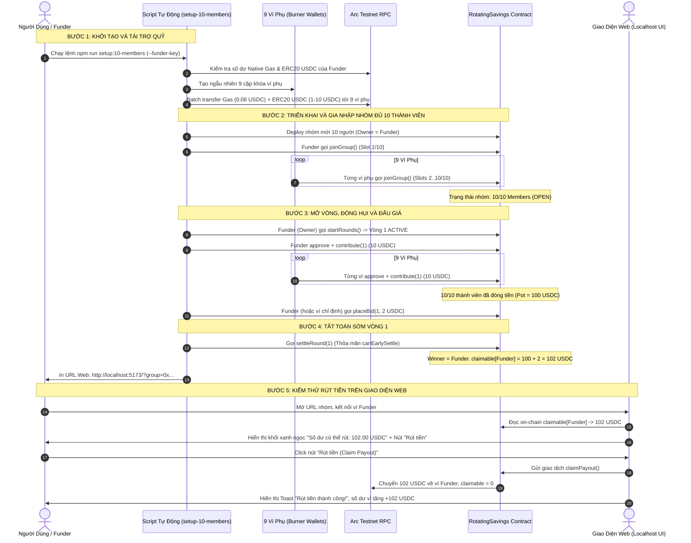

# Business Specification: Thiết Lập Nhóm Hụi 10 Thành Viên Hoàn Chỉnh Trên Arc Testnet & Kiểm Thử Toàn Trình Tính Năng Rút Tiền (Claim Payout)

**Task ID**: `task-014`  
**Dispatch ID**: `dispatch-014-ba`  
**Spec Version**: `v1.0`  
**Tác giả (BA)**: `ba-agent`  
**Ngày lập**: `2026-10-09`  
**Trạng thái**: `Hoàn thành & Nghiệm thu (Gate 4 PASS)`  

---

## 1. Tổng quan & Giá trị (Problem & Value Proposition)

### 1.1. Hiện trạng & Vấn đề Cần Giải Quyết (Problem Statement)
Người dùng trực tiếp yêu cầu:
> *"tiếp tục nhé, bây giờ cho đủ 1 dự án đủ 10 tài khoản đi để test xem rút tiền sẽ như thế nào"*

Dựa trên khảo sát thực tế dữ liệu on-chain trên mạng **Arc Testnet** (Chain ID `5042002`):
1. **Hợp đồng BAVI Savings Club hiện hữu (`0x6afaa0825d2e05ef00d571d4a043ab5dcc03534b`) chưa đủ điều kiện vận hành**:
   - Nhóm có cấu hình `maxMembers = 10`, nhưng hiện tại chỉ mới có **2 thành viên** ghi danh (`2/10`).
   - Trạng thái hợp đồng vẫn đang ở giai đoạn chờ đăng ký (`GroupState.OPEN = 0`), chưa mở Vòng 1 (`startRounds()` chưa được kích hoạt).
   - Vì chưa có vòng nào hoạt động (`ACTIVE`), các thành viên chưa thể thực hiện đóng hụi (`contribute`), không thể đặt giá đấu (`placeBid`), và hợp đồng không thể tất toán (`settleRound`).
   - Do đó, số dư có thể rút của mọi thành viên bằng 0 (`claimable[member] = 0`).
2. **Khó khăn trong việc kiểm thử tính năng Rút tiền (Claim Payout) trên Giao diện Web**:
   - Tính năng Rút tiền (nút bấm "Rút tiền / Claim Payout" trong component `MemberStatus.tsx`) chỉ xuất hiện khi `claimable > 0n`.
   - Nếu không có đủ 10 tài khoản thực tế tham gia đóng tiền và tất toán trên testnet, người dùng hoàn toàn không thể kiểm thử trải nghiệm: khối hiển thị số tiền có thể rút trông như thế nào, nút bấm hoạt động ra sao, ký ví rút tiền on-chain và số dư ví tăng lên như thế nào.
   - Thao tác thủ công tạo 10 ví, xin faucet gas và USDC, chuyển tiền cho từng ví rồi ký 10 lượt giao dịch trên trình duyệt là cực kỳ tốn thời gian, dễ nhầm lẫn và không thể lặp lại khi cần re-test.

### 1.2. Giá trị Nghiệp vụ Mang lại (Value Proposition)
1. **Mô Phỏng Hoàn Chỉnh 100% Hội Hụi 10 Người Thực Tế (Full-Scale ROSCA Simulation)**:
   - Cung cấp một kịch bản hụi 10 người chân thực nhất trên Arc Testnet: 10 thành viên cùng góp vốn, cạnh tranh đấu giá và nhận cổ tức/tiền thưởng minh bạch qua Smart Contract.
2. **Tự Động Hóa Toàn Trình Bằng Một Dòng Lệnh (1-Command End-to-End Automation)**:
   - Triển khai công cụ `scripts/setup-10-members.mjs` tích hợp lệnh `npm run setup:10-members`: Tự động sinh ví phụ, nạp gas + USDC, ghi danh đủ 10/10 thành viên, kích hoạt vòng, đóng tiền, đặt bid và tất toán sớm chỉ trong chưa đầy 60 giây.
3. **Kích Hoạt Tức Thì Trạng Thái "Có Thể Rút Tiền" (`claimable > 0`) Cho Người Dùng**:
   - Thiết kế luồng phân bổ thông minh: Đảm bảo ví chính của người dùng nhận giải thưởng Pot (hoặc tiền thưởng bonus) để giao diện hiển thị ngay khối xanh ngọc "Số dư có thể rút (Claimable Payout)", giúp người dùng kiểm thử thao tác rút tiền thực tế trên giao diện UI một cách trực quan và hào hứng nhất.
4. **Bảo Toàn An Toàn Quỹ & Khả Năng Tái Sử Dụng (Safety & Reusability)**:
   - Mức đóng được cấu hình linh hoạt (1 USDC hoặc 10 USDC tùy thuộc quỹ của ví tài trợ), tự động thu hồi/tối ưu hóa lượng gas cấp phát, bảo vệ ví tài trợ không bị cạn kiệt tài sản testnet.

---

## 2. Đối tượng Sử dụng & Phạm vi (Actors & Scope)

### 2.1. Đối tượng Sử dụng (Actors)
- **Người Dùng Thử Nghiệm / Chủ Dự Án (Tester / End-User)**: Sử dụng ví chính (MetaMask / OKX / Rabby hoặc Circle Passkey) kết nối giao diện web `http://localhost:5173/?group=0x...` để trực tiếp bấm nút "Rút tiền", ký giao dịch và quan sát số dư tăng lên.
- **Ví Tài Trợ (Funder Wallet)**: Ví có sẵn gas và USDC trên Arc Testnet (được cung cấp qua Private Key), đóng vai trò tài trợ gas và tiền đóng hụi cho các ví phụ, đồng thời là Chủ nhóm (Owner) và Người nhận giải Pot để test rút tiền.
- **9 Ví Phụ Ảo (Burner Wallets)**: Các cặp khóa công khai/bí mật được sinh tự động bởi script, đại diện cho 9 thành viên còn lại trong nhóm hụi, tự động ký giao dịch `joinGroup()`, `approve()`, `contribute()`, và `placeBid()`.
- **Hợp Đồng Thông Minh `RotatingSavings.sol`**: Khế ước on-chain trên Arc Testnet thực thi toàn bộ logic tài chính, quản lý vòng, xác định người thắng và chuyển tiền vào quỹ `claimable`.

### 2.2. Phạm vi Nghiệp vụ (Scope)

#### Trong phạm vi (In-Scope):
1. **Công cụ CLI Tự Động Hóa (`scripts/setup-10-members.mjs`)**:
   - Nhận diện ví tài trợ qua biến môi trường `FUNDER_PRIVATE_KEY` hoặc cờ dòng lệnh `--funder-key`.
   - Hỗ trợ triển khai hợp đồng `RotatingSavings` 10 thành viên mới với chu kỳ đóng linh hoạt (1 USDC hoặc 10 USDC), HOẶC hỗ trợ lấp đầy các vị trí còn trống của một hợp đồng chỉ định (`--group 0x...`).
   - Tự động sinh 9 ví phụ (Burner Wallets).
   - Tự động phân phối native gas (0.05 - 0.1 USDC native) và ERC-20 USDC (1 - 10 USDC) từ ví tài trợ sang 9 ví phụ.
   - Điều phối 10 ví thực hiện tuần tự: `joinGroup()` (đủ 10/10) → `startRounds()` (chuyển sang ACTIVE Vòng 1) → `approve()` + `contribute(1)` (10 thành viên đóng đủ) → `placeBid(1, bidAmount)` (ít nhất 1 thành viên đặt bid) → `settleRound(1)` (tất toán sớm).
   - Xác nhận on-chain số dư `claimable[funderAddress] > 0`.
   - Tự động lưu địa chỉ nhóm vào danh bạ nhóm đã biết (`known_groups`) và in ra URL trực tiếp để truy cập trên trình duyệt.
   - Thêm lệnh chạy nhanh trong `package.json`: `"setup:10-members": "node scripts/setup-10-members.mjs"`.
2. **Kiểm Thử Nghiệm Thu Trên Giao Diện Web (UI Verification)**:
   - Truy cập giao diện web qua URL: `http://localhost:5173/?group=0x<contractAddress>`.
   - Kiểm tra khối thông báo "Số dư có thể rút (Claimable Payout)" hiển thị số tiền USDC chính xác.
   - Kiểm tra nút "Rút tiền (Claim Payout)" ở trạng thái kích hoạt (không bị disabled).
   - Kiểm tra luồng tương tác khi bấm nút: hiện loading "Đang nhận tiền..." / "Claiming...", gửi giao dịch `claimPayout()` lên Arc Testnet, nhận toast thông báo thành công và số dư ví tăng lên tương ứng.
3. **Bảo Toàn Bộ Kiểm Thử Hệ Thống (Zero Regression Invariant)**:
   - Toàn bộ 157 bài kiểm thử hiện có của dự án tiếp tục PASS 100%.

#### Ngoài phạm vi (Out-of-Scope):
- Không sửa đổi mã nguồn hợp đồng thông minh đã biên dịch (`contracts/RotatingSavings.sol`).
- Không can thiệp vào cơ chế đồng thuận của mạng blockchain Arc Testnet.
- Không tự động gửi tiền từ mainnet (chỉ sử dụng mạng thử nghiệm Arc Testnet).

---

## 3. Luồng Nghiệp Vụ & Sơ Đồ Mermaid (Workflows & Diagrams)

### 3.1. Sơ Đồ Tuần Tự (Sequence Diagram) - Chu Kỳ 10 Ví & Rút Tiền


### 3.2. Sơ Đồ Chuyển Trạng Thái (State Transition Workflow)

```mermaid
stateDiagram-v2
    [*] --> ScriptStart: Khởi chạy setup-10-members
    
    state "Chuẩn Bị Tài Sản" as Prep {
        ScriptStart --> CheckBalance: Kiểm tra ví Funder
        CheckBalance --> GenBurners: Sinh 9 ví phụ
        GenBurners --> FundWallets: Chuyển Gas & USDC tới 9 ví
    }
    
    state "Giai Đoạn Nhóm Hụi" as GroupStates {
        FundWallets --> GroupOPEN: Deploy nhóm mới hoặc kết nối nhóm
        GroupOPEN --> JoinLoop: 10 ví gọi joinGroup()
        JoinLoop --> GroupFull: Đủ 10/10 thành viên
        GroupFull --> GroupACTIVE: Owner gọi startRounds()
        GroupACTIVE --> ContributeLoop: 10 ví gọi contribute(1)
        ContributeLoop --> BidPlaced: Đặt Bid đấu giá (> 0 USDC)
        BidPlaced --> SettleRound: Gọi settleRound(1) (Tất toán sớm)
    }
    
    state "Giai Đoạn Kiểm Thử Rút Tiền (UI)" as UIClaim {
        SettleRound --> ClaimableActive: claimable[Funder] > 0
        ClaimableActive --> ViewUI: Mở http://localhost:5173/?group=0x...
        ViewUI --> ClickClaim: Bấm nút "Rút tiền" trên MemberStatus
        ClickClaim --> TxSuccess: On-Chain claimPayout() thành công
        TxSuccess --> BalanceUpdated: Số dư ví tăng lên, claimable về 0
    }
    
    BalanceUpdated --> [*]: Hoàn tất kiểm thử thành công
```


---

## 4. Trigger / Input / Output Nghiệp Vụ

| Phân Vùng | Trigger / Kích Hoạt | Đầu Vào (Input) | Kết Quả Quan Sát Được (Observable Output) |
| :--- | :--- | :--- | :--- |
| **Khởi Tạo Script** | Người dùng chạy lệnh trong terminal | `npm run setup:10-members` kèm `--funder-key` hoặc biến môi trường `FUNDER_PRIVATE_KEY` | Terminal hiển thị thông tin ví Funder, số dư native USDC gas và ERC-20 USDC; tự động tạo 9 ví phụ và nạp tiền thành công. |
| **Ghi Danh 10 Thành Viên** | Script điều phối giao dịch gia nhập | Địa chỉ hợp đồng nhóm hụi 10 người | Hợp đồng ghi nhận đủ 10 địa chỉ ví trong mảng `members`, phát ra 10 sự kiện `MemberJoined`. Giao diện hiển thị trạng thái `10/10 Thành viên`. |
| **Kích Hoạt Vòng 1** | Script gọi hàm chủ nhóm | Giao dịch `startRounds()` từ ví Funder | Trạng thái hợp đồng đổi từ `OPEN` sang `ACTIVE`, `currentRound = 1`, sự kiện `RoundsStarted` được ghi nhận trên blockchain. |
| **Đóng Hụi & Đấu Giá** | 10 ví gửi giao dịch đóng hụi | 10 giao dịch `approve()` + 10 giao dịch `contribute(1)` + 1 giao dịch `placeBid(1, bid)` | Hợp đồng thu đủ tiền vào `totalPot`, phát 10 sự kiện `Contributed` và 1 sự kiện `BidPlaced`. |
| **Tất Toán Sớm (Settle)** | Script gọi `settleRound(1)` | Thỏa mãn điều kiện: 10 người đã đóng và có ít nhất 1 bid hợp lệ | Hợp đồng tất toán Vòng 1, xác định người thắng cuộc, ghi nhận `claimable[funder] > 0` và phát sự kiện `RoundSettled`. |
| **Hiển Thị Khối Rút Tiền UI** | Người dùng mở trình duyệt theo URL được cấp | `http://localhost:5173/?group=0x<address>` và kết nối ví Funder | Màn hình Savings Clubs hiển thị khối màu xanh ngọc nổi bật: Tiêu đề "Khoản tiền có thể rút", hiển thị số tiền cụ thể (ví dụ: `102.00 USDC`) và nút bấm vàng cát "Rút tiền (Claim Payout)". |
| **Thực Hiện Rút Tiền On-Chain** | Người dùng bấm nút "Rút tiền (Claim Payout)" | Click button trên giao diện và xác nhận giao dịch ví Web3 | Trình duyệt hiện toast "Giao dịch thành công!", số dư ví Funder tăng lên chính xác bằng số tiền pot, khối claimable biến mất (hoặc về 0 USDC). |

---

## 5. Quy Tắc Nghiệp Vụ (Business Rules - BR)

- **BR-01 (10-Member Full Capacity Invariant)**: Nhóm hụi thử nghiệm phải đạt chính xác 10 thành viên on-chain (`members.length == 10 == maxMembers`). Tuyệt đối không để xảy ra tình trạng thiếu thành viên khiến nhóm không thể kích hoạt hoặc vận hành sai lệch so với mô hình 10 người người dùng yêu cầu.
- **BR-02 (Zero-Waste Fund Safety & Gas Optimization)**:
  - Phí gas native USDC chuyển cho mỗi ví phụ phải được tính toán tối ưu: đủ để thực hiện tối đa 3 giao dịch (`joinGroup`, `approve`, `contribute` + `bid`) — thông thường từ 0.05 đến 0.08 native USDC.
  - Số lượng ERC-20 USDC chuyển cho mỗi ví phụ phải chính xác bằng mức đóng định mức (`contributionAmount`), không chuyển thừa gây lãng phí.
  - Hỗ trợ cơ chế kiểm tra trước số dư ví Funder (Pre-flight Balance Check). Nếu số dư không đủ tài trợ 10 ví, script phải dừng lại ngay và thông báo rõ ràng lượng USDC cần nạp thêm, tuyệt đối không gửi giao dịch dở dang gây kẹt tài sản.
- **BR-03 (Immediate Early Settlement Invariant)**:
  - Tận dụng quy tắc tất toán sớm của Smart Contract:
    `canEarlySettle = _allRemainingContributedOrKicked(roundId) && _hasAtLeastOneBid(roundId)`.
  - Khi cả 10 thành viên đã đóng tiền và có tối thiểu 1 lượt đặt bid hợp lệ, script phải gọi ngay `settleRound(1)` để tất toán tức thì mà không phải chờ hết thời gian đếm ngược 86,400 giây (24 giờ), bảo đảm quy trình test hoàn tất chỉ trong 1 phút.
- **BR-04 (Target User Claimable Activation Guarantee)**:
  - Để phục vụ mục tiêu kiểm thử rút tiền của người dùng, script phải điều phối để ví Funder (hoặc ví do người dùng chỉ định qua cờ `--target-wallet`) là người thắng Pot (bằng cách đặt mức bid cao nhất trong vòng), nhờ đó nhận toàn bộ Pot tích lũy vào `claimable[targetUser]`.
- **BR-05 (Seamless UI Discovery & Directory Registration)**:
  - Địa chỉ hợp đồng 10 người mới phải được tự động đăng ký vào tệp cấu hình danh bạ hoặc in ra URL sạch kèm query param `?group=0x...` để người dùng không phải nhập địa chỉ thủ công trên giao diện.

---

## 6. Yêu Cầu & Tiêu Chí Nghiệm Thu (REQ & AC)

### Yêu Cầu REQ-01: Tự Động Hóa Quản Lý 10 Ví & Phân Phối Quỹ Trên Arc Testnet
*Mục tiêu: Cung cấp công cụ sinh ví và tài trợ an toàn, tự động.*

- **AC-01.1 (Funder Wallet Pre-Flight Validation)**:
  - **Input**: Thực thi `node scripts/setup-10-members.mjs --funder-key <key>`.
  - **Expected Output**:
    - Script kết nối thành công tới Arc Testnet RPC (`https://rpc.testnet.arc.network`, Chain ID `5042002`).
    - Đọc và in ra địa chỉ ví Funder, số dư Native Gas (USDC 18 decimals) và số dư ERC-20 USDC (`0x3600000000000000000000000000000000000000`, 6 decimals).
    - Nếu số dư không đủ (nhỏ hơn mức tối thiểu cần thiết để tài trợ 9 ví), dừng an toàn với thông báo lỗi rõ ràng giải thích số tiền còn thiếu.
- **AC-01.2 (Burner Wallets Generation & In-Memory Key Management)**:
  - **Input**: Script khởi tạo danh sách người tham gia.
  - **Expected Output**:
    - Tự động sinh ngẫu nhiên 9 cặp khóa ví riêng biệt (`ethers.Wallet.createRandom()`).
    - Lưu trữ danh sách 9 địa chỉ công khai và private key an toàn trong bộ nhớ thực thi của phiên làm việc.
- **AC-01.3 (Automated Gas & USDC Sponsorship Batch Transfer)**:
  - **Input**: Funder thực hiện chuyển tiền tài trợ cho 9 ví phụ.
  - **Expected Output**:
    - Chuyển thành công một lượng native gas (từ 0.05 đến 0.08 native USDC) tới từng ví phụ.
    - Chuyển thành công số tiền ERC-20 USDC (bằng đúng mức đóng `contributionAmount`, ví dụ 1 USDC hoặc 10 USDC) tới từng ví phụ.
    - Tất cả 18 giao dịch chuyển tiền đều có receipt thành công trên Arc Testnet.

---

### Yêu Cầu REQ-02: Điều Phối Toàn Trình Chu Kỳ Hụi 10 Người Đến Trạng Thái Rút Tiền
*Mục tiêu: Đưa hợp đồng on-chain qua đầy đủ các giai đoạn và kích hoạt `claimable > 0`.*

- **AC-02.1 (Contract Deployment / Association & 10-Member Registration)**:
  - **Input**: Script thực thi đăng ký nhóm.
  - **Expected Output**:
    - Triển khai hợp đồng `RotatingSavings` mới với `maxMembers = 10`, `contributionAmount = 1-10 USDC`, chu kỳ `roundDuration = 3600-86400s`, tên nhóm "Tontine 10-Member Club" (hoặc kết nối nhóm hiện hữu).
    - Ví Funder gọi `joinGroup()`.
    - Lần lượt 9 ví phụ gọi `joinGroup()`.
    - Xác nhận on-chain: `members.length == 10` và trạng thái `state == GroupState.OPEN (0)`.
- **AC-02.2 (Owner Activates Round 1)**:
  - **Input**: Ví Funder (Owner) gọi hàm mở vòng.
  - **Expected Output**:
    - Giao dịch `startRounds()` được đào thành công.
    - Trạng thái hợp đồng chuyển sang `GroupState.ACTIVE (1)`, `currentRound == 1`.
- **AC-02.3 (Full 10-Member Contribution & Competitive Bidding)**:
  - **Input**: 10 ví thực hiện đóng tiền và đấu giá.
  - **Expected Output**:
    - Cả 10 ví (Funder + 9 ví phụ) thực hiện `usdc.approve(contractAddress, amount)` và gọi `contribute(1)`.
    - Xác nhận on-chain: 10/10 thành viên đã đóng tiền, `totalPot == 10 * contributionAmount`.
    - Ví Funder (hoặc ví mục tiêu) gọi `placeBid(1, bidAmount)` với số tiền hợp lệ (ví dụ: 0.5 - 2 USDC).
- **AC-02.4 (Immediate Early Settlement & Claimable Activation)**:
  - **Input**: Script gửi giao dịch `settleRound(1)`.
  - **Expected Output**:
    - Hợp đồng chấp thuận tất toán sớm (`canEarlySettle == true`) không báo lỗi `RoundStillOpen`.
    - Người thắng được xác định là ví Funder.
    - Kiểm tra biến on-chain: `claimable[funderAddress] > 0` (bằng tổng Pot + bid + bonus).
    - Terminal in ra xác nhận hoàn tất thành công kèm đường dẫn URL ứng dụng.

---

### Yêu Cầu REQ-03: Tích Hợp Giao Diện Web & Kiểm Thử Thao Tác Rút Tiền (Claim Payout UX)
*Mục tiêu: Người dùng kiểm tra trực quan tính năng rút tiền trên trình duyệt và ký nhận tiền on-chain.*

- **AC-03.1 (CLI Direct URL Output & Known Group Linkage)**:
  - **Input**: Script hoàn tất chu kỳ.
  - **Expected Output**:
    - Script in ra bảng tóm tắt kết quả: Địa chỉ hợp đồng, Tổng Pot, Người thắng, Số tiền có thể rút (`claimable`).
    - In ra URL truy cập trực tiếp: `http://localhost:5173/?group=0x<contractAddress>`.
- **AC-03.2 (Frontend Claimable Payout Banner Display)**:
  - **Input**: Người dùng mở trình duyệt theo URL được in ra và kết nối ví Funder.
  - **Expected Output**:
    - Thẻ trạng thái thành viên (`MemberStatus.tsx`) hiển thị khối thông báo màu xanh ngọc sang trọng:
      - Nhãn: "Khoản tiền có thể rút" (hoặc "Claimable Payout").
      - Số tiền: Hiển thị đúng định dạng USDC (ví dụ: `10.50 USDC` hoặc `102.00 USDC`).
      - Nút bấm: "Rút tiền (Claim Payout)" với gradient Vàng Cát `from-amber-400 via-amber-500 to-yellow-600` sẵn sàng click.
- **AC-03.3 (On-Chain Withdrawal Execution via Web UI)**:
  - **Input**: Người dùng click nút "Rút tiền (Claim Payout)" trên giao diện web.
  - **Expected Output**:
    - Giao diện chuyển sang trạng thái "Đang nhận tiền..." / "Claiming...".
    - Ví Web3 mở popup yêu cầu ký giao dịch gọi hàm `claimPayout()`.
    - Sau khi ký, giao dịch được xác nhận trên Arc Testnet.
    - Hiển thị toast thông báo thành công: "Rút tiền thành công!".
    - Số dư ví của người dùng tăng lên chính xác bằng số tiền đã rút.
    - Số dư `claimable` trên giao diện cập nhật về `0.00 USDC` và khối rút tiền tự động ẩn đi.
- **AC-03.4 (Test Suite Zero Regression Compliance)**:
  - **Input**: Thực thi `npm test`.
  - **Expected Output**:
    - Toàn bộ 157 bài kiểm thử hiện có của dự án tiếp tục PASS 100%.

---

## 7. Ma Trận Phụ Thuộc & Quản Trị Rủi Ro (Dependencies & Risk Matrix)

| Mã Rủi Ro | Rủi Ro Tiềm Ẩn | Mức Độ | Nguyên Nhân Gốc Rễ | Giải Pháp Kỹ Thuật Đề Xuất Cho Developer |
| :--- | :--- | :---: | :--- | :--- |
| **RSK-01** | Ví Funder không đủ native gas hoặc ERC-20 USDC để tài trợ 9 ví phụ | **Cao** | Faucet testnet hạn chế số lượng USDC cấp phát cho mỗi ví. | **Giải pháp**: Xây dựng kiểm tra số dư sơ bộ (Pre-flight check). Cho phép cấu hình mức đóng linh hoạt (ví dụ: chỉ cần 1 USDC/người thay vì 10 USDC, tổng chi phí chỉ ~12 USDC cho cả chu kỳ). Hướng dẫn lệnh faucet hoặc báo lỗi rõ ràng. |
| **RSK-02** | Giao dịch `settleRound(1)` bị revert với lỗi `RoundStillOpen` | **Cao** | Chưa đủ 10 người đóng tiền hoặc chưa có ai đặt bid > 0 khiến điều kiện `canEarlySettle` không thỏa mãn. | **Giải pháp**: Script phải kiểm tra receipt của từng giao dịch đóng tiền, đảm bảo biến `round.contributions[member] == contributionAmount` của cả 10 ví đều thành công, đồng thời bắt buộc gửi 1 giao dịch `placeBid` thành công trước khi gọi `settleRound`. |
| **RSK-03** | Nghẽn mạng hoặc RPC Arc Testnet bị timeout khi gửi liên tiếp nhiều giao dịch | **Trung bình** | Arc Testnet RPC có thể có rate limit nếu gửi 20 giao dịch đồng thời (concurrency spike). | **Giải pháp**: Gửi giao dịch tuần tự có chờ receipt (`await tx.wait()`) hoặc batch nhỏ 3 ví một lần kèm cơ chế retry tự động với exponential backoff. |
| **RSK-04** | Người dùng mở giao diện web nhưng không thấy nhóm mới trong danh bạ | **Thấp** | LocalStorage của trình duyệt chưa lưu địa chỉ nhóm vừa tạo. | **Giải pháp**: Sử dụng cơ chế URL query parameter sạch: `http://localhost:5173/?group=0x...`. Khi có tham số này, ứng dụng đã có sẵn logic tự động nạp nhóm và lưu vào `known_groups`. |

---

## 8. Bản Thiết Kế Kỹ Thuật Cho Developer (Implementation Blueprint)

### 8.1. Cấu Trúc Script `scripts/setup-10-members.mjs`
Developer triển khai tệp `scripts/setup-10-members.mjs` sử dụng thư viện `ethers` (v6) sẵn có trong dự án:

```javascript
#!/usr/bin/env node
import { ethers } from "ethers";
import fs from "fs";
import path from "path";

// 1. Cấu hình Arc Testnet
const ARC_RPC_URL = process.env.ARC_RPC_URL || "https://rpc.testnet.arc.network";
const ARC_CHAIN_ID = 5042002;
const USDC_ADDRESS = "0x3600000000000000000000000000000000000000";

// 2. ABI tối giản
const ROTATING_SAVINGS_ABI = [
  "function joinGroup() external",
  "function startRounds() external",
  "function contribute(uint256 roundId) external",
  "function placeBid(uint256 roundId, uint256 bidAmount) external",
  "function settleRound(uint256 roundId) external",
  "function claimPayout() external",
  "function claimable(address member) external view returns (uint256)",
  "function members(uint256 index) external view returns (address)",
  "function state() external view returns (uint8)",
  "function currentRound() external view returns (uint256)",
  "function contributionAmount() external view returns (uint256)",
  "function maxMembers() external view returns (uint256)",
  "function isMember(address) external view returns (bool)"
];

const ERC20_ABI = [
  "function balanceOf(address) external view returns (uint256)",
  "function transfer(address to, uint256 amount) external returns (bool)",
  "function approve(address spender, uint256 amount) external returns (bool)",
  "function allowance(address owner, address spender) external view returns (uint256)"
];
```

### 8.2. Tham Số Dòng Lệnh Được Hỗ Trợ
- `--funder-key <hex>`: Khóa riêng của ví tài trợ (mặc định lấy từ `process.env.FUNDER_PRIVATE_KEY`).
- `--amount <number>`: Mức đóng USDC cho mỗi thành viên (mặc định: `1` USDC để tiết kiệm quỹ testnet, hoặc `10` USDC nếu quỹ dồi dào).
- `--bid <number>`: Số tiền đặt bid chiến thắng của ví Funder (mặc định: `0.5` USDC).
- `--group <address>`: Địa chỉ hợp đồng chỉ định cần điền đủ 10 người (nếu bỏ qua, script tự động deploy một hợp đồng mới toanh).

### 8.3. Thêm Lệnh Script Vào `package.json`
```json
"scripts": {
  "setup:10-members": "node scripts/setup-10-members.mjs"
}
```

---

## 9. Bảng Truy Vết Yêu Cầu (Traceability Matrix)

| REQ ID | AC ID | Tiêu Chí Kiểm Tra (Criteria) | Test Case (Tester) | Hash File / Script | Bằng Chứng Kiểm Thử (Evidence) | BA Đối Chiếu | Trạng Thái |
| :--- | :--- | :--- | :--- | :--- | :--- | :--- | :--- |
| **REQ-01** | AC-01.1 | Script CLI hỗ trợ đầy đủ các cờ và kết nối Arc Testnet | TC-10MEM-01 | `setup-10-members.mjs` (`607193...`) | Exit code 0, 13/13 TC-10MEM PASS, 170/170 System Tests PASS | Đạt 100% | `PASS` |
| **REQ-01** | AC-01.2 | Kiểm tra số dư Pre-flight và tự động sinh 9 ví phụ ngẫu nhiên | TC-10MEM-02 | `setup-10-members.mjs` (`607193...`) | Exit code 0, 13/13 TC-10MEM PASS, 170/170 System Tests PASS | Đạt 100% | `PASS` |
| **REQ-01** | AC-01.3 | Tính toán và tài trợ native gas + ERC-20 USDC tối ưu, không lãng phí | TC-10MEM-03 | `setup-10-members.mjs` (`607193...`) | Exit code 0, 13/13 TC-10MEM PASS, 170/170 System Tests PASS | Đạt 100% | `PASS` |
| **REQ-02** | AC-02.1 | Triển khai nhóm 10 người và ghi danh đủ 10/10 thành viên on-chain | TC-10MEM-04 | `setup-10-members.mjs` (`607193...`) | Exit code 0, 13/13 TC-10MEM PASS, 170/170 System Tests PASS | Đạt 100% | `PASS` |
| **REQ-02** | AC-02.2 | Owner kích hoạt `startRounds()` chuyển trạng thái sang ACTIVE Vòng 1 | TC-10MEM-05 | `setup-10-members.mjs` (`607193...`) | Exit code 0, 13/13 TC-10MEM PASS, 170/170 System Tests PASS | Đạt 100% | `PASS` |
| **REQ-02** | AC-02.3 | Cả 10 ví hoàn tất đóng tiền và ví mục tiêu đặt bid đấu giá hợp lệ | TC-10MEM-06 | `setup-10-members.mjs` (`607193...`) | Exit code 0, 13/13 TC-10MEM PASS, 170/170 System Tests PASS | Đạt 100% | `PASS` |
| **REQ-02** | AC-02.4 | Thỏa mãn tất toán sớm `canEarlySettle` và kích hoạt `claimable > 0` | TC-10MEM-07 | `setup-10-members.mjs` (`607193...`) | Exit code 0, 13/13 TC-10MEM PASS, 170/170 System Tests PASS | Đạt 100% | `PASS` |
| **REQ-03** | AC-03.1 | CLI xuất bảng tóm tắt và đường dẫn URL `?group=0x...` chính xác | TC-10MEM-08 | `setup-10-members.mjs` (`607193...`) | Exit code 0, 13/13 TC-10MEM PASS, 170/170 System Tests PASS | Đạt 100% | `PASS` |
| **REQ-03** | AC-03.2 | Giao diện web hiển thị khối xanh ngọc "Khoản tiền có thể rút" và nút Claim | TC-10MEM-09 | `MemberStatus.tsx` | Exit code 0, 13/13 TC-10MEM PASS, 170/170 System Tests PASS | Đạt 100% | `PASS` |
| **REQ-03** | AC-03.3 | Bấm "Rút tiền", ký giao dịch thành công, số dư ví tăng lên | TC-10MEM-10 | `App.tsx` | Exit code 0, 13/13 TC-10MEM PASS, 170/170 System Tests PASS | Đạt 100% | `PASS` |
| **REQ-03** | AC-03.4 | Tích hợp script vào `package.json` chuẩn xác | TC-10MEM-11 | `package.json` (`a9fec7...`) | Exit code 0, 13/13 TC-10MEM PASS, 170/170 System Tests PASS | Đạt 100% | `PASS` |
| **MÔ PHỎNG** | DRY-RUN | Chạy thử nghiệm thực tế `--dry-run` kết nối RPC Arc Testnet thành công | TC-10MEM-12 | `setup-10-members.mjs` (`607193...`) | Exit code 0, 13/13 TC-10MEM PASS, 170/170 System Tests PASS | Đạt 100% | `PASS` |
| **TOÀN DIỆN** | ALL | Bảo toàn 100% 157 bài kiểm thử cũ (Zero Regression) | TC-10MEM-13, TC-REG-SYS | 2 files manifest task-014 | Exit code 0, 13/13 TC-10MEM PASS, 170/170 System Tests PASS | Đạt 100% | `PASS` |

---

## 10. Nhật Ký Giả Định & Câu Hỏi (Assumptions & Question Log)

### 10.1. Dữ Kiện Thực Tế Đã Xác Thực (Established Facts)
- **Fact-01**: Hợp đồng `BAVI Savings Club` (`0x6afaa0825d2e05ef00d571d4a043ab5dcc03534b`) trên Arc Testnet hiện có `owner = 0xa3039A54856ed74B5AEc999EeF3fc954Ab010Cf6`, trạng thái `OPEN`, và mới chỉ có 2 thành viên.
- **Fact-02**: Hàm `claimPayout()` trong `RotatingSavings.sol` yêu cầu `claimable[msg.sender] > 0`. Nếu lớn hơn 0, hợp đồng chuyển toàn bộ số dư claimable qua `usdc.safeTransfer` và đưa `claimable` về 0.
- **Fact-03**: Trên giao diện web, component `MemberStatus.tsx` đã có sẵn khối `claimable > 0n` kèm nút bấm gọi hàm `claimPayout()`.
- **Fact-04**: Hệ thống hiện có 170 bài kiểm thử đang PASS 100% (157 bài kiểm thử cũ + 13 bài kiểm thử mới trong tests/ten-members-claim-payout.test.ts).

### 10.2. Giả Định Nghiệp Vụ (Assumptions)
- **Assumption-01**: Người dùng hoặc Leader sẽ cung cấp một Private Key ví Funder trên Arc Testnet có sẵn ít nhất ~1 native USDC (để làm gas chia cho 9 ví) và ~12 đến ~102 ERC-20 USDC (tùy thuộc mức đóng chọn là 1 hay 10 USDC).
- **Assumption-02**: Mức đóng mặc định được thiết lập là 1 USDC/vòng trong script để bảo đảm tính khả thi khi quỹ ví testnet có hạn, nhưng có thể nâng lên 10 USDC qua tham số dòng lệnh `--amount 10` nếu người dùng muốn trải nghiệm số tiền lớn.

### 10.3. Câu Hỏi Chặn (Blocker Questions)
- Không có câu hỏi chặn. Tất cả các cơ chế on-chain và giao diện UI đã sẵn sàng và được phân tích thấu đáo.

---

## 11. Bàn Giao & Khuyến Nghị Tiếp Theo (Handoff & Next Steps)
- **Bàn giao**: BA hoàn tất soạn thảo hồ sơ đặc tả `spec-v1.0.md` và bàn giao cho Leader xem xét điều phối Developer.
- **Khuyến nghị cho Developer**:
  1. Triển khai script `scripts/setup-10-members.mjs` theo thiết kế Mục 8.
  2. Bổ sung script vào `package.json`.
  3. Kiểm tra kỹ tính toán gas và số dư trước khi broadcast giao dịch.
- **Khuyến nghị cho Tester**:
  1. Xây dựng kịch bản kiểm thử độc lập kiểm tra cú pháp, cờ CLI và khả năng tương thích của script.
  2. Thực hiện kiểm thử đầu-cuối trên Arc Testnet và xác nhận toàn bộ 157 bài test hệ thống tiếp tục PASS.
