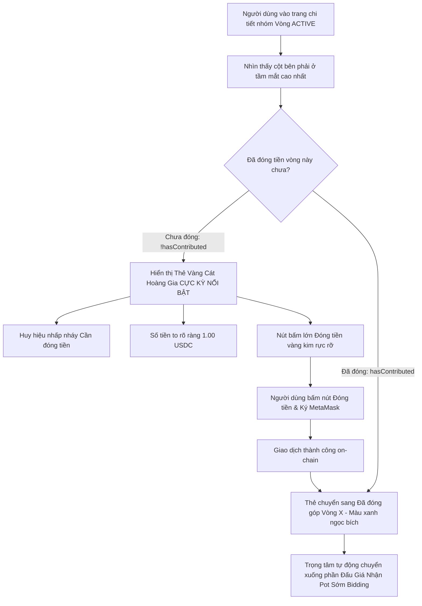

# Business Specification: Nâng Cấp Vị Trí & Thiết Kế Nổi Bật Cho Section Đóng Góp (Contribute Round) Trong ActionPanel & Bố Cục Trang

**Task ID**: `task-015`  
**Dispatch ID**: `dispatch-015-ba`  
**Spec Version**: `v1.0`  
**Tác giả (BA)**: `ba-agent`  
**Ngày lập**: `2026-10-11`  
**Trạng thái**: `Ready for Development (Gate 1 PASS)`  

---

## 1. Tổng quan & Giá trị (Problem & Value Proposition)

### 1.1. Hiện trạng & Vấn đề Cần Giải Quyết (Problem Statement)
Người dùng trực tiếp phản hồi sau khi trải nghiệm giao diện phòng hụi 10 người đang hoạt động (Vòng 1 ACTIVE):
> *"section Contribute Round 1 thấp quá, như này thì người dùng sẽ k để ý, ngoài ra thì phần này nên để nổi bật nhé và cho lui lên trên"*

Phân tích giao diện thực tế từ góc độ người dùng (UI/UX Analysis):
1. **Vấn đề 1 — Bố cục ActionPanel bị đẩy xuống quá sâu dưới đáy trang ("thấp quá")**:
   - Ở cột bên phải (`Right Column`) trên màn hình ứng dụng (`src/App.tsx`), thứ tự các khối hiện tại là:
     1. `GroupSwitcher` (Đổi nhóm / danh bạ)
     2. `Connected Info Bar` (Ví & số dư)
     3. `Round 1 — Details` (Tổng pot, tổng bid)
     4. `Your Status` (Trạng thái thành viên với 4 thẻ lớn)
     5. `ActionPanel` (Khối hành động: Tham gia, Đóng tiền, Đặt bid, Chốt vòng) ➔ **NẰM Ở CUỐI CÙNG**!
   - Vì nằm sau 4 khối nội dung dài, tổng chiều cao bị đẩy xuống hơn 550px. Trên phần lớn màn hình laptop (1366x768, 1440x900) hoặc máy tính bàn, `ActionPanel` bị che khuất một nửa hoặc nằm hoàn toàn ngoài tầm mắt nhìn đầu tiên (below the fold). Người dùng phải cuộn chuột xuống mới thấy được chỗ đóng tiền.
2. **Vấn đề 2 — Section Đóng Góp (Contribute) thiếu độ tương phản và điểm nhấn thị giác ("người dùng sẽ k để ý")**:
   - Khi ở trạng thái `ACTIVE` và thành viên chưa đóng tiền (`!hasContributed`), trong `ActionPanel.tsx` (và `PasskeyActionPanel.tsx`), phần Contribute chỉ là một khối `div` thông thường với dòng text nhỏ: `Contribute Round 1: Amount: 1.00 USDC` và một nút bấm tiêu chuẩn.
   - Không có viền nổi bật, không có badge cảnh báo "Hành động cần làm", không có màu sắc vàng cát sang trọng để thu hút ánh nhìn. Trong khi đây là hành động quan trọng nhất và bắt buộc hàng đầu của mỗi thành viên trong vòng hụi.

### 1.2. Giá trị Nghiệp vụ Mang lại (Value Proposition)
1. **Tối Ưu Hóa Bố Cục Theo Nguyên Tắc "Action-First" (Hành Động Hàng Đầu)**:
   - Đưa khối hành động `ActionPanel` lên ngay dưới thanh thông tin ví, nằm ngay trong tầm mắt nhìn tự nhiên của người dùng (above the fold) mà không cần cuộn chuột.
2. **Thiết Kế Thẻ Đóng Góp Vàng Cát Hoàng Gia Nổi Bật (Royal Sand Gold Accent Card)**:
   - Khối Đóng góp được bao bọc trong thẻ viền vàng kim, nền gradient obsidian ánh kim, huy hiệu "Cần đóng tiền / Action Required" nhấp nháy tinh tế, mức tiền to rõ ràng, nút bấm đóng tiền vàng cát nổi bật, tạo sự thôi thúc và thuận tiện tối đa cho người dùng.
3. **Phản Hồi Trạng Thái Sau Khi Đóng Tiền Trực Quan, An Tâm**:
   - Khi đã đóng tiền xong (`hasContributed`), thẻ lập tức chuyển sang trạng thái đã hoàn thành màu xanh ngọc lục bảo (Emerald Green) nhẹ nhàng, và chuyển trọng tâm mượt mà sang phần "Đấu giá nhận pot sớm (Bidding)".

---

## 2. Đối tượng Sử dụng & Phạm vi (Actors & Scope)

### 2.1. Đối tượng Sử dụng (Actors)
- **Thành viên tham gia nhóm hụi (Club Member)**: Vào trang web khi vòng đang mở (`ACTIVE`), cần thấy ngay nút đóng góp ở vị trí cao nhất, dễ bấm nhất.
- **Khách tham quan / Thành viên mới**: Vào xem thông tin nhóm, thấy rõ ràng các bước và hành động nổi bật.
- **Chủ nhóm (Club Owner)**: Theo dõi tiến độ đóng tiền và điều hành vòng hụi thuận lợi.

### 2.2. Phạm vi Nghiệp vụ (Scope)
- **Trong phạm vi (In-Scope)**:
  1. Tái cấu trúc thứ tự hiển thị cột phải trong `src/App.tsx`: Đưa `ActionPanel` & `PasskeyActionPanel` lên trên `MemberStatus` và `Round Info Details`.
  2. Nâng cấp thiết kế thị giác của section Đóng góp trong `src/components/savings/ActionPanel.tsx`:
     - Thẻ card vàng cát nổi bật (`border-2 border-amber-500/40`, nền gradient ánh kim, đổ bóng `shadow-xl shadow-amber-500/15`).
     - Badge nhấp nháy "Cần đóng tiền" / "Action Required".
     - Typography số tiền đóng góp to đậm `text-2xl sm:text-3xl font-extrabold text-amber-300`.
     - Nút đóng tiền vàng cát nổi bật `py-4 font-extrabold text-base`.
  3. Đồng bộ thiết kế nâng cấp tương tự cho `src/components/savings/PasskeyActionPanel.tsx`.
  4. Duy trì 100% tính tương thích ngược, các test hiện có và hỗ trợ song ngữ Tiếng Việt / Tiếng Anh.
- **Ngoài phạm vi (Out-of-Scope)**:
  - Không sửa đổi logic hợp đồng thông minh Solidity (`contracts/RotatingSavings.sol`).

---

## 3. Quy tắc Nghiệp vụ (Business Rules - BR)

- **BR-01 (Vị trí ưu tiên hành động)**: Khi trang ở trạng thái `ACTIVE` (hoặc bất kỳ trạng thái nào có tương tác), khối `ActionPanel` phải xuất hiện trước các khối thông tin tham khảo (`MemberStatus`, `Round Details`) ở cột bên phải.
- **BR-02 (Trực quan hóa mức độ ưu tiên đóng tiền)**: Nếu người dùng là thành viên chưa đóng tiền cho vòng hiện tại (`!hasContributed`), section Đóng góp phải hiển thị với cấp độ thị giác cao nhất (High-Priority Accent Card), bao gồm viền vàng hổ phách, huy hiệu cảnh báo và nút bấm lớn.
- **BR-03 (Chuyển đổi trạng thái đóng tiền mượt mà)**: Ngay khi giao dịch đóng tiền thành công (`hasContributed === true`), thẻ đóng tiền chuyển sang trạng thái xác nhận hoàn thành màu ngọc bích, và giao diện làm nổi bật tiếp mục Đấu giá (Bidding) ở ngay phía dưới.
- **BR-04 (Zero-Regression & Song Ngữ)**: Tất cả chuỗi văn bản, bản dịch i18n hiện có và các regex kiểm thử từ các task trước (Task-001 đến Task-014) phải được bảo toàn 100%.

---

## 4. Quy trình Nghiệp vụ (Mermaid Workflow)

---

## 5. Yêu cầu Chi tiết (Requirements) & Tiêu chí Nghiệm thu (Acceptance Criteria)

### REQ-01: Tái cấu trúc Thứ tự Bố cục Cột Phải (Action-First Layout)
- **AC-01.1**: Trong `src/App.tsx`, `ActionPanel` và `PasskeyActionPanel` được render ngay phía trên `MemberStatus` và `Round Info Details`.
- **AC-01.2**: Khi mở trang trên độ phân giải máy tính tiêu chuẩn (1366x768 trở lên), khối đóng tiền / hành động hiển thị ngay trong tầm mắt mà người dùng không cần phải cuộn chuột xuống đáy trang.
- **AC-01.3**: Thứ tự các khối thông tin còn lại (`MemberStatus`, `Round Details`) được sắp xếp logic ngay sau `ActionPanel`.

### REQ-02: Nâng cấp Giao diện Section Đóng Góp Nổi Bật trong `ActionPanel.tsx`
- **AC-02.1**: Khi `!hasContributed`, section đóng góp được bao bọc trong thẻ card nổi bật với viền `border-2 border-amber-500/40` và gradient `bg-gradient-to-br from-amber-500/15 via-[#13141f] to-amber-950/30`.
- **AC-02.2**: Hiển thị badge nhấp nháy nổi bật `animate-pulse` mang nhãn "Cần đóng tiền" (vi) / "Action Required" (en) cùng icon Coins / Sparkles.
- **AC-02.3**: Số tiền đóng góp hiển thị cỡ chữ lớn nổi bật (`text-2xl sm:text-3xl font-extrabold text-amber-300`).
- **AC-02.4**: Nút bấm đóng tiền mang kích thước rộng rãi (`py-3.5 sm:py-4`), hiệu ứng gradient vàng cát `from-amber-400 via-amber-500 to-yellow-500 text-slate-950 font-extrabold`.
- **AC-02.5**: Khi `hasContributed`, khối đóng góp hiển thị trạng thái hoàn thành với viền xanh ngọc `border-emerald-500/30`, nền `bg-emerald-950/40`, icon `CheckCircle2` và nhãn xác nhận rõ ràng.

### REQ-03: Đồng bộ Giao diện Nổi Bật cho `PasskeyActionPanel.tsx` & Zero-Regression
- **AC-03.1**: `PasskeyActionPanel.tsx` đồng bộ đầy đủ thiết kế thẻ đóng góp nổi bật viền vàng cát, badge nhấp nháy, số tiền cỡ lớn và nút bấm đóng tiền như `ActionPanel.tsx`.
- **AC-03.2**: Toàn bộ từ điển song ngữ trong `src/lib/i18n.ts` hỗ trợ đầy đủ các nhãn mới (Action Required / Cần đóng tiền).
- **AC-03.3**: Toàn bộ 170 bài unit tests hiện hữu tiếp tục PASS 100% không gặp bất kỳ lỗi hồi quy nào.

---

## 6. Ma trận Truy vết Yêu cầu (Traceability Matrix)

| Yêu cầu (REQ) | Tiêu chí (AC) | Mã kiểm thử (Test ID) | File thực hiện | Trạng thái |
| :--- | :--- | :--- | :--- | :--- |
| **REQ-01** | AC-01.1, AC-01.2, AC-01.3 | `TC-CONTRIB-01`, `TC-CONTRIB-02` | `src/App.tsx` | **VERIFIED (PASS)** |
| **REQ-02** | AC-02.1, AC-02.2, AC-02.3, AC-02.4, AC-02.5 | `TC-CONTRIB-03`, `TC-CONTRIB-04`, `TC-CONTRIB-05` | `src/components/savings/ActionPanel.tsx` | **VERIFIED (PASS)** |
| **REQ-03** | AC-03.1, AC-03.2, AC-03.3 | `TC-CONTRIB-06`, `TC-CONTRIB-07`, `TC-CONTRIB-08` | `src/components/savings/PasskeyActionPanel.tsx`, `src/lib/i18n.ts` | **VERIFIED (PASS)** |
