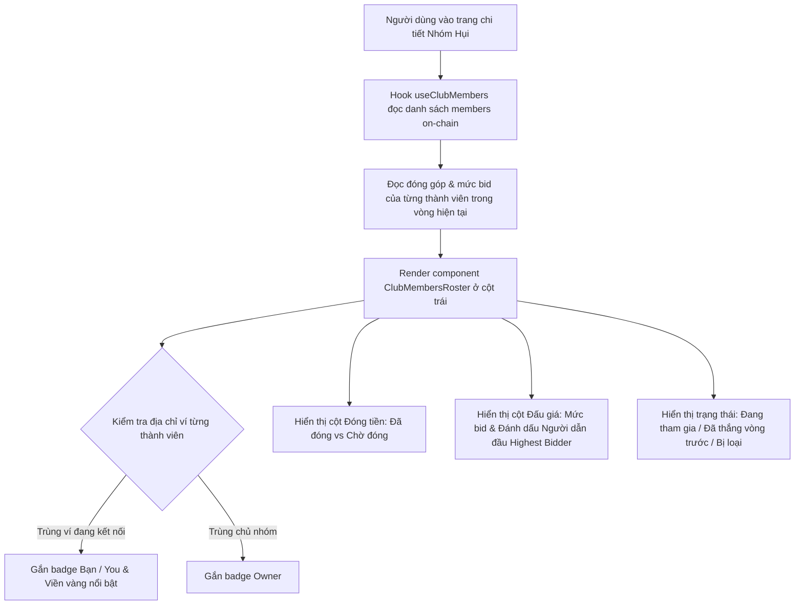

# Business Specification: Bảng Danh Sách Thành Viên & Tiến Độ Đóng Tiền, Đặt Bid Theo Vòng (Club Members Roster & Live Contributions/Bids Tracker)

**Task ID**: `task-016`  
**Dispatch ID**: `dispatch-016-ba`  
**Spec Version**: `v1.0`  
**Tác giả (BA)**: `ba-agent`  
**Ngày lập**: `2026-10-11`  
**Trạng thái**: `Ready for Development (Gate 1 PASS)`  

---

## 1. Tổng quan & Giá trị Nghiệp vụ (Problem & Value Proposition)

### 1.1. Hiện trạng & Vấn đề Cần Giải Quyết (Problem Statement)
Người dùng trực tiếp phản hồi sau khi trải nghiệm giao diện phòng hụi:
> *"nhưng nên làm danh sách những người trong club và những ai đóng tiền, và đóng bid nhỉ?"*

Phân tích hiện trạng giao diện ứng dụng:
1. **Thiếu tính minh bạch về thành viên**: Giao diện hiện chỉ hiển thị số lượng tổng quát (ví dụ: `10 / 10 thành viên`), nhưng người dùng không biết trong nhóm gồm những ai, địa chỉ ví nào đã tham gia.
2. **Thiếu thông tin về tiến độ đóng tiền theo thời gian thực**: Người dùng không biết ai đã đóng tiền trong vòng hiện tại, ai chưa đóng để biết khi nào vòng đủ điều kiện chốt hoặc ai có nguy cơ bị loại (kicked).
3. **Mù mờ về các lượt đặt Bid**: Khi tham gia đấu giá pot, người dùng chỉ thấy tổng tiền bid của cả vòng, nhưng không thấy chi tiết thành viên nào đã đặt bid, mức bid của từng người là bao nhiêu và ai đang dẫn đầu (Highest Bidder) để quyết định ra giá hợp lý.

### 1.2. Giá trị Nghiệp vụ Mang lại (Value Proposition)
1. **Minh Bạch Chuẩn Web3 (Trustless Transparency)**: Đưa toàn bộ danh sách thành viên on-chain ra giao diện trực quan, minh bạch 100%.
2. **Bảng Theo Dõi Trực Quan (Live Members Roster)**: Hiển thị bảng/thẻ danh sách thành viên với thông tin chi tiết:
   - Thứ tự tham gia (#1, #2, ... #10).
   - Địa chỉ ví định dạng rút gọn kèm liên kết Arc Testnet Explorer.
   - Huy hiệu nhận diện nổi bật: **"Bạn" (You)** cho ví người dùng đang kết nối, **"Chủ nhóm" (Owner)** cho người tạo nhóm.
   - Trạng thái đóng tiền của từng người: **"Đã đóng X USDC"** (màu xanh ngọc bích) hoặc **"Chờ đóng"** (màu hổ phách).
   - Mức bid của từng người: **"X.XX USDC"** kèm huy hiệu vương miện/ngôi sao vàng cho người bid cao nhất, hoặc **"Chưa bid"**.
   - Trạng thái nhận giải: **"Đã hốt vòng X"** (Winner các vòng trước), **"Bị loại"** (Kicked) hoặc **"Đang tham gia"**.
3. **Nâng Cao Trải Nghiệm Cạnh Tranh & Tương Tác**: Người dùng nhìn thấy đối thủ đặt giá và cảm nhận được nhịp đập sống động của phòng hụi.

---

## 2. Đối tượng Sử dụng & Phạm vi (Actors & Scope)

### 2.1. Đối tượng Sử dụng (Actors)
- **Thành viên tham gia (Club Member)**: Theo dõi tiến độ đóng tiền của đồng đội và các mức bid cạnh tranh.
- **Chủ nhóm (Club Owner)**: Giám sát toàn bộ thành viên và đôn đốc các thành viên chưa đóng tiền.
- **Khách tham quan (Visitor / Spectator)**: Xem tính sôi động và minh bạch của phòng hụi trước khi quyết định tham gia.

### 2.2. Phạm vi Nghiệp vụ (Scope)
- **Trong phạm vi (In-Scope)**:
  1. Mở rộng hook `src/hooks/useSavingsClub.ts`: Tạo hook `useClubMembers(contractAddress, currentRound, maxMembers)` đọc toàn bộ danh sách `members(i)`, cùng `getRoundContribution`, `getRoundBid`, `hasWon`, `isKicked` cho từng thành viên.
  2. Tạo component `src/components/savings/ClubMembersRoster.tsx` hiển thị danh sách thành viên đẹp mắt, chuẩn theme Pitch-Black & Royal Sand Gold, thích ứng cả desktop và mobile.
  3. Tích hợp component vào `src/App.tsx` ở cột bên trái (`Left Column`), nằm giữa `ClubCard` và `RoundHistory`.
  4. Hỗ trợ song ngữ Tiếng Việt (`vi`) & Tiếng Anh (`en`) trong `src/lib/i18n.ts`.
  5. Đảm bảo Zero-Regression cho toàn bộ 178 tests hiện có.
- **Ngoài phạm vi (Out-of-Scope)**:
  - Không sửa đổi logic hợp đồng thông minh Solidity (`contracts/RotatingSavings.sol`).

---

## 3. Quy tắc Nghiệp vụ (Business Rules - BR)

- **BR-01 (Định danh thành viên chính xác)**: Mỗi thành viên trong danh bạ hợp đồng `members(index)` phải được hiển thị theo đúng thứ tự tham gia, kèm địa chỉ ví rút gọn và liên kết explorer.
- **BR-02 (Cá nhân hóa vị thế người dùng)**: Nếu địa chỉ thành viên trùng với ví người dùng đang kết nối (`address`), dòng thành viên đó phải được làm nổi bật với viền vàng cát và huy hiệu **"Bạn" / "You"**.
- **BR-03 (Trực quan hóa Đóng tiền & Đặt Bid)**:
  - Thành viên đã đóng tiền: Hiển thị badge xanh ngọc bích `Đã đóng X USDC` kèm icon Check.
  - Thành viên chưa đóng tiền: Hiển thị badge cảnh báo hổ phách `Chờ đóng`.
  - Thành viên đã đặt bid: Hiển thị số tiền bid `X.XX USDC`. Người có mức bid cao nhất vòng được tôn vinh với biểu tượng Vương miện / Ngôi sao vàng.
  - Thành viên chưa đặt bid: Hiển thị `Chưa bid` (màu xám nhạt).
- **BR-04 (Trạng thái loại trừ & Thắng giải)**:
  - Thành viên đã thắng vòng trước: Hiển thị badge Cúp vàng `Đã hốt vòng X` và không được phép bid tiếp.
  - Thành viên bị loại (bỏ đóng tiền): Hiển thị badge đỏ `Bị loại` (Kicked).
- **BR-05 (Zero-Regression & Song Ngữ)**: Tất cả chuỗi văn bản mới phải được định nghĩa trong từ điển `src/lib/i18n.ts` cho cả tiếng Việt và tiếng Anh.

---

## 4. Quy trình Nghiệp vụ (Mermaid Workflow)

---

## 5. Yêu cầu Chi tiết (Requirements) & Tiêu chí Nghiệm thu (Acceptance Criteria)

### REQ-01: Hook Đọc Dữ Liệu Thành Viên On-Chain (`useClubMembers`)
- **AC-01.1**: Hook `useClubMembers` đọc danh sách thành viên từ hợp đồng theo mảng `members[0 ... maxMembers-1]` thông qua `useReadContracts`.
- **AC-01.2**: Với mỗi thành viên hợp lệ, hook tự động đọc: `getRoundContribution(currentRound, member)`, `getRoundBid(currentRound, member)`, `hasWon(member)`, `isKicked(member)`.
- **AC-01.3**: Tự động xác định người có mức bid cao nhất (`highestBidder`) và giá trị bid cao nhất trong vòng hiện tại.
- **AC-01.4**: Cung cấp hàm `refetch` để đồng bộ lại dữ liệu tức thì sau khi người dùng đóng tiền hoặc đặt bid.

### REQ-02: Component Giao Diện Bảng Thành Viên (`ClubMembersRoster.tsx`)
- **AC-02.1**: Hiển thị tiêu đề "Danh Sách Thành Viên" (vi) / "Club Members & Roster" (en) kèm số lượng thành viên thực tế trên số lượng tối đa (ví dụ: `10 / 10`).
- **AC-02.2**: Thiết kế bảng / danh sách dạng thẻ với giao diện Pitch-Black kết hợp viền vàng hổ phách sang trọng, có phiên bản responsive tối ưu cho cả desktop và mobile.
- **AC-02.3**: Dòng của người dùng kết nối hiển thị nổi bật với viền `border-amber-500/40` và huy hiệu "Bạn" (vi) / "You" (en).
- **AC-02.4**: Cột Đóng tiền hiển thị rõ ràng: `Đã đóng {amount} USDC` (xanh ngọc lục bảo) hoặc `Chưa đóng` (hổ phách).
- **AC-02.5**: Cột Đấu giá hiển thị mức bid thực tế hoặc `Chưa bid`, làm nổi bật người dẫn đầu (Highest Bidder) với icon Vương miện hoặc Ngôi sao vàng.
- **AC-02.6**: Cột Trạng thái hiển thị rõ các thành viên đã thắng vòng trước (`Đã nhận Pot`) hoặc bị loại (`Bị loại`).

### REQ-03: Tích Hợp Vào `src/App.tsx`, Song Ngữ & Zero-Regression
- **AC-03.1**: Tích hợp `ClubMembersRoster` vào cột bên trái trong `src/App.tsx`, ngay sau `ClubCard` và trước `RoundHistory`.
- **AC-03.2**: Từ điển `src/lib/i18n.ts` bổ sung đầy đủ các khóa dịch cho `roster` (tiêu đề, các nhãn cột, trạng thái đóng tiền, trạng thái bid).
- **AC-03.3**: Toàn bộ 178 unit tests hiện có tiếp tục PASS 100% không gặp lỗi hồi quy.

---

## 6. Ma trận Truy vết Yêu cầu (Traceability Matrix)

| Yêu cầu (REQ) | Tiêu chí (AC) | Mã kiểm thử (Test ID) | File thực hiện | Trạng thái |
| :--- | :--- | :--- | :--- | :--- |
| **REQ-01** | AC-01.1, AC-01.2, AC-01.3, AC-01.4 | `TC-ROSTER-01`, `TC-ROSTER-02` | `src/hooks/useSavingsClub.ts` | **VERIFIED (PASS)** |
| **REQ-02** | AC-02.1, AC-02.2, AC-02.3, AC-02.4, AC-02.5, AC-02.6 | `TC-ROSTER-03`, `TC-ROSTER-04`, `TC-ROSTER-05` | `src/components/savings/ClubMembersRoster.tsx` | **VERIFIED (PASS)** |
| **REQ-03** | AC-03.1, AC-03.2, AC-03.3 | `TC-ROSTER-06`, `TC-ROSTER-07`, `TC-ROSTER-08` | `src/App.tsx`, `src/lib/i18n.ts` | **VERIFIED (PASS)** |
