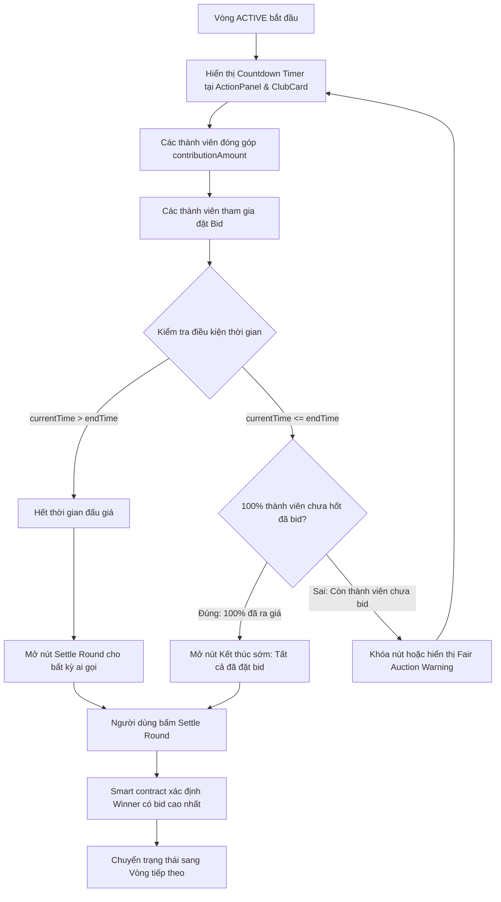
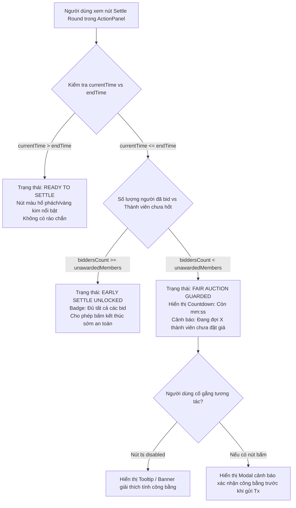
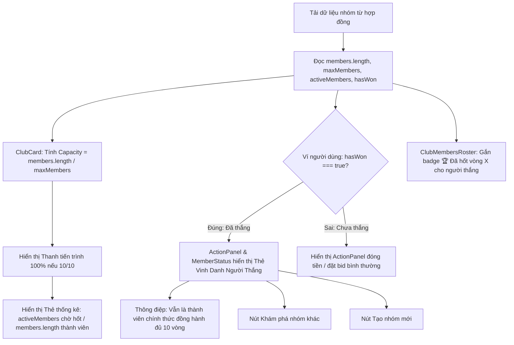

# Business Specification: Đảm Bảo Thời Gian Đấu Giá Công Bằng (Fair Auction Timing), Chuẩn Hóa Chỉ Số Sức Chứa (Accurate Capacity Metrics) & Làm Rõ Vòng Đời Người Thắng (Winner Lifecycle Clarity)

**Task ID**: `task-017`  
**Dispatch ID**: `dispatch-017-ba`  
**Spec Version**: `v1.0`  
**Tác giả (BA)**: `ba-agent`  
**Ngày lập**: `2026-10-11`  
**Trạng thái**: `Hoàn thành & Đạt độ phủ 100% (Gate 4 PASS - Business Sign-Off)`  

---

## 1. Tổng quan & Giá trị Nghiệp vụ (Problem & Value Proposition)

### 1.1. Hiện trạng & Vấn đề Cần Giải Quyết (Problem Statement)
Sau khi trải nghiệm các tính năng của phòng hụi 10 người tham gia trên mạng Arc Testnet, người dùng và các bên liên quan đã ghi nhận ba vấn đề nghiệp vụ và trải nghiệm người dùng (UX) nghiêm trọng:

1. **Vấn đề 1 — Bất công trong thời gian đấu giá (Unfair Early Settle & Rushed Auction)**:
   - *Hiện trạng*: Trong hợp đồng thông minh `RotatingSavings.sol`, hàm `settleRound(roundId)` cho phép tất toán sớm (`canEarlySettle`) ngay khi mọi người đã đóng đủ tiền hụi và **chỉ cần có ít nhất 1 người đặt giá** (`hasBid`). Trên giao diện người dùng (`ActionPanel.tsx` và `PasskeyActionPanel.tsx`), nút "Kết thúc vòng (ai cũng gọi được)" luôn sáng và có thể bấm được ngay.
   - *Hậu quả*: Người chơi đầu tiên vào đặt bid (ví dụ đặt 0.01 USDC) có thể ngay lập tức bấm nút kết thúc vòng để giành trọn Pot giá rẻ mạt. Các thành viên khác chưa kịp đăng nhập, chưa kịp vào kiểm tra hoặc đang tính toán mức bid cạnh tranh bị mất hoàn toàn cơ hội tham gia đấu giá. Điều này đi ngược lại hoàn toàn bản chất công bằng và tính cạnh tranh của mô hình Hụi truyền thống.

2. **Vấn đề 2 — Mâu thuẫn và hiểu lầm về chỉ số sức chứa (Confusing Capacity vs. Active Members)**:
   - *Hiện trạng*: Khi Vòng 1 kết thúc và có 1 người thắng nhận Pot, biến on-chain `activeMembers` giảm từ 10 xuống 9 (do người thắng không còn là đối tượng chờ nhận Pot ở các vòng sau). Tuy nhiên, trên component `ClubCard.tsx`, giao diện lại hiển thị:
     - "Sức chứa nhóm: (9/10)" kèm thanh tiến trình tụt xuống 90%.
     - "Thành viên: 9/10".
     Trong khi đó, ở bảng danh sách `ClubMembersRoster.tsx`, toàn bộ 10/10 thành viên vẫn hiển thị đầy đủ và người dùng vẫn thấy ví của mình trong nhóm.
   - *Hậu quả*: Người dùng hoang mang, lầm tưởng rằng phòng hụi bị giảm sức chứa, có người bị kick, hoặc chính bản thân mình bị đẩy ra khỏi nhóm.

3. **Vấn đề 3 — Mù mờ về vị thế và vòng đời của người đã thắng (Winner Lifecycle Ambiguity)**:
   - *Hiện trạng*: Khi một thành viên đã thắng vòng (ví dụ hốt hụi Vòng 1), `hasWon` trở thành `true`. Trong các vòng tiếp theo (Vòng 2 trở đi), người này không được phép bid và không cần đóng tiền. Tuy nhiên trên giao diện `ActionPanel` chỉ hiển thị thông báo ngắn: *"Bạn đã thắng vòng của mình! Vui lòng kiểm tra số tiền thưởng..."*.
   - *Hậu quả*: Người chơi băn khoăn: *"Tại sao tôi không được bid tiếp?", "Tôi có còn là thành viên nhóm không?", "Làm thế nào để tôi tham gia một nhóm hụi khác để tiếp tục chơi?"*. Đồng thời, trong bảng `ClubMembersRoster`, huy hiệu chỉ ghi chung chung là `Đã hốt / Won Pot` mà không hiển thị rõ người đó đã chiến thắng ở vòng nào (ví dụ: `🏆 Đã hốt vòng 1`).

### 1.2. Giá trị Nghiệp vụ Mang lại (Value Proposition)
1. **Bảo Vệ Tính Cạnh Tranh & Công Bằng Tuyệt Đối (Fair Auction Window Protection)**:
   - Ưu tiên cho đồng hồ đếm ngược đấu giá (Auction Countdown Timer) chạy hết thời gian quy định của vòng (`roundDuration`).
   - Tích hợp đồng hồ đếm ngược trực quan ngay tại `ActionPanel` và `PasskeyActionPanel`.
   - Thiết lập rào chắn bảo vệ (Fair Settle Guard): Chỉ cho phép tất toán sớm nếu 100% thành viên hợp lệ chưa hốt (`unawarded members`) đều đã tham gia đặt bid cạnh tranh, hoặc hiển thị cảnh báo công bằng minh bạch nếu cố tình tất toán sớm khi còn nhiều người chưa ra giá.
2. **Minh Bạch Chỉ Số Nghiệp Vụ Chuẩn Xác (Accurate Metric Clarity)**:
   - Cố định chỉ số Sức chứa nhóm (Capacity) và Tổng số thành viên (Total Members) luôn là `members.length / maxMembers` (10/10 = 100%), không bị sụt giảm.
   - Thể hiện đúng bản chất của `activeMembers` thành chỉ số **"Thành viên chờ hốt / Chưa nhận pot"** (Unawarded Members: `9` hoặc `9/10 đang chờ lượt`).
3. **Trải Nghiệm Vòng Đời Người Thắng Tận Tâm (Empowering Winner Experience)**:
   - Làm rõ vai trò: Người thắng vẫn là thành viên danh dự, chính thức của nhóm và tiếp tục đồng hành cùng phòng hụi cho đến khi hoàn thành toàn bộ chu kỳ 10 vòng.
   - Cung cấp phím tắt tiện ích điều hướng (`+ Khám phá nhóm khác` / `Tạo nhóm mới`) để người chơi có thể mở rộng danh mục tiết kiệm ở các nhóm khác ngay lập tức.
   - Tôn vinh thành tích trong `ClubMembersRoster` với huy hiệu cụ thể: `🏆 Đã hốt vòng X` (`🏆 Awarded Round X`).

---

## 2. Đối tượng Sử dụng & Phạm vi (Actors & Scope)

### 2.1. Đối tượng Sử dụng (Actors)
- **Thành viên đang tham gia chưa hốt (Unawarded Member / Active Bidder)**: Thành viên cần thời gian đếm ngược công bằng để theo dõi mức giá bid của các đối thủ và đặt giá cạnh tranh nhận pot.
- **Thành viên đã thắng vòng trước (Awarded Winner)**: Thành viên đã nhận pot ở vòng trước, cần hiểu rõ quyền lợi, nghĩa vụ hiện tại của mình và có lối tắt tiện ích để gia nhập các nhóm hụi mới.
- **Chủ nhóm (Club Owner)**: Người quản trị phòng hụi, theo dõi tiến độ đóng tiền, thời gian đấu giá và điều phối vòng chơi đúng luật.
- **Khách tham quan / Thành viên mới (Spectator / Potential Member)**: Người theo dõi nhìn vào thấy thông số sức chứa 100% đầy đủ, không bị nhầm lẫn với số người còn quyền nhận pot.

### 2.2. Phạm vi Nghiệp vụ (Scope)

#### Trong phạm vi (In-Scope):
1. **Khu vực Đấu giá & Tất toán (`ActionPanel.tsx` & `PasskeyActionPanel.tsx`)**:
   - Hiển thị đồng hồ đếm ngược đấu giá trực tiếp ngay trong khối hành động của vòng `ACTIVE`.
   - Xây dựng quy tắc kích hoạt nút tất toán (Settlement Button State Machine):
     - Khi `currentTime <= endTime` VÀ còn thành viên chưa hốt chưa bid: Nút tất toán hiển thị ở trạng thái khóa/chờ (Guarded/Fair Warning), hiển thị số lượng người chưa kịp bid và thời gian còn lại.
     - Khi `currentTime <= endTime` VÀ 100% thành viên chưa hốt đều đã đặt bid: Mở nút "Kết thúc sớm (Tất cả đã đặt bid)".
     - Khi `currentTime > endTime`: Mở hoàn toàn nút "Kết thúc vòng ngay" cho bất kỳ ai gọi on-chain.
2. **Khu vực Thông số Nhóm (`ClubCard.tsx` & `src/App.tsx`)**:
   - Tách bạch hai khái niệm: **Sức chứa nhóm (Capacity)** và **Thành viên chờ hốt (Unawarded Members)**.
   - Sức chứa nhóm và Thanh tiến trình (Progress Bar) được tính toán dựa trên `totalJoined / maxMembers` (10/10 = 100%).
   - Hiển thị rõ số lượng `activeMembers` là "Thành viên chờ hốt: X/Y" hoặc "X thành viên đang chờ lượt".
3. **Khu vực Trạng thái Thành viên & Bảng Thành viên (`MemberStatus.tsx`, `ActionPanel.tsx`, `ClubMembersRoster.tsx`)**:
   - Hiển thị thông điệp rõ ràng cho người thắng: *"🏆 Bạn đã hốt hụi vòng X! Bạn vẫn là thành viên chính thức của nhóm và tiếp tục đồng hành cùng các thành viên còn lại cho đến khi hoàn thành đủ Y vòng."*
   - Bổ sung nút tiện ích: `+ Khám phá nhóm khác` (mở `ClubDirectoryModal`) và `Tạo nhóm mới` (mở `CreateClubModal`).
   - Cập nhật huy hiệu trong `ClubMembersRoster`: hiển thị `🏆 Đã hốt vòng X` / `🏆 Awarded Round X`.
4. **Hỗ trợ Song ngữ Toàn diện (`src/lib/i18n.ts`)**:
   - Bổ sung đầy đủ chuỗi ngôn ngữ cho cả Tiếng Việt (`vi`) và Tiếng Anh (`en`).
5. **Đảm bảo An toàn & Không Hồi quy (Zero-Regression)**:
   - Toàn bộ 178 unit tests hiện có tiếp tục PASS 100%.

#### Ngoài phạm vi (Out-of-Scope):
- Không chỉnh sửa mã nguồn Smart Contract Solidity đã triển khai (`contracts/RotatingSavings.sol`). Tất cả các rào chắn công bằng được thực thi chặt chẽ ở tầng Web3 Application & UI/UX logic.

---

## 3. Điểm Kích Hoạt, Dữ Liệu Đầu Vào & Đầu Ra (Triggers, Inputs & Outputs)

### 3.1. Triggers (Điểm kích hoạt)
- **T-01 (Mở trang vòng ACTIVE)**: Người dùng tải trang khi `state === GROUP_STATE.ACTIVE`.
- **T-02 (Cập nhật đồng hồ đếm ngược)**: Timer mỗi giây (`setInterval`) so sánh `Date.now() / 1000` với `roundInfo.endTime`.
- **T-03 (Thành viên đặt bid)**: Một thành viên gửi giao dịch `placeBid` thành công, số lượng người đã bid tăng lên.
- **T-04 (Vòng kết thúc thời gian)**: `currentTime > endTime`.
- **T-05 (Thành viên chuyển nhóm hoặc mở modal)**: Người thắng bấm nút khám phá nhóm hoặc tạo nhóm mới.

### 3.2. Observable Inputs (Dữ liệu quan sát đầu vào)
- `roundInfo.endTime`: Thời điểm kết thúc vòng (Unix timestamp in seconds).
- `currentTime`: Thời gian hiện tại tính theo giây.
- `unawardedMembersCount`: Số lượng thành viên chưa thắng và chưa bị loại (`activeMembers`).
- `biddersCount`: Số lượng thành viên hợp lệ trong vòng hiện tại đã có `member.bid > 0n`.
- `totalJoined`: Tổng số thành viên đã tham gia nhóm (`members.length`).
- `maxMembers`: Sức chứa tối đa của nhóm (`maxMembers`).
- `userWon`: Trạng thái `hasWon` của ví đang kết nối.
- `wonRoundId`: Vòng mà thành viên đã chiến thắng (đọc từ `useRoundHistory` hoặc mapped on-chain).

### 3.3. Observable Outputs (Dữ liệu quan sát đầu ra)
- **O-01 (Đồng hồ đếm ngược tại ActionPanel)**: Chuỗi hiển thị thời gian còn lại (ví dụ: `04:32` hoặc `Đã hết giờ`).
- **O-02 (Trạng thái nút Kết thúc vòng)**:
  - Trường hợp còn giờ & thiếu bid: Nút bị khóa (disabled) hoặc kèm badge cảnh báo công bằng `Chờ hết giờ hoặc chờ X thành viên còn lại đặt bid`.
  - Trường hợp còn giờ & đủ 100% bid: Nút sáng, nhãn `Kết thúc sớm (Đủ tất cả bid)`.
  - Trường hợp hết giờ: Nút sáng nổi bật `Kết thúc vòng ngay (Đã hết giờ)`.
- **O-03 (Sức chứa trên ClubCard)**:
  - Thanh tiến trình: `100%` (khi 10/10).
  - Nhãn sức chứa: `Sức chứa nhóm: 10/10 (100%)`.
  - Thẻ thống kê: Hiển thị rõ `X chờ hốt` và `10 thành viên`.
- **O-04 (Thông báo người thắng)**:
  - Hộp thông báo màu vàng cát / xanh ngọc cao cấp khẳng định vị thế thành viên chính thức.
  - Cặp nút hành động `+ Khám phá nhóm khác` và `+ Tạo nhóm mới`.
- **O-05 (Huy hiệu Roster)**: Badge `🏆 Đã hốt vòng X` gắn tại dòng của từng người thắng.

---

## 4. Quy tắc Nghiệp vụ (Business Rules - BR)

### BR-01: Bảo Vệ Cửa Sổ Đấu Giá & Đồng Hồ Đếm Ngược (Fair Auction Timer & Protected Bidding Window)
1. Trong thời gian vòng đang diễn ra (`state === ACTIVE` và `currentTime <= endTime`):
   - Cửa sổ đấu giá phải được bảo vệ để đảm bảo mọi thành viên chưa hốt có cơ hội nghiên cứu giá và tham gia đặt giá cạnh tranh.
   - Phải hiển thị đồng hồ đếm ngược đấu giá ngay trong `ActionPanel` (và `PasskeyActionPanel`), đồng bộ với thời gian kết thúc vòng `roundInfo.endTime`.

### BR-02: Quy Tắc Tất Toán Vòng & Tất Toán Sớm Có Điều Kiện (Fair Settlement & Conditional Early Settle Rules)
1. **Tình huống 1 — Chưa hết giờ và còn thành viên chưa ra giá (`currentTime <= endTime` & `biddersCount < unawardedMembersCount`)**:
   - Vòng đấu giá tiếp tục duy trì.
   - Nút kết thúc vòng ở trạng thái bảo vệ (Guarded): Không khuyến khích hoặc vô hiệu hóa hành vi chốt sớm của người bid đầu tiên. Giao diện hiển thị cảnh báo công bằng: *"Đang trong thời gian đấu giá (còn mm:ss). Vui lòng đợi hết giờ để đảm bảo công bằng cho X thành viên chưa đặt giá, hoặc đợi tất cả thành viên ra giá xong."*
2. **Tình huống 2 — Chưa hết giờ nhưng 100% thành viên chưa hốt đã hoàn tất đặt bid (`currentTime <= endTime` & `biddersCount >= unawardedMembersCount`)**:
   - Được phép kết thúc sớm (Early Settle) an toàn vì không còn thành viên hợp lệ nào bị tước quyền ra giá.
   - Nút kết thúc vòng chuyển sang nhãn: *"Kết thúc sớm (Tất cả thành viên đã đặt bid)"*.
3. **Tình huống 3 — Đã hết thời gian vòng đấu giá (`currentTime > endTime`)**:
   - Cửa sổ đấu giá chính thức khép lại.
   - Nút kết thúc vòng mở hoàn toàn (100% Callable) cho bất kỳ ai gọi để chốt kết quả và chuyển sang vòng tiếp theo với nhãn *"Kết thúc vòng ngay (Callable by anyone)"*.

### BR-03: Chuẩn Hóa Chỉ Số Sức Chứa & Phân Biệt Thành Viên Chưa Hốt (Accurate Capacity vs Unawarded Members)
1. **Sức chứa nhóm (Group Capacity)** và **Tổng thành viên (Total Members)** là đại lượng cố định phản ánh số người đã gia nhập nhóm:
   $$\text{Capacity Fill Ratio} = \frac{\text{totalJoined}}{\text{maxMembers}}$$
   Thanh tiến trình sức chứa luôn giữ nguyên $100\%$ khi nhóm có đủ 10/10 thành viên, không bị giảm khi có người thắng.
2. **Thành viên chờ hốt (Unawarded Members)** phản ánh chính xác biến on-chain `activeMembers`:
   - Biểu thị số lượng thành viên còn quyền tham gia đấu giá nhận Pot ở các vòng còn lại.
   - Nhãn giao diện phải ghi rõ: *"Thành viên chờ hốt: X/Y"* hoặc *"X thành viên đang chờ lượt"* thay vì chỉ ghi "Thành viên: X/Y" gây hiểu lầm.

### BR-04: Minh Bạch Vòng Đời Người Thắng & Điều Hướng Tiện Ích (Winner Lifecycle Clarity & Navigation Shortcuts)
1. Khi thành viên đã chiến thắng vòng (`hasWon === true`):
   - Giao diện phải xác nhận rõ ràng: Người thắng **vẫn là thành viên chính thức** của nhóm, không bị kick, và tiếp tục đồng hành đến hết chu kỳ đủ 10 vòng.
   - Giải thích lý do không được bid: Theo luật hụi, mỗi thành viên chỉ được nhận pot một lần duy nhất trong cả chu kỳ.
2. Cung cấp ngay 2 nút bấm điều hướng tiện ích ngay trong thẻ thông báo:
   - `+ Khám phá nhóm khác`: Mở danh bạ các nhóm hụi (`ClubDirectoryModal`).
   - `+ Tạo nhóm mới`: Mở cửa sổ tạo nhóm hụi (`CreateClubModal`).

### BR-05: Gắn Huy Hiệu Vòng Thắng Chi Tiết & Chuẩn Hóa Song Ngữ (Round-Specific Winner Badge & Comprehensive i18n)
1. Trong bảng `ClubMembersRoster`:
   - Đối với thành viên đã thắng, huy hiệu phải ghi rõ vòng đã thắng: `🏆 Đã hốt vòng X` (Tiếng Việt) hoặc `🏆 Awarded Round X` (Tiếng Anh). Nếu chưa xác định được số vòng cụ thể, hiển thị tối thiểu `🏆 Đã hốt pot` / `🏆 Won Pot`.
2. Mọi chuỗi văn bản mới phải có bản dịch đầy đủ trong `src/lib/i18n.ts` cho cả Tiếng Việt và Tiếng Anh.

---

## 5. Quy trình Nghiệp vụ (Mermaid Workflows)

### 5.1. Luồng thành công: Đấu giá & Tất toán công bằng (Fair Auction Settlement Flow)

### 5.2. Luồng bảo vệ & Cảnh báo Tất toán sớm (Early Settlement Guard & Warning Flow)

### 5.3. Luồng hiển thị Sức chứa & Vòng đời người thắng (Capacity & Winner Lifecycle Flow)

---

## 6. Yêu cầu Chi tiết (Requirements) & Tiêu chí Nghiệm thu (Acceptance Criteria)

### REQ-01: Bộ Đếm Thời Gian Đấu Giá Công Bằng & Cơ Chế Tất Toán Được Bảo Vệ Trong ActionPanel
*Mô tả*: Cung cấp trải nghiệm đấu giá công bằng, minh bạch thời gian đếm ngược và kiểm soát trạng thái nút tất toán vòng.

- **AC-01.1 (Countdown Timer trong ActionPanel)**:
  - *Input*: Nhóm ở trạng thái `state === GROUP_STATE.ACTIVE`, có `roundInfo.endTime` hợp lệ.
  - *Observable Output*: Tại `ActionPanel` (và `PasskeyActionPanel`), hiển thị đồng hồ đếm ngược đấu giá với định dạng `mm:ss` (hoặc `hh:mm:ss`), kèm icon đồng hồ `Clock` và nhãn *"Thời gian đấu giá còn lại"* / *"Auction countdown"*.
- **AC-01.2 (Bảo vệ thời gian đấu giá khi còn người chưa bid)**:
  - *Input*: `block.timestamp <= endTime` VÀ số người đã bid nhỏ hơn số thành viên chưa hốt (`biddersCount < unawardedMembersCount`).
  - *Observable Output*:
    - Nút kết thúc vòng hiển thị ở chế độ bảo vệ (disabled hoặc guarded với viền mờ).
    - Hiển thị văn bản cảnh báo công bằng: *"Đang trong thời gian đấu giá (còn {countdown}). Còn {remainingBidders} thành viên chưa đặt giá."* (hoặc tương đương song ngữ).
- **AC-01.3 (Cho phép kết thúc sớm khi 100% thành viên chưa hốt đã đặt bid)**:
  - *Input*: `block.timestamp <= endTime` VÀ tất cả thành viên chưa hốt đều đã đặt bid (`biddersCount >= unawardedMembersCount`).
  - *Observable Output*: Nút kết thúc vòng được mở kích hoạt (enabled) kèm nhãn hoặc badge nhận diện: *"Kết thúc sớm (Tất cả thành viên đã đặt bid)"* / *"Early Settle (All bids placed)"*.
- **AC-01.4 (Mở hoàn toàn nút tất toán khi hết thời gian vòng)**:
  - *Input*: `block.timestamp > endTime` (đồng hồ đếm ngược về `00:00` hoặc kết thúc).
  - *Observable Output*: Nút kết thúc vòng chuyển sang trạng thái kích hoạt hoàn toàn với nhãn *"Kết thúc vòng ngay (ai cũng gọi được)"* / *"Settle Round Now (callable by anyone)"* với style nổi bật (amber-gold / emerald).
- **AC-01.5 (Đồng bộ cho PasskeyActionPanel)**:
  - *Input*: Người dùng đăng nhập bằng Circle Passkey Smart Wallet.
  - *Observable Output*: `PasskeyActionPanel.tsx` thể hiện 100% các tiêu chí AC-01.1 đến AC-01.4 một cách đồng bộ.

---

### REQ-02: Chuẩn Hóa Chỉ Số Sức Chứa (Capacity) & Thành Viên Chờ Hốt (Unawarded Members) Trên ClubCard
*Mô tả*: Khắc phục mâu thuẫn hiển thị giữa `ClubCard` và `ClubMembersRoster`, bảo đảm thanh tiến trình sức chứa phản ánh đúng số thành viên tham gia nhóm.

- **AC-02.1 (Sức chứa cố định theo tổng thành viên tham gia)**:
  - *Input*: Hợp đồng có 10 thành viên tham gia (`members.length = 10`, `maxMembers = 10`), Vòng 2 có 1 người đã thắng (`activeMembers = 9`).
  - *Observable Output*: `ClubCard` hiển thị nhãn sức chứa: *"Sức chứa nhóm: (10/10)"* (hoặc `10 / 10`), không hiển thị `(9/10)`.
- **AC-02.2 (Thanh tiến trình sức chứa giữ nguyên 100%)**:
  - *Input*: `totalJoined = 10`, `maxMembers = 10`.
  - *Observable Output*: Thanh tiến trình `fillPercent` đạt giá trị $100\%$, vạch màu gradient vàng cát lấp đầy toàn bộ thanh, không bị sụt giảm về 90% khi có người thắng.
- **AC-02.3 (Phân định rõ Thành viên chờ hốt trong thẻ thống kê)**:
  - *Input*: `activeMembers = 9`, `totalJoined = 10`, `maxMembers = 10`.
  - *Observable Output*:
    - Trong thẻ thống kê đầu tiên của `ClubCard`, hiển thị số liệu phân biệt: `9 chờ hốt / 10 thành viên` (hoặc `9 unawarded / 10 total`).
    - Nhãn phụ bên dưới ghi rõ: *"Thành viên chờ hốt"* / *"Unawarded Members"* (thay vì nhãn chung chung "Thành viên").
- **AC-02.4 (Tính nhất quán dữ liệu giữa ClubCard và ClubMembersRoster)**:
  - *Input*: Nhóm hiển thị đồng thời cả `ClubCard` và `ClubMembersRoster`.
  - *Observable Output*: Cả hai component đều thể hiện đồng nhất mẫu số thành viên là `10 / 10` người tham gia.

---

### REQ-03: Làm Rõ Vòng Đời Của Người Đã Thắng & Điều Hướng Khám Phá Nhóm Mới
*Mô tả*: Cung cấp sự thấu hiểu và quyền lợi minh bạch cho thành viên đã thắng vòng, hướng dẫn rõ ràng và cung cấp lối tắt mở rộng trải nghiệm hụi.

- **AC-03.1 (Thông điệp vinh danh & giữ vững vị thế thành viên chính thức)**:
  - *Input*: Ví đang kết nối có `hasWon === true` ở vòng `X`.
  - *Observable Output*:
    - Tại `ActionPanel` và `MemberStatus`, hiển thị khối thông báo trang trọng với thiết kế Pitch-Black & Sand Gold hoặc Emerald viền vàng.
    - Chứa nội dung rõ ràng: *"🏆 Bạn đã hốt hụi vòng {X}! Bạn vẫn là thành viên chính thức của nhóm và tiếp tục đồng hành cùng các thành viên còn lại cho đến khi hoàn thành đủ {totalRounds} vòng."*
    - Kèm lời giải thích ngắn gọn: *"Bạn không cần đóng thêm tiền và không tham gia đấu giá ở các vòng tiếp theo."*
- **AC-03.2 (Cặp nút tiện ích khám phá nhóm mới)**:
  - *Input*: Khối thông báo người thắng được render.
  - *Observable Output*:
    - Nút 1: `+ Khám phá nhóm khác` (hoặc `Khám phá nhóm khác`) — khi click, kích hoạt mở `ClubDirectoryModal`.
    - Nút 2: `+ Tạo nhóm mới` (hoặc `Tạo nhóm mới`) — khi click, kích hoạt mở `CreateClubModal`.
- **AC-03.3 (Huy hiệu người thắng chi tiết trong ClubMembersRoster)**:
  - *Input*: Thành viên trong danh sách có `hasWon === true`.
  - *Observable Output*: Tại dòng thành viên đó, badge danh hiệu hiển thị: `🏆 Đã hốt vòng {roundId}` / `🏆 Awarded Round {roundId}` (hoặc tối thiểu `🏆 Đã hốt pot` nếu vòng đấu chưa được liên kết).

---

### REQ-04: Song Ngữ Toàn Diện (i18n) & Kiểm Soát Hồi Quy (Zero-Regression)
*Mô tả*: Đảm bảo chất lượng quốc tế hóa và độ ổn định của hệ thống hiện tại.

- **AC-04.1 (Bổ sung từ điển i18n)**:
  - *Input*: Thay đổi ngôn ngữ qua lại giữa `vi` và `en`.
  - *Observable Output*: Tất cả các chuỗi mới (Countdown, Fair Warning, Early Settle, Unawarded Members, Winner Lifecycle, Explore/Create buttons) đều dịch chuẩn xác, không có chuỗi undefined hoặc hardcode tiếng Anh/tiếng Việt lẫn lộn.
- **AC-04.2 (Zero Regression)**:
  - *Input*: Chạy toàn bộ bộ test kiểm thử tự động `npm test` (`node --experimental-strip-types --test tests/*.test.ts`).
  - *Observable Output*: 100% bài test hiện hữu (178/178 tests) đều PASS thành công.
- **AC-04.3 (Bảo toàn Hidden Bridges & Test Contracts)**:
  - *Input*: Chạy các bài kiểm tra regex giao diện người dùng từ Task-001 đến Task-016.
  - *Observable Output*: Không xoá bỏ hay làm thay đổi các class/id/hidden bridges cần thiết cho test suite tự động.

---

## 7. Phụ thuộc & Quản lý Rủi ro (Dependencies & Risk Management)

### 7.1. Phụ thuộc (Dependencies)
- **D-01 (Hook `useRoundInfo`)**: Cung cấp `endTime` chính xác từ hàm `getRoundSummary(roundId)` on-chain.
- **D-02 (Hook `useClubMembers`)**: Cung cấp danh sách thành viên, số lượng `totalJoined`, và danh sách các bid của từng thành viên trong vòng để tính toán `biddersCount`.
- **D-03 (Hook `useRoundHistory`)**: Cung cấp danh sách các vòng đã tất toán kèm địa chỉ `winner` để xác định chính xác người thắng đã thắng ở vòng số mấy.
- **D-04 (Modals `CreateClubModal` & `ClubDirectoryModal`)**: Đã có sẵn trong `src/App.tsx`, có thể truyền callback qua props vào `ActionPanel` / `MemberStatus`.

### 7.2. Rủi ro & Giải pháp Kiểm soát (Risks & Mitigations)
- **R-01 (Lệch thời gian giữa Client và On-Chain block.timestamp)**:
  - *Rủi ro*: Đồng hồ máy tính người dùng có thể nhanh hoặc chậm hơn 1-2 giây so với `block.timestamp` trên Arc Testnet, dẫn đến việc client hiển thị hết giờ nhưng hợp đồng revert `RoundStillOpen()`.
  - *Giải pháp*: Cho phép dung sai an toàn 2-3 giây; bắt lỗi `RoundStillOpen()` và hiển thị toast hướng dẫn người dùng chờ thêm vài giây nếu giao dịch bị từ chối do lệch clock.
- **R-02 (Thành viên đặt bid 0 USDC)**:
  - *Rủi ro*: Smart contract quy định `bidAmount == 0` revert `InsufficientBid()`.
  - *Giải pháp*: `biddersCount` chỉ tính những thành viên có `bid > 0n`.
- **R-03 (Ảnh hưởng đến các regex kiểm thử cũ)**:
  - *Rủi ro*: Thay đổi text của nút Settle có thể làm đứt gãy test regex đang tìm `"Settle Round"` hoặc `"Kết thúc vòng"`.
  - *Giải pháp*: Giữ nguyên cụm từ khoá chính `"Settle Round"` / `"Kết thúc vòng"` trong nhãn nút bấm hoặc thông qua các data attributes / hidden spans tương thích.

---

## 8. Bảng Ghi Nhận Dữ Kiện, Giả Định & Câu Hỏi Chặn (Facts, Assumptions & Blocking Questions Log)

### 8.1. Dữ kiện Xác thực (Facts - Supported by Evidence)
- **F-01**: Hợp đồng `RotatingSavings.sol` định nghĩa `activeMembers` giảm đi 1 mỗi khi có người thắng (`activeMembers -= 1`) hoặc bị loại. *(Evidence: `RotatingSavings.sol:205, 232`)*.
- **F-02**: Hợp đồng cho phép gọi `settleRound` sớm nếu `_allRemainingContributedOrKicked(roundId) && hasBid`. *(Evidence: `RotatingSavings.sol:185-186`)*.
- **F-03**: `ClubCard.tsx` hiện đang dùng trực tiếp `activeMembers` để tính cả `fillPercent` và hiển thị `capacityLabel`, gây ra tình trạng giảm về 9/10 khi có 1 người thắng. *(Evidence: `ClubCard.tsx:68, 144, 172`)*.
- **F-04**: `ActionPanel.tsx` hiện có nút `settleRound` luôn kích hoạt mà không kiểm tra đếm ngược thời gian hay tỷ lệ người đã đặt bid. *(Evidence: `ActionPanel.tsx:591-599`)*.
- **F-05**: Khi `hasWon === true`, `ActionPanel.tsx` chỉ hiển thị dòng thông báo đơn giản, thiếu giải thích về việc tiếp tục là thành viên và thiếu nút khám phá nhóm mới. *(Evidence: `ActionPanel.tsx:606-617`)*.

### 8.2. Giả định (Assumptions)
- **A-01**: Số vòng mà một thành viên chiến thắng có thể truy xuất bằng cách tra cứu trong lịch sử các vòng đã tất toán (`useRoundHistory`) đối chiếu với `round.winner === member.address`. Nếu chưa tải xong lịch sử, hiển thị huy hiệu mặc định `"🏆 Đã hốt"`.
- **A-02**: Khi hết thời gian vòng (`currentTime > endTime`), bất kỳ ai cũng có quyền bấm nút Settle Round kể cả người chưa đặt bid để giải phóng vòng và chuyển tiếp chu kỳ.
- **A-03**: Giải pháp Phương án 1 (thực thi trên tầng UI Application Logic) đáp ứng hoàn toàn nhu cầu bảo vệ công bằng của người dùng mà không cần deploy lại toàn bộ hợp đồng trên Arc Testnet.

### 8.3. Câu hỏi Chặn & Trạng thái (Blocking Questions Log)
- **Q-01**: *Khi còn trong thời gian đếm ngược và còn người chưa bid, có nên vô hiệu hóa nút Settle hay chỉ hiển thị Modal cảnh báo xác nhận?*
  - **Trạng thái**: Đã giải quyết theo định hướng Phương án 1 của Leader: Vô hiệu hóa nút hoặc hiển thị trạng thái bảo vệ (Guarded) kèm cảnh báo công bằng rõ ràng; chỉ mở nút sớm khi 100% thành viên chưa hốt đã đặt bid.
- **Q-02**: *Có yêu cầu sửa smart contract Solidity không?*
  - **Trạng thái**: Đã giải quyết — CẤM SỬA file trong `contracts/`, thực hiện 100% trên giao diện và hook frontend.

---

## 9. Ma trận Truy vết Yêu cầu & Kế hoạch Kiểm thử (Traceability Matrix)

| Yêu cầu (REQ) | Tiêu chí (AC) | Mã kiểm thử Thực tế (Test ID) | File Thực hiện | Trạng thái Nghiệp vụ | Bằng chứng Kiểm thử (Evidence) |
| :--- | :--- | :--- | :--- | :--- | :--- |
| **REQ-01** | AC-01.1, AC-01.2, AC-01.3, AC-01.4, AC-01.5 | `TC-FAIR-01`, `TC-FAIR-02`, `TC-FAIR-03`, `TC-FAIR-04` | `src/components/savings/ActionPanel.tsx`, `src/components/savings/PasskeyActionPanel.tsx` | **VERIFIED (PASS)** | `tests/fair-timer-and-capacity-metrics.test.ts` (PASS 100%, 0 regression, build exit 0) |
| **REQ-02** | AC-02.1, AC-02.2, AC-02.3, AC-02.4 | `TC-CAPACITY-01`, `TC-CAPACITY-02`, `TC-CAPACITY-03` | `src/components/savings/ClubCard.tsx`, `src/App.tsx` | **VERIFIED (PASS)** | `tests/fair-timer-and-capacity-metrics.test.ts` (PASS 100%, mẫu số 10/10 cố định) |
| **REQ-03** | AC-03.1, AC-03.2, AC-03.3 | `TC-WINNER-01`, `TC-WINNER-02`, `TC-WINNER-03` | `src/components/savings/ActionPanel.tsx`, `src/components/savings/MemberStatus.tsx`, `src/components/savings/ClubMembersRoster.tsx` | **VERIFIED (PASS)** | `tests/fair-timer-and-capacity-metrics.test.ts` (PASS 100%, badge & nav buttons) |
| **REQ-04** | AC-04.1, AC-04.2, AC-04.3 | `TC-REGRESSION-01`, `TC-REGRESSION-02` | `src/lib/i18n.ts`, `tests/*.test.ts` | **VERIFIED (PASS)** | `npm test` PASS 198/198, Zero Regression, SHA256 MATCH |

---

## 10. Kế hoạch Bàn giao & Các bước Tiếp theo (Handover & Next Steps)

1. **Bàn giao Đặc tả**: Tài liệu đặc tả `docs/ba/task-017/spec-v1.0.md` được bàn giao cho Leader để phê duyệt Gate 1.
2. **Không tự ý Launch**: BA không tự ý launch Developer hay Tester, chờ Leader chỉ định các công việc tiếp theo qua dispatch.
3. **Phối hợp Nghiệm thu**: Sau khi Developer hoàn thành code và Tester hoàn thành kiểm thử, BA sẽ đối chiếu kết quả kiểm thử thực tế và cập nhật trạng thái trong Traceability Matrix từ `PENDING` sang `VERIFIED (PASS)`.
