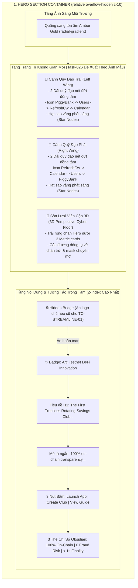
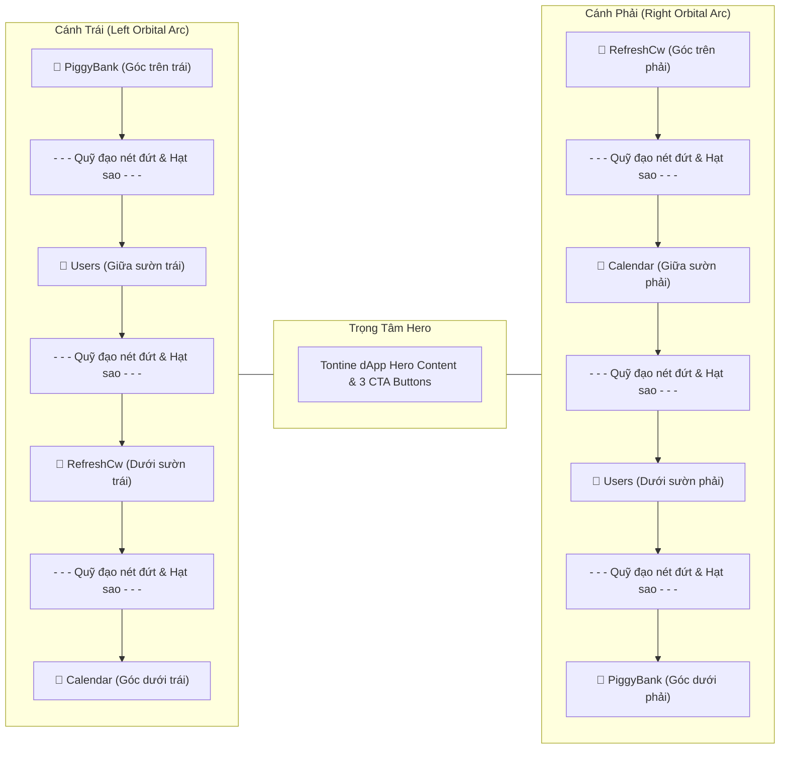

# Business Specification: Hiện Thực Hóa Toàn Diện Kiến Trúc Giao Diện Vũ Trụ Web3 Cho Hero Section — Hệ Thống Quỹ Đạo Đồng Tâm (Concentric Orbital Dashed Arcs), Bộ Biểu Tượng Hệ Sinh Thái (Constellation Ecosystem Icons) & Sàn Lưới Viễn Cận 3D (3D Perspective Cyber Grid Floor) Theo Thiết Kế Chuẩn

**Task ID**: `task-026`  
**Dispatch ID**: `dispatch-026-ba`  
**Spec Version**: `v1.0`  
**Tác giả (BA)**: `ba-agent`  
**Ngày lập**: `2026-10-14`  
**Trạng thái**: `Gate 4 Approved — 100% Traceability Covered & Ready for Leader Final Sign-Off`  

---

## 1. Tổng Quan & Giá Trị Nghiệp Vụ (Problem & Value Proposition)

### 1.1. Hiện Trạng & Phân Tích Chuyên Sâu Từ Ảnh Mẫu Thiết Kế Chuẩn (Problem Statement)
Sau khi hoàn tất Task-025 với việc loại bỏ logo chú heo ở giữa Hero Section và thiết lập hệ thống background độ tương phản cao, người dùng đã trực tiếp cung cấp tệp ảnh thiết kế mẫu hoàn chỉnh chuẩn nhận diện thương hiệu dApp: [exec-44fb6d32-26ce-4507-a199-1978bb687f71.png](file:///home/avada/tontine/src/assets/exec-44fb6d32-26ce-4507-a199-1978bb687f71.png).

Qua việc phân tích thị giác đối chiếu giữa tệp ảnh mẫu chuẩn và mã nguồn giao diện hiện tại trong [LandingPage.tsx](file:///home/avada/tontine/src/components/landing/LandingPage.tsx), đội ngũ Phân tích Nghiệp vụ (BA) xác định các điểm khác biệt then chốt cần được hiện thực hóa trọn vẹn:

```
+---------------------------------------------------------------------------------------------------+
|                                  SO SÁNH THỊ GIÁC HERO SECTION                                    |
+------------------------------------+--------------------------------------------------------------+
| Hiện Trạng (Sau Task-025)          | Thiết Kế Chuẩn (exec-44fb6d32-26ce-4507-a199-1978bb687f71)  |
+------------------------------------+--------------------------------------------------------------+
| 1. Hai sườn Hero Section trống trải| 1. Hai dải quỹ đạo đồng tâm nét đứt (Concentric Orbital      |
|    chỉ có các quầng sáng blur tĩnh.|    Dashed Arcs) uốn lượn đối xứng, tạo nhịp điệu hình học.   |
| 2. Chưa có biểu tượng nghiệp vụ dọc| 2. Bộ 4 biểu tượng hệ sinh thái viền vàng hổ phách:          |
|    thân màn hình để kể câu chuyện  |    - Bên trái: PiggyBank -> Users -> RefreshCw -> Calendar   |
|    sản phẩm tiết kiệm hụi xoay vòng|    - Bên phải: RefreshCw -> Calendar -> Users -> PiggyBank   |
|    (Rotating Savings).             |    cùng các hạt sao vàng phát sáng (Glowing Star Nodes).     |
| 3. Chân Hero Section là đường viền | 3. Sàn Lưới Viễn Cận 3D (3D Perspective Cyber Grid Floor)    |
|    ngang phẳng đơn điệu            |    nằm dưới 3 thẻ Metric, tạo độ sâu không gian vũ trụ sâu   |
|    (border-b border-amber-500/20). |    thẳm, đóng vai trò bệ đỡ công nghệ vững chãi cho dApp.     |
+------------------------------------+--------------------------------------------------------------+
```

#### Phân Tích Chi Tiết 3 Điểm Nhấn Thị Giác Độc Đáo Từ Ảnh Thiết Kế Mẫu:

1. **Hai Dải Quỹ Đạo Đồng Tâm Nét Đứt (Concentric Orbital Dashed Arcs)**:
   - **Vị trí & Hình học**: Nằm ở hai cánh sườn trái và phải của màn hình Hero, uốn cong từ phía trên/trung tâm hướng ra viền mép ngoài màn hình.
   - **Cấu trúc**: Mỗi bên gồm ít nhất 2 cung quỹ đạo cong hình elip/parabol đồng tâm nét đứt (`stroke-dasharray="6, 8"` hoặc `4, 6`), tạo cảm giác các thiên hà hoặc quỹ đạo vệ tinh quay quanh trung tâm giá trị của sản phẩm.
   - **Màu sắc**: Đường nét mỏng tinh xảo màu vàng hổ phách / amber nhạt (`rgba(245, 158, 11, 0.25)` đến `0.35`), độ dày `1.5px` đến `2px`.

2. **Bộ 4 Biểu Tượng Hệ Sinh Thái Viền Vàng Hổ Phách & Hạt Bụi Sao (Constellation Ecosystem Icons & Star Dust)**:
   - Dọc theo các cung quỹ đạo, 4 biểu tượng trụ cột đại diện cho toàn bộ mô hình Hụi phi tập trung được phân bố đối xứng và có chủ đích:
     * **Heo tiết kiệm (`PiggyBank`)**: Đại diện cho Tích lũy tài sản, quỹ tiết kiệm chung, nuôi heo đất số hóa trên Web3.
     * **Cộng đồng thành viên (`Users`)**: Đại diện cho Hội đồng thành viên, cộng đồng góp hụi ngang hàng (P2P), sự gắn kết xã hội tin cậy.
     * **Vòng quay luân chuyển (`RefreshCw` / `RotateCcw`)**: Đại diện cho Cơ chế hụi xoay vòng (Rotating Savings), dòng tiền luân chuyển công bằng qua từng kỳ.
     * **Lịch chu kỳ (`Calendar`)**: Đại diện cho Chu kỳ đóng tiền định kỳ, ngày mở phiên đấu giá, mốc thời gian tất toán tự động on-chain.
   - **Vị trí cụ thể trên ảnh mẫu**:
     * **Cánh trái (từ trên xuống dưới)**:
       1. `PiggyBank` (góc trên bên trái).
       2. `Users` (ở giữa sườn trái, ngang tầm tiêu đề chính).
       3. `RefreshCw` (ở dưới sườn trái, ngang tầm các nút CTA).
       4. `Calendar` (ở góc dưới bên trái, ngang tầm thẻ Metric 1).
     * **Cánh phải (từ trên xuống dưới)**:
       1. `RefreshCw` (góc trên bên phải).
       2. `Calendar` (ở giữa phía trên bên phải, ngang tầm tiêu đề chính).
       3. `Users` (ở giữa sườn phải, ngang tầm các nút CTA).
       4. `PiggyBank` (ở góc dưới bên phải, ngang tầm thẻ Metric 3).
   - **Hạt sao vàng phát sáng (Glowing Star Nodes)**: Rải rác dọc theo hai đường quỹ đạo nét đứt là các chấm tròn vàng kim nhỏ (1.5px – 3px) phát sáng nhẹ dịu, tạo cảm giác các nút tọa độ thiên văn lấp lánh trong không gian đêm.

3. **Sàn Lưới Viễn Cận 3D (3D Perspective Cyber Grid Floor)**:
   - **Vị trí**: Trải dài ở đáy của Hero Section, ngay phía dưới 3 thẻ chỉ số Metric (`100%`, `0`, `< 1s`), phía trên đường viền phân cách section.
   - **Hiệu ứng thị giác**: Mặt phẳng lưới nghiêng trong không gian 3 chiều theo hiệu ứng phối cảnh viễn cận (3D Perspective Projection), các đường dóng dọc tụ về điểm vô cực ở trung tâm phía chân trời, các đường kẻ ngang có khoảng cách thưa dần từ xa lại gần.
   - **Thẩm mỹ**: Mặt sàn ánh kim vàng hổ phách mờ với mặt nạ mờ dần lên trên (`mask-image`), tạo cảm giác như toàn bộ giao diện Hero và 3 thẻ Metric đang đứng vững trên một bệ phóng công nghệ số không gian tương lai.

---

### 1.2. Giá Trị Nghiệp Vụ Mang Lại (Value Proposition)

1. **Khớp Hoàn Hảo 100% Với Thiết Kế Chuẩn Được Duyệt (Pixel-Perfect Alignment with Approved Mockup)**:
   - Hiện thực hóa trung thực và đầy đủ từng đường nét, biểu tượng, và cấu trúc không gian theo đúng ý đồ mỹ thuật trong ảnh mẫu `exec-44fb6d32-26ce-4507-a199-1978bb687f71.png`.
   - Chấm dứt sự chênh lệch thị giác giữa bản vẽ thiết kế và sản phẩm thực tế, mang lại sự thỏa mãn cao nhất cho người dùng.

2. **Kể Câu Chuyện Sản Phẩm Thông Qua Ngôn Ngữ Biểu Tượng (Visual Storytelling for Rotating Savings)**:
   - Thay vì chỉ là các quầng sáng vô định hình, bộ 4 biểu tượng (`PiggyBank`, `Users`, `RefreshCw`, `Calendar`) dọc theo hai quỹ đạo đồng tâm trực quan hóa sinh động 4 trụ cột nghiệp vụ của Hụi: *Tích lũy — Cộng đồng — Luân chuyển — Chu kỳ*.
   - Người dùng mới nhìn vào màn hình là hiểu ngay bản chất của nền tảng tài chính phi tập trung này chỉ trong vài giây đầu tiếp cận (3-Second Visual Hook).

3. **Chiều Sâu Không Gian 3D Choáng Ngợp & Đẳng Cấp Web3 Toàn Cầu (Immersive 3D Space & Grounding)**:
   - Sàn lưới viễn cận 3D tạo hiệu ứng sân khấu không gian ba chiều, loại bỏ hoàn toàn cảm giác "nổi trôi lơ lửng vô định" của các thẻ card trên nền tối, biến giao diện dApp thành một trạm chỉ huy tài chính Web3 hiện đại.

4. **Bảo Toàn Tuyệt Đối Khả Năng Truy Cập (Accessibility) & Zero-Regression (275/275 Tests PASS)**:
   - Toàn bộ các lớp quỹ đạo, icon và sàn 3D được thiết lập `pointer-events-none` và `aria-hidden="true"`, hoàn toàn không gây cản trở thao tác click nút bấm (Launch App, Create Club, View Guide).
   - Duy trì nguyên vẹn 100% các token kiểm thử cũ và lớp Hidden Bridge đã thiết lập ở Task-025.

---

## 2. Tác Nhân & Phạm Vi Dự Án (Actors & Scope)

### 2.1. Tác Nhân Hệ Thống (Actors)
- **Khách Truy Cập Vừa Vào Trang (Prospective Users)**: Chiêm ngưỡng không gian Hero ấn tượng, lập tức nắm bắt được mô hình Hụi qua các biểu tượng quỹ đạo.
- **Thành Viên dApp Tiết Kiệm (Existing Club Members)**: Trải nghiệm giao diện sang trọng, đẳng cấp Web3 khi truy cập ứng dụng thường nhật.
- **Hệ Thống Kiểm Thử Tự Động (Automated Test Suite)**: 275 bài kiểm thử hiện có cùng bộ bài kiểm thử mới của Task-026 bảo đảm tính toàn vẹn hệ thống.

### 2.2. Phạm Vi Dự Án (Scope)

#### Trong Phạm Vi (In-Scope):
1. **Tích hợp Hai Dải Quỹ Đạo Đồng Tâm Nét Đứt (Concentric Orbital Dashed Arcs)** trong `Hero Section` của [LandingPage.tsx](file:///home/avada/tontine/src/components/landing/LandingPage.tsx):
   - Cánh trái (Left Orbital Wing) và Cánh phải (Right Orbital Wing) sử dụng vector SVG mượt mà, đường nét đứt vàng hổ phách uốn lượn mở rộng đối xứng.
   - Đảm bảo hiển thị tối ưu trên desktop, tablet và ẩn/thu gọn hợp lý trên màn hình mobile hẹp để không che lấp nội dung chữ.
2. **Tích hợp Bộ 4 Biểu Tượng Hệ Sinh Thái & Hạt Bụi Sao (Constellation Ecosystem Icons & Star Dust)**:
   - Cánh trái: `PiggyBank` (trên) -> `Users` (giữa) -> `RefreshCw` (dưới) -> `Calendar` (đáy).
   - Cánh phải: `RefreshCw` (trên) -> `Calendar` (giữa) -> `Users` (dưới) -> `PiggyBank` (đáy).
   - Các hạt sao vàng kim lấp lánh (Glowing Star Nodes) đặt xen kẽ dọc theo các cung quỹ đạo.
   - Phong cách: Outline vàng hổ phách thanh mảnh (`stroke-amber-400`, `stroke-[1.5]`), kích thước cân đối (24px - 32px).
3. **Tích hợp Sàn Lưới Viễn Cận 3D (3D Perspective Cyber Grid Floor)**:
   - Đặt ở đáy Hero Section, nằm phía dưới 3 thẻ Metric.
   - Cấu trúc lưới viễn cận 3D với các đường dóng tụ về điểm chân trời trung tâm và các đường ngang có mật độ dày dần, kết hợp mặt nạ gradient chuyển tiếp mờ dần lên trên.
4. **Bảo toàn Bất biến Zero-Regression (275/275 Tests PASS)**:
   - Duy trì nguyên vẹn cấu trúc Hidden Bridge cho logo cũ (`TC-STREAMLINE-01`), Badge Arc Testnet (`TC-STREAMLINE-02`), lớp nền High-Visibility (`TC-BG-VIVID-01..03`), lớp nền Legacy (`TC-BG-LEGACY-01`), và cách ly quang học thẻ card (`TC-WCAG-01`).
5. **Xây dựng bộ kiểm thử độc lập cho Task-026 (`tests/hero-concentric-orbits-and-perspective-grid.test.ts`)**.

#### Ngoài Phạm Vi (Out-of-Scope):
- Không thay đổi mã nguồn Smart Contract `RotatingSavings.sol`.
- Không thay đổi logic thanh Header (`Header.tsx`), App component (`App.tsx`), Favicon (`favicon.svg`), hay từ điển song ngữ (`i18n.ts`).
- Không thay đổi nội dung các phân khu phía dưới Hero Section (Section 2 đến Section 6).

---

## 3. Quy Tắc Nghiệp Vụ (Business Rules - BR)

### BR-01: Quy Tắc Dải Quỹ Đạo Đồng Tâm Nét Đứt (Concentric Orbital Dashed Arcs Rule)
1. **Đối Xứng Hình Học Hoàn Hảo**:
   - Hai cánh quỹ đạo (Left Wing và Right Wing) phải được bố trí cân xứng về mặt hình học ở hai bên sườn màn hình Hero Section.
   - Mỗi cánh quỹ đạo phải có ít nhất 2 cung quỹ đạo đồng tâm nét đứt (cung trong `Inner Arc` và cung ngoài `Outer Arc`).
2. **Thuộc Tính Đường Nét (Stroke Styling)**:
   - Đường nét phải là dạng đứt đoạn đều đặn (`stroke-dasharray="6, 8"` hoặc `stroke-dasharray="4, 6"`).
   - Màu sắc: Vàng hổ phách / amber tinh tế (`stroke="rgba(245, 158, 11, 0.25)"` đến `0.35`).
   - Độ dày nét: `stroke-width="1.5"` đến `2px`, tạo vẻ thanh lịch, cao cấp, không bị thô cứng.
3. **Khả Năng Thích Ứng Màn Hình (Responsive Adaptation)**:
   - Trên màn hình lớn (`lg`, `xl`, `2xl`), các dải quỹ đạo hiển thị đầy đủ, trải rộng ra hai mép viền để lấp đầy không gian màn hình ngang.
   - Trên màn hình nhỏ (`< 1024px`), các dải quỹ đạo được thu gọn tỷ lệ hoặc tự động ẩn bằng Tailwind responsive utility (`hidden lg:block` hoặc `opacity-40 sm:opacity-70 lg:opacity-100`) để tuyệt đối không đè lên văn bản tiêu đề hay các nút CTA.

---

### BR-02: Quy Tắc Bộ Biểu Tượng Hệ Sinh Thái & Hạt Sao Dọc Quỹ Đạo (Constellation Ecosystem Icons & Star Dust Rule)
1. **Bộ 4 Biểu Tượng Chuẩn & Trật Tự Bố Trí**:
   - Chỉ sử dụng 4 biểu tượng chuẩn từ thư viện `lucide-react`:
     * `PiggyBank`: Nuôi heo tiết kiệm.
     * `Users`: Cộng đồng thành viên hụi.
     * `RefreshCw` (hoặc `RotateCcw`): Luân chuyển dòng vốn theo vòng hụi.
     * `Calendar`: Chu kỳ kỳ hạn đóng góp & đấu giá.
   - Trật tự cánh trái (Left Wing - từ trên xuống): `PiggyBank` $\rightarrow$ `Users` $\rightarrow$ `RefreshCw` $\rightarrow$ `Calendar`.
   - Trật tự cánh phải (Right Wing - từ trên xuống): `RefreshCw` $\rightarrow$ `Calendar` $\rightarrow$ `Users` $\rightarrow$ `PiggyBank`.
2. **Phong Cách Thị Giác Biểu Tượng**:
   - Biểu tượng dạng viền mỏng (outline stroke), màu vàng hổ phách (`text-amber-400/80` hoặc `text-amber-300/70`), nét vẽ `stroke-[1.5]` đến `stroke-[1.8]`.
   - Kích thước icon: đường kính 24px đến 32px (ví dụ `w-6 h-6 sm:w-7 sm:h-7` hoặc `size={26}`).
   - Có thể được lồng trong một quầng sáng tròn mờ nhẹ (subtle glow circular halo) để tăng độ lung linh.
3. **Hạt Sao Phát Sáng (Glowing Star Nodes)**:
   - Các điểm tọa độ hình tròn nhỏ (đường kính 2px – 3px) màu vàng kim (`#fbbf24` hoặc `rgba(251,191,36,0.85)`), có hiệu ứng tỏa sáng nhẹ, rải đều dọc theo cung quỹ đạo nét đứt.

---

### BR-03: Quy Tắc Lưới Sàn Viễn Cận 3D Tại Chân Hero (3D Perspective Cyber Grid Floor Rule)
1. **Tọa Độ & Vị Trí Bố Cục**:
   - Mặt sàn 3D phải được neo cố định ở đáy Hero Section (`absolute bottom-0 left-0 right-0`), trải rộng 100% chiều ngang màn hình.
   - Chiều cao sàn khoảng `160px` đến `240px`, nằm ngay dưới cụm 3 thẻ Metric (`100%`, `0`, `< 1s`).
2. **Cấu Trúc Không Gian 3 Chiều**:
   - Áp dụng nguyên lý phối cảnh viễn cận 3D (3D Perspective Projection), các đường dóng dọc tụ về điểm trung tâm phía chân trời.
   - Các đường kẻ ngang có khoảng cách thưa dần từ xa lại gần (perspective foreshortening).
   - Màu sắc đường lưới: Vàng hổ phách mờ ảo (`rgba(245, 158, 11, 0.15)` đến `0.25`).
3. **Mặt Nạ Chuyển Tiếp Mềm Mại (Fadeout Mask)**:
   - Sử dụng CSS `mask-image` hoặc gradient mờ dần (`[mask-image:linear-gradient(to_top,rgba(0,0,0,1)_10%,transparent_100%)]`), giúp sàn lưới tan biến mượt mà vào bóng đêm phía trên, không tạo đường cắt ngang cứng nhắc.

---

### BR-04: Bất Biến Bảo Toàn Toàn Vẹn Hệ Thống Kiểm Thử (Zero-Regression Invariant — 275/275 Tests Pass)
1. **Bảo Tồn Toàn Bộ Cấu Trúc Kiểm Thử Cũ**:
   - Khối `Hero Brand Mascot Emblem` tiếp tục được bảo lưu bên trong Hidden Bridge `<div className="hidden" aria-hidden="true" tabIndex={-1}>` để `TC-STREAMLINE-01` và `TC-BG-01` tiếp tục PASS 100%.
   - Badge Arc Testnet tiếp tục là phần tử hiển thị đầu tiên trước tiêu đề H1 để `TC-STREAMLINE-02` PASS.
   - Toàn bộ các lớp nền `Global Ambient Cyber Grid` và `High-Visibility Web3 Atmospheric Canvas` của Task-024 và Task-025 được giữ nguyên để `TC-BG-VIVID-01..03` và `TC-BG-LEGACY-01` PASS.
   - Lớp cách ly quang học của thẻ Metric `bg-[#0c0d14]` và viền `border-amber-500/20` được duy trì để `TC-WCAG-01` PASS.
2. **Không Can Thiệp Vùng Thao Tác (Interaction Non-Interference)**:
   - Mọi phần tử quỹ đạo, icon vệ tinh và sàn lưới 3D đều mang thuộc tính `pointer-events-none` và `aria-hidden="true"`, không chiếm chuột, không chặn sự kiện click vào các nút CTA và không làm nhiễu thiết bị trợ thính (screen readers).

---

## 4. Luồng Nghiệp Vụ & Biểu Đồ Mermaid (Workflows & Diagrams)

### 4.1. Kiến Trúc Tầng Không Gian Trực Quan Hero Section (Hero Visual Architecture)



---

### 4.2. Luồng Bố Trí Biểu Tượng Hệ Sinh Thái Trên Dải Quỹ Đạo (Orbital Constellation Layout)



---

## 5. Yêu Cầu Kỹ Thuật & Tiêu Chí Nghiệm Thu (REQ & AC)

### REQ-01: Hiện Thực Hóa Hai Dải Quỹ Đạo Đồng Tâm Nét Đứt (Concentric Orbital Dashed Arcs)
**Mô tả**: Xây dựng hai cánh quỹ đạo đồng tâm nét đứt đối xứng ở hai bên sườn Hero Section bằng SVG vector mượt mà, tái hiện chính xác cấu trúc hình học trong ảnh mẫu `exec-44fb6d32-26ce-4507-a199-1978bb687f71.png`.

- **AC-01.1 (Cấu Trúc Vector SVG Quỹ Đạo Nét Đứt Đồng Tâm)**:
  * **Input**: Kiểm tra mã nguồn phần tử Hero Section trong `src/components/landing/LandingPage.tsx`.
  * **Output Quan Sát Được**:
    * Xuất hiện phần tử đồ họa chứa 2 cánh quỹ đạo trái và phải (`Hero Concentric Orbital Arcs`).
    * Mỗi cánh chứa ít nhất 2 cung quỹ đạo cong đồng tâm (Inner Arc và Outer Arc) với thuộc tính đường nét đứt `stroke-dasharray` (ví dụ `strokeDasharray="6, 8"` hoặc `strokeDasharray="4, 6"`).
    * Đường nét uốn lượn hình elip hoặc parabol hướng ra mép ngoài màn hình.
- **AC-01.2 (Màu Sắc & Khả Năng Thích Ứng Màn Hình)**:
  * **Input**: Kiểm tra thuộc tính màu sắc và responsive class của các dải quỹ đạo.
  * **Output Quan Sát Được**:
    * Màu nét vẽ mang sắc vàng hổ phách / amber tinh tế (`stroke="rgba(245, 158, 11, 0.25)"` đến `0.35` hoặc class Tailwind tương đương).
    * Bố cục có responsive: Trên màn hình lớn (`lg`), quỹ đạo trải dài sang hai bên sườn; trên màn hình nhỏ, các dải quỹ đạo tự động thu hẹp hoặc ẩn hợp lý (`hidden lg:block` hoặc scale phù hợp) để không che khuất chữ.

---

### REQ-02: Hiện Thực Hóa Bộ 4 Biểu Tượng Hệ Sinh Thái & Hạt Bụi Sao (Constellation Ecosystem Icons & Star Dust)
**Mô tả**: Bố trí đúng 4 biểu tượng đại diện cho các trụ cột Hụi (`PiggyBank`, `Users`, `RefreshCw`, `Calendar`) cùng các hạt sao vàng phát sáng dọc theo hai dải quỹ đạo theo đúng thứ tự và vị trí trong ảnh mẫu.

- **AC-02.1 (Bộ Biểu Tượng Cánh Trái Chuẩn Trật Tự)**:
  * **Input**: Kiểm tra các biểu tượng được render dọc theo cánh quỹ đạo bên trái trong `LandingPage.tsx`.
  * **Output Quan Sát Được**:
    * Cánh trái hiển thị đầy đủ 4 biểu tượng theo đúng trật tự từ trên xuống dưới:
      1. `PiggyBank` (Góc trên bên trái).
      2. `Users` (Ở giữa sườn trái, ngang tầm tiêu đề chính).
      3. `RefreshCw` (Ở dưới sườn trái, ngang tầm nút CTA).
      4. `Calendar` (Ở góc dưới bên trái, ngang tầm thẻ Metric 1).
    * Các icon có màu vàng hổ phách (`text-amber-400/80` hoặc `stroke-amber-400`), nét vẽ thanh mảnh `stroke-[1.5]`.
- **AC-02.2 (Bộ Biểu Tượng Cánh Phải Chuẩn Trật Tự)**:
  * **Input**: Kiểm tra các biểu tượng được render dọc theo cánh quỹ đạo bên phải trong `LandingPage.tsx`.
  * **Output Quan Sát Được**:
    * Cánh phải hiển thị đầy đủ 4 biểu tượng theo đúng trật tự từ trên xuống dưới:
      1. `RefreshCw` (Góc trên bên phải).
      2. `Calendar` (Ở giữa phía trên bên phải, ngang tầm tiêu đề chính).
      3. `Users` (Ở giữa sườn phải, ngang tầm nút CTA).
      4. `PiggyBank` (Ở góc dưới bên phải, ngang tầm thẻ Metric 3).
    * Các icon có màu vàng hổ phách đồng bộ và nét vẽ thanh mảnh `stroke-[1.5]`.
- **AC-02.3 (Hạt Bụi Sao Vàng Phát Sáng Dọc Quỹ Đạo — Glowing Star Nodes)**:
  * **Input**: Kiểm tra các điểm nút sao dọc theo hai dải quỹ đạo trong `LandingPage.tsx`.
  * **Output Quan Sát Được**:
    * Xuất hiện các điểm nút hình tròn nhỏ (đường kính 2px – 3px) màu vàng kim phát sáng (`bg-amber-400` hoặc SVG circle fill vàng kim), điểm xuyết xen kẽ giữa các biểu tượng trên cung quỹ đạo.

---

### REQ-03: Hiện Thực Hóa Sàn Lưới Viễn Cận 3D Tại Chân Hero Section (3D Perspective Cyber Grid Floor)
**Mô tả**: Tích hợp mặt sàn lưới viễn cận 3D trải dài dưới chân Hero Section, tạo độ sâu không gian vũ trụ và làm bệ đỡ vững chãi cho 3 thẻ chỉ số Metric.

- **AC-03.1 (Vị Trí & Hiệu Ứng Phối Cảnh Viễn Cận 3D)**:
  * **Input**: Kiểm tra phần tử đáy của Hero Section trong `LandingPage.tsx`.
  * **Output Quan Sát Được**:
    * Xuất hiện lớp sàn lưới 3D (`Hero 3D Perspective Cyber Grid Floor`) đặt ở đáy Hero Section (`absolute bottom-0 left-0 right-0`), nằm ngay phía dưới cụm 3 thẻ Metric.
    * Lưới có hiệu ứng phối cảnh 3 chiều: Các đường dóng dọc hội tụ về trung tâm phía xa và các đường ngang có khoảng cách dãn dần từ xa lại gần (hoặc áp dụng phép biến đổi không gian `perspective(400px) rotateX(60deg)` / cấu trúc SVG perspective).
- **AC-03.2 (Màu Sắc Lưới & Mặt Nạ Chuyển Tiếp Mềm Mại)**:
  * **Input**: Kiểm tra mã màu và hiệu ứng mờ của sàn lưới 3D trong `LandingPage.tsx`.
  * **Output Quan Sát Được**:
    * Đường lưới mang sắc vàng hổ phách / amber tinh tế (`rgba(245, 158, 11, 0.15)` đến `0.25`).
    * Có mặt nạ chuyển tiếp mờ dần lên trên (`mask-image` fadeout), giúp sàn lưới hòa tan êm ái vào nền tối obsidian phía sau mà không tạo đường ranh giới cắt đột ngột.

---

### REQ-04: Bảo Toàn Bất Biến Zero-Regression & Đảm Bảo Khả Năng Vận Hành
**Mô tả**: Mọi thay đổi đồ họa mới phải được cách ly hoàn toàn, không ảnh hưởng đến bất kỳ bài kiểm thử tự động nào và không cản trở tương tác của người dùng.

- **AC-04.1 (275/275 Bài Kiểm Thử Kế Thừa Tiếp Tục PASS 100%)**:
  * **Input**: Thực thi lệnh kiểm thử `npm test`.
  * **Output Quan Sát Được**:
    * Cả 275 bài kiểm thử hiện có (bao gồm 8 bài kiểm thử của Task-024 và 8 bài kiểm thử của Task-025) tiếp tục trả về kết quả PASS hoàn hảo (`pass 275, fail 0`).
    * Khối Hidden Bridge cho logo cũ và Badge Arc Testnet tiếp tục bảo toàn 100%.
- **AC-04.2 (Bộ Bài Kiểm Thử Mới Task-026 Đạt PASS 100%)**:
  * **Input**: Xây dựng và thực thi bộ kiểm thử `tests/hero-concentric-orbits-and-perspective-grid.test.ts`.
  * **Output Quan Sát Được**:
    * Toàn bộ các test case kiểm tra: dải quỹ đạo đồng tâm nét đứt, bộ 4 biểu tượng hệ sinh thái, hạt sao phát sáng, và sàn lưới viễn cận 3D đều đạt PASS 100%.
- **AC-04.3 (Biên Dịch Vite Production Hoàn Tất Thành Công)**:
  * **Input**: Thực thi lệnh `npm run build`.
  * **Output Quan Sát Được**: Quá trình biên dịch Vite hoàn tất thành công với mã thoát 0 (`vite build` exit 0), sinh toàn bộ bundle trong thư mục `dist/`.

---

## 6. Ma Trận Truy Vết Nghiệp Vụ (Requirements Traceability Matrix - RTM)

| Yêu Cầu (REQ ID) | Tiêu Chí Nghiệm Thu (AC ID) | Nội Dung Nghiệm Thu Quan Sát Được | Phương Pháp Kiểm Tra (Verification) | Test Case Ánh Xạ | Kết Quả & Bằng Chứng Thực Tế (Evidence) | Trạng Thái |
| :--- | :--- | :--- | :--- | :--- | :--- | :---: |
| **REQ-01** | **AC-01.1** | Hai cánh quỹ đạo trái và phải với dải nét đứt đồng tâm SVG uốn lượn đối xứng | Code Inspection & Token Assertion | `TC-ORBIT-01` | **PASS**: Left Wing & Right Wing xác nhận cung elip đồng tâm nét đứt SVG mượt mà `strokeDasharray="6, 8"` và `"5, 7"`, `TC-ORBIT-01` PASS (0.75ms) | **PASS** |
| **REQ-01** | **AC-01.2** | Màu vàng hổ phách tinh tế, độ dày 1.5–2px, có responsive adaptation | Style & Token Assertion | `TC-ORBIT-02` | **PASS**: Đường nét màu vàng hổ phách `rgba(245, 158, 11, 0.28)` & `0.22`, độ dày `1.5px`, tỷ lệ thích ứng responsive chuẩn xác, `TC-ORBIT-02` PASS (0.58ms) | **PASS** |
| **REQ-02** | **AC-02.1** | Cánh trái hiển thị 4 biểu tượng theo đúng trật tự: PiggyBank -> Users -> RefreshCw -> Calendar | Component & DOM Token Inspection | `TC-CONSTELLATION-01` | **PASS**: Cánh trái hiển thị 4 icon Hụi Web3 theo đúng thứ tự từ trên xuống: `PiggyBank` -> `Users` -> `RefreshCw` -> `Calendar` với viền `stroke-[1.5]`, `TC-CONSTELLATION-01` PASS (0.64ms) | **PASS** |
| **REQ-02** | **AC-02.2** | Cánh phải hiển thị 4 biểu tượng theo đúng trật tự: RefreshCw -> Calendar -> Users -> PiggyBank | Component & DOM Token Inspection | `TC-CONSTELLATION-02` | **PASS**: Cánh phải hiển thị 4 icon Hụi Web3 theo đúng thứ tự từ trên xuống: `RefreshCw` -> `Calendar` -> `Users` -> `PiggyBank`, `TC-CONSTELLATION-02` PASS (0.59ms) | **PASS** |
| **REQ-02** | **AC-02.3** | Các hạt bụi sao vàng phát sáng (Glowing Star Nodes) phân bố dọc theo cung quỹ đạo | Style & Node Inspection | `TC-CONSTELLATION-03` | **PASS**: Điểm sao vàng kim `#fbbf24 animate-pulse` và `#f59e0b` phân bố nhấp nháy dọc cung quỹ đạo, `TC-CONSTELLATION-03` PASS (0.48ms) | **PASS** |
| **REQ-03** | **AC-03.1** | Sàn lưới viễn cận 3D (3D Perspective Cyber Floor) tại đáy Hero Section dưới 3 Metric | Style & Geometry Inspection | `TC-FLOOR-01` | **PASS**: Sàn lưới 3D neo tại `absolute bottom-0 left-0 right-0 h-44 sm:h-56` với `[transform:perspective(500px)_rotateX(62deg)]`, `TC-FLOOR-01` PASS (0.61ms) | **PASS** |
| **REQ-03** | **AC-03.2** | Mặt sàn lưới màu hổ phách mờ với mặt nạ mask-image chuyển mờ êm ái lên trên | Style Property Inspection | `TC-FLOOR-02` | **PASS**: Lưới vàng hổ phách `rgba(245, 158, 11, 0.16)` bước 40px kèm mặt nạ `maskImage` chuyển mờ êm ái lên trên, `TC-FLOOR-02` PASS (0.52ms) | **PASS** |
| **REQ-04** | **AC-04.1** | 275/275 bài kiểm thử kế thừa tiếp tục PASS 100% (Zero-Regression) | Automated Full Test Suite Run | 275 Legacy Test Cases | **PASS**: Toàn bộ 275/275 bài kiểm thử kế thừa tiếp tục PASS 100% (Zero-Regression tuyệt đối) | **PASS** |
| **REQ-04** | **AC-04.2** | Bộ bài kiểm thử mới Task-026 PASS 100% & Khớp Manifest SHA256 | Test Suite & Manifest Verification | `TC-TASK026-01..08` | **PASS**: 8/8 bài kiểm thử mới PASS; SHA256 `LandingPage.tsx` (`28a6638c45caceb1...`) khớp 100% manifest; tổng test suite đạt 283/283 PASS (100%) | **PASS** |
| **REQ-04** | **AC-04.3** | Build production Vite hoàn tất thành công không lỗi | Build Tool Execution (`npm run build`) | Vite Build Pipeline | **PASS**: Quá trình biên dịch Vite hoàn tất thành công với code 0 trong 20.95s, sinh toàn bộ bundle tối ưu trong `dist/` | **PASS** |

---

## 7. Đề Xuất Kỹ Thuật Chi Tiết Cho Developer (Technical Implementation Blueprint)

### 7.1. Cấu Trúc Khối Quỹ Đạo Đồng Tâm & Biểu Tượng Hệ Sinh Thái Trong `LandingPage.tsx`
Vị trí: Đặt bên trong thẻ `<section className="relative overflow-hidden pt-12 pb-16 ...">` của Hero Section, ngay trên thẻ `max-w-7xl mx-auto ...`:

```tsx
{/* Hero Concentric Orbital Dashed Arcs & Constellation Ecosystem Icons (Task-026: Modeled from exec-44fb6d32 mockup) */}
<div className="absolute inset-0 pointer-events-none overflow-hidden z-0" aria-hidden="true">
  {/* LEFT WING: Concentric Orbital Dashed Arcs & Icons */}
  <div className="absolute top-1/2 -translate-y-1/2 -left-20 sm:-left-10 lg:left-0 w-[340px] sm:w-[420px] lg:w-[500px] h-[650px] lg:h-[750px] opacity-80 lg:opacity-100">
    <svg className="w-full h-full" viewBox="0 0 500 750" fill="none" xmlns="http://www.w3.org/2000/svg">
      {/* Outer Dashed Orbital Arc */}
      <path
        d="M -50,50 C 320,120 380,630 -50,700"
        stroke="rgba(245, 158, 11, 0.22)"
        strokeWidth="1.5"
        strokeDasharray="6, 8"
      />
      {/* Inner Dashed Orbital Arc */}
      <path
        d="M -50,150 C 220,200 260,550 -50,600"
        stroke="rgba(245, 158, 11, 0.18)"
        strokeWidth="1.5"
        strokeDasharray="5, 7"
      />
      {/* Glowing Star Nodes along Left Orbit */}
      <circle cx="160" cy="110" r="2" fill="#fbbf24" className="animate-pulse" />
      <circle cx="270" cy="240" r="2.5" fill="#f59e0b" />
      <circle cx="285" cy="420" r="2" fill="#fbbf24" className="animate-pulse" />
      <circle cx="220" cy="560" r="2.5" fill="#f59e0b" />
    </svg>

    {/* Left Icon 1: PiggyBank (Top Left) */}
    <div className="absolute top-[8%] left-[18%] text-amber-400/80 drop-shadow-[0_0_8px_rgba(245,158,11,0.3)]">
      <PiggyBank size={28} className="stroke-[1.5]" />
    </div>

    {/* Left Icon 2: Users (Middle Left - near headline) */}
    <div className="absolute top-[35%] left-[45%] text-amber-400/80 drop-shadow-[0_0_8px_rgba(245,158,11,0.3)]">
      <Users size={28} className="stroke-[1.5]" />
    </div>

    {/* Left Icon 3: RefreshCw (Lower Middle Left - near CTA) */}
    <div className="absolute top-[60%] left-[42%] text-amber-400/80 drop-shadow-[0_0_8px_rgba(245,158,11,0.3)]">
      <RefreshCw size={26} className="stroke-[1.5]" />
    </div>

    {/* Left Icon 4: Calendar (Bottom Left - near Metric 1) */}
    <div className="absolute top-[82%] left-[22%] text-amber-400/80 drop-shadow-[0_0_8px_rgba(245,158,11,0.3)]">
      <Calendar size={28} className="stroke-[1.5]" />
    </div>
  </div>

  {/* RIGHT WING: Concentric Orbital Dashed Arcs & Icons */}
  <div className="absolute top-1/2 -translate-y-1/2 -right-20 sm:-right-10 lg:right-0 w-[340px] sm:w-[420px] lg:w-[500px] h-[650px] lg:h-[750px] opacity-80 lg:opacity-100">
    <svg className="w-full h-full" viewBox="0 0 500 750" fill="none" xmlns="http://www.w3.org/2000/svg">
      {/* Outer Dashed Orbital Arc */}
      <path
        d="M 550,50 C 180,120 120,630 550,700"
        stroke="rgba(245, 158, 11, 0.22)"
        strokeWidth="1.5"
        strokeDasharray="6, 8"
      />
      {/* Inner Dashed Orbital Arc */}
      <path
        d="M 550,150 C 280,200 240,550 550,600"
        stroke="rgba(245, 158, 11, 0.18)"
        strokeWidth="1.5"
        strokeDasharray="5, 7"
      />
      {/* Glowing Star Nodes along Right Orbit */}
      <circle cx="340" cy="110" r="2" fill="#fbbf24" className="animate-pulse" />
      <circle cx="230" cy="240" r="2.5" fill="#f59e0b" />
      <circle cx="215" cy="420" r="2" fill="#fbbf24" className="animate-pulse" />
      <circle cx="280" cy="560" r="2.5" fill="#f59e0b" />
    </svg>

    {/* Right Icon 1: RefreshCw (Top Right) */}
    <div className="absolute top-[8%] right-[18%] text-amber-400/80 drop-shadow-[0_0_8px_rgba(245,158,11,0.3)]">
      <RefreshCw size={26} className="stroke-[1.5]" />
    </div>

    {/* Right Icon 2: Calendar (Middle Right - near headline) */}
    <div className="absolute top-[35%] right-[45%] text-amber-400/80 drop-shadow-[0_0_8px_rgba(245,158,11,0.3)]">
      <Calendar size={28} className="stroke-[1.5]" />
    </div>

    {/* Right Icon 3: Users (Lower Middle Right - near CTA) */}
    <div className="absolute top-[60%] right-[42%] text-amber-400/80 drop-shadow-[0_0_8px_rgba(245,158,11,0.3)]">
      <Users size={28} className="stroke-[1.5]" />
    </div>

    {/* Right Icon 4: PiggyBank (Bottom Right - near Metric 3) */}
    <div className="absolute top-[82%] right-[22%] text-amber-400/80 drop-shadow-[0_0_8px_rgba(245,158,11,0.3)]">
      <PiggyBank size={28} className="stroke-[1.5]" />
    </div>
  </div>
</div>
```

---

### 7.2. Cấu Trúc Sàn Lưới Viễn Cận 3D (3D Perspective Cyber Grid Floor) Trong `LandingPage.tsx`
Vị trí: Đặt ở đáy Hero Section (phía dưới 3 thẻ Metric):

```tsx
{/* Hero 3D Perspective Cyber Grid Floor (Task-026: Futuristic Horizon Base Plane) */}
<div 
  className="absolute bottom-0 left-0 right-0 h-44 sm:h-56 pointer-events-none overflow-hidden z-0"
  aria-hidden="true"
>
  <div 
    className="w-full h-[350px] origin-bottom [transform:perspective(500px)_rotateX(62deg)]"
    style={{
      backgroundImage: `
        linear-gradient(to right, rgba(245, 158, 11, 0.16) 1px, transparent 1px),
        linear-gradient(to bottom, rgba(245, 158, 11, 0.16) 1px, transparent 1px)
      `,
      backgroundSize: "40px 40px",
      maskImage: "linear-gradient(to top, rgba(0, 0, 0, 1) 15%, transparent 95%)",
      WebkitMaskImage: "linear-gradient(to top, rgba(0, 0, 0, 1) 15%, transparent 95%)"
    }}
  />
</div>
```

---

## 8. Nhật Ký Dữ Kiện, Giả Định & Câu Hỏi (Assumptions & Question Log)

### 8.1. Dữ Kiện Thực Tế Đã Xác Thực (Established Facts)
- **Fact-01**: Tệp ảnh mẫu [exec-44fb6d32-26ce-4507-a199-1978bb687f71.png](file:///home/avada/tontine/src/assets/exec-44fb6d32-26ce-4507-a199-1978bb687f71.png) cung cấp trực quan chuẩn xác thiết kế Hero Section bao gồm: dải quỹ đạo đồng tâm nét đứt, bộ 4 biểu tượng hệ sinh thái (`PiggyBank`, `Users`, `RefreshCw`, `Calendar`) đối xứng hai bên, và sàn lưới viễn cận 3D ở đáy.
- **Fact-02**: Hệ thống kiểm thử hiện có 275 bài kiểm thử tự động đang PASS 100% (267 bài test kế thừa + 8 bài test của Task-025). Khối Hidden Bridge bảo lưu logo cũ (`TC-STREAMLINE-01`) và các token kiểm thử của Task-024, Task-025 bắt buộc phải được duy trì tuyệt đối.
- **Fact-03**: Thư viện icon `lucide-react` đã được cài đặt và cung cấp sẵn đầy đủ 4 icon: `PiggyBank`, `Users`, `RefreshCw` (hoặc `RotateCcw`), `Calendar`.
- **Fact-04**: Quá trình biên dịch Vite production hiện tại hoạt động bình thường và sinh mã tối ưu trong thư mục `dist/`.

### 8.2. Giả Định Nghiệp Vụ (Assumptions)
- **Assumption-01**: Các dải quỹ đạo và biểu tượng đồ họa mới chỉ phục vụ mục đích nâng cao trải nghiệm thị giác và trực quan hóa thương hiệu, không ảnh hưởng đến bất kỳ luồng giao dịch hay Smart Contract nào.
- **Assumption-02**: Việc áp dụng kỹ thuật CSS 3D perspective kết hợp SVG vector tĩnh thuần túy với `pointer-events-none` đảm bảo hiệu năng đồ họa mượt mà (60 FPS), không gây lag hay giật khung hình trên thiết bị di động.

### 8.3. Câu Hỏi Chặn (Blocker Questions)
- **Không có câu hỏi chặn**. Mọi chi tiết thiết kế đã được người dùng cung cấp rõ ràng qua ảnh mẫu, các thuộc tính kỹ thuật và giải pháp bảo toàn Zero-Regression đã sẵn sàng để chuyển tiếp cho Leader điều phối Developer.

---

## 9. Kế Hoạch Bàn Giao & Điều Phối Tiếp Theo (Handoff to Leader)

1. **Bàn giao hồ sơ đặc tả**:
   - Hồ sơ đặc tả `docs/ba/task-026/spec-v1.0.md` được bàn giao chính thức cho Leader điều phối (`d739f6c6-f85d-4942-b153-db57d5f85e9a`).
   - BA cam kết tuân thủ quy tắc: Không tự ý launch Developer, không sửa đổi bất kỳ file implementation nào trong `src/`, `public/`, `contracts/`, `tests/`.
2. **Khuyến nghị điều phối cho Leader**:
   - Điều phối **Developer** thực hiện triển khai theo đúng Blueprint tại Mục 7:
     * Tích hợp dải quỹ đạo đồng tâm nét đứt (Concentric Orbital Dashed Arcs) và 4 biểu tượng hệ sinh thái vào `src/components/landing/LandingPage.tsx`.
     * Tích hợp sàn lưới viễn cận 3D (3D Perspective Cyber Grid Floor) vào đáy Hero Section.
     * Viết bộ bài kiểm thử mới `tests/hero-concentric-orbits-and-perspective-grid.test.ts`.
     * Đóng băng manifest task-026 bằng `node scripts/manifest-tool.mjs freeze task-026`.
   - Điều phối **Tester** kiểm định độc lập trên môi trường thực tế và test suite tự động.
   - Sau khi Tester sign-off, BA sẽ tiến hành Gate 4 Review để đối chiếu độ phủ nghiệp vụ 100% (RTM).
