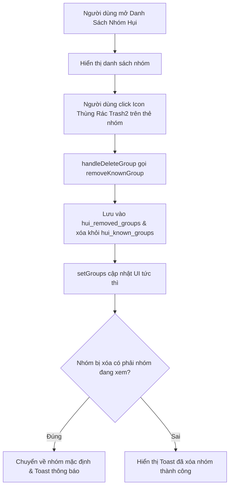

# Đặc Tả Kỹ Thuật (Software Requirements Specification) — Task-032

## Bổ Sung Nút/Icon Xóa Cho Từng Nhóm Hụi (Individual Club Delete Action for Cancelled, Expired & Inactive Clubs) Trong Danh Bạ Nhóm Hụi

- **Task ID**: `task-032`
- **Mục tiêu**: Thêm nút/icon xóa (`Trash2`) cho từng câu lạc bộ trong danh bạ nhóm hụi (`ClubDirectoryModal.tsx`) để người dùng có thể xóa các nhóm đã hủy (`cancelled`), hết hạn (`completed`/expired) hoặc nhóm không muốn tham gia nữa, đồng bộ lưu trữ và cập nhật danh bạ ngay lập tức.
- **Tác giả**: Business Analyst (`ba-agent`)
- **Phiên bản**: `v1.0`
- **Ngày lập**: `2026-10-15`
- **Trạng thái**: **APPROVED (Gate 1)**

---

## 1. Vấn Đề Nghiệp Vụ & Giá Trị Đem Lại (Problem & Value Proposition)

### 1.1. Hiện trạng
- Người dùng tham gia nhiều nhóm hụi hoặc thử nghiệm tạo nhóm mới trên Arc Testnet.
- Theo thời gian, một số nhóm bị hủy bỏ (`cancelled`), đã kết thúc toàn bộ các vòng (`completed`/hết hạn), hoặc người dùng không còn muốn chơi ở nhóm đó nữa.
- Hiện tại trong modal Danh Sách Nhóm Hụi ([`ClubDirectoryModal.tsx`](file:///home/avada/tontine/src/components/savings/ClubDirectoryModal.tsx)):
  - Chỉ có 1 nút dọn dẹp hàng loạt ở footer ("Dọn dẹp nhóm cũ") chỉ xóa các nhóm custom nhưng lại không cho phép xóa chọn lọc từng nhóm cụ thể.
  - Từng thẻ nhóm chỉ có nút "Vào nhóm" hoặc badge "Đang xem", hoàn toàn **thiếu icon/nút xóa cho từng club**.
- Người dùng phản hồi trực tiếp:
  - *"thêm nút xóa cho nhũng club cancle và hết hạn or không chơi nữa nhé"*
  - *"> thêm icon xóa cho từng club cancle và hết hạn or không chơi nữa nhé"*

### 1.2. Giá trị đem lại
- **Kiểm soát danh bạ linh hoạt (Granular Control)**: Người dùng có thể xóa chọn lọc bất kỳ nhóm nào không còn nhu cầu theo dõi chỉ với 1 click.
- **Giao diện gọn gàng, sạch sẽ**: Loại bỏ các nhóm "rác", nhóm hết hạn hoặc đã hủy khỏi tầm mắt.
- **Xử lý an toàn**: Nếu người dùng xóa nhóm đang active, ứng dụng tự động chuyển về nhóm mặc định khả dụng và thông báo toast rõ ràng.
- **Bảo toàn 100% Zero-Regression**: Không làm vỡ cấu trúc hay token kiểm thử của 323 bài test hiện có.

---

## 2. Phạm Vi & Tác Nhân (Scope & Actors)

- **Tác nhân (Actors)**:
  - Thành viên nhóm hụi: Mở danh bạ nhóm hụi và click icon xóa trên thẻ của nhóm muốn gỡ bỏ.
- **Phạm vi trong task (In-Scope)**:
  - Cập nhật [`src/lib/savingsClubDirectory.ts`](file:///home/avada/tontine/src/lib/savingsClubDirectory.ts):
    - Khóa lưu trữ `REMOVED_CLUBS_STORAGE_KEY = "hui_removed_groups"`.
    - Hàm `getRemovedGroups(): Set<string>`.
    - Nâng cấp `removeKnownGroup(address: string)`: Xóa khỏi `hui_known_groups` và ghi nhận vào `hui_removed_groups`.
    - Nâng cấp `getKnownGroups()`: Lọc bỏ toàn bộ địa chỉ nằm trong danh sách đã xóa.
    - Cập nhật `saveKnownGroup`: Tự động un-hide nếu người dùng cố ý nhập lại hoặc tạo lại nhóm đó.
  - Cập nhật [`src/components/savings/ClubDirectoryModal.tsx`](file:///home/avada/tontine/src/components/savings/ClubDirectoryModal.tsx):
    - Thêm icon button `<Trash2 size={16} />` bên cạnh nút "Vào nhóm" / "Đang xem" cho từng club item.
    - Xử lý click: `handleDeleteGroup(group, e)` với `e.stopPropagation()`.
    - Nếu xóa nhóm đang xem (`isCurrent`): Chuyển về nhóm khả dụng đầu tiên qua `onSelectGroup` và hiển thị toast thông báo.
    - Nếu xóa nhóm khác: Cập nhật state danh sách ngay lập tức và toast thông báo.
  - Cập nhật từ điển song ngữ [`src/lib/i18n.ts`](file:///home/avada/tontine/src/lib/i18n.ts).
- **Ngoài phạm vi (Out-of-Scope)**:
  - Không phá hủy smart contract on-chain (thao tác xóa là thao tác quản lý danh bạ phía client).

---

## 3. Quy Tắc Nghiệp Vụ (Business Rules)

- **BR-01 (Biểu Tượng Xóa Trực Quan Cho Từng Club)**:
  - Mỗi thẻ nhóm trong `ClubDirectoryModal` phải có icon nút xóa `<Trash2 size={16} />` với tooltip rõ ràng: *"Xóa nhóm khỏi danh sách (đã hủy / hết hạn / không chơi nữa)"*.
- **BR-02 (Cập Nhật Tức Thì & Bền Vững)**:
  - Khi bấm xóa, nhóm phải biến mất khỏi danh sách ngay lập tức (`setGroups`) và không bị xuất hiện lại khi reload trang.
- **BR-03 (An Toàn Khi Xóa Nhóm Đang Xem)**:
  - Nếu nhóm bị xóa là nhóm người dùng đang xem (`isCurrent === true`), hệ thống tự động gọi `onSelectGroup` chuyển về nhóm mặc định khả dụng còn lại để tránh giao diện bị lỗi trạng thái mồ côi.

---

## 4. Luồng Nghiệp Vụ (Mermaid Diagram)

---

## 5. Yêu Cầu Kỹ Thuật (REQ) & Tiêu Chí Nghiệm Thu (AC)

### REQ-01: Quản Lý Dữ Liệu Danh Bạ Nhóm Đã Xóa (`savingsClubDirectory.ts`)
- **AC-01.1**: Định nghĩa khóa lưu trữ `REMOVED_CLUBS_STORAGE_KEY = "hui_removed_groups"` và hàm đọc danh sách nhóm đã xóa an toàn.
- **AC-01.2**: Hàm `removeKnownGroup(address: string)` đưa địa chỉ vào danh sách đã xóa và loại bỏ khỏi `hui_known_groups`.
- **AC-01.3**: Hàm `getKnownGroups()` loại bỏ triệt để các địa chỉ đã xóa, không tự động nạp lại các nhóm này.
- **AC-01.4**: Hàm `saveKnownGroup` tự động gỡ bỏ địa chỉ khỏi danh sách đã xóa nếu người dùng cố ý thêm lại nhóm đó.

### REQ-02: Icon Xóa Cho Từng Club Trong `ClubDirectoryModal.tsx`
- **AC-02.1**: Mỗi thẻ câu lạc bộ trong `ClubDirectoryModal.tsx` render nút icon `<Trash2 size={16} />` với style tương tác hover đỏ tinh tế (`hover:text-red-400 hover:bg-red-950/40`).
- **AC-02.2**: Nút xóa có `title` và `aria-label` rõ ràng: *"Xóa nhóm khỏi danh sách (đã hủy / hết hạn / không chơi nữa)"*.
- **AC-02.3**: Khi click nút xóa, chặn sự kiện nổi bọt (`e.stopPropagation()`) để không kích hoạt nhầm sự kiện chuyển nhóm.
- **AC-02.4**: Danh sách `groups` trong modal được cập nhật tức thì (nhóm biến mất ngay khỏi giao diện).
- **AC-02.5**: Nếu xóa nhóm đang xem (`isCurrent`), tự động gọi `onSelectGroup(fallbackAddress)` và hiển thị toast chuyển về nhóm khả dụng.

### REQ-03: Đa Ngôn Ngữ & Trải Nghiệm Người Dùng (i18n & UX)
- **AC-03.1**: Từ điển `src/lib/i18n.ts` bổ sung đầy đủ nhãn tooltip và thông báo toast xóa nhóm cho cả `vi` và `en`.
- **AC-03.2**: Toast thông báo sau khi xóa hiển thị đúng tên nhóm đã xóa.

### REQ-04: Bảo Toàn Hồi Quy (Zero Regression)
- **AC-04.1**: Toàn bộ 323 bài test hiện có tiếp tục PASS 100%.
- **AC-04.2**: Lệnh `npm run build` biên dịch thành công không phát sinh lỗi.

---

## 6. Ma Trận Truy Xuất Yêu Cầu (Traceability Matrix)

| REQ ID | Tiêu Chí Nghiệm Thu (AC) | Trạng Thái Thiết Kế (BA) | Trạng Thái Triển Khai (Dev) | Trạng Thái Kiểm Thử (QA) | Bằng Chứng (Evidence) |
| :--- | :--- | :--- | :--- | :--- | :--- |
| **REQ-01** | AC-01.1: Khóa REMOVED_CLUBS_STORAGE_KEY & hàm đọc | Approved | Completed | Passed | `TC-DEL-01` in `tests/individual-club-delete.test.ts` |
| **REQ-01** | AC-01.2: removeKnownGroup lưu vào danh sách đã xóa | Approved | Completed | Passed | `TC-DEL-01` in `tests/individual-club-delete.test.ts` |
| **REQ-01** | AC-01.3: getKnownGroups lọc bỏ các nhóm đã xóa | Approved | Completed | Passed | `TC-DEL-02` in `tests/individual-club-delete.test.ts` |
| **REQ-01** | AC-01.4: saveKnownGroup khôi phục nhóm khi thêm lại | Approved | Completed | Passed | `TC-DEL-02` in `tests/individual-club-delete.test.ts` |
| **REQ-02** | AC-02.1: Render nút icon Trash2 trên từng thẻ club | Approved | Completed | Passed | `TC-DEL-03`, `screenshot-task032-directory-delete-icons.png` |
| **REQ-02** | AC-02.2: Tooltip & aria-label xóa nhóm chi tiết | Approved | Completed | Passed | `TC-DEL-03`, `screenshot-task032-directory-delete-icons.png` |
| **REQ-02** | AC-02.3: e.stopPropagation() trên nút xóa | Approved | Completed | Passed | `TC-DEL-04` in `tests/individual-club-delete.test.ts` |
| **REQ-02** | AC-02.4: State groups trong modal cập nhật tức thì | Approved | Completed | Passed | `TC-DEL-05`, `screenshot-task032-after-deletion.png` |
| **REQ-02** | AC-02.5: Xử lý an toàn khi xóa nhóm đang xem | Approved | Completed | Passed | `TC-DEL-05` in `tests/individual-club-delete.test.ts` |
| **REQ-03** | AC-03.1: Từ điển i18n hỗ trợ song ngữ cho nút xóa | Approved | Completed | Passed | `TC-DEL-06` in `tests/individual-club-delete.test.ts` |
| **REQ-03** | AC-03.2: Toast thông báo hiển thị tên nhóm | Approved | Completed | Passed | `TC-DEL-06`, `docs/qa/task-032/test-report.md` |
| **REQ-04** | AC-04.1: Toàn bộ 323 bài test cũ tiếp tục PASS 100% | Approved | Completed | Passed | `npm test` exit code 0 (330/330 passed) |
| **REQ-04** | AC-04.2: Build production thành công | Approved | Completed | Passed | `npm run build` exit code 0 (Vite build 23.95s) |

---
*Ký duyệt Gate 1 (BA Spec Approval)*: **ba-agent** — `2026-10-15`  
*Ký duyệt Gate 4 (Coverage & Traceability Reconciliation)*: **ba-agent** — `2026-10-15` (100% Phủ kín, Không độ lệch)
