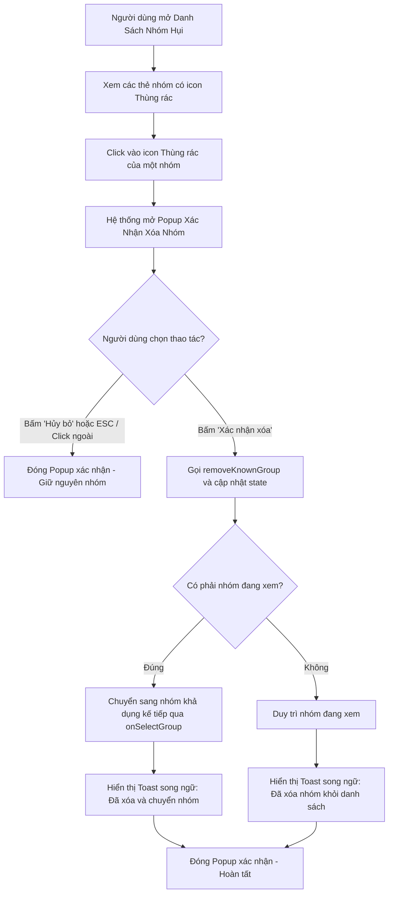

# Đặc Tả Kỹ Thuật (Software Requirements Specification) — Task-033

## Popup Xác Nhận Xóa Nhóm Hụi (Delete Confirmation Modal) & Chuẩn Hóa Thông Báo Song Ngữ Toàn Diện (Comprehensive Bilingual Notifications)

- **Task ID**: `task-033`
- **Mục tiêu**: Bổ sung popup/hộp thoại xác nhận trước khi xóa nhóm hụi trong danh bạ (`ClubDirectoryModal.tsx`) nhằm chống bấm nhầm (accidental click), đồng thời chuẩn hóa 100% các thông báo Toast song ngữ (Tiếng Việt & Tiếng Anh).
- **Tác giả**: Business Analyst (`ba-agent`)
- **Phiên bản**: `v1.0`
- **Ngày lập**: `2026-10-15`
- **Trạng thái**: **APPROVED (Gate 1)**

---

## 1. Vấn Đề Nghiệp Vụ & Giá Trị Đem Lại (Problem & Value Proposition)

### 1.1. Hiện trạng
- Trong Task-032, hệ thống đã cung cấp icon thùng rác `<Trash2 />` trên từng thẻ câu lạc bộ trong modal danh mục (`ClubDirectoryModal.tsx`).
- Tuy nhiên, thao tác xóa hiện tại được thực thi **ngay lập tức** khi người dùng click vào icon mà không có bước xác nhận nào.
- Người dùng phản hồi trực tiếp:
  > *"các thông báo cần phải song ngữ nhé và khi click vào icon xóa thì thêm popup xác nhận nữa xong mới cho xóa vì nhiều khi user sẽ click nhầm vào icon"*
- **Rủi ro người dùng**:
  - Khi thao tác trên thiết bị cảm ứng di động hoặc click chuột nhanh, người dùng rất dễ bấm nhầm vào nút xóa thay vì nút sao chép địa chỉ hoặc nút "Vào nhóm".
  - Một số thông báo Toast trong ứng dụng vẫn còn lẫn các chuỗi văn bản cứng hoặc chưa được đồng bộ 100% theo trạng thái ngôn ngữ được chọn (`vi` / `en`).

### 1.2. Giá trị đem lại
- **Bảo vệ người dùng khỏi thao tác nhầm lẫn (Accidental Click Protection)**: Hộp thoại xác nhận yêu cầu người dùng xác nhận chủ đích trước khi thực hiện xóa vĩnh viễn khỏi danh sách hiển thị.
- **Minh bạch thông tin**: Popup xác nhận hiển thị rõ tên nhóm, địa chỉ hợp đồng và thông điệp cảnh báo rõ ràng.
- **Trải nghiệm song ngữ hoàn chỉnh (100% Bilingual UX)**: Toàn bộ thông báo Toast, tiêu đề hộp thoại, nút bấm xác nhận và nhãn giải thích đều chuyển đổi mượt mà giữa Tiếng Việt và Tiếng Anh dựa trên thuộc tính `language`.
- **Zero-Regression**: Đảm bảo 330 bài unit test hiện có tiếp tục vượt qua 100%.

---

## 2. Phạm Vi & Tác Nhân (Scope & Actors)

- **Tác nhân (Actors)**:
  - Người dùng / Thành viên nhóm hụi: Mở danh bạ nhóm hụi, nhấn icon xóa, xem popup xác nhận và đưa ra quyết định "Hủy bỏ" hoặc "Xác nhận xóa".
- **Phạm vi trong task (In-Scope)**:
  - Cập nhật [`src/lib/i18n.ts`](file:///home/avada/tontine/src/lib/i18n.ts):
    - Mở rộng interface `Translations.clubDirectoryModal` với các khóa: `confirmDeleteTitle`, `confirmDeleteDesc`, `confirmDeleteBtn`, `cancelDeleteBtn`.
    - Cập nhật từ điển `vi` và `en` với các chuỗi song ngữ chi tiết, chuẩn văn phong tài chính cộng đồng.
  - Cập nhật [`src/components/savings/ClubDirectoryModal.tsx`](file:///home/avada/tontine/src/components/savings/ClubDirectoryModal.tsx):
    - Bổ sung state `confirmingClub: SavingsClubItem | null` để quản lý nhóm đang được yêu cầu xóa.
    - Khi bấm icon `<Trash2 />`: Gọi `handleRequestDelete(club, e)` $\rightarrow$ `setConfirmingClub(club)`, KHÔNG xóa ngay.
    - Render Popup xác nhận xóa (`Confirmation Dialog / Modal`):
      - Tiêu đề: `confirmDeleteTitle` ("Xác nhận xóa nhóm" / "Confirm Delete Club") kèm icon cảnh báo `AlertTriangle` / `Trash2`.
      - Mô tả: `confirmDeleteDesc` hiển thị tên nhóm và địa chỉ rút gọn.
      - Nút "Hủy bỏ" / "Cancel" (`cancelDeleteBtn`): Đóng popup xác nhận, không thay đổi dữ liệu.
      - Nút "Xác nhận xóa" / "Delete" (`confirmDeleteBtn`): Gọi `handleConfirmDelete()`, thực thi xóa nhóm, đóng popup và hiển thị Toast song ngữ.
      - Bắt sự kiện phím `Escape` và click backdrop của popup xác nhận để đóng popup an toàn.
    - Chuẩn hóa toàn bộ Toast thông báo trong modal: `handleCopy`, `handleSelect`, `handleClearCustomGroups`, `handleConfirmDelete` đều lấy chuỗi song ngữ theo `language`.
- **Ngoài phạm vi (Out-of-Scope)**:
  - Không thay đổi logic blockchain on-chain của smart contract.

---

## 3. Quy Tắc Nghiệp Vụ (Business Rules)

- **BR-01 (Bắt Buộc Xác Nhận Trước Khi Xóa)**:
  - Bấm icon xóa `<Trash2 />` trên bất kỳ thẻ câu lạc bộ nào KHÔNG ĐƯỢC PHÉP xóa ngay lập tức. Hệ thống bắt buộc phải mở Popup xác nhận xóa.
- **BR-02 (Thông Tin Minh Bạch Trên Popup Xác Nhận)**:
  - Popup xác nhận phải hiển thị rõ tên nhóm, địa chỉ hợp đồng rút gọn, và cảnh báo rõ ràng về việc nhóm sẽ bị ẩn khỏi danh sách.
- **BR-03 (Thao Tác Hủy Bỏ An Toàn)**:
  - Nhấn nút "Hủy bỏ", click vào vùng backdrop mờ, hoặc bấm phím `Escape` (khi popup xác nhận đang mở) sẽ đóng popup xác nhận và giữ nguyên 100% dữ liệu danh bạ nhóm.
- **BR-04 (Xác Nhận Xóa & Fallback Hợp Lệ)**:
  - Khi người dùng nhấn "Xác nhận xóa":
    - Hệ thống gọi `removeKnownGroup(address)`.
    - Cập nhật ngay lập tức danh sách trong state `setGroups`.
    - Nếu nhóm bị xóa là nhóm người dùng đang xem (`isCurrent === true`), hệ thống tự động fallback chuyển sang nhóm khả dụng kế tiếp thông qua `onSelectGroup`.
    - Đóng popup xác nhận.
- **BR-05 (Song Ngữ 100% Cho Mọi Thông Báo Toast)**:
  - Toàn bộ Toast thông báo phát sinh từ modal danh bạ (`copy`, `switch`, `clear`, `delete`, `deleteAndSwitched`) phải tuân thủ nghiêm ngặt thuộc tính `language` (`vi` hoặc `en`), tuyệt đối không bị cố định ngôn ngữ.

---

## 4. Luồng Nghiệp Vụ (Mermaid Diagram)

---

## 5. Danh Sách Yêu Cầu & Tiêu Chí Nghiệm Thu (Requirements & Acceptance Criteria)

### REQ-01: Popup Xác Nhận Xóa Nhóm (Confirmation Modal)
- **AC-01.1**: Bấm icon `<Trash2 />` trên bất kỳ thẻ nhóm nào kích hoạt mở popup xác nhận xóa với thông tin nhóm đó; danh sách nhóm chưa bị xóa khi popup vừa mở.
- **AC-01.2**: Popup xác nhận hiển thị đầy đủ tiêu đề, tên nhóm, địa chỉ hợp đồng rút gọn, nút "Hủy bỏ" và nút "Xác nhận xóa".
- **AC-01.3**: Bấm nút "Hủy bỏ" (`Cancel`) đóng popup xác nhận và danh sách nhóm được bảo toàn nguyên vẹn.
- **AC-01.4**: Bấm phím `Escape` khi popup xác nhận đang mở sẽ đóng popup xác nhận trước mà không đóng toàn bộ modal danh bạ.
- **AC-01.5**: Bấm nút "Xác nhận xóa" thực hiện xóa nhóm khỏi danh sách, ghi nhận vào `localStorage`, và đóng popup xác nhận.

### REQ-02: Chuẩn Hóa Thông Báo Song Ngữ Toàn Diện (100% Bilingual Toasts)
- **AC-02.1**: Khi xóa nhóm thông thường ở ngôn ngữ Tiếng Việt (`vi`), Toast thông báo có định dạng: `Đã xóa nhóm "[Tên nhóm]" khỏi danh sách!`.
- **AC-02.2**: Khi xóa nhóm thông thường ở ngôn ngữ Tiếng Anh (`en`), Toast thông báo có định dạng: `Removed club "[Club Name]" from directory!`.
- **AC-02.3**: Khi xóa nhóm đang active ở Tiếng Việt (`vi`), Toast thông báo hiển thị việc đã xóa và chuyển về nhóm khả dụng kế tiếp.
- **AC-02.4**: Khi xóa nhóm đang active ở Tiếng Anh (`en`), Toast thông báo bằng tiếng Anh hiển thị việc đã xóa và switched to default club.
- **AC-02.5**: Các thông báo Toast sao chép địa chỉ (`copyAddrSuccess`/`copyAddrFail`) và đổi nhóm (`switchedToast`) đều phản ánh đúng ngôn ngữ đang active.

### REQ-03: Mở Rộng Từ Điển Song Ngữ i18n
- **AC-03.1**: Interface `Translations.clubDirectoryModal` chứa các thuộc tính: `confirmDeleteTitle`, `confirmDeleteDesc`, `confirmDeleteBtn`, `cancelDeleteBtn`.
- **AC-03.2**: Từ điển `vi` định nghĩa đầy đủ các văn bản tiếng Việt cho popup xác nhận xóa.
- **AC-03.3**: Từ điển `en` định nghĩa đầy đủ các văn bản tiếng Anh cho popup xác nhận xóa.

### REQ-04: Bảo Toàn Hồi Quy (Zero Regression)
- **AC-04.1**: Toàn bộ 330 bài unit test hiện có tiếp tục PASS 100%.
- **AC-04.2**: Lệnh `npm run build` biên dịch thành công không phát sinh bất kỳ lỗi TypeScript nào.

---

## 6. Ma Trận Truy Xuất Yêu Cầu (Traceability Matrix)

| REQ ID | Tiêu Chí Nghiệm Thu (AC) | Trạng Thái Thiết Kế (BA) | Trạng Thái Triển Khai (Dev) | Trạng Thái Kiểm Thử (QA) | Bằng Chứng (Evidence) |
| :--- | :--- | :--- | :--- | :--- | :--- |
| **REQ-01** | AC-01.1: Bấm trash icon mở popup xác nhận, không xóa ngay | Approved | Completed | Passed | `TC-CONFIRM-01` in `tests/delete-confirmation-and-bilingual-toasts.test.ts` |
| **REQ-01** | AC-01.2: Hiển thị tên nhóm, địa chỉ, nút Hủy và Xóa | Approved | Completed | Passed | `TC-CONFIRM-02`, `screenshot-task033-confirm-delete-popup.png` |
| **REQ-01** | AC-01.3: Bấm Hủy đóng popup, không xóa | Approved | Completed | Passed | `TC-CONFIRM-03` in `tests/delete-confirmation-and-bilingual-toasts.test.ts` |
| **REQ-01** | AC-01.4: Phím Escape đóng popup xác nhận | Approved | Completed | Passed | `TC-CONFIRM-04` in `tests/delete-confirmation-and-bilingual-toasts.test.ts` |
| **REQ-01** | AC-01.5: Bấm Xác nhận xóa thực thi xóa thật và đóng popup | Approved | Completed | Passed | `TC-CONFIRM-05`, `screenshot-task033-after-confirm-delete.png` |
| **REQ-02** | AC-02.1: Toast xóa nhóm tiếng Việt đúng định dạng | Approved | Completed | Passed | `TC-TOAST-01` in `tests/delete-confirmation-and-bilingual-toasts.test.ts` |
| **REQ-02** | AC-02.2: Toast xóa nhóm tiếng Anh đúng định dạng | Approved | Completed | Passed | `TC-TOAST-01`, `screenshot-task033-confirm-delete-en.png` |
| **REQ-02** | AC-02.3: Toast xóa nhóm đang xem tiếng Việt | Approved | Completed | Passed | `TC-TOAST-02` in `tests/delete-confirmation-and-bilingual-toasts.test.ts` |
| **REQ-02** | AC-02.4: Toast xóa nhóm đang xem tiếng Anh | Approved | Completed | Passed | `TC-TOAST-02` in `tests/delete-confirmation-and-bilingual-toasts.test.ts` |
| **REQ-02** | AC-02.5: Toast copy và chuyển nhóm phản ánh đúng ngôn ngữ | Approved | Completed | Passed | `tests/bilingual-and-layout.test.ts` |
| **REQ-03** | AC-03.1: Interface Translations bổ sung 4 khóa mới | Approved | Completed | Passed | `TC-I18N-01` in `tests/delete-confirmation-and-bilingual-toasts.test.ts` |
| **REQ-03** | AC-03.2: Từ điển vi bổ sung đầy đủ văn bản | Approved | Completed | Passed | `TC-I18N-01` in `tests/delete-confirmation-and-bilingual-toasts.test.ts` |
| **REQ-03** | AC-03.3: Từ điển en bổ sung đầy đủ văn bản | Approved | Completed | Passed | `TC-I18N-01`, `screenshot-task033-confirm-delete-en.png` |
| **REQ-04** | AC-04.1: Toàn bộ 330 bài test cũ tiếp tục PASS 100% | Approved | Completed | Passed | `npm test` exit code 0 (339/339 passed) |
| **REQ-04** | AC-04.2: Build production thành công | Approved | Completed | Passed | `npm run build` exit code 0 (built in 24.30s) |

---
*Ký duyệt Gate 1 (BA Spec Approval)*: **ba-agent** — `2026-10-15`  
*Ký duyệt Gate 4 (Coverage & Traceability Reconciliation)*: **ba-agent** — `2026-10-15` (100% Phủ kín, Không độ lệch)
