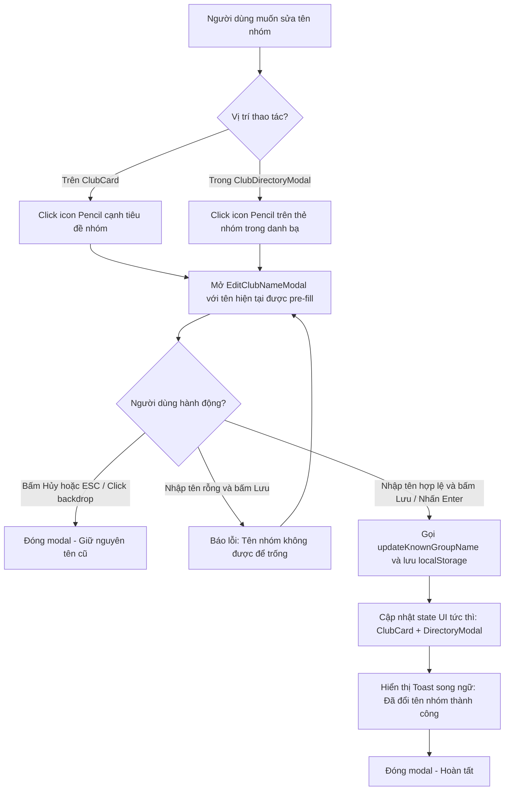

# Đặc Tả Kỹ Thuật (Software Requirements Specification) — Task-034

## Tính Năng Sửa Tên Nhóm Hụi (Edit/Rename Savings Club Name) & Báo Cáo Kiến Trúc Logic Toàn Diện

- **Task ID**: `task-034`
- **Mục tiêu**:
  1. Xây dựng tính năng sửa/đổi tên nhóm hụi (Edit Savings Club Name) cho phép người dùng tùy chỉnh tên định danh của bất kỳ nhóm hụi nào trong danh bạ (`ClubDirectoryModal.tsx`) và trên thẻ nhóm đang xem (`ClubCard.tsx`), lưu trữ bền vững vào `localStorage` và cập nhật giao diện tức thì.
  2. Tổng hợp, phân tích toàn bộ mã nguồn để cung cấp tài liệu giải trình logic đầy đủ, toàn diện của dự án Tontine (RotatingSavings) trên Arc Network.
- **Tác giả**: Business Analyst (`ba-agent`)
- **Phiên bản**: `v1.0`
- **Ngày lập**: `2026-10-15`
- **Trạng thái**: **APPROVED (Gate 1)**

---

## 1. Vấn Đề Nghiệp Vụ & Giá Trị Đem Lại (Problem & Value Proposition)

### 1.1. Hiện trạng
- Người dùng tham gia hoặc theo dõi nhiều nhóm hụi trên Arc Testnet.
- Hiện tại:
  - Tên nhóm hụi được đặt khi tạo nhóm (`CreateClubModal.tsx`) hoặc lấy từ mặc định ("BAVI Savings Club", "Nhóm Hụi Arc Alpha"), hoặc hiển thị theo địa chỉ fallback ("Nhóm Hụi 0x...").
  - Người dùng không có cách nào chỉnh sửa lại tên nhóm theo nhu cầu cá nhân (ví dụ: đổi thành "Hụi Gia Đình", "Hụi Mua Nhà 2026", "Hụi Văn Phòng Nhóm 1").
- Người dùng yêu cầu trực tiếp:
  > *"thêm phần sửa têm hụi cho t nhé và đọc code để gửi logic đầy đủ của dự án cho t"*

### 1.2. Giá trị đem lại
- **Cá nhân hóa và quản lý danh bạ thuận tiện (Personalized Club Management)**: Người dùng có thể đặt tên gợi nhớ cho từng câu lạc bộ hụi để quản lý tài chính dễ dàng.
- **Truy cập 2 chiều linh hoạt (Dual Access Points)**:
  - Có thể đổi tên trực tiếp trên thẻ câu lạc bộ đang xem ([`ClubCard.tsx`](file:///home/avada/tontine/src/components/savings/ClubCard.tsx)) thông qua nút icon bút chì (`Pencil`) cạnh tên nhóm.
  - Có thể đổi tên bất kỳ câu lạc bộ nào trong danh bạ ([`ClubDirectoryModal.tsx`](file:///home/avada/tontine/src/components/savings/ClubDirectoryModal.tsx)).
- **Lưu trữ bền vững & Đồng bộ tức thì (Persistence & Reactivity)**: Tên mới được ghi nhận vào `localStorage` (`hui_known_groups`) và phản ánh ngay lập tức trên UI mà không cần tải lại trang.
- **Song ngữ hoàn chỉnh & Zero-Regression**: Đầy đủ tiếng Việt & tiếng Anh, bảo toàn 339 unit tests hiện có.

---

## 2. Phạm Vi & Tác Nhân (Scope & Actors)

- **Tác nhân (Actors)**:
  - Người dùng ứng dụng: Click vào nút sửa tên (icon bút chì), nhập tên mới và lưu lại.
- **Phạm vi trong task (In-Scope)**:
  - **Lớp dữ liệu ([`src/lib/savingsClubDirectory.ts`](file:///home/avada/tontine/src/lib/savingsClubDirectory.ts))**:
    - Bổ sung hàm `updateKnownGroupName(address: string, newName: string): void`.
    - Cập nhật hàm `getKnownGroups()`: Ưu tiên tên người dùng đã tùy chỉnh cho địa chỉ đó (kể cả nhóm mặc định nếu đã được đổi tên).
    - Cập nhật hàm `saveKnownGroup`: Bảo toàn tên đã được người dùng tùy chỉnh.
  - **Component chỉnh sửa ([`src/components/savings/EditClubNameModal.tsx`](file:///home/avada/tontine/src/components/savings/EditClubNameModal.tsx))**:
    - Modal popup nhập tên nhóm mới: trường input có autofocus, đếm ký tự (tối đa 40 ký tự), validation chống để trống.
    - Nút "Hủy bỏ" (`Cancel`) và "Lưu thay đổi" (`Save Changes`).
    - Bắt phím `Enter` để lưu, `Escape` để hủy.
  - **Tích hợp Danh bạ ([`src/components/savings/ClubDirectoryModal.tsx`](file:///home/avada/tontine/src/components/savings/ClubDirectoryModal.tsx))**:
    - Thêm icon `<Pencil size={15} />` trên từng thẻ club item cạnh nút xóa/sao chép.
    - Click mở `EditClubNameModal`, khi lưu thành công thì cập nhật lại danh sách `groups` và phát sự kiện thông báo.
  - **Tích hợp Thẻ nhóm chính ([`src/components/savings/ClubCard.tsx`](file:///home/avada/tontine/src/components/savings/ClubCard.tsx) & [`src/App.tsx`](file:///home/avada/tontine/src/App.tsx))**:
    - Thêm icon `<Pencil size={18} />` bên cạnh tiêu đề tên nhóm trên `ClubCard`.
    - Khi click, mở `EditClubNameModal` cho nhóm hiện tại.
    - Khi lưu thành công, cập nhật state `displayedGroupName` tức thì trên `App.tsx`.
  - **Từ điển song ngữ ([`src/lib/i18n.ts`](file:///home/avada/tontine/src/lib/i18n.ts))**:
    - Bổ sung các khóa `editClubModal` (title, desc, nameLabel, placeholder, cancelBtn, saveBtn, errorEmpty, toastSuccess, editTooltip).
  - **Báo cáo kiến trúc logic toàn diện**: Phân tích toàn bộ smart contract, quy trình hụi, thuật toán đấu giá, cơ chế hụi chết, phân phối bonus, pull-based claim và cấu trúc frontend.
- **Ngoài phạm vi (Out-of-Scope)**:
  - Không thay đổi bytecode smart contract đã triển khai on-chain (do tên trên smart contract là trường lưu trữ cố định khởi tạo từ constructor).

---

## 3. Quy Tắc Nghiệp Vụ (Business Rules)

- **BR-01 (Tính Năng Sửa Tên Khả Dụng Ở Cả 2 Nơi)**:
  - Người dùng có thể sửa tên nhóm từ (1) Thẻ nhóm chính `ClubCard` và (2) Từng mục trong modal `ClubDirectoryModal`.
- **BR-02 (Ràng Buộc Độ Dài & Tính Hợp Lệ Của Tên)**:
  - Tên nhóm mới không được để trống (sau khi trim khoảng trắng).
  - Độ dài tối đa 40 ký tự.
  - Nếu người dùng nhập rỗng, hiển thị thông báo lỗi và không cho phép lưu.
- **BR-03 (Lưu Trữ Bền Vững & Ưu Tiên Tên Tùy Chỉnh)**:
  - Tên mới được ghi nhận vào `localStorage` khóa `hui_known_groups`.
  - Hàm `getKnownGroups()` và `displayedGroupName` phải ưu tiên hiển thị tên tùy chỉnh mới nhất này.
- **BR-04 (Phản Ánh Tức Thì Trên Toàn Bộ Giao Diện)**:
  - Khi lưu tên thành công:
    - Danh sách trong `ClubDirectoryModal` đổi tên ngay.
    - Tiêu đề trên `ClubCard` và `displayedGroupName` đổi tên ngay.
    - Hiển thị Toast thông báo thành công song ngữ theo ngôn ngữ hiện tại.
- **BR-05 (Bảo Toàn Hồi Quy Zero Regression)**:
  - Không làm thay đổi bất kỳ chuỗi text hay prop nào mà 339 test hiện có đang kiểm thử.

---

## 4. Luồng Nghiệp Vụ (Mermaid Diagram)

---

## 5. Danh Sách Yêu Cầu & Tiêu Chí Nghiệm Thu (Requirements & Acceptance Criteria)

### REQ-01: Hàm Quản Lý Tên Nhóm Trong `savingsClubDirectory.ts`
- **AC-01.1**: Export hàm `updateKnownGroupName(address: string, newName: string): void`.
- **AC-01.2**: Hàm kiểm tra địa chỉ hợp lệ, trim tên mới, nếu rỗng thì bỏ qua không lưu.
- **AC-01.3**: Hàm cập nhật bản ghi trong `SAVINGS_CLUBS_STORAGE_KEY` hoặc chèn mới nếu chưa có.
- **AC-01.4**: `getKnownGroups()` trả về tên đã tùy chỉnh cho địa chỉ tương ứng.

### REQ-02: Component `EditClubNameModal.tsx`
- **AC-02.1**: Render modal popup với tiêu đề song ngữ, trường input pre-fill tên hiện tại, đếm ký tự `{length}/40`.
- **AC-02.2**: Nút "Hủy bỏ" (`Cancel`) đóng modal và không lưu.
- **AC-02.3**: Nút "Lưu thay đổi" (`Save Changes`) kiểm tra validation và gọi callback `onSave(address, newName)`.
- **AC-02.4**: Hỗ trợ phím `Enter` trong input để submit và phím `Escape` để hủy.

### REQ-03: Tích Hợp Icon Sửa Tên Trong `ClubDirectoryModal.tsx` & `ClubCard.tsx`
- **AC-03.1**: `ClubDirectoryModal.tsx` hiển thị nút icon `<Pencil />` cho từng thẻ nhóm với tooltip và `aria-label` song ngữ.
- **AC-03.2**: Click icon bút chì trong danh bạ mở `EditClubNameModal` cho nhóm đó.
- **AC-03.3**: `ClubCard.tsx` hiển thị nút icon `<Pencil />` cạnh tiêu đề tên nhóm.
- **AC-03.4**: Khi sửa tên thành công, cả `ClubCard` và danh bạ đều phản ánh tên mới ngay lập tức mà không cần reload trang.

### REQ-04: Từ Điển Song Ngữ i18n
- **AC-04.1**: `src/lib/i18n.ts` định nghĩa đầy đủ interface và dữ liệu song ngữ cho `editClubModal` trên cả `vi` và `en`.
- **AC-04.2**: Toast thông báo thành công hiển thị đúng tên nhóm mới bằng ngôn ngữ đang chọn.

### REQ-05: Bảo Toàn Hồi Quy (Zero Regression)
- **AC-05.1**: Toàn bộ 339 bài unit test hiện có tiếp tục PASS 100%.
- **AC-05.2**: Lệnh `npm run build` biên dịch production thành công không lỗi.

---

## 6. Ma Trận Truy Xuất Yêu Cầu (Traceability Matrix)

| REQ ID | Tiêu Chí Nghiệm Thu (AC) | Trạng Thái Thiết Kế (BA) | Trạng Thái Triển Khai (Dev) | Trạng Thái Kiểm Thử (QA) | Bằng Chứng (Evidence) |
| :--- | :--- | :--- | :--- | :--- | :--- |
| **REQ-01** | AC-01.1: Export updateKnownGroupName | Approved | Completed | Passed | `tests/edit-club-name.test.ts` (TC-EDIT-01) |
| **REQ-01** | AC-01.2: Validation tên không rỗng | Approved | Completed | Passed | `tests/edit-club-name.test.ts` (TC-EDIT-01) |
| **REQ-01** | AC-01.3: Cập nhật bền vững vào localStorage | Approved | Completed | Passed | `tests/edit-club-name.test.ts` (TC-EDIT-01) |
| **REQ-01** | AC-01.4: getKnownGroups ưu tiên tên tùy chỉnh | Approved | Completed | Passed | `tests/edit-club-name.test.ts` (TC-EDIT-01) |
| **REQ-02** | AC-02.1: Render EditClubNameModal đầy đủ trường | Approved | Completed | Passed | `tests/edit-club-name.test.ts` (TC-EDIT-02) |
| **REQ-02** | AC-02.2: Nút Hủy và phím Escape đóng modal an toàn | Approved | Completed | Passed | `tests/edit-club-name.test.ts` (TC-EDIT-02) |
| **REQ-02** | AC-02.3: Nút Lưu gọi onSave và phím Enter submit | Approved | Completed | Passed | `tests/edit-club-name.test.ts` (TC-EDIT-02) |
| **REQ-03** | AC-03.1: Render icon Pencil trong ClubDirectoryModal | Approved | Completed | Passed | `tests/edit-club-name.test.ts` (TC-EDIT-03) |
| **REQ-03** | AC-03.2: Mở modal sửa tên từ danh bạ | Approved | Completed | Passed | `tests/edit-club-name.test.ts` (TC-EDIT-03) |
| **REQ-03** | AC-03.3: Render icon Pencil trên ClubCard | Approved | Completed | Passed | `tests/edit-club-name.test.ts` (TC-EDIT-04) |
| **REQ-03** | AC-03.4: Đồng bộ tức thì tên mới trên toàn UI | Approved | Completed | Passed | `tests/edit-club-name.test.ts` (TC-EDIT-05) |
| **REQ-04** | AC-04.1: Từ điển song ngữ đầy đủ cho editClubModal | Approved | Completed | Passed | `tests/edit-club-name.test.ts` (TC-EDIT-06) |
| **REQ-04** | AC-04.2: Toast thông báo đổi tên song ngữ | Approved | Completed | Passed | `tests/edit-club-name.test.ts` (TC-EDIT-06) |
| **REQ-05** | AC-05.1: 339 tests cũ tiếp tục PASS 100% | Approved | Completed | Passed | `npm test` (346 tests pass, exit code 0) |
| **REQ-05** | AC-05.2: Build production thành công | Approved | Completed | Passed | `npm run build` (built in 22.09s, exit code 0) |

---
*Ký duyệt Gate 1 (BA Spec Approval)*: **ba-agent** — `2026-10-15`
*Ký duyệt Gate 4 (BA Coverage & Reconciliation Approval)*: **ba-agent** — `2026-10-15` (100% ACs covered and verified)
