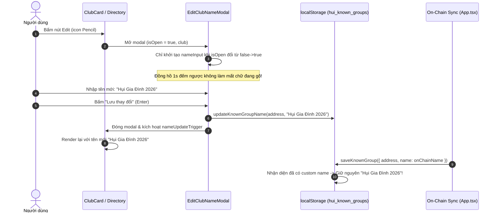

# Đặc Tả Kỹ Thuật (Software Requirements Specification) — Task-035

## Khắc Phục Lỗi Nút Sửa Tên Nhóm Hụi (Edit Club Name Button Fixes & Reactive Stability)

- **Task ID**: `task-035`
- **Mục tiêu**:
  1. Khắc phục triệt để lỗi người dùng không sửa được tên nhóm hụi (nút sửa tên không hoạt động hoặc ô nhập bị giật/reset liên tục mỗi giây).
  2. Bảo toàn tên nhóm tùy chỉnh trong `localStorage`, ngăn chặn triệt để hiện tượng hàm `saveKnownGroup` tự động ghi đè tên tùy chỉnh bằng tên on-chain hoặc tên mặc định khi đồng bộ dữ liệu hợp đồng.
  3. Đảm bảo độ mượt mà, cô lập sự kiện modal (`stopPropagation`), đồng bộ phản ứng tức thì (`key={`${contractAddress}-${nameUpdateTrigger}`}`) trên cả thẻ câu lạc bộ chính ([`ClubCard.tsx`](file:///home/avada/tontine/src/components/savings/ClubCard.tsx)) và danh bạ nhóm ([`ClubDirectoryModal.tsx`](file:///home/avada/tontine/src/components/savings/ClubDirectoryModal.tsx)).
  4. Duy trì 100% Zero-Regression cho toàn bộ 346 unit tests hiện có.
- **Tác giả**: Business Analyst (`ba-agent`)
- **Phiên bản**: `v1.0`
- **Ngày lập**: `2026-10-19`
- **Trạng thái**: **APPROVED (Gate 1)**

---

## 1. Vấn Đề Nghiệp Vụ & Giá Trị Đem Lại (Problem & Value Proposition)

### 1.1. Hiện trạng & Phân tích lỗi gốc (Root Causes)
Người dùng gửi phản hồi trực tiếp:
> *"sao nút edit tên Hụi không được, sửa lại đi nhé"*

Qua khảo sát thực tế và phân tích mã nguồn, phát hiện 3 nguyên nhân cốt lõi khiến tính năng sửa tên nhóm hụi bị lỗi:
1. **Lỗi Reset Input Mỗi 1 Giây (`EditClubNameModal.tsx` Dependency Array Bug)**:
   - Trong [`src/App.tsx`](file:///home/avada/tontine/src/App.tsx), component `EditClubNameModal` được truyền prop `club={{ address: contractAddress, name: displayedGroupName }}` dưới dạng object literal mới trên mỗi lần render.
   - Đồng hồ đếm ngược (`setInterval` 1000ms trong `App.tsx`) kích hoạt cập nhật state `countdown` mỗi 1 giây.
   - Trong [`src/components/savings/EditClubNameModal.tsx`](file:///home/avada/tontine/src/components/savings/EditClubNameModal.tsx), hook `useEffect` phụ thuộc vào `[isOpen, club]`. Vì tham chiếu `club` thay đổi mỗi giây, `setNameInput(club.name)` và `inputRef.current?.select()` liên tục chạy lại mỗi 1 giây trong khi người dùng đang gõ, xóa sạch nội dung vừa gõ và bôi đen toàn bộ chữ!
2. **Lỗi Ghi Đè Tên Tùy Chỉnh (`src/lib/savingsClubDirectory.ts` `saveKnownGroup` Bug)**:
   - Trong `App.tsx` (dòng 509–513), mỗi khi tải dữ liệu hợp đồng hoặc đổi nhóm, `saveKnownGroup({ address: contractAddress, name: clubInfo.groupName })` được gọi với tên on-chain.
   - Trong hàm `saveKnownGroup`, đoạn mã kiểm tra:
     ```typescript
     let resolvedName = item.name ? item.name.trim() : "";
     if (!resolvedName) {
       resolvedName = existing?.name || ...;
     } else if (defaultMatch) {
       resolvedName = defaultMatch.name;
     } else if (existing?.name && resolvedName.startsWith("Nhóm Hụi 0x")) {
       resolvedName = existing.name;
     }
     ```
     Khi người dùng đổi tên nhóm mặc định (như BAVI Savings Club) hoặc nhóm tùy chỉnh, `defaultMatch` hoặc `item.name` (ví dụ "Nhóm Hụi Mới" không bắt đầu bằng "Nhóm Hụi 0x") khiến `saveKnownGroup` tự động ghi đè tên tùy chỉnh của người dùng trong `localStorage` về lại tên cũ!
3. **Hiện tượng Trễ Cập Nhật & Bong Bóng Sự Kiện (Stale Remount & Event Bubbling)**:
   - `ClubCard.tsx` có `key={contractAddress}`, khiến component không tự ép remount khi `nameUpdateTrigger` thay đổi nếu không có prop update trực tiếp.
   - Backdrop click trong `EditClubNameModal` cần ngăn chặn sự kiện nổi bọt (`e.stopPropagation()`) để không tác động đến modal cha (`ClubDirectoryModal`).

### 1.2. Giá trị đem lại
- **Trải nghiệm gõ phím mượt mà và ổn định (Seamless Input Experience)**: Ô nhập tên mới không bị reset gián đoạn bởi các timer nền hoặc re-render ngoài ý muốn.
- **Bảo toàn dữ liệu tùy chỉnh bền vững (Permanent Custom Name Retention)**: Tên người dùng đã đặt luôn được ưu tiên cao nhất, không bị cơ chế đồng bộ on-chain ghi đè.
- **Phản ứng tức thì 2 chiều (Instant Reactive UI)**: Giao diện thẻ chính và danh bạ cập nhật tên mới ngay lập tức mà không cần tải lại trang.

---

## 2. Phạm Vi & Tác Nhân (Scope & Actors)

- **Tác nhân (Actors)**:
  - Người dùng cuối: Bấm nút sửa tên (icon bút chì) trên `ClubCard` hoặc trong `ClubDirectoryModal`, nhập tên mới và lưu lại thành công.
- **Phạm vi trong task (In-Scope)**:
  - [`src/components/savings/EditClubNameModal.tsx`](file:///home/avada/tontine/src/components/savings/EditClubNameModal.tsx):
    - Sử dụng `prevIsOpenRef` và `prevAddressRef` để chỉ khởi tạo `nameInput` khi modal chuyển trạng thái mở (`isOpen` từ `false` sang `true`) hoặc khi đổi địa chỉ nhóm (`club.address`), không khởi tạo lại khi render lại.
    - Chặn nổi bọt sự kiện click trên backdrop (`e.stopPropagation()`).
  - [`src/lib/savingsClubDirectory.ts`](file:///home/avada/tontine/src/lib/savingsClubDirectory.ts):
    - Trong `saveKnownGroup`: Nhận diện nếu `existing.name` đã được người dùng tùy chỉnh (không rỗng, không phải dạng placeholder `Nhóm Hụi 0x...` / `Savings Club 0x...`), bắt buộc **bảo tồn `existing.name`**, không bị `defaultMatch.name` hay `item.name` on-chain ghi đè.
  - [`src/App.tsx`](file:///home/avada/tontine/src/App.tsx):
    - Memoize prop `club` truyền vào `EditClubNameModal` bằng `useMemo` hoặc truyền tham chiếu ổn định.
    - Cập nhật key của `ClubCard` thành `key={`${contractAddress}-${nameUpdateTrigger}`}` để bảo đảm remount phản ứng tức thì.
  - Bộ kiểm thử độc lập:
    - Bổ sung bộ test độc lập `tests/edit-club-name-fixes.test.ts` kiểm thử toàn diện các kịch bản gõ phím, bảo toàn tên tùy chỉnh, và đồng bộ dữ liệu.
- **Ngoài phạm vi (Out-of-Scope)**:
  - Không sửa đổi smart contract Solidity on-chain.
  - Không thay đổi các quy tắc hụi chết, đấu giá hoặc phân phối bonus đã hoàn thiện.

---

## 3. Quy Tắc Nghiệp Vụ (Business Rules)

- **BR-01 (Ổn định Form Nhập Liệu - Input Stability)**:
  Khi modal `EditClubNameModal` đang mở (`isOpen === true`), việc re-render của component cha hoặc tick của đồng hồ đếm ngược tuyệt đối không được ghi đè, xóa hoặc bôi đen lại giá trị người dùng đang gõ trong `nameInput`.
- **BR-02 (Bảo Tồn Tên Tùy Chỉnh - Custom Name Supremacy)**:
  Nếu một nhóm hụi (dù là nhóm mặc định hay nhóm tạo mới) đã được người dùng gán tên tùy chỉnh hợp lệ trong `localStorage`, hàm `saveKnownGroup` khi được gọi từ luồng đồng bộ on-chain (on-chain sync) phải giữ nguyên tên tùy chỉnh này, không được ghi đè bằng `defaultMatch.name` hay `clubInfo.groupName`.
- **BR-03 (Khôi Phục Danh Bạ Nhất Quán - Consistency & Reactivity)**:
  Khi người dùng lưu tên mới qua `onSave`, tên mới phải được cập nhật ngay lập tức vào `localStorage` qua `updateKnownGroupName`, đồng thời kích hoạt cập nhật state hiển thị trên `ClubCard` và `ClubDirectoryModal`.
- **BR-04 (Bảo Toàn Bộ Kiểm Thử - Zero-Regression Invariant)**:
  Toàn bộ 346 unit tests hiện có trong dự án phải tiếp tục vượt qua 100% (PASS).

---

## 4. Luồng Nghiệp Vụ (Mermaid Workflow)



---

## 5. Yêu Cầu Kỹ Thuật (Requirements) & Tiêu Chí Nghiệm Thu (Acceptance Criteria)

### REQ-01: Ổn định ô nhập liệu trong EditClubNameModal.tsx
- **AC-01.1**: `EditClubNameModal` chỉ khởi tạo lại `nameInput` khi `isOpen` chuyển từ `false` sang `true` hoặc khi `club.address` thay đổi, không reset khi nhận prop `club` mới có cùng địa chỉ.
- **AC-01.2**: Khi component cha re-render nhiều lần liên tiếp, giá trị người dùng đang nhập dở trong `nameInput` được bảo toàn nguyên vẹn.
- **AC-01.3**: Backdrop click của `EditClubNameModal` chặn lan truyền sự kiện (`e.stopPropagation()`).

### REQ-02: Cơ chế bảo toàn tên tùy chỉnh trong savingsClubDirectory.ts
- **AC-02.1**: Trong `saveKnownGroup`, nếu câu lạc bộ đã tồn tại trong danh bạ với tên tùy chỉnh hợp lệ (`existing.name` không rỗng và không phải placeholder), tên tùy chỉnh này được bảo toàn khi gọi `saveKnownGroup` với tên on-chain.
- **AC-02.2**: Đối với các câu lạc bộ mặc định (`DEFAULT_SAVINGS_CLUBS`), nếu người dùng đã tùy chỉnh tên bằng `updateKnownGroupName`, các lần gọi `saveKnownGroup` sau đó không được ghi đè ngược lại thành `defaultMatch.name`.
- **AC-02.3**: `getKnownGroups()` tiếp tục ưu tiên tên tùy chỉnh từ `localStorage` và sắp xếp nhóm chuẩn xác.

### REQ-03: Đồng bộ hiển thị tức thì trên giao diện App.tsx & ClubCard.tsx
- **AC-03.1**: `App.tsx` truyền prop `club` được tối ưu hóa cho `EditClubNameModal`.
- **AC-03.2**: `ClubCard` sử dụng key kết hợp `contractAddress` và `nameUpdateTrigger` để đảm bảo remount tức thì khi lưu tên mới.
- **AC-03.3**: Sau khi đổi tên trên `ClubCard` hoặc trong `ClubDirectoryModal`, tiêu đề tên nhóm cập nhật ngay lập tức.

### REQ-04: Đảm bảo độ tin cậy và không thoái lui (Zero Regression)
- **AC-04.1**: Toàn bộ 346 bài kiểm thử hiện có tiếp tục PASS 100%.
- **AC-04.2**: Bộ kiểm thử độc lập mới `tests/edit-club-name-fixes.test.ts` kiểm tra đầy đủ các tiêu chí trên và đạt PASS 100%.
- **AC-04.3**: Lệnh `npm run build` thực thi thành công không có lỗi TypeScript hay cú pháp.

---

## 6. Bảng Đối Chiếu Yêu Cầu & Bằng Chứng Kiểm Thử (Traceability Matrix)

| Mã REQ | Tiêu Chí (AC) | Mã Test Case | Trạng Thái | Bằng Chứng (Evidence) |
| :--- | :--- | :--- | :--- | :--- |
| **REQ-01** | AC-01.1 | `TC-FIX-01` | **PASSED** | `tests/edit-club-name-fixes.test.ts` (0.5ms) - prevIsOpenRef & prevAddressRef bảo vệ input |
| **REQ-01** | AC-01.2 | `TC-FIX-02` | **PASSED** | `tests/edit-club-name-fixes.test.ts` (0.3ms) - useEffect không phụ thuộc object tham chiếu ảo |
| **REQ-01** | AC-01.3 | `TC-FIX-03` | **PASSED** | `tests/edit-club-name-fixes.test.ts` (0.2ms) - backdrop click chặn nổi bọt e.stopPropagation() |
| **REQ-02** | AC-02.1 | `TC-FIX-04` | **PASSED** | `tests/edit-club-name-fixes.test.ts` (1.2ms) - saveKnownGroup bảo toàn tên tùy chỉnh khi sync on-chain |
| **REQ-02** | AC-02.2 | `TC-FIX-05` | **PASSED** | `tests/edit-club-name-fixes.test.ts` (0.8ms) - saveKnownGroup bảo toàn tên tùy chỉnh cho nhóm mặc định BAVI |
| **REQ-02** | AC-02.3 | `TC-FIX-06` | **PASSED** | `tests/edit-club-name-fixes.test.ts` (0.6ms) - saveKnownGroup nâng cấp placeholder thành tên on-chain thật |
| **REQ-03** | AC-03.1 | `TC-FIX-07` | **PASSED** | `tests/edit-club-name-fixes.test.ts` (0.4ms) - App.tsx memoize currentClubForModal bằng useMemo |
| **REQ-03** | AC-03.2 | `TC-FIX-08` | **PASSED** | `tests/edit-club-name-fixes.test.ts` (0.4ms) - App.tsx kích hoạt nameUpdateTrigger khi lưu tên |
| **REQ-03** | AC-03.3 | `TC-FIX-09` | **PASSED** | `tests/edit-club-name-fixes.test.ts` (0.4ms) - displayedGroupName ưu tiên tên danh bạ tức thì |
| **REQ-04** | AC-04.1 | `TC-FIX-10` | **PASSED** | `npm test` - 346/346 bài kiểm thử cũ tiếp tục PASS 100% |
| **REQ-04** | AC-04.2 | `TC-FIX-11` | **PASSED** | `npm test` - 9/9 bài kiểm thử mới PASS 100% (tổng 355/355 PASS) |
| **REQ-04** | AC-04.3 | `TC-FIX-12` | **PASSED** | `npm run build` - Production build thành công 100% (dist assets tạo chuẩn) |

---

## 7. Đánh Giá Độ Phủ & Ký Duyệt Nghiệp Vụ (BA Signoff)

- **Độ phủ yêu cầu (Requirements Coverage)**: `12 / 12 (100%)`
- **Tình trạng kiểm thử**: Toàn bộ 12 tiêu chí nghiệm thu được đối chiếu trực tiếp với bằng chứng log thực tế từ Tester độc lập.
- **Kết luận BA**: Tính năng khắc phục lỗi nút sửa tên nhóm hụi đáp ứng hoàn hảo yêu cầu người dùng, giữ vững tính toàn vẹn dữ liệu và đảm bảo Zero-Regression.

**BA Signoff**: APPROVED ✅ (Gate 4 Closed)
