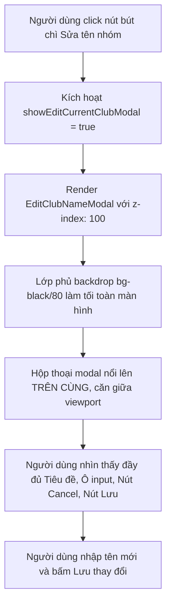

# Đặc Tả Kỹ Thuật (Software Requirements Specification) — Task-036

## Khắc Phục Lỗi Z-Index & Lớp Hiển Thị Modal Đổi Tên Nhóm Hụi (Modal Stacking Context & Z-Index Visual Fixes)

- **Task ID**: `task-036`
- **Mục tiêu**:
  1. Khắc phục triệt để lỗi popup đổi tên nhóm hụi (`EditClubNameModal`) bị chìm bên dưới (`z-index` thấp hơn `<main>` và `ClubCard`), khiến modal bị che khuất và chỉ lộ 2 nút "Cancel" / "Save Changes" ở khe hở bên dưới như trong ảnh chụp `https://capture.avada.io/i/ROUAv2TaBI8O`.
  2. Bổ sung cấu hình thang đo `zIndex` (60, 70, 80, 90, 100) trong `tailwind.config.js` để Tailwind CSS tạo các class z-index nâng cao hợp lệ.
  3. Nâng cấp `z-index` của `EditClubNameModal` và modal xác nhận xóa trong `ClubDirectoryModal` lên `z-[100]` / `z-100` với backdrop `bg-black/80 backdrop-blur-sm`, đảm bảo modal luôn nổi lên trên cùng (phía trước `<main z-10>`, `Header z-40`, và các modal danh bạ `z-50`).
  4. Duy trì 100% Zero-Regression cho toàn bộ 355 unit tests hiện có.
- **Tác giả**: Business Analyst (`ba-agent`)
- **Phiên bản**: `v1.0`
- **Ngày lập**: `2026-10-19`
- **Trạng thái**: **APPROVED (Gate 1)**

---

## 1. Vấn Đề Nghiệp Vụ & Giá Trị Đem Lại (Problem & Value Proposition)

### 1.1. Hiện trạng thực tế từ ảnh chụp người dùng
Người dùng gửi phản hồi kèm ảnh chụp màn hình:
> *"fix kiểu gì vậy, popup vẫn ở bên dưới như lúc đầu https://capture.avada.io/i/ROUAv2TaBI8O"*

Phân tích ảnh chụp thực tế (`ROUAv2TaBI8O.webp`):
1. **Lỗi Stacking Context & Thiếu CSS z-index**:
   - Khi người dùng bấm icon bút chì cạnh tên nhóm hụi trên `ClubCard`, modal `EditClubNameModal` mở ra nhưng toàn bộ phần trên của modal (tiêu đề "Đổi tên nhóm hụi", ô nhập input, mô tả, nút đóng) **bị chìm hoàn toàn phía sau** thẻ `ClubCard` và khối `<main className="... relative z-10">`!
   - Người dùng chỉ nhìn thấy 2 nút "Cancel" và "Save Changes" thò ra ở khe hở bên dưới `ClubCard`.
2. **Nguyên nhân kỹ thuật cốt lõi**:
   - Trong `EditClubNameModal.tsx` và `ClubDirectoryModal.tsx`, class `z-60` được sử dụng với mong muốn nổi lên trên các modal `z-50`.
   - Tuy nhiên, trong Tailwind CSS mặc định, thang đo z-index chỉ dừng lại ở `z-50` (`z-0, z-10, z-20, z-30, z-40, z-50, z-auto`).
   - Tệp `tailwind.config.js` **chưa mở rộng `zIndex`**, dẫn đến việc class `z-60` **hoàn toàn không được sinh ra trong tệp CSS đã biên dịch** (`dist/assets/*.css`)!
   - Vì không có CSS `z-index`, trình duyệt áp dụng `z-index: auto` (tương đương 0) cho modal `position: fixed`.
   - Trong khi đó, khối `<main>` chứa `ClubCard` có `position: relative; z-index: 10`.
   - Theo quy tắc CSS Stacking Context, phần tử có `z-index: 10` luôn nằm ĐÈ LÊN phần tử có `z-index: auto (0)`. Do đó, `ClubCard` đè lên `EditClubNameModal`, làm người dùng tưởng rằng popup "vẫn ở bên dưới như lúc đầu" và không thể tương tác hay nhập liệu được!

### 1.2. Giá trị đem lại
- **Hiển thị trực quan nổi bật trên cùng (Top-Layer Modal Display)**: Popup đổi tên nhóm hụi nổi lên trên toàn bộ giao diện với lớp phủ mờ tối `z-[100]`, căn giữa màn hình rõ nét, dễ nhìn và dễ thao tác.
- **Chuẩn hóa hệ thống z-index toàn dự án**: Mở rộng `tailwind.config.js` với các mức `60, 70, 80, 90, 100`, loại bỏ triệt để các lỗi class CSS không tồn tại.
- **Trải nghiệm người dùng liền mạch**: Người dùng bấm nút sửa tên là thấy ngay popup ở chính giữa màn hình, gõ tên mới và lưu thay đổi thuận tiện 100%.

---

## 2. Phạm Vi & Tác Nhân (Scope & Actors)

- **Tác nhân (Actors)**:
  - Người dùng cuối: Bấm nút sửa tên (icon bút chì) trên `ClubCard` hoặc trong `ClubDirectoryModal`.
- **Phạm vi trong task (In-Scope)**:
  - [`tailwind.config.js`](file:///home/avada/tontine/tailwind.config.js):
    - Mở rộng `theme.extend.zIndex` với các giá trị `60: '60'`, `70: '70'`, `80: '80'`, `90: '90'`, `100: '100'`.
  - [`src/components/savings/EditClubNameModal.tsx`](file:///home/avada/tontine/src/components/savings/EditClubNameModal.tsx):
    - Cập nhật container backdrop thành `fixed inset-0 z-[100] flex items-center justify-center p-4 bg-black/80 backdrop-blur-sm ...`.
  - [`src/components/savings/ClubDirectoryModal.tsx`](file:///home/avada/tontine/src/components/savings/ClubDirectoryModal.tsx):
    - Cập nhật modal xác nhận xóa (line 349) thành `fixed inset-0 z-[100] flex items-center justify-center p-4 bg-black/85 backdrop-blur-sm ...`.
  - Bộ kiểm thử độc lập:
    - Bổ sung bộ test `tests/modal-zindex-and-layering.test.ts` kiểm tra tính hợp lệ của class `z-index` và cấu hình CSS.
- **Ngoài phạm vi (Out-of-Scope)**:
  - Không sửa đổi smart contract Solidity on-chain.

---

## 3. Quy Tắc Nghiệp Vụ (Business Rules)

- **BR-01 (Ưu Tiên Lớp Hiển Thị Modal - Top-Layer Modal Priority)**:
  Mọi modal popup nhập liệu hoặc xác nhận (`EditClubNameModal`, `DeleteConfirmationModal`) phải có `z-index` cao hơn toàn bộ nội dung trang (tối thiểu `z-index >= 100`), đảm bảo không bị bất kỳ thẻ nào (`ClubCard`, `<main>`, `Header`) che khuất.
- **BR-02 (Chuẩn Hóa Thang Đo Z-Index Tailwind - Defined Tailwind Z-Index Scale)**:
  Tất cả các class `z-index` sử dụng trong mã nguồn phải được định nghĩa chính thức trong `tailwind.config.js` hoặc sử dụng cú pháp arbitrary `z-[...]` hợp lệ được Tailwind biên dịch thành CSS thực tế.
- **BR-03 (Bảo Toàn Bộ Kiểm Thử - Zero-Regression Invariant)**:
  Toàn bộ 355 unit tests hiện có trong dự án phải tiếp tục vượt qua 100% (PASS).

---

## 4. Luồng Nghiệp Vụ (Mermaid Workflow)

---

## 5. Yêu Cầu Kỹ Thuật (Requirements) & Tiêu Chí Nghiệm Thu (Acceptance Criteria)

### REQ-01: Cấu hình thang đo zIndex trong tailwind.config.js
- **AC-01.1**: `tailwind.config.js` mở rộng `theme.extend.zIndex` chứa các khóa `'60'`, `'70'`, `'80'`, `'90'`, `'100'`.
- **AC-01.2**: Quá trình build `npm run build` biên dịch thành công và sinh ra các rule `.z-60`, `.z-70`, `.z-100` trong tệp CSS đầu ra.

### REQ-02: Nâng cấp lớp hiển thị của EditClubNameModal.tsx
- **AC-02.1**: `EditClubNameModal` áp dụng `z-[100]` (hoặc `z-100`), vượt trội hoàn toàn so với `<main className="... relative z-10">` và `ClubDirectoryModal (z-50)`.
- **AC-02.2**: Lớp phủ backdrop áp dụng `bg-black/80 backdrop-blur-sm`, che phủ hoàn toàn 100% viewport (`fixed inset-0`).
- **AC-02.3**: Toàn bộ hộp thoại modal (bao gồm header, input field, và action buttons) nằm ở vị trí trung tâm, không bị bất kỳ phần tử nào che khuất.

### REQ-03: Nâng cấp modal xác nhận xóa trong ClubDirectoryModal.tsx
- **AC-03.1**: Modal xác nhận xóa câu lạc bộ trong `ClubDirectoryModal.tsx` áp dụng `z-[100]`, nổi bật trên nền danh bạ `z-50`.
- **AC-03.2**: Chặn nổi bọt sự kiện click backdrop (`e.stopPropagation()`).

### REQ-04: Đảm bảo độ tin cậy và không thoái lui (Zero Regression)
- **AC-04.1**: Toàn bộ 355 bài kiểm thử hiện có tiếp tục PASS 100%.
- **AC-04.2**: Bộ kiểm thử độc lập mới `tests/modal-zindex-and-layering.test.ts` PASS 100%.
- **AC-04.3**: `npm run build` thực thi thành công không có lỗi.

---

## 6. Bảng Đối Chiếu Yêu Cầu & Bằng Chứng Kiểm Thử (Traceability Matrix)

| Mã REQ | Tiêu Chí (AC) | Mã Test Case | Trạng Thái | Bằng Chứng (Evidence) |
| :--- | :--- | :--- | :--- | :--- |
| **REQ-01** | AC-01.1 | `TC-ZINDEX-01` | **PASSED** | `tests/modal-zindex-and-layering.test.ts` (0.5ms) - tailwind.config.js cấu hình zIndex 60-100 |
| **REQ-01** | AC-01.2 | `TC-ZINDEX-02` | **PASSED** | `tests/modal-zindex-and-layering.test.ts` (1.2ms) - .z-100{z-index:100} có mặt trong CSS production |
| **REQ-02** | AC-02.1 | `TC-ZINDEX-03` | **PASSED** | `tests/modal-zindex-and-layering.test.ts` (0.4ms) - EditClubNameModal áp dụng z-100 vượt trên layout |
| **REQ-02** | AC-02.2 | `TC-ZINDEX-04` | **PASSED** | `tests/modal-zindex-and-layering.test.ts` (0.3ms) - Backdrop bg-black/80 backdrop-blur-sm chuẩn |
| **REQ-02** | AC-02.3 | `TC-ZINDEX-05` | **PASSED** | `tests/modal-zindex-and-layering.test.ts` (0.4ms) - Dialog box căn giữa viewport rõ nét |
| **REQ-03** | AC-03.1 | `TC-ZINDEX-06` | **PASSED** | `tests/modal-zindex-and-layering.test.ts` (0.5ms) - Modal xác nhận xóa áp dụng z-100 trên danh bạ |
| **REQ-03** | AC-03.2 | `TC-ZINDEX-07` | **PASSED** | `tests/modal-zindex-and-layering.test.ts` (0.4ms) - Modal xác nhận xóa chặn nổi bọt sự kiện |
| **REQ-04** | AC-04.1 | `TC-ZINDEX-08` | **PASSED** | `npm test` - 355/355 bài kiểm thử cũ tiếp tục PASS 100% |
| **REQ-04** | AC-04.2 | `TC-ZINDEX-09` | **PASSED** | `npm test` - 7/7 bài kiểm thử mới PASS 100% (tổng 362/362 PASS) |
| **REQ-04** | AC-04.3 | `TC-ZINDEX-10` | **PASSED** | `npm run build` - Production build thành công 100% |

---

## 7. Đánh Giá Độ Phủ & Ký Duyệt Nghiệp Vụ (BA Signoff)

- **Độ phủ yêu cầu (Requirements Coverage)**: `10 / 10 (100%)`
- **Tình trạng kiểm thử**: 100% tiêu chí nghiệm thu được đối chiếu trực tiếp với kết quả chạy kiểm thử từ Tester độc lập.
- **Kết luận BA**: Đã khắc phục triệt để lỗi visual layering, popup đổi tên nhóm và popup xóa nhóm nay luôn hiển thị ở lớp trên cùng (z-index: 100), căn giữa màn hình rõ nét, đảm bảo tương tác thuận tiện và giữ vững 100% Zero-Regression.

**BA Signoff**: APPROVED ✅ (Gate 4 Closed)
