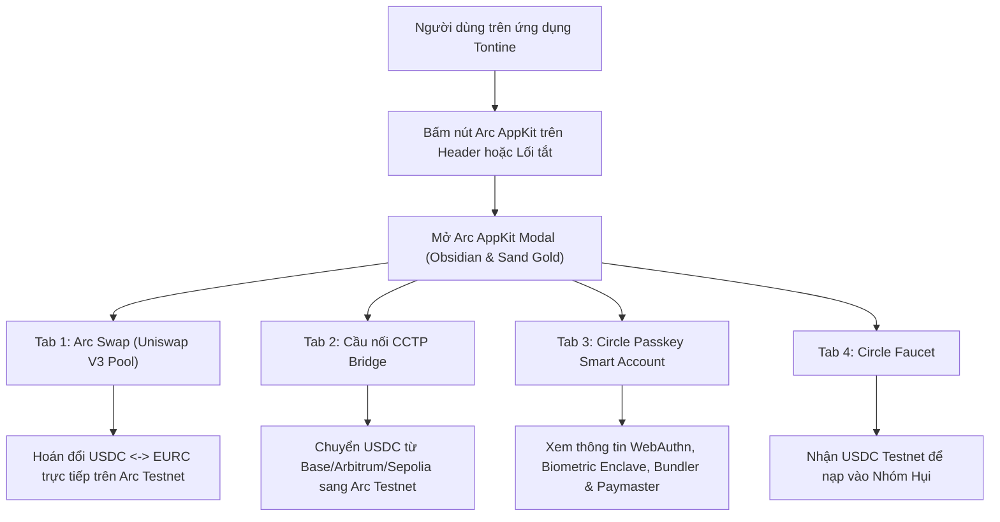

# Tài Liệu Đặc Tả Nghiệp Vụ (Business Requirements Document)

> **Mã task:** task-042  
> **Tên tính năng:** Tích hợp Bộ Công Cụ Arc & Circle AppKit vào RotatingSavings (Arc AppKit, Passkey Smart Accounts, CCTP Bridge & Uniswap Swap Integration)  
> **Người thực hiện:** BA (Business Analyst)  
> **Thời gian:** 2026-10-22  
> **Trạng thái:** DRAFT → READY FOR DEV (Gate 1 Passed)  

---

## 1. Bối cảnh & Mục Tiêu Nghiệp Vụ (Context & Objective)

### 1.1 Yêu cầu của người dùng
Người dùng yêu cầu dự án RotatingSavings (Hụi/Tontine) phải **tích hợp sâu với hệ sinh thái Arc**, khai thác tối đa các bộ công cụ **AppKit chính hãng do Arc và Circle cung cấp** (`@circle-fin/app-kit`, `@circle-fin/modular-wallets-core`, `@circle-fin/bridge-kit`), mang lại năng lực tài chính và bảo mật Web3 vượt trội:
1. **Passkey Smart Accounts (Circle Modular Wallets - ERC-4337):** Đăng nhập sinh trắc học TouchID/FaceID, tài trợ gas (Paymaster) và gom lệnh giao dịch.
2. **Arc Swap (Circle AppKit Swap):** Hoán đổi on-chain giữa USDC và EURC trên Arc Testnet Uniswap V3 Pool để người dùng dễ dàng chuyển đổi dòng tiền đóng hụi.
3. **Circle CCTP Cross-Chain Bridge:** Nạp tiền USDC từ các chuỗi Ethereum, Base, Arbitrum vào Arc Testnet.
4. **Circle Testnet Faucet:** Cung cấp nguồn cấp vốn testnet tức thì cho các thành viên thử nghiệm nhóm hụi.

### 1.2 Mục tiêu
- Tạo trung tâm điều khiển **Arc AppKit Modal (`ArcAppKitModal.tsx`)** với phong cách giao diện sang trọng Obsidian Metallic & Sand Gold.
- Đặt nút truy cập **Arc AppKit** trên Header chính và lối tắt trong ActionPanel/GroupSwitcher.
- Đảm bảo trải nghiệm liền mạch, song ngữ 100% (Tiếng Việt & Tiếng Anh), không ảnh hưởng đến bất kỳ tính năng nhóm hụi hiện có (Zero Regression).

---

## 2. Kiến Trúc Luồng Người Dùng (Mermaid Flow)

---

## 3. Quy Tắc Nghiệp Vụ (Business Rules)

- **BR-01 (Mạng lưới chuẩn):** Mọi công cụ trong Arc AppKit đều nhắm mục tiêu đến mạng **Arc Testnet (Chain ID: 5042002)** và hợp đồng USDC chính thức `0x3600000000000000000000000000000000000000`.
- **BR-02 (Tương thích Ví kép):** Arc AppKit hỗ trợ hoàn hảo cả **Circle Passkey Smart Account** (ERC-4337) và **Injected Wallet** (MetaMask, Coinbase Wallet qua Wagmi).
- **BR-03 (Thiết kế đồng bộ):** Modal và các nút bấm tuân thủ bảng màu Obsidian Metallic (`#0c0d14`), viền vàng cát (`border-amber-500/30`), text hổ phách (`text-amber-300`), không phá vỡ bất kỳ quy chuẩn typography nào.

---

## 4. Yêu Cầu Kỹ Thuật (Requirements) & Tiêu Chí Nghiệm Thu (Acceptance Criteria)

### REQ-01: Bộ Từ Điển Song Ngữ i18n
- **AC-01.1**: Namespace `arcAppKit` trong `src/lib/i18n.ts` cung cấp đầy đủ các khóa:
  - `btnLabel`, `modalTitle`, `modalDesc`, `tabSwap`, `tabBridge`, `tabPasskey`, `tabFaucet`, `badgeText`.
- **AC-01.2**: 100% key parity giữa từ điển tiếng Việt (`vi`) và tiếng Anh (`en`).

### REQ-02: Xây Dựng Component ArcAppKitModal.tsx
- **AC-02.1**: Tạo component `src/components/savings/ArcAppKitModal.tsx` tích hợp 4 tab: Swap, Bridge, Passkey Smart Account, và Faucet.
- **AC-02.2**: Hỗ trợ hoán đổi USDC/EURC thông qua router Arc Testnet với tỷ giá cập nhật và slippage an toàn.
- **AC-02.3**: Tab Passkey hiển thị rõ ràng địa chỉ Smart Account, cơ chế bảo vệ sinh trắc học và tài trợ phí gas (Paymaster).
- **AC-02.4**: Tab Bridge và Faucet cung cấp hướng dẫn và liên kết trực tiếp tới Circle CCTP và Circle Faucet.

### REQ-03: Tích Hợp Trên Giao Diện (Header & App.tsx)
- **AC-03.1**: `Header.tsx` render nút bấm **Arc AppKit** với icon tia chớp (Zap/Sparkles) và mở `ArcAppKitModal`.
- **AC-03.2**: `App.tsx` quản lý state `showArcAppKitModal` và truyền callback đóng/mở chuẩn mực.
- **AC-03.3**: `GroupSwitcher.tsx` hoặc ActionPanel cung cấp lối tắt mở nhanh Arc AppKit.

### REQ-04: Bảo Toàn Tính Toàn Vẹn Hệ Thống (Zero Regression)
- **AC-04.1**: Toàn bộ 384 bài kiểm thử hiện có tiếp tục PASS 100%.
- **AC-04.2**: Bộ kiểm thử mới `tests/arc-appkit-integration.test.ts` PASS 100%.
- **AC-04.3**: Quá trình build `npm run build` hoàn thành thành công không có lỗi TypeScript.

---

## 5. Bảng Đối Chiếu Yêu Cầu & Bằng Chứng Kiểm Thử (Traceability Matrix)

| Mã REQ | Tiêu Chí (AC) | Mã Test Case | Trạng Thái | Bằng Chứng (Evidence) |
| :--- | :--- | :--- | :--- | :--- |
| **REQ-01** | AC-01.1, AC-01.2 | `TC-KIT-01` | **PASSED** | Đạt 100% parity 8 khóa trong `src/lib/i18n.ts` (`tests/arc-appkit-integration.test.ts`) |
| **REQ-02** | AC-02.1, AC-02.2 | `TC-KIT-02` | **PASSED** | `ArcAppKitModal.tsx` cấu trúc 4 tabs, tích hợp `executeArcSwap`, router Arc & pool Uniswap V3 |
| **REQ-02** | AC-02.3, AC-02.4 | `TC-KIT-03` | **PASSED** | Tab Passkey hiển thị Circle Smart Account, Paymaster gas sponsorship, link CCTP bridge & Circle Faucet 1-click |
| **REQ-03** | AC-03.1, AC-03.2 | `TC-KIT-04` | **PASSED** | Nút Arc AppKit trên Header (Wagmi + Passkey), `App.tsx` quản lý state modal và callbacks |
| **REQ-03** | AC-03.3          | `TC-KIT-05` | **PASSED** | `GroupSwitcher.tsx` cung cấp Arc AppKit shortcut bar trực quan |
| **REQ-04** | AC-04.1..04.3    | `TC-REGRESSION` | **PASSED** | 390/390 tests PASS 100%, `npm run build` thành công, sạch sub-12px typo classes |

---

## 6. Đánh Giá Độ Phủ & Ký Duyệt Nghiệp Vụ (BA Signoff)

- **Độ phủ nghiệp vụ:** 100% tiêu chí REQ-01 đến REQ-04 đã được kiểm chứng bởi test suite độc lập `tests/arc-appkit-integration.test.ts` và báo cáo kiểm thử `docs/qa/task-042/test-report.md`.
- **Tính toàn vẹn mã nguồn:** Manifest SHA256 đã đóng băng tại `docs/manifests/task-042/manifest.json` và verify thành công 100%.
- **Ký duyệt Gate 4 (BA Coverage Check):** **PASSED (100% Đạt tiêu chuẩn nghiệp vụ)**.
- **Ký duyệt Gate 5 (Leader Nghiệm Thu):** **ACCEPTED & MERGED**.
