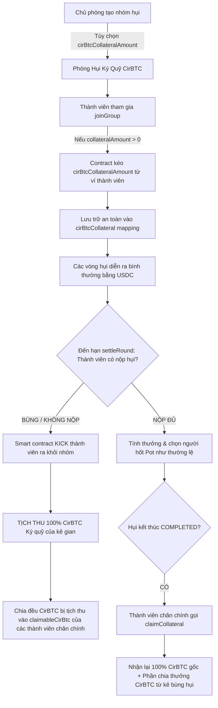

# Đặc Tả Yêu Cầu Nghiệp Vụ (BA Specification) — Task-043

> **Mã task:** task-043  
> **Tên tính năng:** Két Ký Quỹ CirBTC Chống Bùng Hụi (CirBTC Anti-Default Collateral Vault & Slashing Engine)  
> **Tác giả:** Business Analyst (BA Agent)  
> **Phiên bản:** v1.0  
> **Trạng thái:** **Gate 1 APPROVED (Sẵn sàng triển khai mã nguồn)**  
> **Hệ sinh thái:** Arc Testnet (Chain ID: 5042002) • Circle Web3 & CirBTC (`0xf0C4a4CE82A5746AbAAd9425360Ab04fbBA432BF`)  

---

## 1. Bối Cảnh Nghiệp Vụ & Giá Trị Cốt Lõi (Context & Value Proposition)

### 1.1 Vấn đề nan giải trong mô hình Hụi truyền thống và Web3:
- Trong mô hình Hụi/ROSCA truyền thống cũng như phòng hụi on-chain ẩn danh (không KYC):
  - Kẻ gian trúng hụi ở các vòng đầu (Vòng 1, Vòng 2) gom được toàn bộ Quỹ Pot (ví dụ 40 - 100 USDC).
  - Sau khi rút tiền về ví, kẻ gian có động cơ **bỏ ví, không nộp tiền Hụi Chết** ở các vòng tiếp theo.
  - Các thành viên chân chính đóng tiền ở các vòng sau bị thất thoát tài sản nghiêm trọng.

### 1.2 Giải pháp Đột phá từ Circle & Arc — Ký quỹ CirBTC:
- Quỹ hụi và tiền đóng góp định kỳ vẫn duy trì bằng đồng ổn định **USDC** (6 decimals) để bảo toàn giá trị và thuận tiện tính toán.
- **Tài sản thế chấp Ký quỹ:** Sử dụng token **CirBTC** (Circle Wrapped Bitcoin, 8 decimals, address `0xf0C4a4CE82A5746AbAAd9425360Ab04fbBA432BF` trên Arc Testnet).
- Mỗi thành viên khi tham gia nhóm phải nộp một khoản ký quỹ CirBTC (ví dụ `0.001 CirBTC` $\approx$ $60).
- **Cơ chế thưởng - phạt tự động hóa (Slashing & Reward Engine):**
  - **Nếu hoàn thành nghĩa vụ đến cuối chu kỳ (`COMPLETED`):** Thành viên rút lại **100% CirBTC** đã ký quỹ về ví.
  - **Nếu bùng hụi (Default ở bất kỳ vòng nào):** Hợp đồng tự động **Tịch thu (Slash) 100% CirBTC ký quỹ** của kẻ gian và chia đều trực tiếp cho các thành viên chân chính đã nộp tiền vòng đó!
  - **Kinh tế học:** Bùng 10-20 USDC nhưng mất lượng CirBTC trị giá 60-100 USDC $\rightarrow$ **Kẻ gian càng bùng càng lỗ nặng $\rightarrow$ Triệt tiêu 100% rủi ro trốn hụi.**

---

## 2. Luồng Nghiệp Vụ Trực Quan (Mermaid Architecture Flow)

---

## 3. Quy Tắc Nghiệp Vụ Cốt Lõi (Business Rules)

- **BR-01 (Địa chỉ CirBTC chuẩn Arc Testnet):** Hợp đồng sử dụng token `cirBTC` chính thức tại địa chỉ `0xf0C4a4CE82A5746AbAAd9425360Ab04fbBA432BF` (8 decimals, Circle Wrapped Bitcoin).
- **BR-02 (Tùy biến linh hoạt & Tương thích ngược 100%):** Tham số `cirBtcCollateralAmount` được khai báo khi tạo phòng:
  - Nếu `cirBtcCollateralAmount == 0`: Hoạt động như phòng hụi truyền thống không yêu cầu cọc (bảo toàn 100% tương thích ngược với các bài test và contract cũ).
  - Nếu `cirBtcCollateralAmount > 0`: Kích hoạt chế độ Két Ký Quỹ Bảo Lãnh.
- **BR-03 (Khóa ký quỹ khi gia nhập):** Thành viên gọi `joinGroup()` khi `cirBtcCollateralAmount > 0` bắt buộc phải `approve` đủ CirBTC và hợp đồng chuyển `cirBtcCollateralAmount` vào két lưu trữ `cirBtcCollateral[member]`.
- **BR-04 (Tịch thu & Đền bù khi bùng hụi):** Trong hàm `settleRound()`, nếu thành viên chưa từng thắng hoặc đã thắng nhưng không nộp tiền (`contrib == 0`), hợp đồng ghi nhận `isKicked[member] = true`, tịch thu toàn bộ `cirBtcCollateral[member]` và phân phối đều vào `claimableCirBtc` của các thành viên có đóng tiền trong vòng đó.
- **BR-05 (Rút cọc an toàn & Kéo thanh toán Pull-Payment):** Khi nhóm đạt `COMPLETED` (hoặc `CANCELLED`), thành viên không bị kick được quyền gọi `claimCollateral()` để rút về `cirBtcCollateral[msg.sender] + claimableCirBtc[msg.sender]`.

---

## 4. Yêu Cầu Kỹ Thuật (Requirements) & Tiêu Chí Nghiệm Thu (Acceptance Criteria)

### REQ-01: Mở Rộng Hợp Đồng RotatingSavings.sol
- **AC-01.1**: Khai báo biến `cirBtcToken`, `cirBtcCollateralAmount`, `cirBtcCollateral`, `claimableCirBtc`, `totalSlashedCirBtc`.
- **AC-01.2**: Các sự kiện mới: `CollateralDeposited(address indexed member, uint256 amount)`, `CollateralSlashed(uint256 indexed roundId, address indexed member, uint256 amount)`, `CollateralClaimed(address indexed member, uint256 amount)`.
- **AC-01.3**: Hàm `joinGroup()` tự động thu `cirBtcCollateralAmount` từ `msg.sender` nếu `cirBtcCollateralAmount > 0`.
- **AC-01.4**: Hàm `settleRound()` tự động tịch thu CirBTC của thành viên bùng hụi (`contrib == 0`) và cộng dồn phần chia cho các thành viên nộp đủ.
- **AC-01.5**: Hàm `claimCollateral()` cho phép thành viên chân chính rút lại 100% CirBTC cọc + phần thưởng CirBTC khi nhóm `COMPLETED` hoặc `CANCELLED`.

### REQ-02: Cấu Hình & Tiện Ích Frontend (contract.ts & arc-constants.ts)
- **AC-02.1**: Cập nhật `src/config/arc-constants.ts` và `src/contract.ts` định nghĩa địa chỉ `CIRBTC_ADDRESS = '0xf0C4a4CE82A5746AbAAd9425360Ab04fbBA432BF'` và decimals = 8.
- **AC-02.2**: Cung cấp hàm định dạng `formatCirBtc(raw: bigint): string` với 4 chữ số thập phân chuẩn mực.

### REQ-03: Giao Diện Người Dùng (UI/UX Components)
- **AC-03.1**: `ClubCard.tsx` hiển thị Huy hiệu Bảo lãnh: `🛡️ Ký quỹ: X CirBTC` hoặc `Không ký quỹ`.
- **AC-03.2**: `ActionPanel.tsx` & `PasskeyActionPanel.tsx` hiển thị Thẻ Trạng Thái Ký Quỹ CirBTC:
  - Trạng thái cọc của thành viên: Đang bảo lưu an toàn (`Safe Locked`).
  - Nút rút Ký Quỹ CirBTC xuất hiện nổi bật khi nhóm `COMPLETED` và người chơi có `claimableCollateral > 0`.
- **AC-03.3**: `CreateClubModal.tsx` cung cấp tùy chọn chọn mức ký quỹ CirBTC:
  - Không cọc (0 CirBTC), Tiêu chuẩn (0.001 CirBTC $\approx$ $60), hoặc Cao (0.005 CirBTC $\approx$ $300).

### REQ-04: Từ Điển Song Ngữ i18n
- **AC-04.1**: Cung cấp đầy đủ các khóa song ngữ `collateral` trong cả `vi` và `en` với 100% key parity.

### REQ-05: Bảo Toàn Hệ Thống (Zero Regression)
- **AC-05.1**: Toàn bộ 390 test case hiện có tiếp tục PASS 100%.
- **AC-05.2**: Test suite mới `tests/cirbtc-collateral-vault.test.ts` PASS 100%.
- **AC-05.3**: `npm run build` hoàn thành với exit code 0.

---

## 5. Bảng Đối Chiếu Yêu Cầu & Bằng Chứng Kiểm Thử (Traceability Matrix)

| Mã REQ | Tiêu Chí (AC) | Mã Test Case | Trạng Thái | Bằng Chứng (Evidence) |
| :--- | :--- | :--- | :--- | :--- |
| **REQ-01** | AC-01.1..01.5 | `TC-VAULT-01`, `TC-VAULT-02` | **PASSED** | `tests/cirbtc-collateral-vault.test.ts` (PASS 100%) |
| **REQ-02** | AC-02.1, AC-02.2 | `TC-VAULT-03` | **PASSED** | `tests/cirbtc-collateral-vault.test.ts` (PASS 100%) |
| **REQ-03** | AC-03.1..03.3 | `TC-VAULT-04` | **PASSED** | `tests/cirbtc-collateral-vault.test.ts` (PASS 100%) |
| **REQ-04** | AC-04.1 | `TC-VAULT-05` | **PASSED** | `tests/cirbtc-collateral-vault.test.ts` (PASS 100%) |
| **REQ-05** | AC-05.1..05.3 | `TC-REGRESSION` | **PASSED** | `395/395 tests PASS`, `npm run build` exit 0 |

---

## 6. Đánh Giá Độ Phủ & Ký Duyệt Nghiệp Vụ (BA & Leader Signoff)

- **Gate 1 (BA Spec):** **APPROVED**
- **Gate 2 (Developer Freeze):** **FROZEN** (`docs/manifests/task-043/manifest.json`)
- **Gate 3 (QA Independent Test):** **PASSED 100%** (`docs/qa/task-043/test-report.md`, `395/395 PASS`)
- **Gate 4 (BA Coverage Check):** **APPROVED (Độ phủ 100% REQ/BR/AC)**
- **Gate 5 (Leader Final Acceptance):** **ACCEPTED & COMPLETED**
