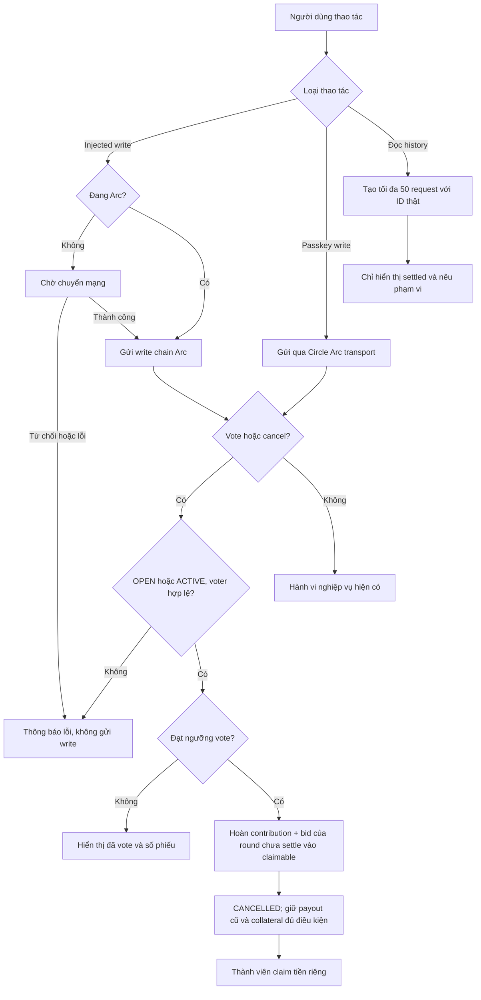

# Task-044 — Hoàn tất sửa review Arc/Circle sau phiên Gemini

Version: v1 — 2026-10-25. Spec đã được Leader duyệt Gate 1; sau Tester signoff, BA duyệt Gate 4 ngày 2026-10-25 theo [coverage-review.md](./coverage-review.md). Yêu cầu v1 không thay đổi trong lần cập nhật evidence này.

## Bối cảnh, giá trị và phạm vi

Max yêu cầu đọc `docs/tontine-arc-review.md`, `docs/tontine-fix-recommendations.md` và tiếp tục phần sửa Gemini bị ngắt. Baseline đã có thay đổi ở Solidity, artifact JSON, `src/contract.ts`, `src/onchain-money.ts`; Developer phải snapshot trước khi tiếp tục, không mặc định các thay đổi đó đã đúng hay đã test.

Giá trị cần đạt: hủy nhóm đang chạy bằng cơ chế biểu quyết hiện có và nhận lại tiền vòng chưa quyết toán; thao tác đúng mạng; số tiền không mất precision; cấu hình token/RPC thống nhất; giới hạn đọc lịch sử và dữ liệu credential lưu trong phiên. Chỉ thay đổi mã, tài liệu và kiểm thử cục bộ, không deploy hoặc gửi giao dịch lên mạng thật. Contract đang deploy không tự được nâng cấp bởi sửa source.

Actors: owner, member (gồm người đã hốt), người ngoài gọi settlement, ví injected, ví passkey, deployer. Trigger: vote/cancel, submit write, tạo nhóm, khôi phục passkey, đọc balance/history. Inputs: group state, round data, votes, amount string/bigint, chain ID, token config và credential; outputs: claimable balances, transactions đúng chain, thông báo đúng trạng thái, lịch sử bounded và artifact compile được.

## Đối chiếu đủ 12 finding và 9 đề xuất

| Review / Fix | Quyết định và căn cứ từ source |
| --- | --- |
| 1 / 1 | Thực hiện cancellation ACTIVE + refunds; giữ consensus đang có. Khẳng định owner biến mất làm tiền khóa vĩnh viễn không đúng tổng quát vì settlement hiện permissionless. |
| 2 / 2 | Dùng bigint/onchain-money, giữ API UI hiện có; không re-export mù quáng vì module có format không nhóm hàng nghìn và parse có thể throw. |
| 3 / 3 | `config.ts` dùng RPC từ registry. Circle publicClient/bundler hiện dùng modular transport có client key, không phải URL public hardcode; giữ transport Circle phù hợp. Registry hiện vẫn chứa public Arc URL, đổi import không tự bảo đảm tránh rate-limit/proxy. Không đưa RPC proxy secret backend vào frontend. |
| 4 / 4 | Chain/USDC constants từ registry, kiểm tra thiếu token thay vì dereference undefined. Registry là nguồn cấu hình trong repo, không tuyên bố luôn đúng với mạng bên ngoài. |
| 5 | Kiểm tra balance savings chỉ ERC-20 6 decimals, không cộng thêm native balance; không sửa nếu không có double-count. |
| 6 / 6 | Thêm địa chỉ collateral token vào constructor cho deployment mới; đồng bộ ABI/bytecode/callers. Setter custom token Gemini thêm không đáp ứng nếu public getter/UI vẫn address khác; tránh hai nguồn token có thể lệch. |
| 7 | Giữ settlement permissionless và điều kiện thời gian/early-settle hiện có; ghi comment rõ, không thêm onlyOwner. |
| 8 / 7 | Giảm thời gian lưu credential sang sessionStorage; không fallback ghi localStorage. Installed viem P256Credential có id/publicKey/raw, không chứng minh private key export; sessionStorage không ngăn XSS. |
| 9 | Giữ fresh-cycle behavior cho hasWon/isKicked như hiện có, giải thích collateral đã slash không phục hồi; reset votes khi bắt đầu cycle mới, event riêng có thể giữ từ Gemini. |
| 10 / 8 | RoundEnded dành cho contribute/bid quá hạn; RoundStillOpen dành cho settlement/kick quá sớm; thông báo khác nhau. |
| 11 / 9 | Chỉ đọc tối đa 50 round mới nhất và giữ round ID thực; UI nói rõ phạm vi nếu hiển thị bị cắt. |
| 12 / 5 | Chờ switch chain trước injected write/deploy; chainId trong write không đơn thuần là type hint (wagmi có kiểm tra chain runtime), nhưng không nên dựa vào đó để cung cấp UX switch. |

## Quy tắc nghiệp vụ

- BR-01: OPEN và ACTIVE được bỏ phiếu hủy, COMPLETED/CANCELLED từ chối. Giữ electorate và threshold đã có: member hoặc owner được vote, owner dùng cancelGroup; mỗi địa chỉ tối đa một vote; requiredCancelVotes = 1 khi <=1 member, ngược lại floor(memberCount/2)+1. Không tự thay electorate/kicked-member policy ở task này. Owner không được hủy đơn phương khi >=2 member.
- BR-02: Hủy ACTIVE là kết thúc nhóm theo consensus, không unwind vòng đã settle hoặc thu hồi payout đã claim; không tạo khoản nợ/thu bù nghĩa vụ tương lai. Chỉ contribution và tổng bid đã nạp của vòng chưa settle được cộng đúng một lần vào claimable; claimable cũ giữ nguyên. Phải giải thích điều này trong UI hủy để thành viên hiểu trước khi vote.
- BR-03: Hoàn tiền USDC qua claimPayout, không transfer vòng lặp trong cancel. Cấm contribute/bid/settle sau CANCELLED. Collateral/reward đủ điều kiện hiện có vẫn claim được sau cancel; không hoàn lại khoản đã slash. Task này không tái thiết kế chính sách slash/eligibility của task-043.
- BR-04: Settlement luôn permissionless với guard hiện tại. Fresh cycle reset hasWon/isKicked/votes, gồm vote của owner nếu owner không phải member, không khôi phục collateral đã slash.
- BR-05: Các giá trị token dùng bigint và decimals registry; `formatUsdc` giữ dấu phân cách hàng nghìn và hai chữ số thập phân như UI cũ, làm tròn half-up bằng bigint để không đổi sang truncation ngoài ý muốn; `parseUsdc` giữ hành vi input hợp lệ và invalid -> 0n hiện có, gồm `.5`, khoảng trắng, cắt phần dư sau 6 decimals. Hàm shared strict parser vẫn được quyền strict.
- BR-06: Injected write chỉ chạy sau khi chắc chắn đang ở Arc; từ chối switch không gửi write tiếp. Passkey sử dụng chain/transport Circle hiện có, không switch injected wallet. Approval -> write nối tiếp phải áp dụng cùng guard, kể cả user đổi chain giữa hai bước.
- BR-07: Constructor mới cần cirBtcToken_ khác zero; token thực dùng, getter, allowance, balance, approval và claim phải cùng token. Không silent fallback về token mặc định nếu env override có mặt nhưng sai. Existing club giữ token riêng đọc từ contract; không áp env mới áp đặt lên club cũ.
- BR-08: Credential cache chỉ tồn tại trong sessionStorage hoặc memory khi storage bị chặn; loại bỏ localStorage legacy; logout dọn cả hai nơi mà không throw. Không lưu private key và không tuyên bố sessionStorage chống XSS.
- BR-09: History window là 50 round mới nhất tính cả current round; round đang chưa settle không xuất hiện như đã settle. Mọi chỉ số/tình trạng dùng history không được nhầm cửa sổ 50 round là toàn bộ lifetime.

## Luồng thành công và lỗi

## Yêu cầu và tiêu chí nghiệm thu

| REQ | AC kiểm chứng được |
| --- | --- |
| REQ-01 Cancellation và refunds | AC-01a: OPEN/ACTIVE, dưới ngưỡng vẫn giữ state; đạt ngưỡng cancel; owner một mình không cancel nhóm >=2; outsider, duplicate vote và terminal state bị từ chối theo BR-01. AC-01b: với A góp 10, bid tăng 2→3 và B góp 10 ở current unsettled round, cancel cộng A=13, B=10 USDC đúng một lần ngoài payout cũ; claim thực chuyển đủ, lần hai không nhận thêm; settle sau cancel revert. AC-01c: cancel sau round đã trả payout không đòi lại tiền round cũ; eligible collateral/reward claim được sau cancel, không credit lại phần đã slash. |
| REQ-02 Cancellation UX | AC-02a: injected và passkey member có đường vote trong ACTIVE; owner cũng có đường vote phù hợp; chưa đủ phiếu không báo “đã hủy”. AC-02b: UI giải thích chỉ hoàn vòng chưa quyết toán, giữ payout cũ, chấm dứt vòng tương lai; CANCELLED không còn nói chỉ owner hủy ở giai đoạn đăng ký hoặc tự trả hết tiền; claim USDC/collateral đủ điều kiện vẫn truy cập được. |
| REQ-03 Money/facts | AC-03a: parseUsdc('9007199254740993.123456') = 9007199254740993123456n, '.5'=500000n, invalid/negative=0n, dư decimal cắt ở 6 theo tương thích; không đi qua Number cho amount. AC-03b: formatUsdc(9007199254740993123456n) = '9,007,199,254,740,993.12'; 1999999n -> '2.00', 0n -> '0.00'; CirBTC large bigint format không mất integer digits. AC-03c: USDC address/decimals/chain từ facts có guard token missing; savings balance không cộng native vào ERC-20. |
| REQ-04 RPC | AC-04a: registerChain, exported Arc chain RPC, wagmi http dùng cùng URL từ facts; không duplicate Arc URL trong config. AC-04b: passkey bundler và WebAuthn transport Circle tiếp tục được sử dụng; không đổi bundler sang public RPC và không expose secret proxy. |
| REQ-05 Chain guard | AC-05a: kiểm kê tất cả injected savings writes trong App/ActionPanel/CreateClubModal, gồm owner, claim, approve, callback sau receipt, collateral, vote, cycle; sai mạng phải chờ switch resolve trước write. AC-05b: rejected switch không có write, có lỗi người dùng; đang Arc gửi đúng một write, passkey không gọi switch injected. |
| REQ-06 CirBTC deployment | AC-06a: constructor nhận token khác zero, zero revert; new local deployments với token A/B đều getter/deposit/claim đúng token; không hardcode default trong Solidity. AC-06b: ABI constructor/bytecode thực compile khớp 6 args, CreateClubModal/deploy callers truyền cấu hình hợp lệ; env override malformed không âm thầm đổi sang token khác. AC-06c: UI đọc collateral token của selected club cho approve/balance/transfer, không lấy env cho existing club; địa chỉ default deployed club không thay. |
| REQ-07 Session credential | AC-07a: save/load session hoạt động, không ghi localStorage, legacy persistent item được xóa, malformed cache bỏ qua; storage get/set/remove throw không phá login/logout. AC-07b: logout xóa cache và account/bundler, session mới không auto-restore từ localStorage; tài liệu không nói public credential chứa private key hoặc sessionStorage chặn XSS. |
| REQ-08 Error/cycle semantics | AC-08a: contribute/placeBid đúng endTime vẫn theo boundary hiện có, sau endTime dùng RoundEnded; settle sớm không đủ điều kiện dùng RoundStillOpen; frontend có hai message đúng nghĩa. AC-08b: outsider vẫn settle được khi hợp lệ; cycle mới reset votes/hasWon/isKicked, gồm owner nonmember có thể bỏ phiếu lại, nhưng collateral đã slash không phục hồi; NewCycleStarted nếu giữ phải emit đúng ID. |
| REQ-09 Bounded history | AC-09a: undefined/0 tạo 0 request, round 1 tạo [1], 50 tạo [1..50], 51 tạo [2..51], 100 tạo [51..100]; không vượt 50; result index 0 ở round 100 map roundId 51; failures/unsettled không thành settled giả. AC-09b: hiển thị phạm vi rút gọn; trạng thái member đã thắng vẫn dựa onchain hasWon dù winning round ngoài window; không gắn sai winner ID/cycle totals. |
| REQ-10 Integrity/validation | AC-10a: giữ baseline Gemini, freeze toàn bộ implementation/artifact liên quan; Tester verify SHA trước/sau. AC-10b: npm test, typecheck/build và Solidity behavior tests có log/exit thật; artifact được compiler tạo có ABI và bytecode nhất quán; test cũ trái requirement mới được Tester cập nhật có giải thích, không thêm hidden UI chỉ để giữ regex pass. |

## Owner và phụ thuộc

Leader phân công chính thức trước dispatch; đây là danh sách dự kiến:

- BA: chỉ `docs/ba/task-044/**`.
- Developer: `contracts/RotatingSavings.sol`, artifact `contracts/out/RotatingSavings.sol/RotatingSavings.json`, `src/contract.ts`, `src/onchain-money.ts`, `src/config.ts`, `src/hooks/usePasskeyWallet.ts`, `src/hooks/useSavingsClub.ts`, `src/App.tsx`, `src/components/savings/ActionPanel.tsx`, `PasskeyActionPanel.tsx`, `CreateClubModal.tsx`, `RoundHistory.tsx`, `MemberStatus.tsx`, `src/lib/i18n.ts`; helper mới và deployment metadata nếu cần phải báo Leader giao owner cụ thể; `docs/manifests/task-044/**`.
- Tester: `docs/qa/task-044/**`, test regression mới và tests hiện có liên quan, `contracts/test/RotatingSavings.t.sol`; không sửa source để pass.
- Leader: root/config tooling/docs triển khai nếu cần; không sửa `.env` có secrets chỉ để test.

Rủi ro/phụ thuộc: Leader đã chuẩn bị forge tại `/tmp/tontine-task-044-toolchain/node_modules/@foundry-rs/forge-linux-amd64/bin/forge` dùng `--use /tmp/tontine-task-044-toolchain/solc-0.8.28`; Solidity cần execution test chứ regex không đủ; Circle account WebAuthn thật cần thiết bị/user interaction nên local test chỉ xác minh boundary/logic và ghi rõ giới hạn; old deployed contract không hỗ trợ ACTIVE cancel hay ABI mới, không tuyên bố đã nâng cấp. Constructor thay đổi đòi update toàn bộ local caller và independent tests; `contracts/contract-metadata/RotatingSavings.json` là metadata deployment lịch sử, giữ nguyên. Consensus hủy ACTIVE chỉ cung cấp lối kết thúc theo yêu cầu, không bảo đảm mọi thành viên đã nhận cùng giá trị trong cycle chưa hoàn tất.

Không có quyết định nghiệp vụ mới chặn spec: các rule cancellation lấy từ recommendation user yêu cầu và electorate/threshold source hiện có; các semantics ngoài phạm vi giữ nguyên, không tự thiết kế debt redistribution, đổi slash hay mandatory collateral.

## Traceability sau Tester signoff

Evidence chi tiết từng AC và loại kiểm chứng nằm trong [BA coverage review](./coverage-review.md), dẫn tới [Tester report](../../qa/task-044/test-report.md) và [source integration review](../../qa/task-044/source-review.md). Source là manifest 19 file đóng băng lúc `2026-10-25T12:06:02.711Z`, pre/post verify đều MATCH.

| REQ | AC | Test độc lập | Spec / source | Evidence | BA đối chiếu |
| --- | --- | --- | --- | --- | --- |
| 01 | 01a–01c | ArcReviewFixesTest cancellation/collateral/fuzz | v1 / task-044 manifest | Foundry run2 | PASS |
| 02 | 02a–02b | Cancellation regressions + source integration review | v1 / task-044 manifest | npm run3 + source-review AC02 | PASS; source integration, không browser E2E |
| 03 | 03a–03c | T044-MONEY, ERROR-FACTS, INTEGRATION | v1 / task-044 manifest | runtime run3 + source-review | PASS |
| 04 | 04a–04b | T044-INTEGRATION + transport review | v1 / task-044 manifest | runtime run3 + source-review | PASS |
| 05 | 05a–05b | T044-CHAIN, GUARDED-HOOK + call-site inventory | v1 / task-044 manifest | runtime run3 + source-review | PASS |
| 06 | 06a–06c | Foundry custom token; T044-DEPLOY, EXISTING-CLUB | v1 / task-044 manifest | Foundry run2, runtime run3, artifact comparison | PASS |
| 07 | 07a–07b | T044-SESSION + logout review | v1 / task-044 manifest | runtime run3 + source-review | PASS |
| 08 | 08a–08b | Foundry time/cycle/event + T044-ERROR-FACTS | v1 / task-044 manifest | Foundry run2, targeted event run3, runtime run3 | PASS |
| 09 | 09a–09b | T044-HISTORY + window/winner review | v1 / task-044 manifest | runtime run3 + source-review | PASS |
| 10 | 10a–10b | Pre/post SHA, full npm/Foundry/typecheck/build, artifact compare | v1 / task-044 manifest | Tester report và logs được dẫn trong coverage-review | PASS |

Gate 3 Tester signoff: PASS. Gate 4 BA coverage: APPROVED, đủ 10/10 REQ trong scope local. Gate 5 Leader acceptance: pending Leader quyết định.
