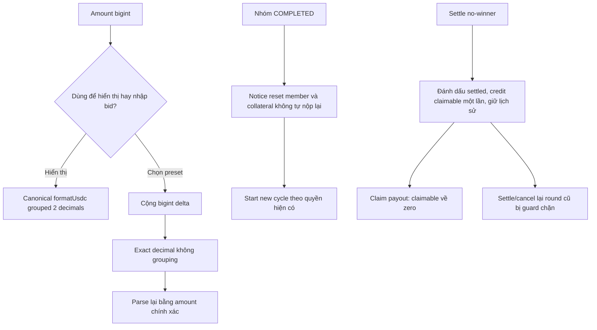

# Task-045 — Follow-up formatter, cycle notice và refund history

Version v1, 2026-10-25. Gate 1 đã được Leader duyệt; Tester PASS và BA Gate 4 APPROVED theo [coverage-review.md](./coverage-review.md), yêu cầu v1 không đổi khi cập nhật evidence. Baseline được Leader xác định là HEAD `71357f5`; hai file review cũ đang untracked, giữ nguyên và không đưa vào commit task này.

## Vấn đề, giá trị và disposition

Max gửi re-review ba điểm: formatter USDC trùng tên khác semantics, reset kicked member khi mở cycle nhưng không nộp lại collateral, và no-winner refund không clear historical mappings. Scope chỉ sửa code/docs/tests cục bộ cần thiết, không deploy/transaction; giữ semantics kế toán và collateral hiện có.

1. `src/contract.ts` hiện format grouped hai decimals half-up; `onchain-money.ts` export cùng tên nhưng exact không grouping. Chỉ `contract.ts` import module này trong source repo hiện tại. Gom canonical UI `formatUsdc` vào module và re-export từ contract; giữ exact formatting qua `formatUnitsExact`, `formatAmount` và API có tên rõ nếu cần. Không thay strict parser hoặc compatibility parser ngoài yêu cầu.
2. `startNewCycle()` hiện reset hasWon/isKicked/votes, giữ collateral thực có, không tự restore slashed funds và không gọi transferFrom. Giữ rule này và thêm giải thích VI/EN tại vùng COMPLETED/cycle của cả hai panel; không thêm nghĩa vụ nộp collateral hay tự chuyển token. Existing Solidity comment đã có nhưng người dùng cần thấy trước khi mở cycle. Copy “mọi thành viên chắc chắn thắng đúng một lần”/“hoàn thành tất cả vòng” phải sửa cho đúng khả năng cycle kết thúc sớm khi không còn người đủ điều kiện.
3. **Giữ `_refundRound(roundId, false)` cho no-winner settlement.** `getRoundContribution`/`getRoundBid` công khai dữ liệu lịch sử; `claimable` mới là khoản tiền được claim, không phải những mappings đã settle. `round.settled` được set trước refund, guards state/currentRound/settled ngăn xử lý lại; cancel ACTIVE chỉ hoàn current unsettled round. Đổi `true` sẽ xóa historical getter data không cần thiết. Thêm comment rõ khác biệt với ACTIVE cancellation (vẫn dùng `true`) và behavioral regression chứng minh không double credit.
4. Lỗi consumer liên quan thực tế: hai panel dùng `Number(formatUsdc(userBid))` cộng preset, trả NaN khi >=1000 do grouping và mất precision/fraction khi lớn. Sửa cùng task bằng bigint cộng preset và xuất decimal input không grouping, giữ đủ tối đa 6 decimals; không dùng display string để tính toán.

Actors: member injected/passkey, người mở cycle, người gọi settle/claim và người đọc lịch sử. Trigger/input: render amount bigint, chọn raise-bid preset, xem COMPLETED, settle no-winner/claim/cancel tiếp. Output: display không đổi, bid input đúng raw amount, notice đúng collateral, lịch sử intact và payout chỉ một lần.

## BR và flow

- BR-01: Canonical `formatUsdc` là một implementation shared; contract export cùng function, display en-US grouping, 2 decimals, bigint half-up như task-044. Exact money conversion phải tiếp tục tồn tại và không bị chuyển thành display rounded string.
- BR-02: Preset delta dùng raw bigint; parsed input mới bằng userBid + delta chính xác, không comma, không exponent, không NaN. Hai wallet paths cùng semantics.
- BR-03: Mở cycle không tự nộp/khôi phục collateral; kicked members được tham gia lại, có thể còn 0 collateral nếu trước đó đã bị slash/rút, muốn nộp thêm phải qua thao tác deposit riêng được hỗ trợ. Không hứa đồng loạt mọi member có 0 hoặc được bảo lãnh lại.
- BR-04: No-winner settle giữ historical contribution/bid, credit claimable một lần, claim làm zero claimable nhưng không xóa lịch sử. ACTIVE cancellation tiếp tục clear unsettled mappings. Không đổi payout/eligibility/debt/slashing/constructor/ABI chức năng.

## REQ và AC

| REQ | AC đo được |
| --- | --- |
| REQ-01 Canonical formatter | AC-01a: import formatUsdc từ contract và shared module cho cùng function/outputs; contract không còn implementation formatUsdc riêng. AC-01b: 0n -> `0.00`, 1005000n -> `1.01`, 1999999n -> `2.00`, 9007199254740993123456n -> `9,007,199,254,740,993.12`; exact conversion của cùng raw vẫn `9007199254740993.123456`, không mất 6 decimals. Existing parser behavior không đổi. |
| REQ-02 Bid presets | AC-02a: tại cả hai panel, userBid=1000000000n với delta 0.5 USDC tạo input parse được thành 1000500000n; userBid=1234567n với delta 0.1 tạo 1334567n; userBid=9007199254740993123456n với delta 0.5 tạo 9007199254740993623456n. AC-02b: button wiring dùng exact bigint helper/logic, không Number(display-format), input không comma/NaN/exponent, lựa chọn preset hiện có không đổi. |
| REQ-03 Cycle notice | AC-03a: cả injected/passkey COMPLETED view có notice VI/EN nói reset kicked/winner status, collateral đã slash/rút không tự phục hồi và không tự nộp lại; injected notice ở gần/trước Start New Cycle; eligible ACTIVE member có lockedCollateral đã đọc bằng 0 được thấy cảnh báo không có ký quỹ khóa và muốn bổ sung cần giao dịch deposit riêng. AC-03b: copy không hứa tất cả member chắc chắn hốt đủ hoặc luôn hoàn thành đúng N vòng, nêu cycle có thể kết thúc khi không còn người đủ điều kiện; không hướng dẫn bấm nút deposit/start cycle không tồn tại ở passkey UI. AC-03c: không thêm transferFrom/approve vào startNewCycle, không thay rule collateral/deposit hoặc quyền khởi động; Solidity regression cycle reset vẫn pass; không bắt buộc xây thêm chức năng deposit/start cycle cho passkey. |
| REQ-04 Refund history safety | AC-04a: comment giải thích settled history vs outstanding claimable và vì sao false ở no-winner, true ở ACTIVE cancellation. AC-04b: tạo kịch bản no-winner có contribution thật của previous winner, sau settle historical getter còn giá trị cũ, claimable tăng đúng contribution/bid, claim chuyển token đúng một lần; repeat claim/settle không credit thêm. AC-04c: sau bắt đầu cycle tiếp hoặc cancellation khi hợp lệ không hoàn lại settled round cũ; ACTIVE cancellation test vẫn xác nhận unsettled mapping clear/refund một lần. |
| REQ-05 Handoff/validation | AC-05a: baseline/freeze source và artifact nếu Solidity comment khiến rebuild artifact; Tester SHA trước/sau đúng, không sửa source sau freeze. AC-05b: targeted runtime money/preset + Foundry history/cycle tests, npm/typecheck/build regression có log/exit thật; artifact nếu build lại khớp compiler; hai docs review cũ giữ nguyên ngoài commit. |

## Owners, dependencies và evidence

BA chỉ `docs/ba/task-045/**`. Leader giao Developer cụ thể các file: `src/onchain-money.ts`, `src/contract.ts`, `src/components/savings/ActionPanel.tsx`, `src/components/savings/PasskeyActionPanel.tsx`, `contracts/RotatingSavings.sol`, artifact tương ứng nếu rebuild; i18n/helper mới cần Leader giao thêm. Tester sở hữu tests và `docs/qa/task-045/**`. Developer sở hữu `docs/manifests/task-045/**`. Toolchain task-044 dùng lại; tests không gửi giao dịch lên public network.

Không có blocker nghiệp vụ: chọn document collateral thay vì đổi economic policy, giữ lịch sử vì dữ liệu có public getter và guards hiện có. Không coi comments/test pass là đã nâng cấp deployed contract. Kiểm thử exact bid consumer là phần cần thiết để canonical display format không được dùng nhầm làm dữ liệu tính toán.

| REQ | AC | Test độc lập | Spec/hash | Evidence/BA |
| --- | --- | --- | --- | --- |
| 01 | 01a–b | T045 formatter runtime | v1 / task-045 8-file manifest | PASS; coverage-review REQ01 |
| 02 | 02a–b | T045 helper + real component preset clicks | v1 / task-045 8-file manifest | PASS; coverage-review REQ02 |
| 03 | 03a–c | T045 VI/EN renders + Foundry cycle + source review | v1 / task-045 8-file manifest | PASS; coverage-review REQ03 |
| 04 | 04a–c | Foundry historical refund/claim/next-cycle cancel | v1 / task-045 8-file manifest | PASS; coverage-review REQ04 |
| 05 | 05a–b | Pre/post8match, npm408, Forge89, typecheck/build, artifact | v1 / task-045 8-file manifest | PASS; coverage-review REQ05 |

Gate 3 Tester: PASS. Gate 4 BA coverage: APPROVED, đủ 5/5 REQ và toàn bộ AC trong scope local. Gate 5 Leader: pending Leader quyết định.
