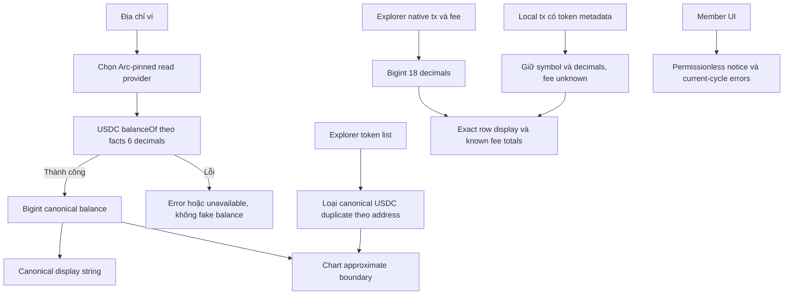

# Task-046 — Review v3: số dư legacy, cấu hình và thông báo nghiệp vụ

Version v1, 2026-10-25. Leader đã duyệt Gate 1; Tester PASS và BA Gate 4 APPROVED theo [coverage-review.md](./coverage-review.md), yêu cầu không đổi trong lần cập nhật evidence. Baseline HEAD `f686b9b`; ba review docs (`tontine-arc-review.md`, `tontine-fix-recommendations.md`, `tontine-arc-review-v3.md`) giữ nguyên local/untracked và ngoài commit.

## Vấn đề và phạm vi

Max yêu cầu đọc toàn bộ review v3 và sửa tiếp. Core savings money đã dùng bigint nhưng một số panel legacy đọc native balance, chuyển tiền sang Number/parseFloat rồi render. Analytics thực sự đưa native USDC lẫn token list vào cùng biểu đồ. Cấu hình Arc còn nhiều nguồn; permissionless/default thông báo và presets chưa thống nhất.

Giá trị: UI số dư có nguồn Arc đúng, USDC chỉ một pool trong tổng hợp, số lớn không mất integer/fraction do float, cấu hình không lệch và mô tả đúng contract. Scope local source/tests/docs; không deploy/send transaction, không sửa economics hoặc thiết kế lại Dashboard/Analytics/treasury mô phỏng.

Actors: người dùng connected wallet, người đọc dashboard/analytics, member/defaulting member, caller settlement/kick. Inputs: address, provider/chain, ERC-20 balances bigint, explorer raw transaction values/fees, local transaction metadata và contract errors. Outputs: balance/transaction display chính xác, chart có boundary approximate rõ ràng, chain config thống nhất, thông báo và presets giữ hành vi.

## Disposition đầy đủ 10 findings

| # | Quyết định |
| --- | --- |
| 1 ArcAppKitModal | Đọc USDC `balanceOf` 6 decimals qua Arc provider và canonical formatter; chuyển EURC/cirBTC balance formatting khỏi float. Native balance đứng riêng không tự là double-count; lỗi ở precision và provider có thể sai chain. |
| 2 RightSidebar/ArcAppKit/Dashboard/Analytics | Sửa balance đọc/display và aggregation; Analytics hiện push native USDC rồi toàn bộ token list nên có nguy cơ duplicate xác thực từ code. Không đổi native gas decimals18 thành6 khi xử lý fee/tx native. |
| 3 arc-constants | Chain ID/RPC/explorer/native decimals/USDC address-decimals từ facts với guard. EURC/CirBTC không có trong registry hiện tại: giữ explicit project defaults một nơi, không bịa registry/mainnet address. Contract facade dùng cùng default CirBTC, nhưng per-club getter và env deployment override task044 vẫn giữ đúng. |
| 4 arcChain | `globalRpcProvider`, ARC_TESTNET_CONFIG và Arc item SUPPORTED_CHAINS lấy chung facts/constants. Generic `switchOrAddNetwork` và các chain ngoài Arc giữ metadata/token semantics. Arc config trùng ở `arcNetwork.ts` và affected panels cũng chuyển dùng chung để không còn nguồn RPC cũ. |
| 5 MerchantTreasury | TOKEN_CONFIGS dùng constants; không đổi vault deployment addresses hay token/address-decimals theo symbol. Nếu sửa monetary display tại consumer cần giữ exact decimal string, không parse lại grouped string hoặc đổi simulation thành live. |
| 6 Permissionless | Giữ quyền contract hiện có, không thêm onlyOwner/grace period. Document VI/EN UI: bất kỳ ai có thể settle khi điều kiện đủ và kick member đủ điều kiện sau deadline; previous winner không bị kick bằng `kickDefaulter`, nhưng settlement vẫn áp dụng default rule hiện có. Manual kick hiện chỉ đánh dấu kicked, không gọi slash; settle bỏ qua member đã kicked, nên không mô tả manual kick là tự động tịch thu collateral hoặc bảo vệ tài sản hoàn toàn. Chính sách này giữ nguyên, ghi rõ limitation thay vì tự thay economics. |
| 7 Bonus | Không có bug thứ tự hasWon đã xác nhận từ source. Thêm comment rõ winner đã loại riêng, prior winners bị loại khỏi bonus recipient pool, không đổi payout/eligibility. |
| 8 AlreadyWon | Sửa message nói current-cycle restriction, bỏ chẩn đoán contract cũ Task-018. Message phải phù hợp cả placeBid và kickDefaulter, ví dụ “Thành viên này đã nhận hụi trong chu kỳ hiện tại; không thể đặt bid hoặc bị loại bằng thao tác này.” |
| 9 Presets | Export shared immutable `["1","2","5","10"]` ở bidPresets và dùng cho cả initial-bid/raise-bid lists của cả hai panels; giữ bigint getRaisedBidInput. |
| 10 Analytics duplicate division | Thay repeated float nativeBalance conversions bằng canonical raw USDC balance display và bigint transaction/fee conversions. Chỉ chuyển Number tại chart boundary được đánh dấu approximate; không tính tổng từ display đã grouping/rounding. |

## BR

- BR-01: Arc native USDC18 và ERC-20 USDC6 là hai view cùng pool. Wallet balance/KPI dùng canonical ERC-20 view đúng chain; không cộng native+ERC20. Gas/native tx raw values vẫn18 decimals. Arc USDC không đồng nhất với WUSDC router token.
- BR-02: Monetary source giữ bigint/raw decimal string; balance và exact transaction/fee display không qua Number/parseFloat. USDC balance dùng canonical `formatUsdc`; EURC/CirBTC dùng bigint helper đúng decimals và mức display phù hợp hiện có. Chart/ước tính tỷ giá có thể dùng Number tại boundary rõ ràng, phải finite và được mô tả approximate, không feed ngược vào balances/transactions. Không parse formatted comma string để tính tổng.
- BR-03: Khi wallet sai chain/không có injected provider, Arc balance reads dùng Arc-pinned fallback/provider; không hiện native ETH của chain khác thành USDC. Read failure phải xử lý rõ theo UI error/unavailable hiện có, không tạo balance live giả từ simulation.
- BR-04: Analytics canonical USDC có đúng một entry. Deduplicate token list bằng canonical contract address case-insensitive, không chỉ symbol; token khác address có symbol USDC không được giả định cùng pool. Nếu metadata address thiếu, không khẳng định đó là canonical USDC hay cộng nó như canonical. Decimals phải được kiểm tra trước parse; dữ liệu raw lỗi không gây crash/NaN.
- BR-05: Analytics tx explorer native value/fee sum bằng bigint. Local history phải giữ tokenSymbol/decimals có căn cứ; non-USDC local records không được chuyển thành USDC volume chỉ vì amount string. Fee chưa biết không được bịa fixed fee để tính KPI live; có thể hiển thị unavailable hoặc loại khỏi known-fee total. Không mở rộng sang thiết kế lại toàn bộ synthetic charts/product.
- BR-06: Consolidation chỉ loại duplicate source, không đổi chain/token/router/vault đang cấu hình. EURC/CirBTC local defaults được chú thích rõ không đến từ facts; env CirBTC override chỉ cho new club deployments, old clubs tiếp tục đọc own getter. Không đổi external chain configs thành Arc defaults.
- BR-07: Permissionless settlement/kick, bonus rules, winner contribution và collateral như hiện tại; chỉ comment/UI/error messaging. Presets giữ giá trị, thứ tự và mọi action hiện có.

## REQ / AC

| REQ | Tiêu chí nghiệm thu |
| --- | --- |
| REQ-01 Arc balance reads/display (#1/#2) | AC-01a: ArcAppKitModal, RightSidebar, ArcAppKit, Dashboard, Analytics đọc USDC6 balanceOf tại canonical address, không dùng native balance làm số dư thứ hai. AC-01b: raw `9007199254740993123456n` render USDC `9,007,199,254,740,993.12`; 1999999n render2.00; zero0.00; EURC/CirBTC large raw giữ đúng integer digits theo decimals6/8. AC-01c: wrong-chain/no-wallet path vẫn đọc Arc hoặc báo unavailable, không render native chain khác thành USDC; không parse lại grouped display cho values/calculation. |
| REQ-02 Analytics dedup/exact values (#2/#10) | AC-02a: canonical USDC raw từ read + token list chứa cùng address (mixed case) chỉ tạo1 canonical pool; token khác address/symbolUSDC giữ riêng identity, không cộng vào canonical balance; address missing/malformed/raw malformed xử lý không crash/NaN. AC-02b: native tx/fees bigint18 đúng display và fee sums; local USDC/EURC/cirBTC records không đổi nhầm symbol/decimals hoặc tổng vào USDC volume; unknown local fee không cộng fake fee. AC-02c: only Number conversion tại approximate chart/estimate boundary; balance/table/fee totals exact; UI không quảng cáo chart approximate là balance chính xác; repeated native `/1e18` code được loại. |
| REQ-03 Configuration (#3/#4/#5) | AC-03a: arc-constants exports chain/RPC/explorer/USDC/decimals khớp facts, thiếu chain/token có guard; utils provider, wallet add config, arcNetwork và affected panels dùng chung cấu hình. AC-03b: MerchantTreasury TOKEN_CONFIGS và affected balance token addresses dùng defaults chung; EURC/CirBTC không bị thêm facts giả; contract CirBTC default dùng cùng source mà vẫn giữ deployment override validation/per-club getter. AC-03c: WUSDC/router/vault và non-Arc supported chain IDs/RPC/symbol/decimals không bị thay, regression consumers vẫn build; native decimals18/USDC ERC206 luôn phân biệt. |
| REQ-04 Contract semantics documentation (#6/#7/#8) | AC-04a: cả hai savings panels có notice VI/EN accessible và guide wording liên quan giải thích permissionless settle/kick, deadline/eligibility đúng; không gọi manual kick là auto-slash, không thêm access-control/grace period. AC-04b: `_distributeBonuses` comment giải thích prior winners không nhận bonus, winner loại riêng; actual payout code không đổi. AC-04c: parseContractError AlreadyWon nói restriction chu kỳ hiện tại phù hợp bid/kick, không nói contract cũ Task018; Foundry permissions/winner/bonus regression vẫn pass. |
| REQ-05 Shared presets (#9) | AC-05a: shared readonly presets đúng1/2/5/10, cả initial/raise branches của ActionPanel và PasskeyActionPanel dùng export này; không duplicate array. AC-05b: runtime clicks vẫn đưa đúng input, raise với >=1000/6-decimal/>2^53 giữ bigint exact từ task045. |
| REQ-06 Validation/integrity | AC-06a: baseline/freeze source liên quan, QA verify SHA trước/sau; targeted runtime RPC/contract mocks kiểm actual balances/analytics normalization/formatting và component/consumer wiring, không fake test pass. AC-06b: npm/typecheck/build và Foundry regression thực chạy, log/exit và artifact compiler match nếu Solidity comments rebuild; giữ3 review docs unchanged ngoài commit; không deploy/public transaction. |

## Ownership đề xuất và phụ thuộc

Leader chốt owner file cụ thể trước dispatch. Developer cần: `src/components/savings/ArcAppKitModal.tsx`, `src/components/RightSidebar.tsx`, `src/components/ArcAppKit.tsx`, `src/components/Dashboard.tsx`, `src/components/Analytics.tsx`, `src/components/MerchantTreasury.tsx`, `src/config/arc-constants.ts`, `src/config/arcNetwork.ts`, `src/utils/arcChain.ts`, `src/contract.ts`, `src/lib/bidPresets.ts`, `src/components/savings/ActionPanel.tsx`, `src/components/savings/PasskeyActionPanel.tsx`, `src/lib/i18n.ts`, `contracts/RotatingSavings.sol` và `contracts/out/RotatingSavings.sol/RotatingSavings.json` nếu rebuild; shared balance/analytics helper mới chỉ khi Leader giao tên file. `src/onchain-money.ts` chỉ nếu cần bổ sung reusable bigint formatting, giữ API task045. Developer sở hữu `docs/manifests/task-046/**`; BA chỉ `docs/ba/task-046/**`; Tester `tests/**`, `contracts/test/**` liên quan và `docs/qa/task-046/**`.

Toolchain trước có sẵn. Shared reader đề xuất `src/lib/arcBalances.ts` dùng Arc-pinned provider cho cả5 consumers; Leader cấp owner tên file này và analytics helper nếu cần. Không blocker nghiệp vụ mới; missing token facts được giữ explicit local config. Primary technical context do Leader đối chiếu: [Arc compatibility guide](https://www.arc.io/blog/arc-compatibility-guide-for-existing-evm-apps), dual views cùng balance. Native-only read không tự chứng minh double-count; Analytics aggregation có cả hai nguồn là finding cụ thể. Runtime local mocks không chứng minh availability của RPC/explorer thật hoặc ví/device thật. Simulation/history cũ ngoài phần exact display/token labeling vẫn giữ product flow; không mở rộng treasury/swap redesign. Đặc biệt RightSidebar routing `ADDRESSES.USDC` thực là WUSDC, chỉ balance reader dùng canonical USDC, không đổi wrapped routing address.

## Traceability sau Tester signoff

Chi tiết từng AC/loại evidence trong [BA coverage](./coverage-review.md) và [Tester report](../../qa/task-046/test-report.md), cùng manifest18file frozen `2026-10-25T13:06:53.528Z`; source pre/post18MATCH.

| REQ | AC | Test/evidence | Spec/hash | BA |
| --- | --- | --- | --- | --- |
| 01 | 01a–c | V3 ERC20/format/Dashboard runtime + source integration | v1/task046manifest | PASS |
| 02 | 02a–c | V3 holdings/normalizers/Analytics runtime + source integration | v1/task046manifest | PASS |
| 03 | 03a–c | V3 config/non-Arc runtime + full npm deployment/per-club + source integration | v1/task046manifest | PASS |
| 04 | 04a–c | VI/EN panels/AlreadyWon runtime + Foundry permission/bonus tests | v1/task046manifest | PASS |
| 05 | 05a–b | Panel actual initial/raise clicks, shared presets source | v1/task046manifest | PASS |
| 06 | 06a–b | Pre/post18MATCH, npm418, Foundry91, typecheck/build, artifact,3doc hashes | v1/task046manifest | PASS |

Gate 3 Tester PASS; Gate 4 BA APPROVED đủ6/6REQ/toàn bộAC và10findings trong scope local; Gate 5 Leader pending quyết định nghiệm thu.
