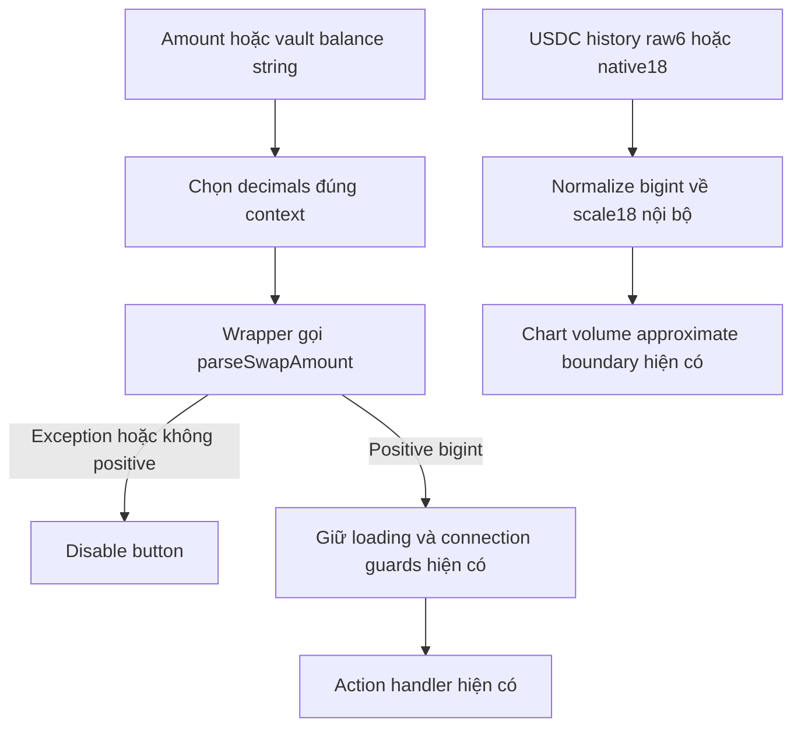

# Task-047 — Cleanup ba ghi chú sau review

Version 1, ngày 2026-10-25; Leader đã duyệt Gate1, Tester PASS và BA Gate4 APPROVED; Gate5 chờ Leader.

## Problem, scope và disposition

Max yêu cầu tiếp tục xử lý ba ghi chú không chặn nghiệm thu trước. Giá trị: nút UI kiểm tra số tiền nhất quán với parser giao dịch và comment diễn đạt đúng giới hạn cấu hình/analytics. Actor: người nhập swap, người xem/rút treasury, developer bảo trì cấu hình và biểu đồ. Chỉ sửa cục bộ frontend/comments; không deploy, gửi giao dịch, thay token routing hoặc economics.

| Ghi chú | Disposition có căn cứ source |
| --- | --- |
| EURC/CirBTC hardcoded; gợi ý env override | Giữ project defaults tại `arc-constants.ts`, thêm lý do rõ: facts chưa có hai token, legacy swap/payment/router/vault đang ràng buộc address cụ thể. Override một phần sẽ khiến token hiển thị khác token giao dịch. Không thêm `VITE_EURC_ADDRESS` hoặc global CirBTC override và không tạo `.env.example` quảng cáo khả năng chưa có. `VITE_CIRBTC_ADDRESS_TESTNET` hiện hữu chỉ chọn collateral token cho deployment club mới, giữ validation và getter theo từng club. |
| Hai parseFloat chỉ điều khiển disabled | Không phải bug chuyển tiền hiện đã xác nhận, nhưng NaN/junk có thể vượt predicate `<= 0`. Thay bằng boolean wrapper dùng `parseSwapAmount` hiện có, không parse float, để guard cùng grammar/precision với parser thật. Merchant simulation deposit còn parseFloat: ngoài scope, không tuyên bố loại toàn bộ float. |
| usdcVolumeByDay dùng scale18 | Thuật toán hiện đúng: quy đổi raw USDC6/native18 về scale chung trước cộng chart volume. Làm rõ comment rằng đây là đơn vị nội bộ của chart; không đổi ERC-20 decimals, amount chuyển token hoặc thuật toán. |

## BR và luồng

- BR-01: Giữ nguyên address/decimals/router/vault và semantics của override deployment hiện có; không fabricate facts hoặc hỗ trợ cấu hình nửa chừng.
- BR-02: Positive amount được quyết định bằng `parseSwapAmount` và bigint. Swap dùng decimals của `executeArcSwap`: USDC native/wrapped18, EURC6, cirBTC8; vault ERC-20 dùng TOKEN_CONFIGS6/6/8. Wrapper bắt exception thành false, không throw khi render.
- BR-03: Giữ grammar parser hiện hữu: chuỗi decimal không exponent/sign/grouping/junk; zero/negative bị loại. Precision dư không thể biểu diễn bị loại; extra trailing zero được chấp nhận nếu parser hiện hữu chấp nhận, không tự thay transaction validation hay rounding.
- BR-04: Chart normalization là bigint ở scale18 cho successful outgoing USDC, không phải decimals chung cho mọi token. Number chỉ ở approximate chart boundary hiện có; monetary transaction units không thay.

## REQ và AC

| REQ | Tiêu chí nghiệm thu |
| --- | --- |
| REQ-01 Cấu hình đúng phạm vi | AC-01a: comment tại defaults giải thích thiếu facts và ràng buộc legacy deployments; không thêm global env overrides, không đổi giá trị token/router/vault. AC-01b: existing deployment-only CirBTC override/validation/per-club getter giữ hành vi và không được mô tả là global override. |
| REQ-02 Exact UI positive guard | AC-02a: hai disabled predicates tại ArcAppKitModal swap và MerchantTreasury withdraw dùng shared safe boolean wrapper của parser hiện có, không parseFloat; loading/isSwapping/connectedAccount guards hiện hữu giữ nguyên. AC-02b: empty, NaN, Infinity, junk, exponent, negative, zero và precision không biểu diễn được trả false; positive micro/satoshi và số lớn hơn Number.MAX_SAFE_INTEGER trả true khi hợp lệ; invalid không crash render. AC-02c: swap USDC `0.000000000000000001` hợp lệ ở18, vault USDC `0.0000001` không hợp lệ ở6; EURC `0.000001` và cirBTC `0.00000001` hợp lệ, unit nhỏ hơn tương ứng không hợp lệ. Hai UI dùng decimals đúng token đang chọn; parser/transaction handlers không đổi semantics. |
| REQ-03 Chart normalization rõ nghĩa | AC-03a: comment giải thích scale18 chỉ để cộng volume chart giữa USDC6/native18; không phải ERC-20 input/transfer units. AC-03b: regression runtime mixed6/18 cùng ngày cộng raw đúng scale18, non-USDC/failed/incoming không lọt volume; algorithm/output không đổi. |

## Ownership, validation và giới hạn

Developer đề xuất đúng5files: `src/config/arc-constants.ts`, `src/lib/swapSafety.ts`, `src/components/savings/ArcAppKitModal.tsx`, `src/components/MerchantTreasury.tsx`, `src/lib/arcAnalytics.ts`; Leader chốt owner trước dispatch. BA chỉ `docs/ba/task-047/**`; Developer manifest `docs/manifests/task-047/**`; Tester tests liên quan và `docs/qa/task-047/**`.

Developer baseline/freeze; Tester kiểm hash trước/sau, chạy runtime parser cases và component integration/guard behavior, analytics regression, npm/typecheck/build; ghi log/exit thực. Không đổi Solidity nên không bắt buộc chạy lại Foundry cho scope này. Giữ ba original review docs local/unmodified/excluded commits. Không có blocker nghiệp vụ. Test local không chứng minh hoạt động RPC/live wallet. Simulation arithmetic, approximate quotes và legacy hardcoded transaction routes không được thiết kế lại trong task này.

| REQ | AC | Test/evidence | Spec/hash | BA coverage |
| --- | --- | --- | --- | --- |
| 01 | 01a–b | QA source review + npm deployment/config regressions | v1 / task047manifest5files | PASS |
| 02 | 02a–c | guard-followup runtime cases1/3/4: parser + both production consumers | v1 / task047manifest5files | PASS |
| 03 | 03a–b | Comment-only diff + mixed-unit runtime case2 + reused9 analytics tests | v1 / task047manifest5files | PASS |

Chi tiết evidence và giới hạn tại [coverage-review](./coverage-review.md) và [Tester report](../../qa/task-047/test-report.md): npm422/422, targeted4+9 nằm trong422, typecheck/buildexit0, pre/post5MATCH,3reviewdocs unchanged. Gate3 Tester PASS; Gate4 BA đủ3REQ/7AC; Leader điều phối nghiệm thu Gate5.
