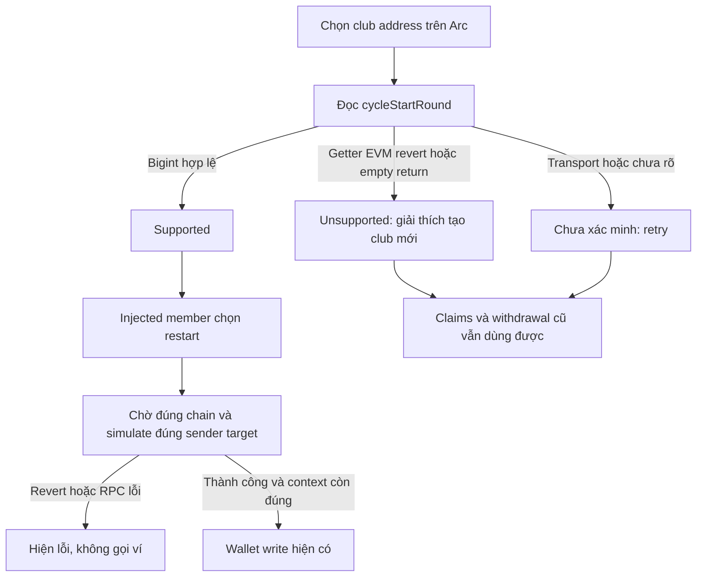

# Task-048 — Chặn restart không được hỗ trợ trên club legacy

Version1,2026-10-25; Leader Gate1 đã duyệt, Tester PASS, BA Gate4 APPROVED; Gate5 chờ Leader.

## Problem và evidence

Ảnh Max gửi tại club `0xc5064f3963761eef64ece72f853e90871ff1e1e9` có ví OKX Unknown transaction/fee unavailable/Confirm disabled, còn nút restart của ứng dụng hiển thị Sign in wallet. Loading của hook dùng chung nên ảnh chưa chứng minh action đã bấm hoặc calldata request đang chờ; Leader đã hỏi người dùng, chưa capture wallet request. Độc lập với điều đó, Leader xác minh read-only calldata `0x7f2736d1` của startNewCycle và getter cycleStartRound đều revert không data; deployed code9386bytes không có hai selectors; club COMPLETED/currentRound2, owner là sender/member và2members, sender native balance579.301876642549148167USDC, nonce latest=pending1072. cirBtcToken đọc được. Đây là lỗi restart xác định ở deployed legacy club thiếu cycle API; frontend đang dùng ABI mới và luôn hiện restart cho member. Không tuyên bố đã xác định mọi nguyên nhân của hộp thoại ví hoặc có verified deployed source. Chi tiết source/dependency ban đầu trong [diagnosis](./diagnosis.md); raw independent RPC evidence ở `docs/qa/task-048/live-readonly-request.json` và `live-readonly-response.json`.

Actor: member của club completed, người dùng injected/passkey, owner tạo club mới. Scope: nhận diện khả năng cycle của contract đang chọn, nội dung UI VI/EN chính xác và preflight restart trước mở ví. Không sửa/deploy contract cũ, cố định gas/fee hoặc tự chuyển tài sản/tạo club. Existing claims/withdraw/history giữ nguyên.

## BR và flow

- BR01: Capability gắn với address+Arc chain5042002; không suy từ frontend ABI hoặc club khác. Getter `cycleStartRound` trả bigint hợp lệ (kể cả0n) là supported. Trong API contract đã biết, EVM getter revert/empty return xác nhận getter không dùng được là unsupported; transport timeout/disconnect/rate-limit/unknown RPC error là error/unverified, không kết luận legacy từ chuỗi message chung.
- BR02: Checking/unknown/error không enable restart. Chỉ supported cho phép action hiện có; unsupported giải thích club này không hỗ trợ chu kỳ mới, muốn chơi tiếp cần tạo club mới và vẫn có thể nhận/rút khoản đủ điều kiện ở club cũ. Error/checking nói chưa xác minh/đang kiểm tra, có retry/refetch, không yêu cầu tạo club mới như sự thật đã xác nhận.
- BR03: Passkey hiện không có restart action: chỉ sửa notice phù hợp capability và dùng onOpenCreateModal hiện có để mở flow tạo club khi unsupported, không xây thêm write feature. Cả hai panel cung cấp create-club CTA nếu callback được truyền và chỉ dùng cycleRestartNotice/cycleEndNotice khẳng định khả năng restart khi đúng capability; notice collateral/task045 giữ nguyên cho club supported và ACTIVE.
- BR04: Trước injected startNewCycle, chờ chain guard rồi simulateContract tại Arc bằng đúng sender, target, ABI/function, args/value của request. Revert/RPC failure ngăn wallet write và hiển thị error hữu ích; không ép gas để bỏ qua revert. Simulation thành công mới forward một lần request hiện có. Other writes giữ hành vi; simulation không bảo đảm state sẽ không đổi trước mining.
- BR05: Loading/error/retry được giải phóng khi simulation lỗi; ngăn double submit trong preflight. Thay club không dùng cached supported của club trước; không gửi kết quả preflight cho account/chain đã thay trong lúc chờ.

## REQ / AC

| REQ | Acceptance criteria |
| --- | --- |
| REQ01 Capability đúng contract | AC01a: read cycleStartRound trên Arc với address đang chọn; valid bigint0n/positive → supported, definite EVM revert/empty-return → unsupported, loading → checking, generic RPC failure → error. Phân loại bằng typed error/cause có căn cứ, không broad string matching mọi error thành legacy. AC01b: đổi address không rò supported từ cache cũ; refetch/retry cập nhật capability; getter thất bại không làm mất dữ liệu club hoặc chặn claims/withdraw. |
| REQ02 UI VI/EN theo capability | AC02a: injected completed member chỉ có restart actionable khi supported; unsupported/error/checking không thể gửi restart qua click, có notice phân biệt rõ. Unsupported hướng dẫn tạo club mới qua flow hiện có, không tự tạo/di chuyển tiền. AC02b: passkey completed cũng hiển thị notice đúng, không khẳng định legacy có restart; không thêm action passkey mới. Both panels giữ claims/withdraw/history và supported collateral notice; App thực sự truyền capability của club đang chọn vào cả hai. |
| REQ03 Preflight chống wallet prompt vô ích | AC03a: actual guarded hook chỉ simulate startNewCycle sau chain guard với đúng Arc/sender/address/ABI/function trước wallet write; success forward đúng1lần, reject switch/revert/transport failure →0wallet calls và error được trả/hiển thị, hết pending để retry. AC03b: double-click trong preflight không tạo duplicate; account/chain thay trong chờ không forward kết quả cũ; approve/contribute/claim và writes khác không bị thêm restart simulation hoặc thay request/handler semantics. |
| REQ04 Validation/integrity | AC04a: Tester chạy independent capability classifier/hook runtime, cả hai panel completed trong VI/EN với supported/unsupported/checking/error, actual guarded preflight ordering/failure/retry/context và regression claims/withdraw/writes; logs/exit thật. npm/typecheck/build pass trên source SHA pre/post khớp; preserve3reviewdocs; không live write/deploy hoặc wallet confirmation. Solidity/artifact không đổi nên không bắt buộc Foundry rerun. |

## Ownership đề xuất

Leader chốt owner: `src/hooks/useSavingsClub.ts`, `src/App.tsx`, `src/components/savings/ActionPanel.tsx`, `src/components/savings/PasskeyActionPanel.tsx`, `src/hooks/useArcWriteContract.ts`, `src/lib/i18n.ts`; helper mới `src/lib/cycleCapabilities.ts` nếu cần phân loại/share types. Không đổi config gas/RPC hoặc Solidity. BA chỉ `docs/ba/task-048/**`; Developer manifest/snapshot `docs/manifests/task-048/**`; Tester tests và `docs/qa/task-048/**`. Read-only RPC findings do Leader cung cấp; behavior tests dùng fixtures/mocks, không cần giao dịch ví thật.

## Traceability

| REQ | AC | Test/evidence | Source hash | BA |
| --- | --- | --- | --- | --- |
| 01 | 01a–b | cycle-capability cases1/2: classifier/selected-address hook runtime | task048manifest7files | PASS |
| 02 | 02a–b | cases3/5: both panels VI/EN callbacks + App source mapping; regressions | task048manifest7files | PASS |
| 03 | 03a–b | case4: actual hook preflight ordering/failure/retry/context/duplicate runtime | task048manifest7files | PASS |
| 04 | 04a | QA report/logs,focused5/npm427,typecheck/build,pre/post7MATCH | task048manifest7files | PASS |

Không blocker nghiệp vụ. Unknown transaction là wallet display, không phải lý do tự sửa contract; lỗi restart cụ thể ở club legacy được xác minh bằng onchain reads, chưa capture wallet popup calldata. Gate3 Tester PASS và Gate4 BA đủ4REQ/7AC; xem [coverage-review](./coverage-review.md) và [Tester report](../../qa/task-048/test-report.md) cho bằng chứng/giới hạn/harness corrections; chờ Leader Gate5.
