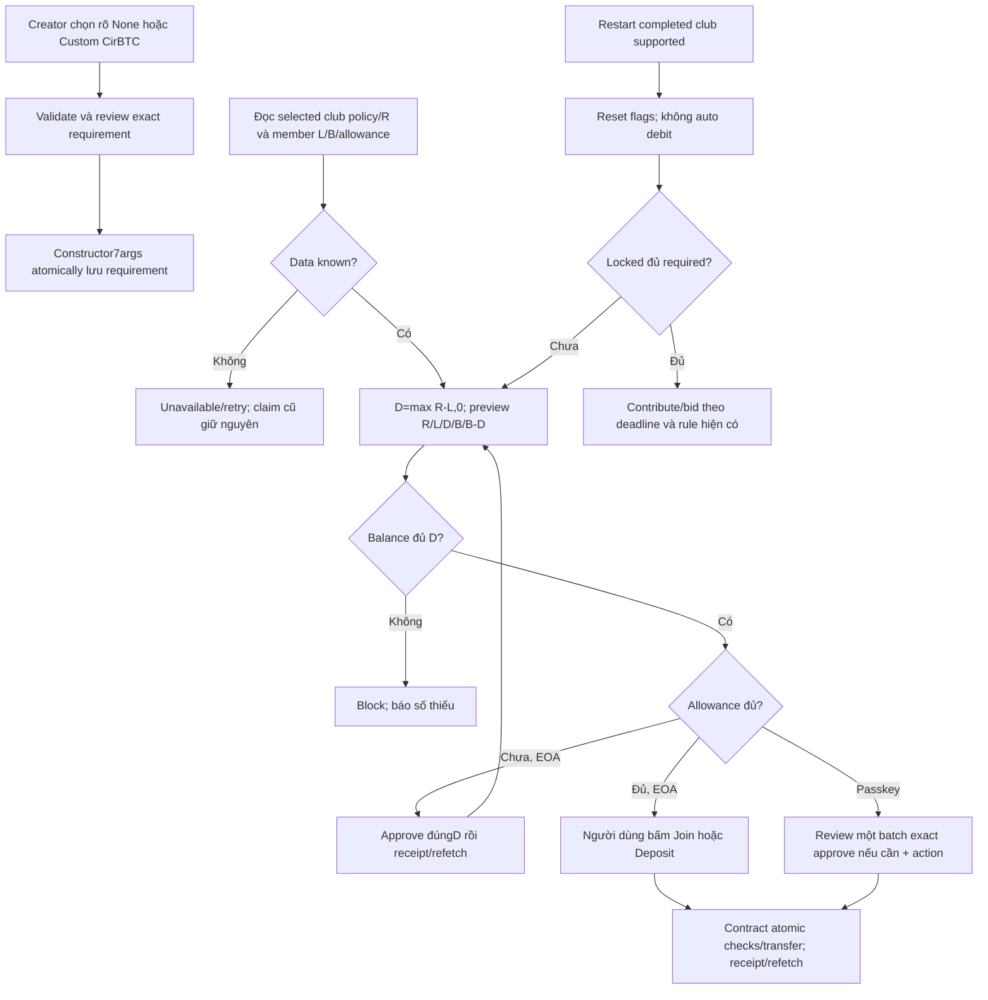

# Task-049 — Chính sách ký quỹ CirBTC rõ ràng và bắt buộc khi tham gia

Version1,2026-10-25; **Gate1 APPROVED, Tester PASS, Gate4 BA APPROVED đủ7REQ/14AC**, Gate5 chờ Leader. **LOCAL ONLY: không commit nếu không cần, không push, deploy, gửi transaction hoặc xác nhận ví thật.**

## Problem, value, actors và phạm vi

Max đồng ý thực hiện cả5 đề xuất: chọn rõ không ký quỹ/mức tự nhập; chỉ nộp phần còn thiếu; xem số tiền/số dư trước ký; allowance đúng khoản cần; contract mới bắt buộc đủ ký quỹ thay vì join âm thầm không nộp. Giữ CirBTC8decimals, USDC6 vẫn là token góp hụi; không đổi token/định giá bằng oracle.

Source hiện tại: Create chọn sẵn0.001 rồi chỉ lưu local preference, constructor6args luôn đặt required0; App thay onchain0 bằng local/default100000; owner config lưu local/toast trước receipt; join chỉ thu khi đủ balance+allowance rồi vẫn nhận member nếu thiếu; deposit0 có fallback100000 và chấp nhận overdeposit; UI cap khoản nộp bằng số dư ví, approve100x, tự chạy deposit sau approval, passkey chưa có collateral approval/topup. Các lỗi này làm số tiền hiển thị, contract policy và khoản bị trừ không đồng nhất.

Actors: creator/owner đặt mức trước member đầu tiên; prospective member join; member nộp thêm; prior winner/withdrawn/slashed member ở chu kỳ mới; injected wallet/passkey; người xem/rút khoản eligible ở legacy club. Chính sách contract mới chỉ áp dụng bytecode mới; contract đã deploy không upgrade. Không đổi cancellation, bonus distribution, slash allocation, kicked-final-claim rules hoặc USDC approval multiplier trong scope này.

## Quyết định policy đã được Leader duyệt

1. Constructor thêm arg7 `requiredCollateral` và marker `collateralPolicyVersion()` trả1. Mức được thiết lập atomically khi deploy, không làm flow deploy rồi set riêng để sửa cấu hình mặc định sai. Token arg6/env deployment-only và old deployed addresses/metadata giữ nguyên.
2. New-contract join chuyển đúng shortfall hoặc revert nguyên transaction; thêm nonReentrant. Entry mới `joinGroupWithCollateral(uint256 expectedRequirement)` kiểm R==expectedRequirement rồi dùng shared `_joinGroup(expectedRequirement)`; UI marker1 bắt buộc entry mới để bound khoản đã review khi owner thay config trước member đầu tiên. Existing `joinGroup()` vẫn nonReentrant và gọi shared implementation với actualR để giữ compatibility, vẫn enforce đủ collateral nhưng external caller tự chọn method cũ không có quote binding. Không dùng overload cùng tên để tránh ambiguous ABI. startRounds kiểm đủ required của tất cả members làm phòng vệ. Required0 là không ký quỹ thật, không token transfer/approval.
3. depositCollateral(amount) chỉ nhận positive amount <=shortfall, required>0, member chưa kicked và state OPEN/ACTIVE như hiện hữu. UI luôn gửi toàn bộ shortfall; contract cho phép deposit một phần nhưng chưa được tham gia nếu vẫn thiếu. Không fallback deposit0, không overdeposit.
4. startNewCycle vẫn reset flags và không tự nạp/trừ token; không chờ toàn bộ members bổ sung để mở chu kỳ. Contract mới bắt buộc locked>=required tại **contribute và placeBid**; người đã rút/bị slash nộp thêm sau khi ACTIVE trước khi góp/bid và trước deadline. Không hỗ trợ COMPLETED deposit, không thay quyền claimCollateral/kicked. Điều này tránh deadlock chờ tất cả members ký quỹ trước restart, nhưng không hứa mọi member luôn có đủ collateral ngay sau restart.
5. EOA: approve riêng, chờ receipt+refetch, rồi người dùng bấm Join/Deposit riêng; không tự gửi second money transaction. Passkey: được dùng một atomic batch approve+join/deposit sau một CTA ghi rõ và preview đủ số tiền; không tạo transaction tự động sau đó.

## BR

- BR01 Onchain authority: Required R chỉ từ current-club read. `0n` là explicit none; undefined/error là unknown, không0/0.001. Local storage không quyết định displayed requirement, debit, allowance hoặc security status. Owner thay config chỉ OPEN và chưa có member, dùng none/custom; chưa receipt/refetch không quảng cáo đã áp dụng. Rejection/revert giữ actual requirement cũ và hiện lỗi, không success giả.
- BR02 Exact units: CirBTC raw bigint8, R>=0, locked L>=0, wallet B>=0, claimable reward riêng (không cộng reward vào locked). D=max(R-L,0). Nếu B<D, block approve/join/deposit, nêu thiếu D-B; không cap D xuốngB hoặc sweep cả ví. Nếu L>=R, D0 không approve/deposit. Mức custom dùng strict8decimal parser, >0 và <=uint256 max; reject malformed/negative/exponent/nonzero precision dư, không truncate bằng tolerant parseCirBtc. None là lựa chọn riêng, không tự xem custom0 là valid positive.
- BR03 Review trước ký: cả2wallet modes hiển thị R, L, D, B, B-D dự kiến bằng exact decimal CirBTC (không float/round mất satoshi), token/group đúng context. Approval tự nó không chuyển token; nhãn phân biệt approval và actual debit. Nếu thiếu data hoặc số dư thì không hiển thị khoản khả dụng giả hoặc enable debit. Số dư sau chỉ dự tính từ đọc hiện tại, không gồm gas USDC.
- BR04 Allowance CirBTC: nếu allowance<D thì approve(spender=currentClub,amount=D), không100x/unlimited; không cần approve nếu allowance>=D, không tự revoke allowance cũ lớn hơn. EOA refresh requirement/balance/allowance sau receipt, yêu cầu action click tiếp và review mới; đổi club/account/amount không được dùng stale followup. Passkey dùng collateral token của club và account smart-wallet, batch approve đúngD khi cần rồi một join/deposit đúngD. D0 không thêm approve/transfer.
- BR05 Atomic enforcement: join thiếu allowance/balance reverts, membership/list/index/locked/token balances không đổi; transferFrom failure cũng rollback. R0 join không gọi token. Full join không thu lại collateral đã khóa; các checks trước active participation dùng locked, không wallet balance/allowance hay claimable rewards. startRounds từ chối thiếu collateral; contribute/placeBid thiếu collateral không chuyển USDC hoặc cập nhật contribution/bid. Existing deadline/member/kicked/winner rules giữ nguyên.
- BR06 Lifecycle: slash vẫn giảm locked theo hiện tại; claim chỉ theo existing final-state/non-kicked eligibility. Restart không restore locked hoặc auto debit; new-cycle insufficient member có đường topup ACTIVE, sau đủ mới góp/bid. Partial deposit không cấp quyền tham gia khi L<R. Required0 không topup và không hiện cảnh báo thiếu ký quỹ sai. No funds seized/new penalty policy được thêm.
- BR07 Compatibility: marker1 xác nhận enforcement mới. Getter absent/definite revert là legacy; transport failure/unrecognized version là unknown, phân biệt loading. Không nói legacy được bảo vệ bắt buộc; actual onchain R/L vẫn là source cho preview và exact topup, không bật semantics chỉ dựa ABI. Unknown policy/required/token/balance chặn collateral-sensitive money actions đến khi đọc lại được; claims/withdraw/history và existing cycle capability task048 vẫn độc lập. Legacy completed deposit không được mở; không đổi claim eligibility theo rule mới không có trên contract cũ.
- BR08 Owner setting và races: setCollateralAmount vẫn owner/OPEN/zero-members; policy có thể đổi trước join. Mọi request phải dựa preview vừa xác nhận, re-read/review khi data/context thay; new UI dùng joinGroupWithCollateral(expectedRequirement=reviewedR), contract mismatch reverts trước membership/transfer kể cả allowance cũ lớn. Legacy chỉ có noarg join nên không enforce boundquote; exact allowance/new read giảm rủi ro nhưng allowance cũ lớn vẫn có race, UI phải nói rõ legacy limitation trước join có collateral. Không tuyên bố simulation loại trừ mọi race trước mining. Constructor-policy metadata lưu từ submitted deployment snapshot, không form vừa đổi khi receipt tới.

## REQ, AC và traceability dự kiến

| REQ | Tiêu chí nghiệm thu | Test/evidence cần Tester |
| --- | --- | --- |
| REQ01 Explicit creation/config | AC01a: modal ban đầu chưa chọn policy; phải chọn none hoặc custom valid8decimals, không preselect0.001/presets áp mặc định. Review và encoded constructor7args chứa exact0/custom; token override/validation giữ. Success metadata dùng submitted snapshot, không local collateral authoritative. AC01b: owner none/custom chỉ enabled OPEN+zero-member; pending/reject/receipt paths không optimistic save/success, current display cập nhật từ confirmed chain read. | Runtime create inputs/encoded deploy data/receipt snapshot, owner confirmed/rejected flows; Forge constructor/setter guards |
| REQ02 Exact collateral model | AC02a: R100000,L40000,B1000000→D60000,after940000; B59999 block với thiếu1; R0→D0; L>=R→D0; rewards không bùL; >2^53 vẫn exact. AC02b: onchain0 thắng stale local100000, unknown không thành0; shared UI both modes show R/L/D/B/after, exact1satoshi, deficit/unavailable distinct; no walletcap/fallback/sweep. | Shared helper runtime vectors + actual panel/App data wiring |
| REQ03 Explicit EOA approval/actions | AC03a: insufficient allowance approve exactD to currentClub on per-club CirBTC; approval receipt không gọi join/deposit, chỉ refresh; click action mới gửi newpolicy joinGroupWithCollateral(reviewedR), legacy joinGroup(), hoặc deposit exactD. AC03b: insufficient funds/unknown/token/context changes/D0 prevent unintended approval/deposit; re-read/review fresh required+locked+balance before money step, pending duplicates blocked, reject/revert releases UI and preserves funds/state. Existing join R0 emits no CirBTCapprove. | Actual component/hook callbacks with captured calls, receipt/refetch/no-autofollowup; state changes and errors |
| REQ04 Passkey reviewed collateral path | AC04a: add per-club token/balance/allowance reads/props for smart account; join/topup preview as REQ02. CTA explicitly identifies atomic approve+action when needed; captured batch has exactDapprove iff needed then exactly1 newpolicy joinGroupWithCollateral(reviewedR), legacy joinGroup(), hoặc deposit, no unexpected second operation. AC04b: insufficient/unknown/zero/fullylocked/context change guards and receipt/rejection behavior preserve usability; both languages; no-collateral join has no approval/deposit. | Production passkey render/click/bundler fixtures, call decode amounts/order/target/account; receipt/revert |
| REQ05 Mandatory new-contract enforcement | AC05a: marker1+constructor7arg policy; both join entrypoints exactshortfall or full rollback on funds/allowance/transfer failure, repeatjoin rejects and reentrancy guarded; new entry mismatched expectedRequirement reverts without effects even with large allowance; none0 performs no token pull. AC05b: deposit0/notrequired/overremaining reject with no accounting changes; positive<=remaining accepted exactly, UI request equalsremaining; nonmember/kicked/invalidstate guards hold. AC05c: startRounds allmembers sufficiently funded; contribute/placeBid underfunded reject with no USDC/accounting update; sufficient and none paths retain rules. | Foundry real mock-token tests, failures/accounting/events/balance assertions and bounded invariants |
| REQ06 Lifecycle and legacy | AC06a: withdrawn/slashed member across startNewCycle remains not auto-funded; attempt contribute/bid fails until explicit ACTIVEtopup, then succeeds under existing eligibility/deadline; partial topup still fails. No COMPLETEDdeposit; claim/kicked policy, slash allocation, payout/refund behavior unchanged. AC06b: policy marker states new/legacy/unknown/loading distinct by current address; absence does not break reads/claims/cycle capability; legacy zero reads no local fallback and legacy notice does not claim mandatory coverage. UI newpolicy restart notice says topup before next contribution/bid, no blanket guarantee allmembers funded. | Foundry lifecycle+claim/slash/cancellation regressions; both-panel VI/EN capability/legacy fixtures + task048 regressions |
| REQ07 Local integrity/regression | AC07a: Developer snapshot/freeze; Tester independent pre/post hashes, focused runtime+fullnpm+typecheck/build+fullForge/invariants, compiler ABI/creation/runtime artifact exact and constructor callers migrated coherently. Preserve historical deployment metadata and3reviewdocs; no commit/push/deploy/livewrites. Record obsolete oldpolicy oracle changes explicitly against this spec, preserve firstfail evidence. | QA logs/exit/hashes/report, artifact check, coverage review |

## Ownership đề xuất và integration impact

Developer source: `contracts/RotatingSavings.sol`, `contracts/out/RotatingSavings.sol/RotatingSavings.json`, `src/contract.ts`, `src/hooks/useSavingsClub.ts`, `src/App.tsx`, `src/components/savings/CreateClubModal.tsx`, `src/components/savings/ActionPanel.tsx`, `src/components/savings/PasskeyActionPanel.tsx`, `src/components/savings/ClubCard.tsx`, `src/lib/i18n.ts`, new `src/lib/collateralPolicy.ts` (strict parser/shortfall/review/capability helpers nếu cần), `src/lib/savingsClubDirectory.ts` chỉ nếu xóa/deprecate unused collateral-preference authority; không xóa danh bạ người dùng. Leader cấp thêm hook/helper filename cụ thể nếu tách shared presentation/preflight, không tự mở rộng.

Developer thêm6 deployment script owners để migrate constructor7args rõ actualrequired: `scripts/setup-2min-arena.mjs`, `scripts/setup-10-members.mjs`, `scripts/wait-and-launch-interactive-arena.mjs`, `scripts/setup-interactive-bidding.mjs`, `scripts/launch-interactive-arena.mjs`, `scripts/setup-complete-user-arena.mjs`. Chỉ edit/static syntax checks, **không execute các script có thể gửi transaction/deploy**. Không mặc định script requirement100000 vô căn cứ; explicit0 giữ no-collateral scenario hoặc script phải chỉ rõ configured requirement và funding setup tương ứng.

Tester owns `tests/**`, `contracts/test/**`, `docs/qa/task-049/**`: constructor6→7 cập nhật mọi Foundry caller và ABI tests. Old tests từng kỳ vọng overdeposit, silent unfunded join, newcycle uncollateralized participation phải thay oracle theo explicit REQ05/06, không blanket disable regression. Helpers/static tests cho legacy behavior cần fixture oldcontract hoặc source scope đúng, không lấy old behavior làm required của newcode. Developer chỉ đóng băng implementation/artifact; Tester ghi hash tests riêng. BA chỉ `docs/ba/task-049/**`; Developer manifests `docs/manifests/task-049/**`.

Không deploy script live, không sửa historical address/ABI metadata thành deployment mới. Artifact rebuild và constructor preview không phải deployment. Full suite Solidity cần đủ token approval/funding trong setup mới khi required>0; default0 setup vẫn tương thích economics cũ nếu không kiểm collateral. Allowance exact chỉ CirBTC trong task này, không redesign unrelated USDC flows.

## Assumptions, risks, Gate1

Leader đã quyết định giữ final claim/kicked rules và dùng ACTIVE contribution/bid guard thay allmember collateral prerequisite cho restart; đây là quyết định nghiệp vụ đã duyệt, không còn blocker này. Fixed required CirBTC không phải bảo hiểm đủ mọi nghĩa vụ USDC, không có pricing ratio/auto recalculation. Manual kick hiện không slash như task046, giữ nguyên và không quảng cáo bảo vệ toàn bộ nợ. Legacy behavior không được nâng cấp bởi frontend, chỉ xử lý amount/consent rõ hơn. Local runtime tests không chứng minh ví/RPC thật hoặc transaction mined; không được vượt lệnh NO PUSH/DEPLOY để kiểm chứng.

Traceability final REQ01–07 / toàn bộ14AC **PASS**, mapping cụ thể tại [coverage-review](./coverage-review.md) và [Tester report](../../qa/task-049/test-report.md), V2manifest21paths frozen `2026-10-25T15:52:57.529Z`. Focused10/fullnpm437,Forge106,typecheck/buildexit0,artifactABI/creation/runtimeequal,pre/post21MATCH. Leader đã cấp thêm `src/hooks/useCollateralPolicy.ts`, `src/components/savings/CollateralPreview.tsx` và `src/hooks/useArcWriteContract.ts` cho shared review/context-bound writes. Gate3TesterPASS/Gate4BAAPPROVED; Gate5 Leader pending, localonly restriction giữ nguyên.

Baseline clarification từ Leader/Tester:3original reviewdocs không tồn tại tại task049 baseline (recordednull). Yêu cầu preserve ở trên nghĩa là không tự tái tạo/chỉnh/push chúng; QA báo continuedabsence nếu đúng, không dùng task048 historical hashes để tuyên bố currentfiles unchanged.
