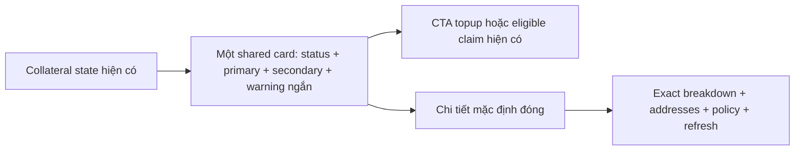

# Task-050 — Thẻ ký quỹ gọn hơn

Version1,2026-10-25; Gate1 Leader approved, Tester PASS, Gate4 BA APPROVED đủ3REQ/5AC; Gate5 chờ Leader. **UI only, local only; không push/deploy/live transaction.**

Max thấy quá nhiều dữ liệu ký quỹ trên màn hình. Gộp hai thẻ đang xếp chồng thành một shared collateral card trong cả ActionPanel và PasskeyActionPanel; giữ mọi số tiền/consent/guard và hành vi task049.

## BR / flow

- BR01: Default chỉ title/status, primary **Cần nộp** nếu shortfall>0, ngược lại **Đang khóa**; secondary **Số dư sau nộp** khi thiếu, ngược lại **Số dư ví**. Giữ exact8CirBTC; unknown không giả0, thiếu tiền không giả walletafter hợp lệ.
- BR02: Deficit/loading/unknown/legacy warning ngắn vẫn visible, không che rủi ro trước ký. Không default fulladdresses hoặc giải thích dài. Legacy warning ngắn giữ ý priorapproval/changedrequirement có thể làm debit khác; nội dung đầy đủ trong details.
- BR03: Native `
` mặc định đóng với nhãn VI/EN **Chi tiết / Details**, chứa required/locked/currentwallet/rewards/fulladdresses/policy explanation/refresh. Topup và eligible claim CTA vẫn visible ngoài details; giữ EOA approval-separate và passkey atomic-batch consent labels, guard/amount/account/receipt logic hiện có.

| REQ | AC |
| --- | --- |
| REQ01 Compact consistent display | AC01a: cả2wallet modes chỉ1card; primary/secondary đúng BR01 cho shortfall,fullyfunded,none,unknown; số1sat không bị mất. AC01b: details native mặc định đóng, nhãnVI/EN; breakdown/rewards/addresses/policy/refresh có thể mở xem; không còn2card hoặc default text/address dài. |
| REQ02 Preserve visible decisions/actions | AC02a: deficit/loading/unknown/legacy warning ngắn visible; topup/claim đủ điều kiện ngoài details, kicked/invalid/loading guards và exactapproval/batch consent labels giữ nguyên. AC02b: không đổi collateral calculations,transaction calls,constructor/contracts/hooks; targeted existing runtime tests xác nhận amounts/callbacks/guards giữ hành vi, chỉ sửa markup expectations cần thiết. |
| REQ03 Integrity/local validation | AC03a: freeze đúng3sourcefiles, Tester pre/posthash + targeted existingtests và typecheck/build phù hợp; testreport/log/exit thật. Không thêm suite chỉ để mirror cosmeticmarkup; không push/deploy hoặc đổi source ngoài owner. |

Developer owns đúng `src/components/savings/CollateralPreview.tsx`, `src/components/savings/ActionPanel.tsx`, `src/components/savings/PasskeyActionPanel.tsx`; có thể dùng sharedcard children chứa existingCTAs. BA chỉ `docs/ba/task-050/**`, Tester tests/evidence liên quan, Developer manifest `docs/manifests/task-050/**`.

Traceability REQ01/AC01a–b,REQ02/AC02a–b,REQ03/AC03a: **PASS** theo [coverage-review](./coverage-review.md) và [Testerreport](../../qa/task-050/test-report.md), V2manifest3files frozen16:13:34.120Z,pre/post3MATCH,focused25/full437,typecheck/buildexit0. Không blocker; presentation-only, financialpolicy task049 và18non-UIpaths giữ nguyên. Gate3TesterPASS/Gate4BAAPPROVED, chờ Leader nghiệm thu; không push/deploy.
