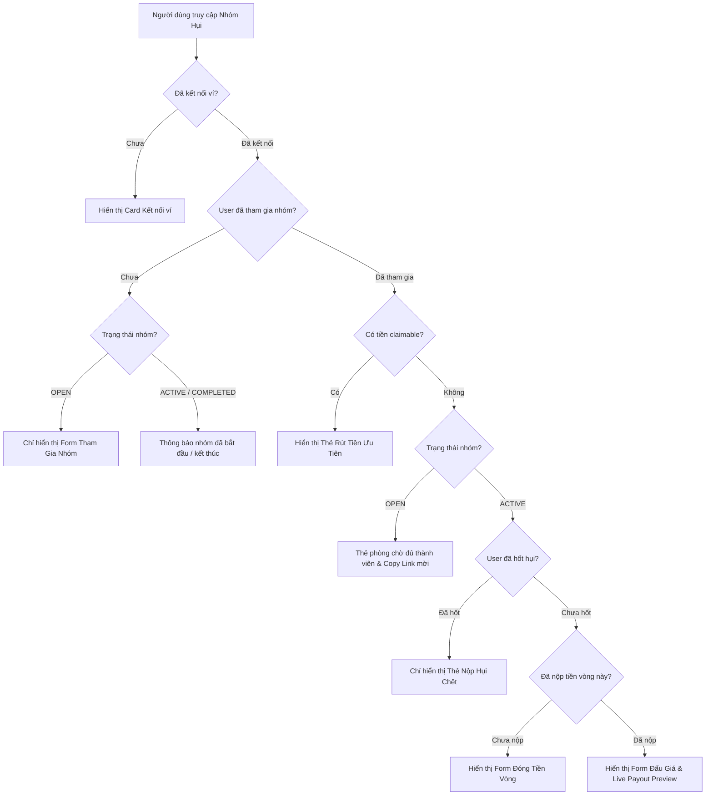

# Task-051 — Tinh Chỉnh UX: Progressive ActionPanel, Ký Quỹ Thân Thiện, Safe Link, Review Deploy & Bidding Preview

**Version:** 1.0 (2026-10-28)  
**Tác giả:** BA Agent  
**Trạng thái:** Gate 1 Leader Review  

---

## 1. Bối cảnh & Giá trị mang lại

Dựa trên phản hồi thực tế từ người dùng và chuyên gia đánh giá sản phẩm (Review feedback):
1. **ActionPanel quá tải**: Giao diện hiển thị cùng lúc tất cả các thẻ (Join, Đóng tiền, Đấu giá, Ký quỹ, Claim, Huỷ nhóm) khiến người dùng bị ngợp thông tin (Information Overload). Cần áp dụng nguyên lý **Progressive Disclosure** (Tiết lộ lũy tiến) để người dùng chỉ thấy đúng hành động cần làm tương ứng với trạng thái của họ trong nhóm.
2. **Ký quỹ CirBTC chưa thân thiện**: Khái niệm cọc crypto xa lạ với người chơi hụi truyền thống. Cần có tooltip giải thích ý nghĩa bảo vệ tài sản, **ẩn hoàn toàn khi nhóm không yêu cầu cọc**, và chuyển chế độ cọc trong `CreateClubModal` sang **Tắt mặc định (Off by default)**.
3. **Các điểm tinh chỉnh quan trọng khác**:
   - Invite link cần dùng bộ tạo link an toàn (`buildShareGroupUrl`) thay vì nối chuỗi `window.location.origin` thô.
   - Thêm bước **Review & Confirm (Xem lại & Xác nhận)** trong `CreateClubModal` trước khi ký ví deploy contract để chủ hụi kiểm tra lại thông số.
   - Bổ sung dòng tính toán trực tiếp trong ô đấu giá: **"Bạn sẽ nhận ~Y USDC nếu thắng"**.

---

## 2. Quy tắc nghiệp vụ (Business Rules - BR)

- **BR-01 (Progressive ActionPanel)**:
  - Khi chưa tham gia (`!isMember`): Chỉ hiển thị form "Tham gia nhóm" ở trạng thái `OPEN`. Không hiển thị form nộp tiền vòng, đấu giá, hay tất toán.
  - Khi đã tham gia (`isMember`):
    - Nhóm `OPEN`: Hiển thị thẻ thông báo "Bạn đã là thành viên, chờ đủ người để bắt đầu" kèm lối tắt chia sẻ link mời.
    - Nhóm `ACTIVE`:
      - Người đã thắng (`hasWon == true`): Ưu tiên hiển thị Thẻ nộp Hụi Chết. Ẩn form đặt bid.
      - Người chưa thắng (`hasWon == false`):
        - Chưa đóng tiền vòng này (`!hasContributed`): Hiển thị form Đóng tiền vòng này.
        - Đã đóng tiền vòng này (`hasContributed`): Hiển thị form Đấu giá (Bidding) nhận Pot.
      - Vòng hết hạn (`isTimeEnded`): Hiển thị hành động Tất toán vòng (`Settle Round`).
  - Khi có tiền thưởng / tiền rút (`claimable > 0` hoặc `claimableCirBtc > 0`): Luôn hiển thị Thẻ Rút tiền ở vị trí ưu tiên.

- **BR-02 (Collateral Transparency & Zero Clutter)**:
  - Nếu nhóm không yêu cầu ký quỹ (`collateralAmount === 0n` hoặc undefined): Ẩn hoàn toàn tất cả các khối thông tin về CirBTC. Không hiển thị các giá trị 0.00000000 CirBTC thừa thãi.
  - Nếu nhóm có yêu cầu ký quỹ (`collateralAmount > 0n`): Cung cấp Tooltip giải thích trực quan tại chỗ: Ký quỹ là tiền cọc chống bùng hụi và được hoàn trả 100% khi hoàn thành.
  - Trong `CreateClubModal`: Mặc định không yêu cầu ký quỹ (`collateralMode = 'none'`, 0 CirBTC). Chỉ khi người tạo chủ động chọn mới bật cấu hình cọc.

- **BR-03 (Share-safe Invite Link)**:
  - Tạo hàm `buildShareGroupUrl(address: string, origin?: string)` chuẩn hóa URL mời tham gia dạng `https://.../?group=0x...` sạch sẽ, không dính param rác (`view`, `tab`), an toàn với SSR / test runner.

- **BR-04 (Create Club Review & Confirm)**:
  - Bổ sung bước xác nhận trước khi deploy: hiển thị popup hoặc view tóm tắt đầy đủ các thông số (Tên nhóm, Mức đóng, Số thành viên, Quỹ tối đa, Thời gian vòng, Cọc) kèm 2 nút "Quay lại chỉnh sửa" và "Xác nhận & Ký ví".

- **BR-05 (Bidding Payout Preview)**:
  - Trong form đặt bid, khi người dùng nhập số tiền bid, hiển thị dòng preview:
    `Bạn sẽ nhận thực tế: ~[PotSize - BidAmount] USDC nếu thắng vòng này`.

---

## 3. Luồng nghiệp vụ (Mermaid Flow)

---

## 4. Danh sách Yêu cầu (REQ) & Tiêu chí nghiệm thu (AC)

| Mã REQ | Mô tả | Mã AC | Tiêu chí nghiệm thu chi tiết |
| :--- | :--- | :--- | :--- |
| **REQ-01** | Progressive Disclosure ActionPanel | **AC-01.1** | Khi `!isMember`, chỉ hiển thị form Tham gia nhóm ở trạng thái OPEN, không hiện Bidding/DeadHui/Settle. |
| | | **AC-01.2** | Khi `isMember` và `hasWon == true`, ưu tiên form Nộp Hụi Chết, ẩn form Bid. |
| | | **AC-01.3** | Khi `isMember`, `!hasWon` và `!hasContributed`, ưu tiên form Đóng tiền vòng này. |
| | | **AC-01.4** | Khi `isMember`, `!hasWon` và `hasContributed`, hiển thị form Đấu giá với Payout preview. |
| | | **AC-01.5** | Khi `claimable > 0` hoặc `claimableCirBtc > 0`, hiển thị thẻ Claim ưu tiên. |
| **REQ-02** | Ký quỹ CirBTC Thân thiện | **AC-02.1** | Ẩn hoàn toàn toàn bộ khối/nhãn/thẻ CirBTC khi `collateralAmount === 0n` hoặc không yêu cầu. |
| | | **AC-02.2** | Hiển thị Tooltip/Popup giải thích bản chất cọc chống bùng hụi khi nhóm có yêu cầu ký quỹ. |
| | | **AC-02.3** | Trong `CreateClubModal`, cấu hình Ký quỹ mặc định là TẮT (`none` / 0 CirBTC). |
| **REQ-03** | Share-safe Invite Link | **AC-03.1** | `buildShareGroupUrl(address)` tạo URL chuẩn không chứa param rác `view`, an toàn trên mọi trình duyệt/test. |
| | | **AC-03.2** | `GroupSwitcher.tsx` và `ActionPanel.tsx` sử dụng `buildShareGroupUrl`. |
| **REQ-04** | Review & Confirm Deploy | **AC-04.1** | `CreateClubModal.tsx` có bước Review & Confirm tóm tắt trước khi gửi lệnh deploy. |
| | | **AC-04.2** | Cung cấp nút quay lại chỉnh sửa và nút xác nhận triển khai. |
| **REQ-05** | Bidding Payout Preview | **AC-05.1** | Bidding form hiển thị dòng preview số tiền nhận thực tế: `~[PotSize - BidAmount] USDC`. |
| **REQ-06** | Song ngữ & Zero Regression | **AC-06.1** | Cung cấp 100% khóa song ngữ VI/EN trong `src/lib/i18n.ts`. |
| | | **AC-06.2** | Toàn bộ 437/437 unit tests hiện tại tiếp tục PASS 100%. |

---

## 5. Phân công Owner file

- `docs/ba/task-051/**`: BA Agent
- `src/components/savings/ActionPanel.tsx`: Developer Agent
- `src/components/savings/PasskeyActionPanel.tsx`: Developer Agent
- `src/components/savings/CreateClubModal.tsx`: Developer Agent
- `src/components/savings/GroupSwitcher.tsx`: Developer Agent
- `src/lib/savingsClubDirectory.ts`: Developer Agent
- `src/lib/i18n.ts`: Developer Agent
- `tests/task-051-ux-refinements.test.ts`: Independent Tester Agent
- `docs/qa/task-051/**`: Independent Tester Agent
- `docs/manifests/task-051/**`: Developer Agent
