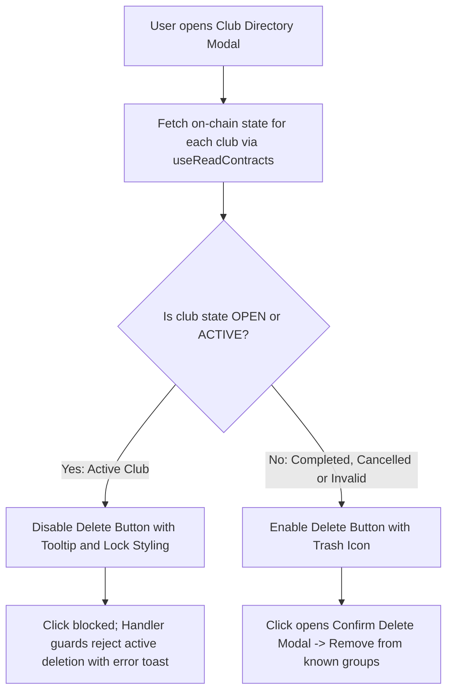

# BA Specification: Task-056 — Prevent Deletion of Active Savings Clubs

- **Task ID**: task-056
- **Author**: Business Analyst
- **Version**: 1.0.0
- **Status**: READY_FOR_DEV (Gate 1 Passed)
- **Date**: 2026-11-01

---

## 1. Problem Statement & User Voice

### User Feedback:
> "sao lại xóa được club khi vẫn club vẫn đang hoạt động nhỉ? làm lại logic chỗ này nhé"

### Business Analysis:
- In `ClubDirectoryModal.tsx`, an unrestricted trash button (`Trash2`) was rendered for every savings club item in the directory.
- This allowed users to delete clubs that are actively running rounds (`ACTIVE`) or still open for member registration (`OPEN`).
- Deleting an active club from the local directory causes severe UX and operational issues:
  1. Members lose immediate dashboard access to their ongoing savings circle.
  2. Members cannot track contribution deadlines, place auction bids, or claim payouts for won rounds.
  3. Members with locked CirBTC collateral lose visibility over their collateral and risk slashing if they inadvertently miss round contributions due to missing club tracking.
- The original design intent (as stated in existing tooltip and comments: "đã hủy / hết hạn / không chơi nữa") is that only clubs which are **no longer active** (`COMPLETED` or `CANCELLED`, or defunct/unreachable contracts) should be eligible for deletion from the directory.

---

## 2. Scope & Target State

### Affected Actors:
- All users browsing the Club Directory modal (`ClubDirectoryModal`).
- Members, club owners, and observers.

---

## 3. Requirements (REQ) & Business Rules (BR)

### REQ-01: On-Chain Club State Retrieval in ClubDirectoryModal
- **BR-01.1**: `ClubDirectoryModal` MUST use `useReadContracts` to fetch the on-chain `state()` for each savings club in `groups`.
- **BR-01.2**: On-chain contract state values:
  - `0`: `GROUP_STATE.OPEN` (Mở tham gia)
  - `1`: `GROUP_STATE.ACTIVE` (Đang chạy)
  - `2`: `GROUP_STATE.COMPLETED` (Hoàn thành)
  - `3`: `GROUP_STATE.CANCELLED` (Đã huỷ)
- **BR-01.3**: A club is classified as `isActive` if its resolved on-chain `state === GROUP_STATE.OPEN || state === GROUP_STATE.ACTIVE`. If state is `COMPLETED`, `CANCELLED`, undefined, or RPC call fails (defunct contract), it is classified as `!isActive` (deletable).

### REQ-02: Deletion Prevention for Active Clubs
- **BR-02.1**: When a club is active (`isActive === true`):
  - The delete button MUST be disabled (`disabled={true}`).
  - Visually styled with reduced opacity, cursor-not-allowed, and non-hoverable red tone.
  - The tooltip MUST clearly explain why deletion is prevented:
    - VI: `"Không thể xóa nhóm đang hoạt động (Mở tham gia / Đang chạy)"`
    - EN: `"Cannot remove active savings club (Open / Active)"`
- **BR-02.2**: When a club is not active (`isActive === false`):
  - The delete button MUST be enabled.
  - Clicking triggers `handleDeleteGroup(group, e)`, opening the confirmation modal as before.

### REQ-03: Double Guard in Delete Handlers
- **BR-03.1**: In `handleDeleteGroup(group, e)`:
  - If the club's state is `OPEN` or `ACTIVE`, prevent opening the confirmation modal and notify with `toast.error(t("clubDirectoryModal.deleteActiveError", language))`.
- **BR-03.2**: In `handleConfirmDelete()`:
  - Verify that the club being confirmed is not active. If active, dismiss modal and reject deletion.

### REQ-04: Status Badge Clarity in Directory List
- **BR-04.1**: Display an on-chain status badge next to each club's name in `ClubDirectoryModal`:
  - `OPEN`: Green/Emerald badge with label `"Mở tham gia"` / `"Open"`.
  - `ACTIVE`: Amber/Yellow badge with label `"Đang chạy"` / `"Active"`.
  - `COMPLETED`: Slate/Purple badge with label `"Hoàn thành"` / `"Completed"`.
  - `CANCELLED`: Red badge with label `"Đã huỷ"` / `"Cancelled"`.
- **BR-04.2**: Helps users immediately see which clubs are active and why certain clubs cannot be removed.

### REQ-05: Bilingual Dictionary (i18n) Parity
- **BR-05.1**: Add `deleteClubDisabledTooltip` and `deleteActiveError` to both `vi` and `en` in `src/lib/i18n.ts`.

---

## 4. Acceptance Criteria (AC)

- [ ] **AC-01**: `ClubDirectoryModal` executes on-chain state reads for all listed clubs without breaking when some contracts fail.
- [ ] **AC-02**: Clubs with `state === GROUP_STATE.OPEN` or `state === GROUP_STATE.ACTIVE` render disabled delete buttons with appropriate explanatory tooltips.
- [ ] **AC-03**: Clubs with `state === GROUP_STATE.COMPLETED` or `state === GROUP_STATE.CANCELLED` (or defunct) render active delete buttons and can be removed.
- [ ] **AC-04**: Handler guards prevent deletion even if triggered programmatically.
- [ ] **AC-05**: Status badges accurately reflect each club's on-chain state.
- [ ] **AC-06**: 100% key parity between English and Vietnamese dictionaries in `src/lib/i18n.ts`.
- [ ] **AC-07**: All 460+ unit tests pass without regressions.

---

## 5. Traceability Matrix

| Requirement | Business Rule | Acceptance Criteria | Target File |
| :--- | :--- | :--- | :--- |
| REQ-01 | BR-01.1 .. BR-01.3 | AC-01 | `src/components/savings/ClubDirectoryModal.tsx` |
| REQ-02 | BR-02.1 .. BR-02.2 | AC-02, AC-03 | `src/components/savings/ClubDirectoryModal.tsx` |
| REQ-03 | BR-03.1 .. BR-03.2 | AC-04 | `src/components/savings/ClubDirectoryModal.tsx` |
| REQ-04 | BR-04.1 .. BR-04.2 | AC-05 | `src/components/savings/ClubDirectoryModal.tsx` |
| REQ-05 | BR-05.1 | AC-06 | `src/lib/i18n.ts` |
| Quality | Regression zero | AC-07 | `tests/prevent-delete-active-club.test.ts` |
