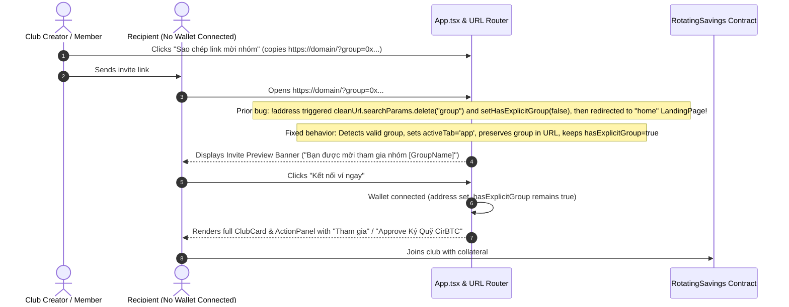

# BA Specification: Task-057 — Fix Invite Link Routing & Unauthenticated Club Join

- **Task ID**: task-057
- **Author**: Business Analyst
- **Version**: 1.0.0
- **Status**: READY_FOR_DEV (Gate 1 Passed)
- **Date**: 2026-11-01

---

## 1. Problem Statement & User Journey

### User Feedback:
> "sao copy link club để cho người khác join không được? người khác truy cập vào link thì bị redirect về trang chủ"

### Flow Analysis:

---

## 2. Requirements (REQ) & Business Rules (BR)

### REQ-01: Direct Routing to App Tab on Valid Group Query
- **BR-01.1**: When URL search query contains a valid `group` address (`isValidAddress(group)`):
  - `activeTab` MUST be initialized to `"app"`.
  - `contractAddress` MUST be initialized to `group.toLowerCase()`.
  - `hasExplicitGroup` MUST be initialized to `true`.
- **BR-01.2**: It MUST NOT redirect to `"home"` (LandingPage).

### REQ-02: Preservation of Invite Parameter in URL Cleaner
- **BR-02.1**: In the URL cleaner effect in `src/App.tsx`:
  - When `!address` and `isValidAddress(group)` is TRUE:
    - DO NOT delete `group` from the URL.
    - Set/maintain `hasExplicitGroup = true`.
  - Only when `group` is invalid (`!isValidAddress(group)`) or when on the `home` tab should `group` be cleaned.
- **BR-02.2**: Maintain backward compatibility with TC-TAB-01 and TC-TAB-02:
  - Switching tabs via `handleSelectTab('app')` cleans `group` when clicking the top navigation tab directly.
  - Invalid groups or legacy views are cleaned when unauthenticated.

### REQ-03: Welcoming Invite View for Unauthenticated Users
- **BR-03.1**: When `!address` and `hasExplicitGroup === true`:
  - The Unauthenticated Card MUST display the targeted club name:
    - VI: `"Bạn được mời tham gia: {displayedGroupName}"`
    - EN: `"You're invited to join: {displayedGroupName}"`
  - Subtitle:
    - VI: `"Kết nối ví của bạn để xem chi tiết nhóm, nộp tiền cọc và cùng tham gia hụi."`
    - EN: `"Connect your wallet to review club details, deposit collateral, and join."`
  - Action button:
    - VI: `"Kết nối ví để tham gia ngay"`
    - EN: `"Connect Wallet to Join"`
- **BR-03.2**: When `!address` and `hasExplicitGroup === false`:
  - Render standard generic unauthenticated message as before.

### REQ-04: Seamless Post-Connection Join Access
- **BR-04.1**: Once the recipient connects their wallet, since `hasExplicitGroup === true`:
  - Line 1239 condition `Boolean(address) && (hasExplicitGroup || isUserAffiliated)` evaluates to `true`.
  - The recipient is immediately presented with the club card, member roster, and action panel with the Join / Approve Collateral buttons.
  - The club is automatically saved to their local directory via `saveKnownGroup`.

---

## 3. Acceptance Criteria (AC)

- [ ] **AC-01**: Opening `/?group=0x<address>` navigates to `activeTab = "app"` and loads the invited club, never redirecting to `"home"`.
- [ ] **AC-02**: The `group` parameter is NOT deleted when unauthenticated if it is a valid address.
- [ ] **AC-03**: Unauthenticated view displays personalized invitation for `hasExplicitGroup`.
- [ ] **AC-04**: Connecting wallet preserves `hasExplicitGroup = true` and shows the ClubCard with Join action.
- [ ] **AC-05**: Zero regressions on existing 466 tests.
