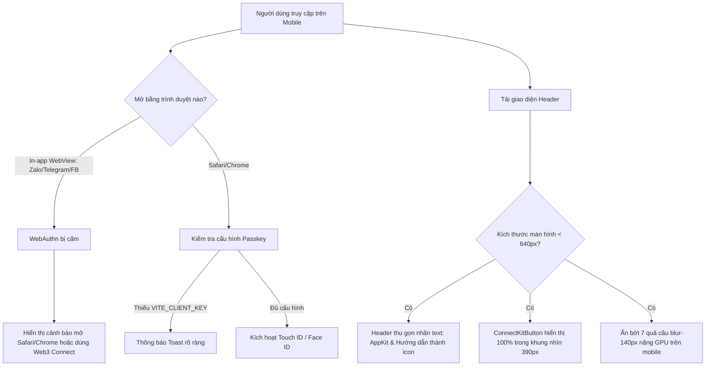

# BA Specification: Task-058 — Fix Mobile Layout Overflow, Sluggish Scrolling & Passkey Mobile Diagnostics

- **Task ID**: task-058
- **Author**: Business Analyst
- **Version**: 1.0.0
- **Status**: READY_FOR_DEV (Gate 1 Passed)
- **Date**: 2026-11-01

---

## 1. Problem Statement & User Journey

### User Feedback:
> "sao layout trên mobile lỗi hết vậy và rất đơ, ngoài ra passkey cũng không work khi vào bằng điện thoại. Layout trên mobile thì dùng thêm browserskill để check nhé"

### Flow Analysis:

---

## 2. Requirements (REQ) & Business Rules (BR)

### REQ-01: Header Responsive Compaction for Mobile
- **BR-01.1**: On viewport widths `< 640px` (`sm:` breakpoint):
  - The Arc AppKit button label MUST hide its text label: `...`, retaining only the `<Zap size={14} />` icon.
  - The Guide button label MUST hide its text label: `...`, retaining only the `<BookOpen size={15} />` icon.
  - The Language button label MUST remain compact (`px-2 py-1.5 sm:px-3 sm:py-2`).
- **BR-01.2**: The `ConnectKitButton` MUST remain 100% visible inside the viewport bounds on a standard 390px mobile viewport (`element.right <= 390`).
- **BR-01.3**: The header container MUST NOT cause horizontal window scrolling (`overflow-x-hidden` or fitted width).

### REQ-02: GPU Performance Optimization on Mobile
- **BR-02.1**: In `src/App.tsx`, the fixed background glow layers MUST have `overflow-hidden` to prevent extending document scroll bounds.
- **BR-02.2**: The heavy 600px-900px blur divs with `blur-[140px]` MUST be disabled on mobile (`hidden sm:block`) or simplified to eliminate mobile GPU lag.
- **BR-02.3**: In `LandingPage.tsx`, the scroll event handler MUST be throttled so `setScrollY` only updates when `Math.abs(scrollY - lastY) >= 10`, preventing 60fps re-renders of the entire 943-line SVG tree.

### REQ-03: Passkey Mobile Diagnostics & In-App Browser Guidance
- **BR-03.1**: When `pkState.status === "error"`, `src/App.tsx` MUST show a `toast.error` with the descriptive error message instead of failing silently.
- **BR-03.2**: In `usePasskeyWallet.ts`, detect when `window.PublicKeyCredential` is missing or in an in-app browser:
  - Return clear guidance: *"Trình duyệt này không hỗ trợ Passkey (như Zalo, Telegram). Vui lòng mở bằng Safari hoặc Chrome, hoặc kết nối ví Web3."*
- **BR-03.3**: In `ArcAppKitModal.tsx`, provide an explicit fallback button to connect standard Web3 wallets if Passkey is unavailable.

---

## 3. Acceptance Criteria (AC)

- [ ] **AC-01**: Mobile headless browser test on 390px viewport verifies `header` content does not overflow off-screen (`rectRight <= 390` for all primary controls including ConnectKitButton).
- [ ] **AC-02**: Background fixed containers have `overflow-hidden`, preventing horizontal scrollbar emergence.
- [ ] **AC-03**: Scroll handler in `LandingPage.tsx` throttled, reducing render thrashing.
- [ ] **AC-04**: Passkey errors are surfaced via `toast.error` instead of being silently swallowed.
- [ ] **AC-05**: 100% pass on all 471+ unit tests and zero build errors.
