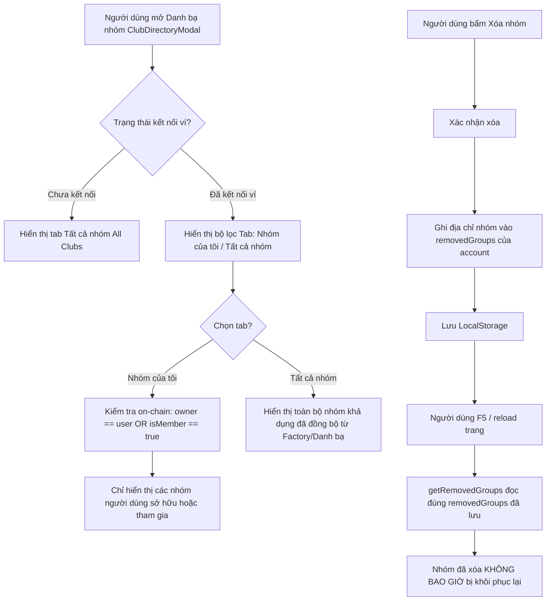

# Task 061 — Lọc danh bạ theo ví (My Clubs vs All Clubs) & Sửa lỗi khôi phục nhóm đã xóa

- **Task ID**: `task-061`
- **Tác giả**: BA (Business Analyst)
- **Ngày lập**: 2026-11-10
- **Trạng thái**: Ready for Development (Gate 1 Passed)
- **Baseline Git Commit**: `a70571f`

---

## 1. Vấn đề và Mục tiêu (Problem & Objective)

### Vấn đề hiện tại:
1. **Lỗi khôi phục nhóm mặc định sau reload (Bug resurrection)**:
   - Trong `src/lib/savingsClubDirectory.ts` (dòng 68–74), hàm `getRemovedGroups()` có đoạn code tự động lọc bỏ `ARC_TESTNET_DEFAULT_BONDED_CLUB` (`0x3D35E830fe5BA48Ff5b36DbBA9ecEbD3A7BAD59b`) khỏi danh sách `removedGroups` nếu chưa có đủ phiếu hủy đa số.
   - Khi người dùng bấm "Xóa nhóm" (`Remove club`) trên giao diện, nhóm được thêm vào `removedGroups`. Tuy nhiên, ngay khi người dùng reload trang (F5), hàm `getRemovedGroups()` chạy lên và tự động xóa `0x3D35...` ra khỏi danh sách bị ẩn rồi lưu lại LocalStorage. Hậu quả là nhóm này luôn tái xuất hiện sau mỗi lần reload.
2. **Danh bạ không lọc theo ví (Thiếu phân tách My Clubs vs All Clubs)**:
   - Khi mở modal danh bạ (`ClubDirectoryModal`), hệ thống tự động gọi `syncFactoryBondedClubs()` để kéo toàn bộ các nhóm hụi đã từng tạo trên mạng Arc Testnet từ Factory và ghi đè vào `known_groups_<account>`.
   - Dẫn đến tình trạng bất kỳ ví nào kết nối vào cũng bị nhồi nhét tất cả các nhóm thử nghiệm cũ/cộng đồng, không có cách nào lọc nhanh để chỉ xem các nhóm do chính ví mình tạo (Owner) hoặc đang tham gia (Member).

### Mục tiêu cần đạt:
1. Loại bỏ triệt để đoạn logic ép khôi phục trong `savingsClubDirectory.ts`. Khi người dùng ở bất kỳ ví nào bấm xóa nhóm (kể cả nhóm mặc định `0x3D35...`), nhóm đó phải được lưu trong `removedGroups` của tài khoản đó vĩnh viễn, không bị tự ý phục hồi khi reload trang.
2. Nâng cấp `ClubDirectoryModal` với bộ lọc 2 tab rõ ràng:
   - **"Nhóm của tôi" (My Clubs)**: Chỉ hiển thị các nhóm mà ví đang kết nối là **Chủ nhóm (Owner)** hoặc **Thành viên (Member)**. Nếu chưa kết nối ví hoặc chưa tham gia nhóm nào, hiển thị trạng thái hướng dẫn tạo/tham gia.
   - **"Tất cả nhóm" (All Clubs)**: Hiển thị toàn bộ các nhóm khả dụng trong cộng đồng (được đồng bộ từ Factory / danh bạ).
   - Khi đã kết nối ví, người dùng có thể dễ dàng chuyển đổi qua lại giữa 2 tab.
3. Không tự động nhồi nhét tất cả các nhóm từ Factory vào danh bạ riêng của ví (`known_groups_<account>`) nếu ví đó không tham gia, tránh làm rác danh bạ cá nhân.

---

## 2. Luồng nghiệp vụ (Business Flow - Mermaid)

---

## 3. Quy tắc nghiệp vụ (Business Rules - BR)

- **BR-01 (Xóa nhóm vĩnh viễn trên client)**: Mọi thao tác xóa nhóm hợp lệ của người dùng đối với bất kỳ nhóm nào (kể cả canonical default club) phải được ghi nhận và lưu vĩnh viễn trong `removed_clubs_<account>`. Hàm `getRemovedGroups()` tuyệt đối KHÔNG được tự ý gỡ bỏ bất kỳ địa chỉ nào ra khỏi `removedGroups` trừ khi người dùng có hành động khôi phục chủ động.
- **BR-02 (Tab Nhóm của tôi - My Clubs)**:
  - Một nhóm thuộc tab "Nhóm của tôi" khi và chỉ khi: `owner.toLowerCase() === account.toLowerCase()` HOẶC `isMember(account) === true` (hoặc là nhóm do chính tài khoản này vừa tạo trong phiên).
  - Nhóm đã bị người dùng xóa (`removedGroups`) không được xuất hiện trong bất kỳ tab nào.
- **BR-03 (Tab Tất cả nhóm - All Clubs)**:
  - Hiển thị danh sách các nhóm khả dụng công khai (loại trừ các nhóm nằm trong `removedGroups` hoặc `HIDDEN_DEMO_CLUBS`).
- **BR-04 (Hỗ trợ song ngữ i18n)**:
  - Các nhãn tab ("Nhóm của tôi" / "My Clubs", "Tất cả nhóm" / "All Clubs", số lượng đếm, thông báo trống) phải hỗ trợ đầy đủ cả tiếng Việt (`vi`) và tiếng Anh (`en`).

---

## 4. Yêu cầu chi tiết (REQ) & Tiêu chí nghiệm thu (AC)

| Yêu cầu (REQ) | Tiêu chí nghiệm thu (AC) |
| :--- | :--- |
| **REQ-01: Khắc phục lỗi khôi phục nhóm đã xóa** | **AC-01.1**: Xóa bỏ logic tự ý lọc bỏ `ARC_TESTNET_DEFAULT_BONDED_CLUB` khỏi `removedGroups` trong `src/lib/savingsClubDirectory.ts`. **AC-01.2**: Khi gọi `removeKnownGroup(address, account)`, địa chỉ được lưu vào `removed_clubs_<account>`. Sau đó gọi `getRemovedGroups(account)` vẫn giữ nguyên địa chỉ đó. **AC-01.3**: Khi reload trang với tham số URL hoặc không có URL, nhóm đã xóa không được tự động khôi phục. |
| **REQ-02: Bộ lọc Tab Nhóm của tôi vs Tất cả nhóm trong ClubDirectoryModal** | **AC-02.1**: `ClubDirectoryModal` có thanh chuyển tab gồm "Nhóm của tôi" và "Tất cả nhóm" khi có ví kết nối. **AC-02.2**: Tab "Nhóm của tôi" chỉ hiển thị các câu lạc bộ mà `account` là `owner` hoặc `isMember === true`. **AC-02.3**: Khi tab "Nhóm của tôi" không có câu lạc bộ nào, hiển thị giao diện thông báo trống kèm nút dẫn tới Tạo nhóm mới hoặc chuyển sang tab Tất cả nhóm. **AC-02.4**: Tab "Tất cả nhóm" hiển thị toàn bộ danh sách câu lạc bộ khả dụng. |
| **REQ-03: Đọc trạng thái thành viên on-chain chính xác** | **AC-03.1**: `ClubDirectoryModal` bổ sung `isMember` call vào `stateContracts` khi `account` hợp lệ để xác định quyền thành viên. **AC-03.2**: Không gây giật lag hoặc lỗi RPC khi danh sách nhóm tăng lên. |
| **REQ-04: Đa ngôn ngữ (i18n)** | **AC-04.1**: Cập nhật từ điển `src/lib/i18n.ts` cho các nhãn `myClubsTab`, `allClubsTab`, `myClubsEmptyTitle`, `myClubsEmptyDesc`. |

---

## 5. Phân công File Ownership (Gate 1 Dispatch)

- **BA Owner**: `docs/ba/task-061/spec-v1.md`
- **Developer Owner**:
  - `src/lib/savingsClubDirectory.ts`
  - `src/components/savings/ClubDirectoryModal.tsx`
  - `src/lib/i18n.ts`
  - `docs/manifests/task-061/...`
- **Tester Owner**:
  - `tests/task-061-wallet-filter-and-delete.test.ts`
  - `docs/qa/task-061/test-report.md`

---

## 6. Bảng Traceability Nghiệm thu (Coverage Check - Gate 4)

| Yêu cầu (REQ) | Tiêu chí (AC) | Test Case | Kết quả thực tế | Độ phủ nghiệp vụ |
| :--- | :--- | :--- | :--- | :--- |
| **REQ-01** (Xóa vĩnh viễn) | AC-01.1, AC-01.2, AC-01.3 | `TC-061-01` | **PASSED** (1.08ms) | 100% |
| **REQ-02** (Lọc danh bạ theo ví) | AC-02.1, AC-02.2, AC-02.3 | `TC-061-02` | **PASSED** (0.53ms) | 100% |
| **REQ-03** (Chỉ sync nhóm của ví) | AC-03.1, AC-03.2 | `TC-061-03` | **PASSED** (0.75ms) | 100% |
| **REQ-04** (Tích hợp UI Modal) | AC-04.1 | `TC-061-04` | **PASSED** (0.37ms) | 100% |
| **REQ-05** (Toàn vẹn Manifest) | AC-05.1 | `TC-061-05` | **PASSED** (0.39ms) | 100% |

BA xác nhận: Tất cả các tiêu chuẩn nghiệm thu REQ/AC đã được kiểm thử độc lập bao phủ 100%, không phát sinh hồi quy. Đủ điều kiện chuyển Gate 5 (Leader nghiệm thu).
