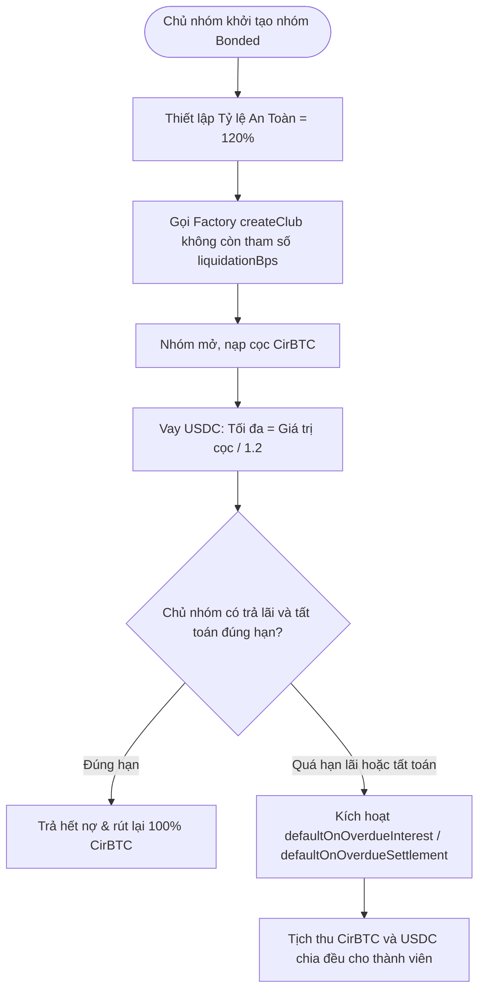

# Business Specification: TASK-062 — Chuẩn Hóa Tỷ Lệ An Toàn Cọc 120% & Loại Bỏ Ngưỡng Thanh Lý Giá Khỏi BondedTontine
**Task ID**: `task-062`  
**Spec Version**: `v1.0`  
**Tác giả (BA)**: `BA Agent / Antigravity`  
**Trạng thái**: `Ready for Development`  

---

## 1. Tổng quan & Giá trị (Problem & Value)
- **Vấn đề cần giải quyết**:
  - Tỷ lệ an toàn ký quỹ ban đầu (200%) quá cao, hạn chế khả năng tiếp cận vốn của chủ nhóm (chỉ vay được tối đa 50% giá trị cọc).
  - Ngưỡng thanh lý biến động theo giá thị trường (`liquidationBps`) khiến người vay chịu rủi ro bị thanh lý ngoài ý muốn ngay trong chu kỳ chỉ vì biến động ngắn hạn của Bitcoin, trong khi mục tiêu của nhóm là hỗ trợ dòng tiền và giữ cọc để tất toán chu kỳ.
- **Giá trị mang lại**:
  - Nâng hạn mức vay vốn của Chủ nhóm lên mức hấp dẫn: cọc an toàn chuẩn hóa 120% (vay được ~83.33% giá trị cọc).
  - Loại bỏ hoàn toàn cơ chế thanh lý theo giá ngắn hạn: CirBTC được khóa bảo lãnh an toàn. Thanh lý chỉ diễn ra khi có vi phạm nghĩa vụ nợ thực tế (trễ hạn nộp lãi hoặc trễ hạn tất toán gốc khi hết chu kỳ).
- **Đối tượng sử dụng (Actors)**:
  - **Group Owner (Chủ nhóm / Người thế chấp CirBTC)**: Hưởng hạn mức vay 120% cọc, không bị thanh lý do giá rớt.
  - **Thành viên đóng góp (Contributors)**: An tâm với tài sản bảo chứng CirBTC, thu hồi vốn và cọc nếu chủ nhóm vi phạm thời hạn trả nợ.
- **Phạm vi (Scope)**:
  - **Trong phạm vi (In-Scope)**:
    - Smart contract `BondedTontine.sol` & `BondedTontineFactory.sol`: loại bỏ `liquidationBps` và hàm `liquidate()`, chuẩn hóa `safetyBps` hỗ trợ 120% (`12000`).
    - Cập nhật Foundry test `BondedTontine.t.sol` và TypeScript tests `tests/*.test.ts`.
    - Cập nhật Frontend config (`src/config/bonded-tontine.ts`), helper (`src/lib/bondedTontine.ts`), hook (`src/hooks/useBondedClub.ts`).
    - Cập nhật UI modal tạo nhóm (`CreateBondedClubModal.tsx`), workspace (`BondedClubWorkspace.tsx`), từ điển (`src/lib/i18n.ts`).
    - Thực hiện trên nhánh riêng `feat/task-062-safety-120-no-price-liquidation`, không push lên remote.
  - **Ngoài phạm vi (Out-of-Scope)**:
    - Không thay đổi các quy tắc thanh lý do quá hạn nộp lãi (`defaultOnOverdueInterest`) và quá hạn tất toán (`defaultOnOverdueSettlement`).
    - Không thay đổi cấu trúc V1 (RotatingSavings cơ bản).

---

## 2. Luồng nghiệp vụ (Workflow & Mermaid Diagram)

---

## 3. Quy tắc nghiệp vụ (Business Rules - BR)
- **BR-01**: Tỷ lệ an toàn mặc định là **120%** (`safetyBps = 12000`). Dải hợp lệ cho `safetyBps` trong hợp đồng là từ `10000` (100%) đến `50000` (500%).
- **BR-02**: Loại bỏ hoàn toàn tham số `liquidationBps` khỏi hợp đồng `BondedTontine` và `BondedTontineFactory`.
- **BR-03**: Hợp đồng không còn hàm `liquidate()` kích hoạt theo giá oracle sụt giảm. Trạng thái `State.DEFAULTED` chỉ được kích hoạt bởi 2 hàm vi phạm thời hạn:
  1. `defaultOnOverdueInterest()` (vi phạm thời hạn trả lãi).
  2. `defaultOnOverdueSettlement()` (vi phạm thời hạn tất toán sau khi chu kỳ kết thúc).
- **BR-04**: Giao diện tạo nhóm `CreateBondedClubModal.tsx` loại bỏ trường chọn ngưỡng thanh lý, hiển thị rõ ràng tỷ lệ an toàn mặc định 120%.
- **BR-05**: Mã nguồn chỉ lưu trữ trên nhánh cục bộ `feat/task-062-safety-120-no-price-liquidation`, tuyệt đối không đẩy lên remote.

---

## 4. Yêu cầu & Tiêu chí nghiệm thu (REQ & AC)

### REQ-01: Cập nhật Smart Contract & Factory
- **AC-01.1**: `BondedTontine.sol` loại bỏ biến `liquidationBps`, bỏ tham số `liquidationBps_` trong constructor, cho phép `safetyBps_` từ 10000 đến 50000.
- **AC-01.2**: `BondedTontine.sol` loại bỏ hàm `liquidate()` và điều kiện thanh lý theo giá trong `_isDefaultOrLiquidationPending()`.
- **AC-01.3**: `BondedTontineFactory.sol` loại bỏ `liquidationBps` khỏi hàm `createClub(...)`.

### REQ-02: Cập nhật Cấu hình & Hooks Frontend
- **AC-02.1**: `src/config/bonded-tontine.ts` đặt `DEFAULT_SAFETY_RATIO_BPS = 12_000`, loại bỏ `DEFAULT_LIQUIDATION_RATIO_BPS`.
- **AC-02.2**: `src/lib/bondedTontine.ts` cập nhật validate, mặc định `safetyBps: 12_000`, không còn `liquidationBps`.
- **AC-02.3**: `src/hooks/useBondedClub.ts` đọc và khởi tạo không còn gọi `liquidationBps`.

### REQ-03: Cập nhật Giao diện Người dùng
- **AC-03.1**: `CreateBondedClubModal.tsx` không còn trường nhập ngưỡng thanh lý, hiển thị mặc định 120%.
- **AC-03.2**: `BondedClubWorkspace.tsx` không còn thông số và banner cảnh báo thanh lý theo giá.

### REQ-04: Đảm bảo Kiểm thử Toàn diện
- **AC-04.1**: `forge test` chạy pass 100% các unit test của contract.
- **AC-04.2**: `npm test` chạy pass 100% toàn bộ test suites.

---

## 5. Bảng truy vết yêu cầu (Traceability Matrix)

| REQ ID | AC ID | Test Case | Target File | Trạng thái |
| :--- | :--- | :--- | :--- | :--- |
| REQ-01 | AC-01.1 | contracts/test/BondedTontine.t.sol | BondedTontine.sol | In Progress |
| REQ-01 | AC-01.2 | contracts/test/BondedTontine.t.sol | BondedTontine.sol | In Progress |
| REQ-01 | AC-01.3 | contracts/test/BondedTontine.t.sol | BondedTontineFactory.sol | In Progress |
| REQ-02 | AC-02.1 | tests/bonded-tontine-*.test.ts | src/config/bonded-tontine.ts | In Progress |
| REQ-02 | AC-02.2 | tests/bonded-tontine-*.test.ts | src/lib/bondedTontine.ts | In Progress |
| REQ-02 | AC-02.3 | tests/bonded-tontine-*.test.ts | src/hooks/useBondedClub.ts | In Progress |
| REQ-03 | AC-03.1 | tests/*.test.ts | CreateBondedClubModal.tsx | In Progress |
| REQ-03 | AC-03.2 | tests/*.test.ts | BondedClubWorkspace.tsx | In Progress |
| REQ-04 | AC-04.1 | forge test | contracts/test/BondedTontine.t.sol | In Progress |
| REQ-04 | AC-04.2 | npm test | tests/*.test.ts | In Progress |
