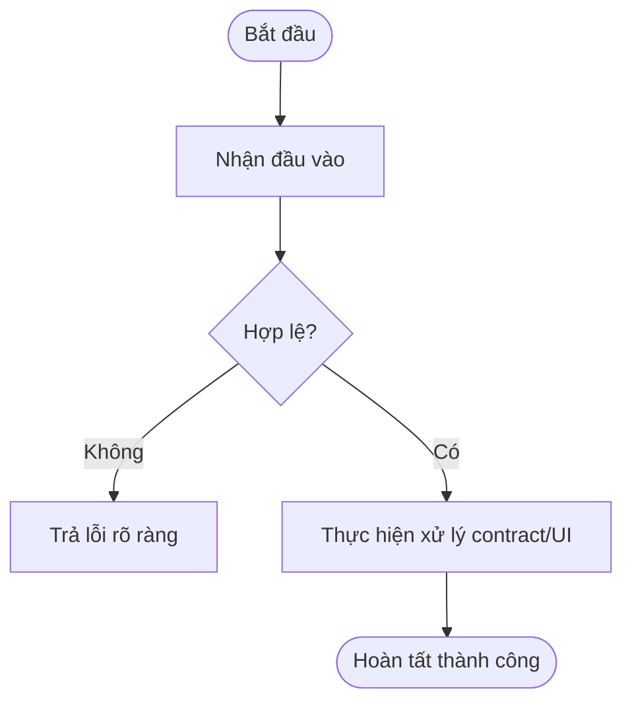

# Business Specification: <Tên Task / Tính năng>
**Task ID**: `<task-id>`  
**Spec Version**: `v1.0`  
**Tác giả (BA)**: `<BA Agent>`  
**Trạng thái**: `[Draft | Ready for Development | In Progress | Ready for Verification | Verified]`  

---

## 1. Tổng quan & Giá trị (Problem & Value)
- **Vấn đề cần giải quyết**: <Mô tả vấn đề trong nghiệp vụ hụi/tontine>
- **Giá trị mang lại**: <Mục tiêu và lợi ích đạt được trên Arc Testnet>
- **Đối tượng sử dụng (Actors)**: <Member / Group Owner / Caller / System>
- **Phạm vi (Scope)**:
  - **Trong phạm vi (In-Scope)**: <Những gì cần làm>
  - **Ngoài phạm vi (Out-of-Scope)**: <Những gì không làm trong task này>

---

## 2. Luồng nghiệp vụ (Workflow & Mermaid Diagram)
Mô tả luồng xử lý chính và các nhánh ngoại lệ/lỗi:

---

## 3. Quy tắc nghiệp vụ (Business Rules - BR)
- **BR-01**: <Quy tắc 1>
- **BR-02**: <Quy tắc 2>

---

## 4. Yêu cầu & Tiêu chí nghiệm thu (REQ & AC)

### Yêu cầu: REQ-01: <Tiêu đề REQ>
- **AC-01.1 (Happy path)**:
  - **Input**: `<Đầu vào cụ thể>`
  - **Expected Output**: `<Kết quả mong đợi quan sát được>`
- **AC-01.2 (Error / Edge case)**:
  - **Input**: `<Đầu vào lỗi hoặc biên>`
  - **Expected Output**: `<Hành vi bắt lỗi hoặc xử lý mong đợi>`

---

## 5. Bảng truy vết yêu cầu (Traceability Matrix)

| REQ ID | AC ID | Test Case (Tester) | Spec/Source Hash | Evidence / Test Run | BA Đối chiếu | Trạng thái |
| :--- | :--- | :--- | :--- | :--- | :--- | :--- |
| REQ-01 | AC-01.1 | pending | pending | pending | pending | pending |
| REQ-01 | AC-01.2 | pending | pending | pending | pending | pending |

---

## 6. Giả định & Câu hỏi (Assumptions & Questions)
- **Giả định**: <Các giả định nếu có>
- **Câu hỏi cần Leader/Chủ dự án làm rõ**: <None hoặc danh sách câu hỏi>
